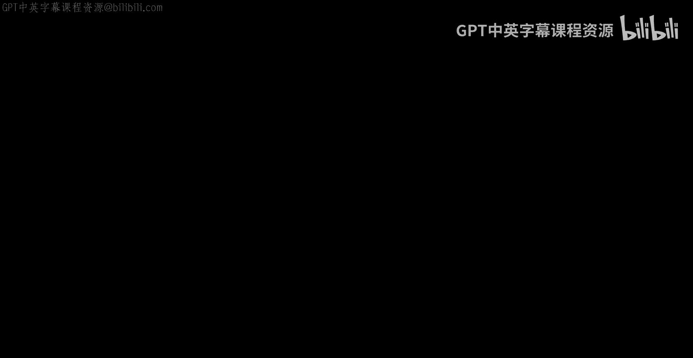
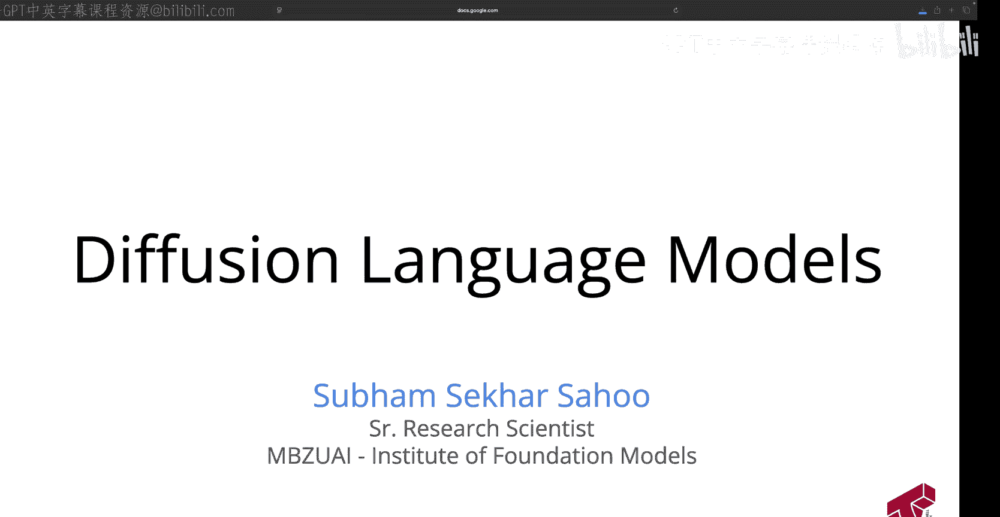
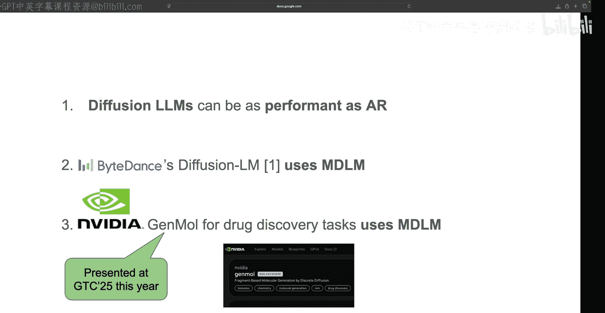

# 扩散与流模型：14：嘉宾讲座1_ Subham Sahoo 

在本节课中，我们将学习扩散语言模型。这是我在康奈尔大学博士论文研究的核心内容。传统上，自回归模型一直是语言生成的主导范式。但现在，它们面临着一类新算法的严峻挑战，即扩散语言模型。与自回归模型严格从左到右生成文本不同，扩散模型不受此约束。这意味着它们可以按任意顺序生成文本。

最显著的特点是，它们能够并行生成单词。最近，这些模型引起了广泛关注，例如谷歌的Gemini Diffusion、Dancer的Seed Diffusion和Inception Labs的Market Decor等主要版本相继发布。它们的影响力甚至延伸到了主流媒体，《福布斯》和《财富》杂志都发表了文章，强调这些算法的有效性。所有这些兴奋点都是合理的。这些模型不仅非常有效，而且比自回归模型快得多。本次讲座将深入探讨这些模型，审视推动其成功的创新之处，以及它们为何代表了文本生成领域如此引人注目的转变。

以下是时间线的简要概述。扩散语言模型于2022年首次提出。与自回归模型预测从左到右不同，这些模型可以按随机顺序生成单词，正如您在这个动图中看到的那样。然而，主要缺点是，尽管速度更快，但其文本质量落后于自回归模型。直到去年年初，当Lu等人证明扩散语言模型与现代Transformer架构结合时，可以匹配像GPT-2这样的旧自回归模型的样本质量，同时速度显著加快，社区才开始认真对待这个模型。几个月后，我们发布了MDLM，我们重新表述并简化了扩散训练算法，并证明这些模型至少在较小的文本数据集上可以匹配自回归模型的性能。今年早些时候，在名为“扩散对偶性”的论文中，我们提出了蒸馏算法，使这些模型能够仅用10步就生成长达千词的序列，且质量几乎没有下降。最后，我们开发了SOLM，它将自回归模型与离散扩散融合。与之前的方法不同，SOLM支持KV缓存而不影响并行生成，因此在推理时比标准扩散模型快几个数量级。这些论文共同使扩散语言模型变得实用。值得注意的是，Dancer的Seed Diffusion框架就是使用我们将在本次讲座中介绍的MDLM框架构建的。

今天，我们将重点讨论这两篇论文：MDLM和SOLM。让我们从第一篇论文开始，即简单有效的掩码扩散语言模型。

我们的目标是设计一个可以进行并行采样的语言模型。也就是说，我们不希望像自回归模型那样从左到右生成单词。我们希望设计一个可以同时生成多个单词的语言模型。其工作方式是，您从一个全是空白标记的序列开始，然后将其输入到一个类似BERT的模型中。BERT本质上是一个具有双向注意力的Transformer，其中每个单词都依赖于整个上下文，这与自回归模型不同，后者每个单词只依赖于自身和先前的上下文。您将这个掩码序列输入到类似BERT的模型中，BERT将填充一些单词，填充更多，最终当它完成时，您将得到一个来自底层分布的真实样本。

假设我们有一个句子，如我在讲座开始时展示的那个，表示为一个底部带有彩色框的一维序列。当我们谈论噪声时，我们将讨论掩码噪声，即我们会抹去单词，具体来说是用掩码标记来表示它们被掩盖了。当然，在讨论掩码扩散时，我们将与标准的自回归模型进行比较。

您可以将自回归语言模型视为通过自回归解掩码来生成单词。也就是说，您从一个空白序列开始，然后模型一次填充一个单词。在预测了这些单词之后，模型将预测下一个单词，依此类推。最终，当完成时，您将得到幻灯片最顶部显示的干净句子。

在这项工作中，我们将朝着离散掩码扩散迈出一步。在接下来的幻灯片中，我将首先介绍我们在这篇论文中提出的MDLM框架，然后讨论一些结果。我们将尝试比较和对比MDLM与先前的离散扩散方法有何不同，以及是什么导致了MDLM的成功。

以下是我们的过程示意图。我们在幻灯片的最顶部有干净的句子X，在最底部有完全掩码的版本。这里我们有一个函数Q向下走并抹去单词。然后右边有一个函数P_theta。生成建模的目标是逆转已知的破坏过程。所以您有这个函数Q向下走，试图将句子X转换成一个全是掩码标记的序列。我们尚不清楚Q是如何工作的，我们将在接下来的幻灯片中讨论。然后我们的最终目标是学习这个函数P_theta，它将带我们从全是空白的序列到顶部的干净句子X。

我用红色突出显示的是一个部分掩码的序列，我们称之为Z_t。

现在，让我们将其分解为各个组成部分。第一步是理解“向下走”意味着什么，即我们如何从干净句子X到全是掩码标记的序列。首先，我们将根据信号水平alpha_t来细分这个空间。当alpha_t为1时，它代表干净的句子X。当alpha_t为0时，它代表完全掩码的版本。为了从干净句子X到这个中间噪声状态Z_t，我们只需抛硬币。对于每个干净的单词，我们抛硬币，并以概率1 - alpha_t掩码该单词。想象一下，假设此时alpha_t是0.3。那么您为每个单词抛硬币，并以0.7的概率掩码该单词。这样做将得到这个中间序列Z_t。

这可能是整个讲座中最重要的幻灯片之一。这个函数Q(Z_s | Z_t, X)描述了去掩码函数。让我们试着理解这是什么。这本质上是反向后验。这个函数表示，给定某个噪声序列Z_t，我们如何得到一个噪声更少的序列Z_s。请注意，这个函数Q以Z_t和X为条件。其含义是，如果我有一个噪声序列Z_t，对于每个掩码标记，我以这里给出的概率对其进行去掩码。同样，alpha_s是对应于时间步s的信号水平，s只是一个小于t的时间步，alpha_t是对应于Z_t的信号水平。然后这里有这个项，它表示，给定Z_t，我以这个概率去掩码一个标记，并且该标记被去掩码为干净版本，因为在这种情况下，您知道X是什么，您知道干净信号是什么，您知道噪声序列Z_t是什么。问题是，噪声更少的序列Z_s是什么？自然地，这个函数本身并不是很有用，因为如果您有X，就没有理由从M开始模拟去掩码过程。但挑战在于您没有X，目标是学习X的某种表示，以便在生成时将其插入到这里。因为在生成过程中，您有一个全是掩码标记的序列M，您不知道X是什么。问题是如何从M到X。为此，我们将使用这个函数，即P_theta函数。所以我们要做的是训练一个神经网络，我们将在接下来的幻灯片中讨论确切的损失函数及其训练方式。但为了让您对P_theta函数有个概念，想象您有一个训练好的类似BERT的模型。为了从噪声序列Z_t到噪声更少的序列Z_s，您只需将网络学习到的干净表示插入到Q函数中，这就得到了P_theta函数。所以P_theta将带您从Z_t到Z_s。去掩码的工作方式是，干净的标记始终保持干净，我们稍后会讨论Y。对于掩码标记，给定一个掩码标记，您抛硬币，并以我们之前看到的概率对其进行去掩码，但尚不清楚它去掩码成什么标记。所以您只需采样，X_theta本质上是所有掩码位置上的分类分布。您抛硬币并根据X_theta指定的分布抽取一个标记，这就成为您去掩码后的标记。

现在的问题是，如何训练这个去噪Transformer X_theta？让我们逐一讲解。

幻灯片最顶部展示的是自回归模型中的目标函数。训练自回归模型的方法是，您有句子的真实似然，并试图最小化负对数似然，这本质上意味着最大化似然。但在扩散模型中，您无法计算精确的似然，所以您有的是似然的一个下界，由这个方程给出。这里展示的是可以用来训练这些离散扩散模型的损失函数。

首先，我们有一个期望。让我们试着理解如何计算这个期望。您还记得，我们细分了空间，从顶部到底部，其中alpha_t等于1代表干净信号X，这也对应于t等于0。所以您的扩散过程本质上从X开始，即t=0，一直到t=1，即完全掩码序列。您随机采样一个时间步t，对应地抛硬币，得到一个噪声序列Z_t。这个Z_t被输入到去噪模型中。

接下来，这里还有另一个项，即alpha，它是去掩码的概率，这是我们之前讨论过的。这张幻灯片的目的是直观地解释扩散损失中每一项的含义。您有一个权重项，本质上是去掩码的概率，最后您有一个交叉熵损失。这里的含义是，您的X_theta是一个Transformer，您将噪声序列Z_t输入到Transformer中，并计算整个序列的损失。但由于Transformer具有复制操作，这意味着如果某个标记是干净的，您可以简单地预测它本身，所以这个交叉熵损失实际上只针对缺失的掩码标记进行计算。您将Z_t输入到类似BERT的模型中，并为缺失的标记计算交叉熵损失，然后对它们求和，乘以权重项，这就是您的扩散损失。但有趣的是，我们一直在谈论大写字母T。这个大写的T告诉您在t=0到t=1之间有多少个时间离散化。在MDLM论文中，我们证明，如果您将T设置为无穷大，这实际上代表了一个连续时间马尔可夫链，然后您有这个扩散目标函数，看起来像这样，有alpha_t' / (1 - alpha_t)。这是MDLM论文的主要贡献，提出了这个非常简化的扩散目标函数，对于训练这些模型以及评估这些模型都非常有用。我们稍后会在这个幻灯片上更多地讨论这个损失函数的有趣特性。但我想总结一下MDLM中的训练是如何工作的。

现在，让我们尝试比较自回归模型和MDLM模型的训练算法。在自回归模型中，您有一个数据集，采样一个句子X，您将句子输入到X_theta中，这里X_theta是一个因果Transformer，然后您计算每个标记的交叉熵损失。每个标记只以先前的上下文为条件。然后您使用梯度下降训练模型。在右侧，我展示了MDLM模型的训练过程，您可以看到它们非常相似。您采样一个句子X，此外，您还需要采样一个时间步t。这里的方程是一种非常花哨的说法，表示您通过抛硬币来掩码单词。它告诉您，您以概率1 - alpha_t掩码X中的每个标记，从而得到一个噪声序列Z_t。这个Z_t被输入到使用双向注意力而非因果注意力的去噪模型中，并且您使用权重项alpha_t' / (1 - alpha_t)而不是交叉熵损失。这就是您训练掩码扩散模型的方式。这张幻灯片基本上告诉您，如果您知道如何训练自回归模型，您也几乎知道如何训练掩码扩散模型。

现在，假设我们已经训练了这个模型，问题是我们如何实际从这个模型中采样？在这张幻灯片中，我展示了一步生成过程。给定一个噪声序列Z_t，我们如何得到一个噪声更少的序列Z_s？请注意，Z_s比Z_t有更少的掩码标记。其反向过程是，您只需将其输入到类似BERT的模型中，这个模型将填充所有掩码标记。其工作方式是，这个模型本质上学习了每个掩码标记上可能标记的分布，您从该分布中采样，然后填充整个句子，并选择性地重新掩码模型做出的一些预测。

干净的标记在Z_t中保持干净。只有为掩码标记做出的预测才会被重新掩码。这是一步生成过程。我必须说明，这是祖先采样器，这不是我发明的。当您进行数学推导时，您会得到一个采样器，它告诉您保持干净标记的干净，并且只重新掩码预测的标记。然而，从这些模型中采样有很多启发式方法。如果大家普遍感兴趣，我才会讨论，否则我们可以安全地跳过。

这是一步生成过程。现在，如果您想从模型中生成，完整的生成方案看起来是这样的：您从所有掩码标记开始，递归地使用我们之前讨论的一步生成方案，直到最终得到一个干净的句子X。在这里您看到的是，在第一个去噪步骤中，只预测了这个单词；在下一个去噪步骤中，您预测了这两个单词。这就是您递归地使用先前的去掩码策略，最终得到一个干净句子X的方式。这就是您训练和从MDLM模型采样的方法。

现在，让我们看看一些实验结果。在L1B数据集上，我们在Y轴上报告了困惑度。较低的困惑度数字意味着对数据的拟合更好。在语言建模中，困惑度是首选指标，因为最终人们关心的是下游性能，例如编码数据集或解码推理等任务。人们根据经验发现，如果模型在训练集或验证集上获得良好的困惑度分数，那么它在下游任务中的表现会更好。这就是为什么困惑度是NLP中一个非常有用的指标。在Y轴上是困惑度，在X轴上是MDLM和其他基线。SED可能是最接近MDLM的基线。我们看到MDLM显著优于所有基线，并且接近自回归模型的性能。这是在Element1B数据集上，这是一个小数据集，上下文长度为128。当我们将上下文长度增加到2024时，我们看到类似的情况，MDLM的困惑度优于SED，但仍然存在一些差距。不过，考虑到早期的掩码扩散模型比自回归基线差得多，这仍然非常有希望。

在这张幻灯片中，我展示了零样本似然。这意味着您在Open Web Text上训练您的数据，然后看您的模型在训练期间未见过的其他数据集上的表现如何，例如PTB、Archive或PubM。较低的数字意味着更好。我们看到MDLM始终优于SED，并且非常有趣的是，它在七个数据集中的三个上获得了比自回归模型更好的分数，这在当时非常有希望。

MDLM已经被扩展到80亿参数规模。我想分享来自这篇论文的一些结果，“La Lada，大型语言扩散模型”。实际上，Lada正是一个扩展到十亿规模的MDLM模型，他们将其命名为Lada。在蓝色部分，我们有自回归基线。这张图是关于多任务语言理解的，Y轴上的数字越高越好，X轴上是训练浮点运算次数。您训练这个80亿参数的模型很长时间，然后监控在这个特定任务上的下游性能。您看到非常有趣的是，MDLM始终比自回归基线给出更好的分数。尽管在前一张幻灯片中，我们看到MDLM和自回归模型在性能上存在一些差距，但在这张幻灯片中，当我们查看在这个特定测试上的实际下游性能时，MDLM比自回归基线表现好得多。在推理方面，您看到MDLM的扩展可能是指数级的，而自回归模型是线性的。这再次非常有希望，MDLM在推理方面的表现比自回归模型好得多。论文中也有一些负面结果，他们发现在常识问题或编码测试上，MDLM与自回归模型持平或稍差。在这里，尚不能确定哪个更好，但我们会说MDLM与自回归基线持平。在这里，MDLM略微领先于自回归模型。

现在，MDLM也被应用于其他领域。我们讨论了语言生成。语言生成隐含着从左到右的偏见，人类就是这样说话的，这也反映在自然文本的出现方式中。但是，如果您看其他离散数据结构的建模，例如蛋白质生成、药物发现或分子生成，就没有从左到右的性质，没有从左到右的偏见。这正是我们看到MDLM表现最好的地方。例如，在这篇论文“Gen”中，这些人训练了一个MDLM模型来预测分子。他们发现，他们修改了我们之前讨论的采样方案，进行了一些贪婪采样，他们设计了一个课程，基本上是用温度进行采样。当您改变该采样器的超参数时，您会得到这个帕累托前沿。在Y轴上，您有预测分子的质量，更高的质量意味着模型预测的分子质量更高；在X轴上，您有多样性。这些人发现，自回归基线在这个短星号处，没有这样的权衡，但使用MDLM，您可以改变采样温度并获得这个帕累托前沿，在这里您严格优于自回归基线。因此，根据您的需求，您可以修改采样超参数来生成质量非常高但多样性较低的分子。但如果您关心多样性，您也可以做到，这自然会降低质量，同时增加分子的多样性。所以，MDLM在药物发现等测试上非常成功，并且还有许多可控引导任务，遗憾的是我无法包含这些幻灯片。MDLM在这些方面做得非常好。想象一下，您有这个生成模型MDLM来预测分子。假设您希望生成的分子具有某些特性，使用自回归模型很难做到这一点。自回归模型 notoriously 难以进行受控采样。但是使用MDLM，如果您记得，MDLM非常适合受控生成。原因很简单，如果您记得前一张幻灯片，您有这个噪声序列Z_t，然后类似BERT的模型将填充所有掩码标记，这意味着您可以访问最终样本可能是什么样子的表示。因为您可以访问这些高级信息，您可以调整采样过程，从而生成具有所需属性的样本。是的，今年早些时候有一些论文强调了这一点。

现在，让我们谈谈MDLM的局限性。首先，特别是在语言生成的背景下，有一个叫做KV缓存的东西。让我们看看KV缓存是什么。KV缓存的工作方式是这样的：您有一个单词，然后您的因果Transformer将第一个单词映射到下一个单词，然后您将该单词再次输入模型，您的自回归Transformer会将其映射到下一个单词。但请注意，单词A不会改变，对应于单词A的激活永远不会改变，因为模型预测单词时它是因果的。这个标记的激活不依赖于未来的标记。因此，在推理过程中，人们所做的是，一旦一个单词被预测，他们就冻结其激活。所以您预测B，您可以安全地冻结激活，而质量没有任何下降。自然地，您可以看到，当您预测单词时，您只对单个单词进行前向传播，而不是对整个上下文进行前向传播。想象一下，当您预测一个包含20000个标记的文本序列时，在某些时候注意力将成为最大的瓶颈，因为它是O(n^2)操作。由于KV缓存，您不需要对整个上下文进行完整的前向传播，您只需冻结激活。这就是为什么即使您的自回归模型有数千步解码，每一步解码都非常便宜。但在MDLM中，我们有一个问题。想象一下，当生成开始时，您从一个全是掩码标记的序列开始，将其输入模型。假设您的模型预测了两个标记，比如B和D。在下一个去噪步骤中，您将B和D输入模型，这些是激活。假设您采样了A和F。现在有趣的事情发生了，当您将A和F输入模型时，您不能简单地冻结对应于B和D的激活。原因是，由于双向注意力，每次输入改变时，所有激活都会改变。回想一下，在自回归模型中，由于因果注意力，一个标记不受未来标记的影响，因此可以冻结激活。但在MDLM中，由于每个标记都关注其他所有标记，您无法冻结激活。这阻止了KV缓存。其影响很简单，即使MDLM可以用500或400步生成一千个单词，但生成的每一步都比自回归模型昂贵得多。这就是为什么它比自回归模型慢得多。

那么，我们如何解决这个问题呢？在这篇正在审阅的论文中，在名为“SOLM”的论文