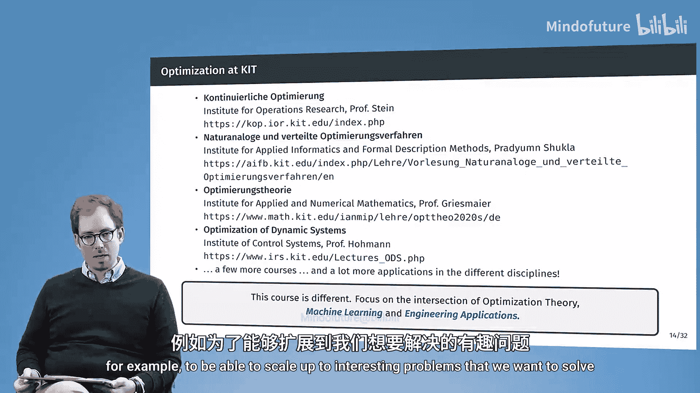

# 002：课程组织 📚

在本节中，我们将了解本课程的整体组织架构，包括课程大纲、学习资源以及本课程在凯尔大学课程体系中的定位。

## 课程大纲概览

以下是本课程涵盖的14个主要主题，每个主题都配有相应的实践练习环节。

*   **第1-4周：优化基础模块**：我们将学习优化的主要构建块，包括核心算法以及处理不同约束或条件的方法。
*   **第5周：实践案例**：本节将完全专注于实际应用案例，包括机械设计中的电机预测控制和金融领域的股票投资组合优化。
*   **第6周及以后：进阶主题**：我们将学习自动微分以简化数学计算负担，从向量空间的新视角看待优化问题，并优化之前学到的工具以解决大规模问题，例如来自计算机视觉或机器学习的高维优化问题。

## 学习资源与形式

课程将以视频形式录制，并与幻灯片一同提供。此外，我们还会提供习题集和Jupyter笔记本。

在Jupyter笔记本中，会预设一些问题，但关键部分需要由你完成。例如，你的任务可能是实现一个在课程中见过的小算法，或是解决某个优化问题。

携带笔记本电脑参加练习课是有益的，但不是强制要求。我们期望你能完成这些练习，因为大量的学习和实际应用理解将来源于此。

## 主要参考书目

本课程内容主要参考并受以下两本书籍启发：

*   **《Optimization by Vector Space Methods》** (David Luenberger著)：这是一本较为经典的著作，因其写作年代计算能力有限，故更侧重于对优化问题的解析性思考。
*   **《Convex Optimization》** (Stephen Boyd与Lieven Vandenberghe著)：这是一本现代经典教材，被广泛引用，是该领域的必备参考书。

你**不需要**购买这些书籍来跟上课程。它们仅作为深入学习的参考资料。

## 凯尔大学内的优化相关课程

在凯尔大学，优化并非仅在本课程中涉及。其他科学领域也关注此主题：

*   **运筹学**：源自工程与经济系，主要研究组织或商业背景下的优化问题。
*   **自然启发式优化方法**：由IFB开设，更接近计算机科学，但仍属经济与工程系。
*   **数学系的优化理论**：与数学系的课程相比，本课程的不同之处在于，数学课程会更深地探讨证明，但不会涵盖同样广泛的应用工具。本课程会在证明相关时进行讲解，但在许多领域仅提供证明参考，重点是理解“为什么”，并实现重要的算法。

此外，电气工程等工程领域也有大量涉及优化的课程，例如Oman教授的讲座。

## 本课程的独特视角

综上所述，凯尔大学存在多个涉及优化的课程背景。而本课程将采取一个非常独特的视角：我们将专注于机器学习和工程领域的应用，并以此作为学习动机，理解为什么我们需要特定的算法改进，例如，为了能够扩展到我们想要解决的有趣问题。

---

本节课中，我们一起了解了《机器学习优化方法》课程的组织结构、学习资源、参考书目以及它在更广泛学术背景下的定位。下一节，我们将开始深入课程的第一个核心主题。