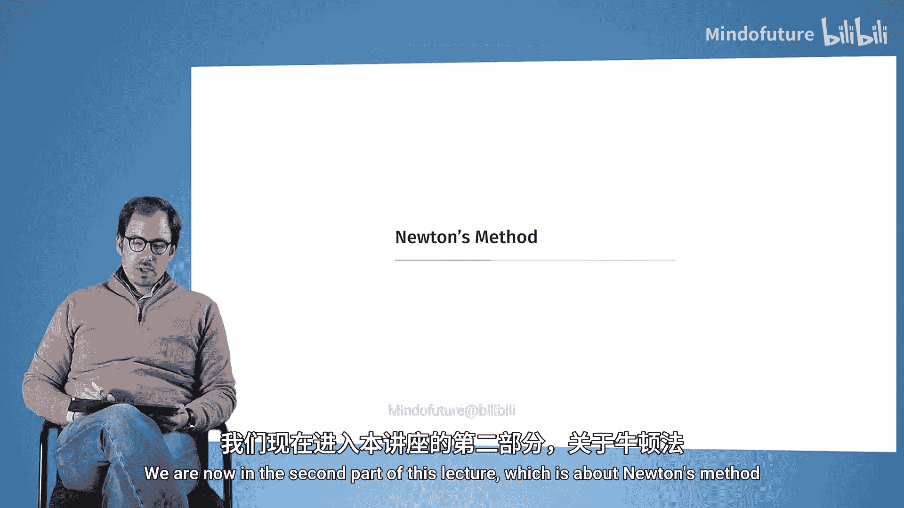
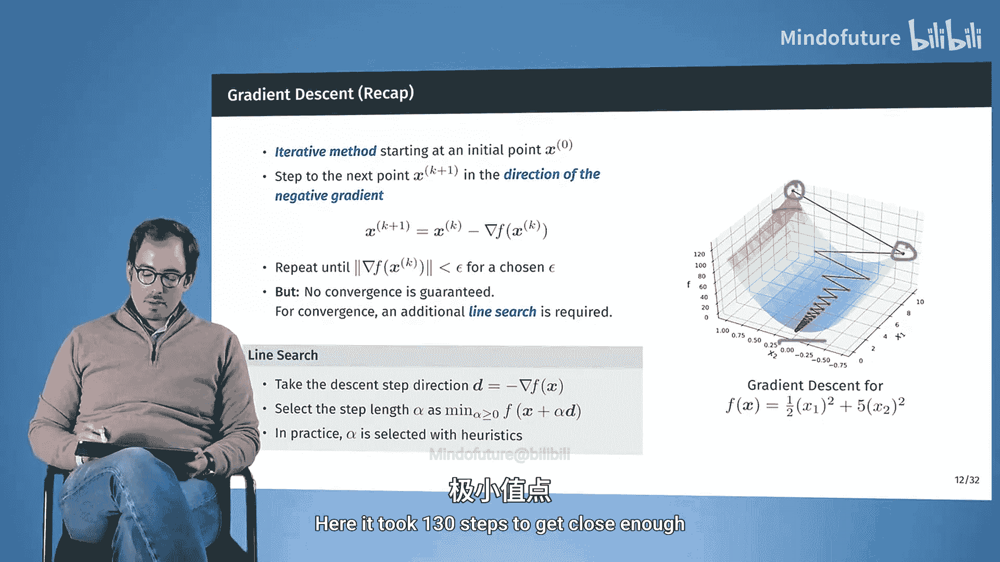
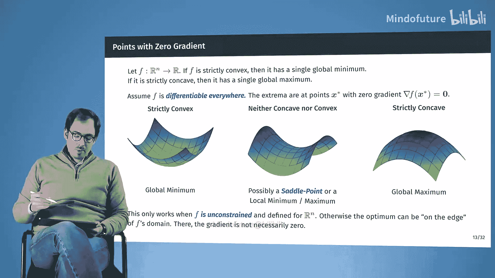
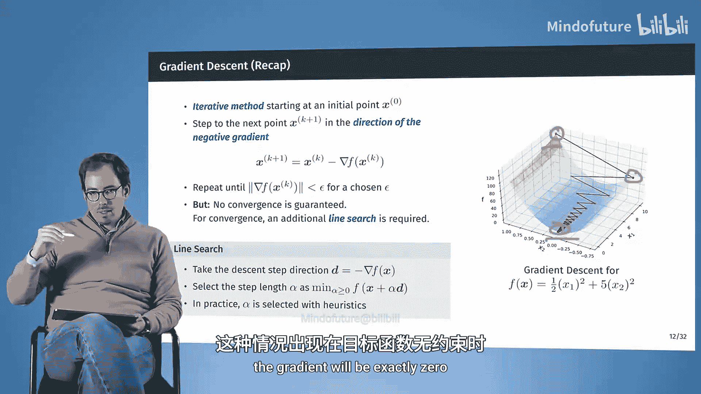
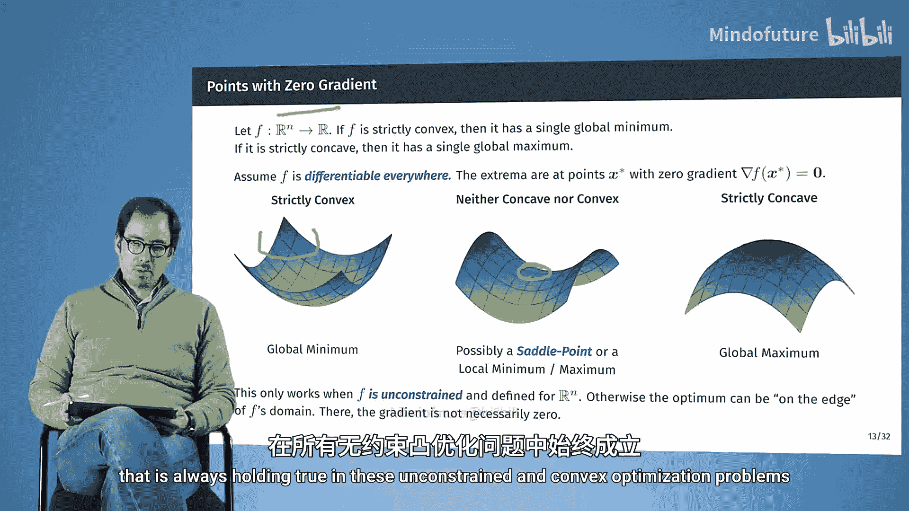
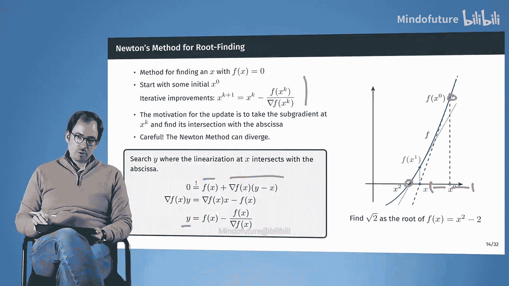
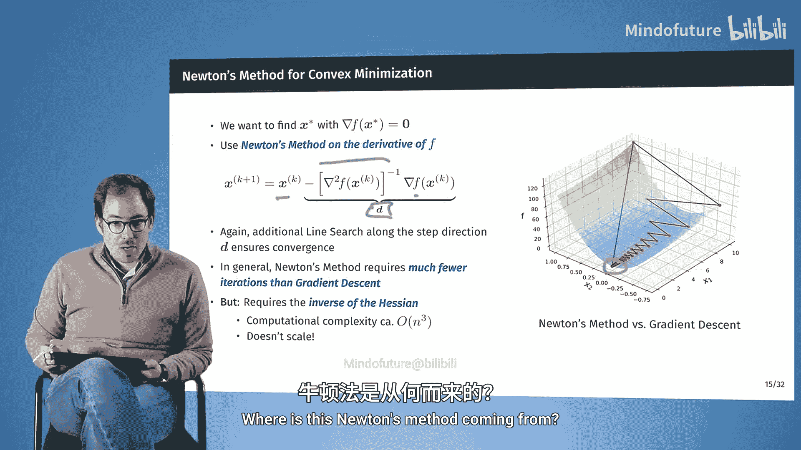
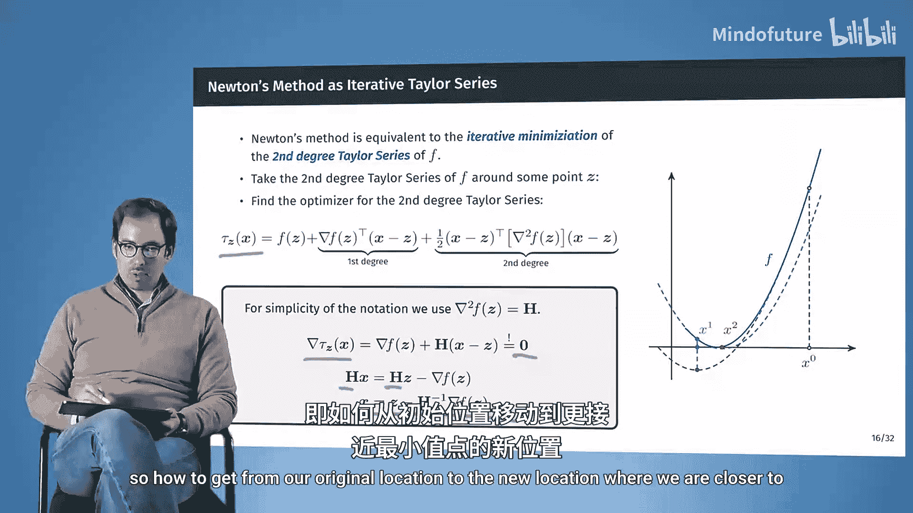

# 007：牛顿法 🚀





在本节课中，我们将学习牛顿法，这是一种比梯度下降法更快的优化算法。我们将了解其基本原理、推导过程、收敛速度，并理解其优缺点。





上一节我们介绍了梯度下降法，本节中我们来看看牛顿法。

## 牛顿法的基本思想 💡

梯度下降法的核心思想是沿着当前点的梯度方向（即最陡下降方向）移动，以找到函数的最小值。然而，牛顿法采用了不同的策略。



牛顿法的核心思想是，我们不仅希望“下山”，更希望直接找到梯度为零的点。对于一个无约束且严格凸的目标函数，其全局最小值点处的梯度恰好为零。因此，寻找最小值点等价于寻找梯度函数的零点。

## 从求根到优化 🔄

寻找函数零点（求根）的问题，早在数百年前就已被研究，其经典方法是牛顿法。

牛顿法是一种迭代方法。它从一个初始点开始，通过一系列步骤逼近函数的根。其过程是：在当前点 `x_k` 处，对函数 `f(x)` 进行线性化（即使用其切线），然后找到该切线与x轴的交点，并将该交点作为下一个迭代点 `x_{k+1}`。

以下是牛顿法求根的核心迭代公式：
```
x_{k+1} = x_k - f(x_k) / f'(x_k)
```
其中，`f'(x_k)` 是函数在 `x_k` 处的导数。

牛顿法通常收敛速度很快，尽管在某些情况下可能发散，但本节课我们暂不讨论发散的情形。

## 应用于优化问题 ⚙️



现在，我们将牛顿法应用于优化问题：寻找目标函数 `F(x)` 的梯度为零的点（即最小值点）。

为此，我们使用牛顿法来逼近梯度 `∇F(x) = 0` 的解。此时的迭代公式变得稍微复杂一些：
```
x_{k+1} = x_k - [∇²F(x_k)]⁻¹ ∇F(x_k)
```
其中：
*   `∇F(x_k)` 是函数在 `x_k` 处的梯度（一阶导数向量）。
*   `∇²F(x_k)` 是函数在 `x_k` 处的海森矩阵（二阶导数矩阵）。
*   `[∇²F(x_k)]⁻¹` 是海森矩阵的逆。

公式中的 `d_k = - [∇²F(x_k)]⁻¹ ∇F(x_k)` 给出了搜索方向。与梯度下降法类似，我们可以在此方向上应用线搜索来进一步优化步长。

与需要130步的梯度下降法相比，牛顿法在上图的例子中仅用一步就达到了最小值点附近，速度提升了130倍。然而，牛顿法的每次迭代计算成本更高，因为需要计算并求逆海森矩阵。对于高维问题，求逆可能变得计算困难。



## 公式推导 📝

牛顿法的优化公式是如何从求根公式演变而来的呢？其动机源于对目标函数的二阶泰勒展开。

我们在当前点 `x_k` 对目标函数 `F(x)` 进行二阶泰勒展开：
```
T(x) = F(x_k) + ∇F(x_k)^T (x - x_k) + 1/2 (x - x_k)^T ∇²F(x_k) (x - x_k)
```
这个展开式在 `x_k` 处的一阶和二阶导数与原函数 `F` 相同，因此是原函数的一个良好局部近似。

牛顿法的策略是：在每一步，我们寻找使得这个二次近似模型 `T(x)` 的梯度为零的点，并将其作为下一个迭代点。即求解 `∇T(x) = 0`。

计算 `T(x)` 的梯度并令其为零：
```
∇T(x) = ∇F(x_k) + ∇²F(x_k) (x - x_k) = 0
```
通过线性代数变换，解出 `x`：
```
x = x_k - [∇²F(x_k)]⁻¹ ∇F(x_k)
```
这就得到了牛顿法的迭代公式。



## 超线性收敛速度 ⚡

关于牛顿法的收敛速度，有一个非常重要的定理，即康托罗维奇在20世纪40年代证明的牛顿法超线性收敛定理。

该定理指出，如果函数 `F` 二阶可微，其海森矩阵正定，且梯度的变化率（由利普希茨常数界定）有上界，那么只要初始点足够接近最小值点，牛顿法就能以 **双对数级别** 的速度收敛。

收敛的复杂度阶为 `O(log log(1/ε))`，其中 `ε` 是允许的误差。这意味着，如果我们将误差要求提高1000倍，可能只需要增加一两次牛顿迭代。这种超线性收敛区域就像最小值点周围的一个“球”，一旦进入这个球，牛顿法能在极少的几步内达到机器浮点数所能表示的精度极限。

---

本节课中我们一起学习了牛顿法。我们了解到，牛顿法通过利用目标函数的二阶导数（海森矩阵）信息，能够比只利用一阶导数的梯度下降法更快地收敛到最小值点。其核心步骤是求解当前点处二次近似模型的极小值。虽然每次迭代计算成本较高，但其卓越的收敛速度（尤其是接近解时的超线性收敛）使其在许多中低维优化问题中非常有效。理解牛顿法为后续学习处理高维问题的拟牛顿法等优化算法奠定了基础。