# 010：不等式约束 🧩


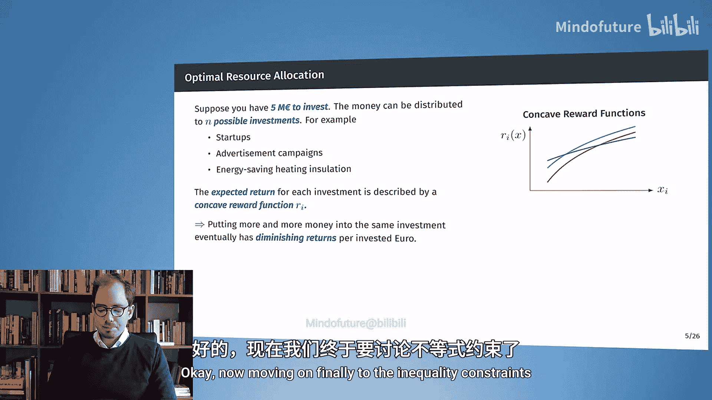

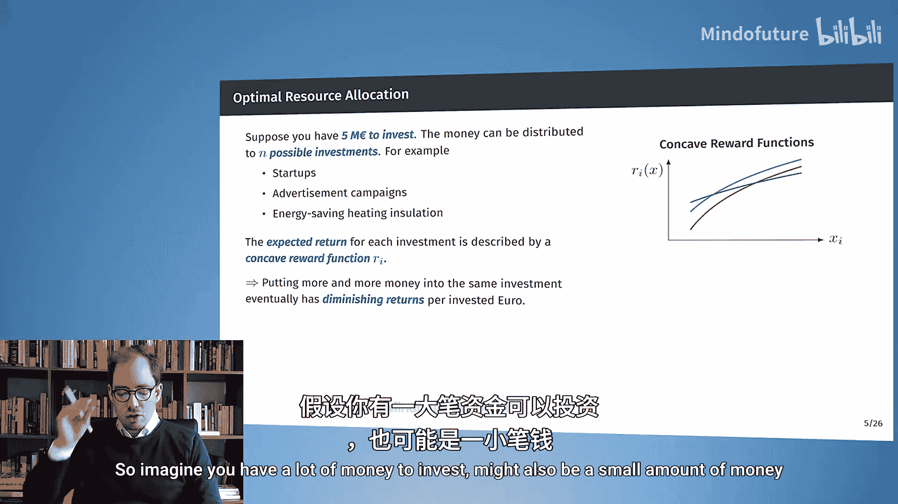

在本节课中，我们将要学习如何处理带有不等式约束的优化问题。我们将从一个现实的投资分配例子出发，理解不等式约束的直观意义，然后学习如何将这类约束优化问题转化为我们熟悉的、可以使用梯度下降或牛顿法等算法求解的形式。

## 从投资问题引入不等式约束 💰

上一节我们介绍了无约束优化问题，本节中我们来看看当问题存在限制条件时该如何处理。让我们从一个投资分配的例子开始。

假设你有一笔资金（例如500万欧元）可以用于多项投资，比如投资初创公司、为公司做广告宣传，或者为房屋安装节能隔热材料。在这些例子中，一个合理的假设是**回报函数是凹函数**。

凹函数体现了“收益递减”原则。以安装房屋隔热材料为例：第一次安装10厘米隔热层会显著提升能效，带来可观的回报。但在此基础上再增加10厘米，虽然能效仍会提升，但其带来的额外节能收益通常不如第一次那么显著。因此，回报随投资金额增加而增加，但增速逐渐放缓，函数图像呈**凹形**。

由于我们的目标是**最大化回报**，而我们的算法擅长**最小化凸函数**，因此我们可以取回报函数的负值。这样，最大化凹回报函数的问题，就等价于最小化一个凸函数的问题。

## 最优资源分配问题 📊

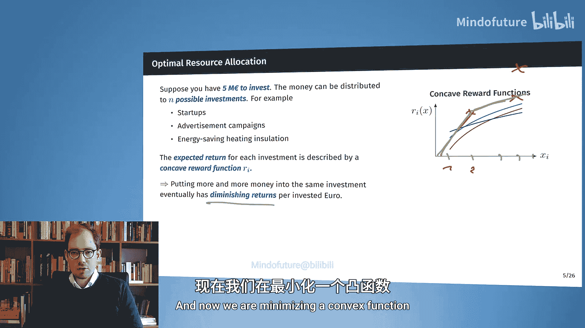

那么，如何在各项投资之间分配资金呢？如果没有限制，拥有无限资金就无需过多思考。但现实中，我们的资源是有限的，必须进行分配。这个问题被称为**最优资源分配问题**。

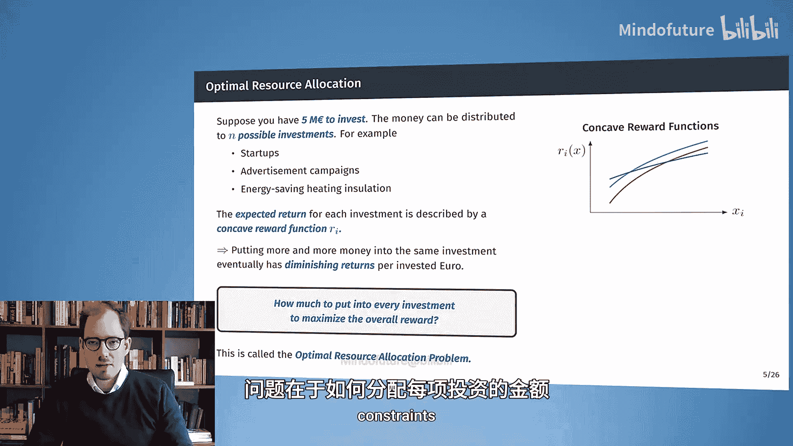

我们可以用数学形式来描述它，构建一个带约束的优化问题：
*   **目标**：最大化总投资回报。
*   **约束1**：总投资额不能超过总预算（例如500万欧元）。
*   **约束2**：每项投资金额不能为负（即不能通过贷款等方式进行“负投资”）。

用公式表示如下：
```
最大化：∑ᵢ Rᵢ(xᵢ)
约束条件：
    ∑ᵢ xᵢ ≤ B   (预算约束)
    xᵢ ≥ 0      (非负约束)
```
其中，`Rᵢ(xᵢ)` 是第 `i` 项投资的回报函数（凹函数），`xᵢ` 是投入第 `i` 项的资金，`B` 是总预算。

在这个问题中，`∑ᵢ xᵢ ≤ B` 就是一个典型的**不等式约束**。它要求左侧的和小于或等于右侧的常数。即使取等号，这也被称为不等式约束。

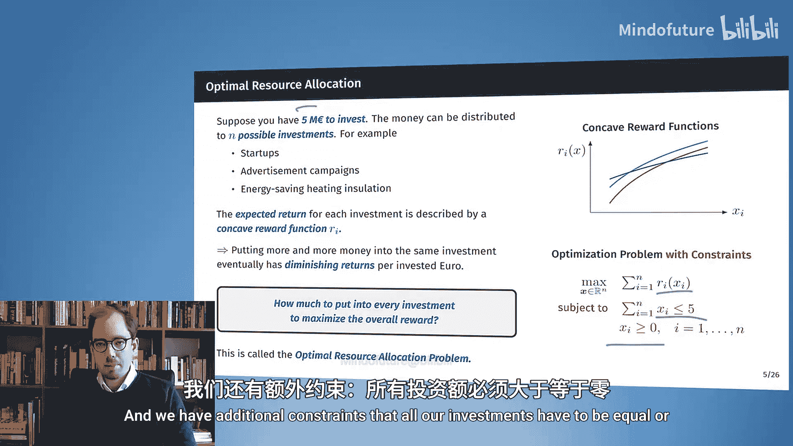

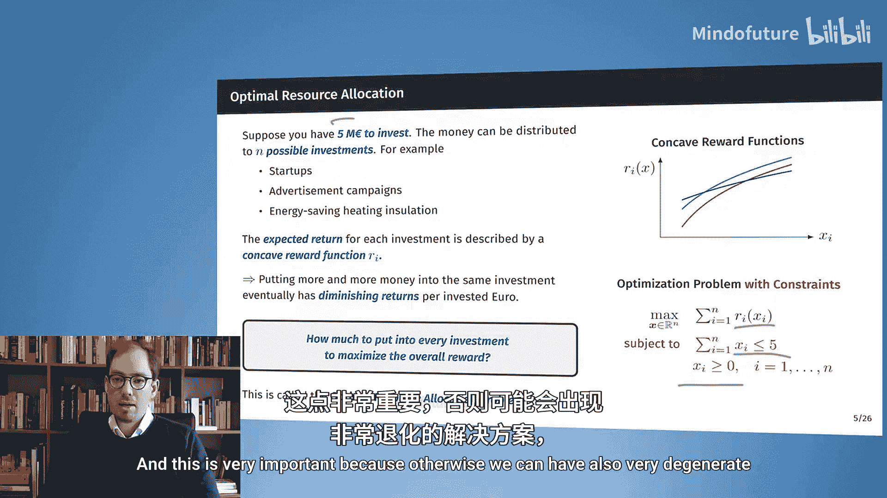

## 约束优化的一般形式 🔧

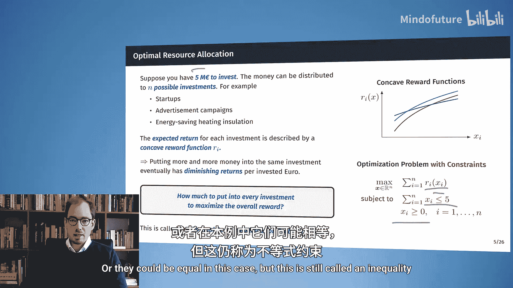

一般来说，约束优化意味着我们对所考虑的解决方案集合施加了限制。

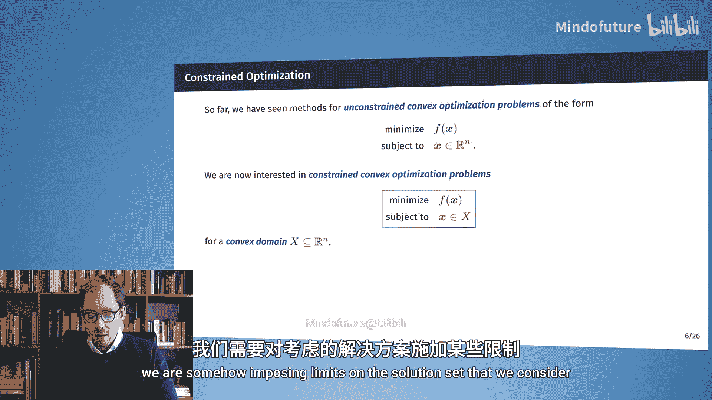

此前，我们在 `Rⁿ` 空间中进行（无约束）优化，所有解都是可行的。现在，我们引入约束，定义了一个可行域 `X`，它是 `Rⁿ` 的一个子集，可能更小且结构更复杂。

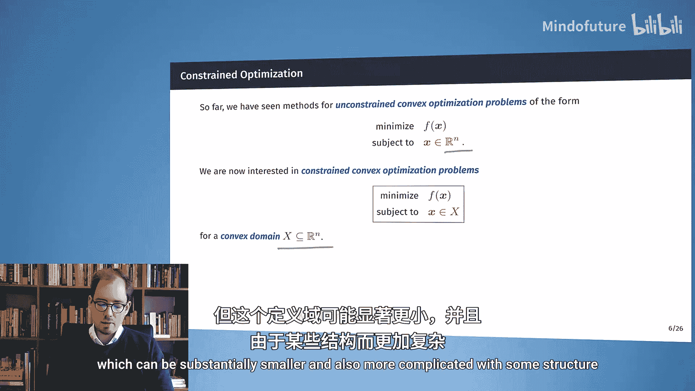

我们的核心思想是：将这个要求解必须位于集合 `X` 中的约束优化问题，转化为一个**无约束形式**或**等价表示**，从而能够运用前面学过的梯度下降、线搜索、牛顿法等算法进行求解。

对于不等式约束，这正是本节课要学习的内容。

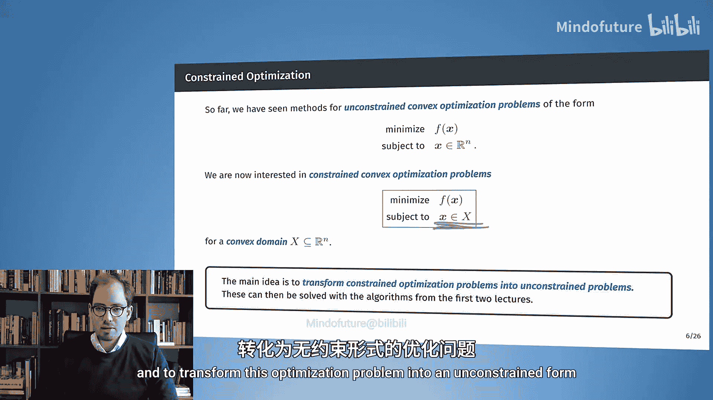

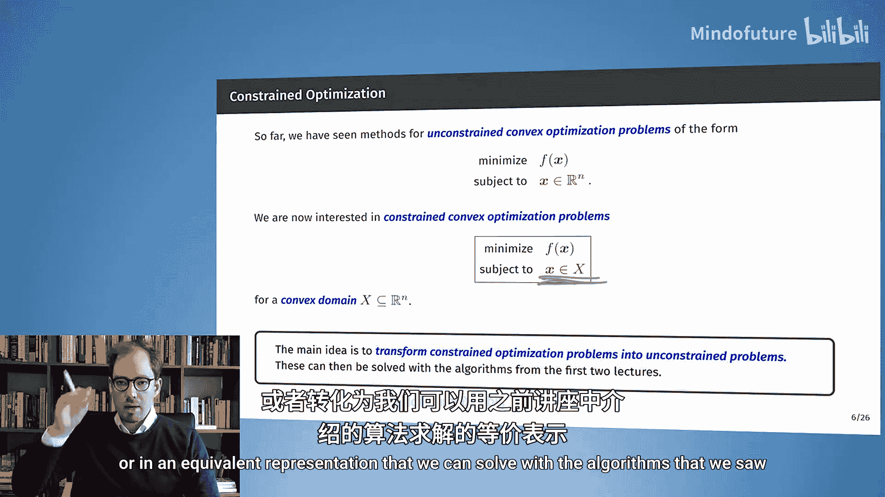

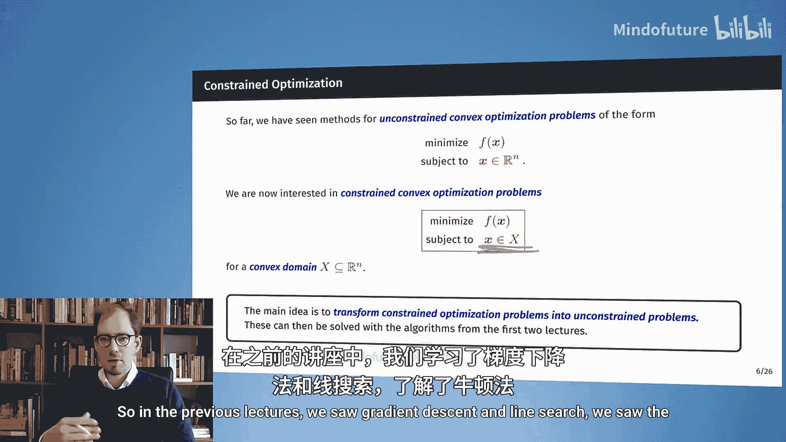

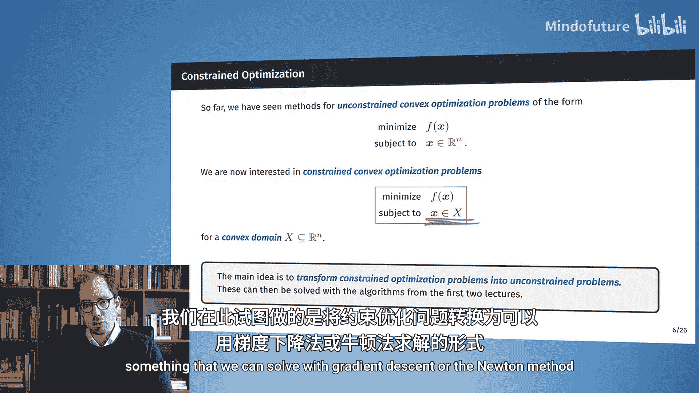

## 约束类型与规范形式 📐

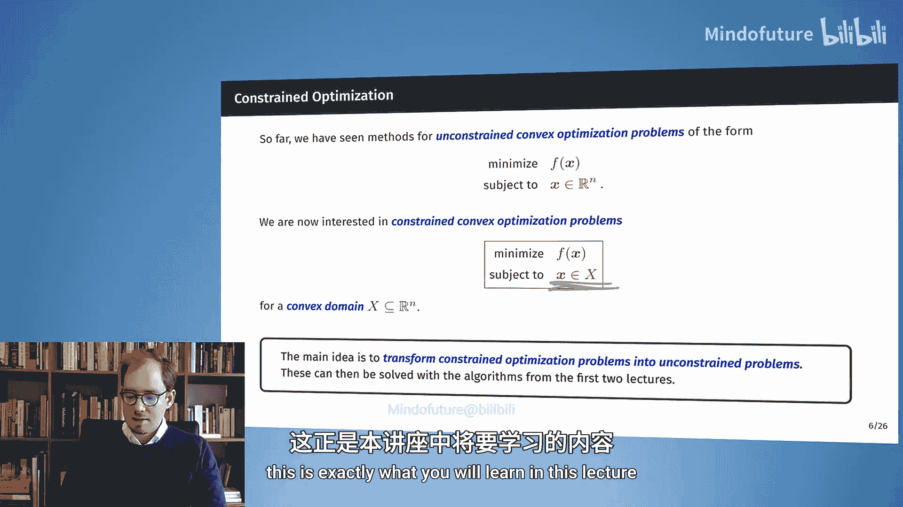

除了不等式约束，优化问题中还可能存在等式约束。为了给出完整的图景，我们先进行对比，再深入细节。

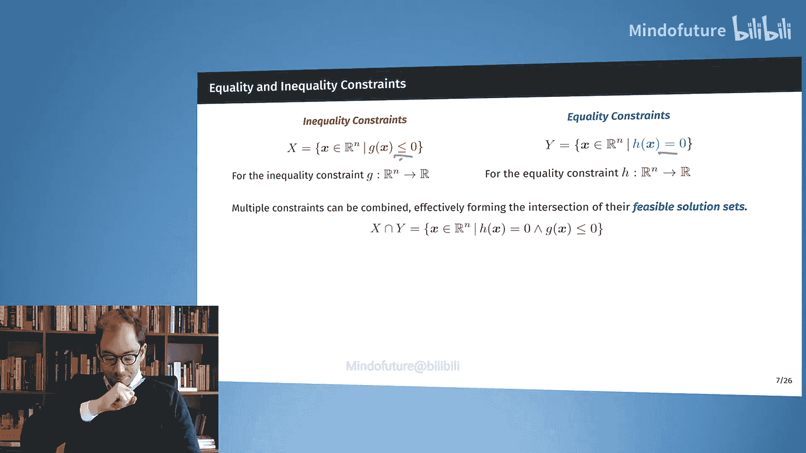

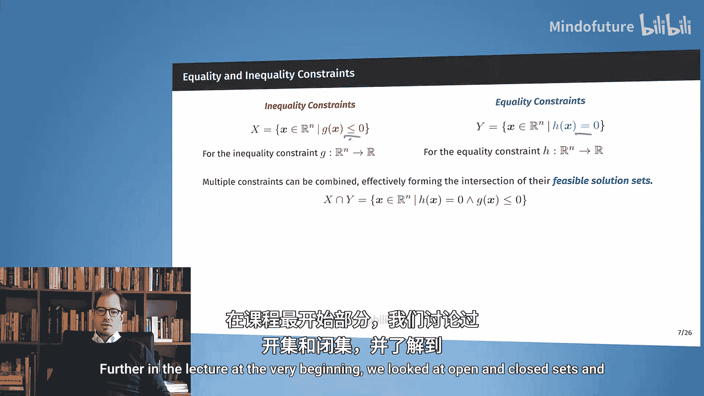

以下是两种基本约束类型：
*   **不等式约束**：`g(x) ≤ 0`
*   **等式约束**：`h(x) = 0`

我们可以组合多个约束。就像课程开始时讨论的集合交集一样，如果一个问题同时有不等式约束和等式约束，那么可行解必须同时满足所有约束，即位于所有约束条件定义的集合的**交集**之中。

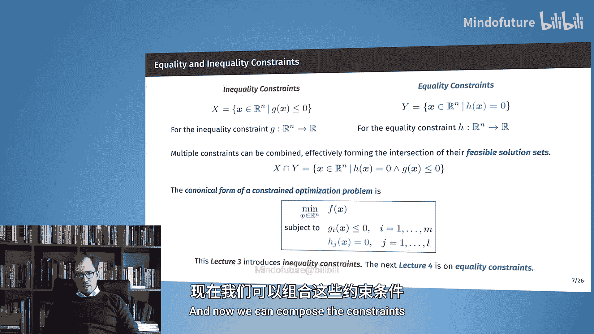

由此，我们可以得到约束优化问题的**规范形式**，这种形式将在后续课程中反复使用：
```
最小化：f(x)
约束条件：
    gᵢ(x) ≤ 0,  i = 1, ..., m
    hⱼ(x) = 0,  j = 1, ..., p
```
其中，`f(x)` 是凸函数，`gᵢ(x)` 是凸函数（这能保证不等式约束定义的集合是凸集），`hⱼ(x)` 是仿射函数。我们首先将分别学习处理不等式和等式约束的方法，之后会将它们结合起来，以求解这种一般规范形式的约束优化问题。

在本课程中，我们始终确保处理的是凸优化问题。这意味着，当我们把所有约束条件结合起来，构造出满足所有约束的可行解集 `X` 时，我们希望这个集合 `X` 本身也是**凸集**。凸集的性质对于保证优化问题的良好性质和求解效率至关重要。

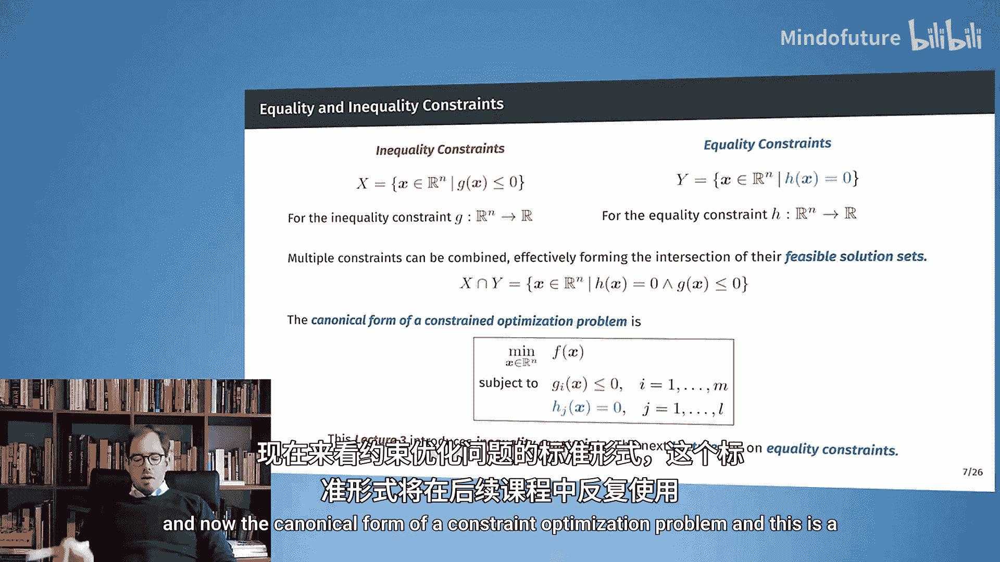

## 总结 🎯

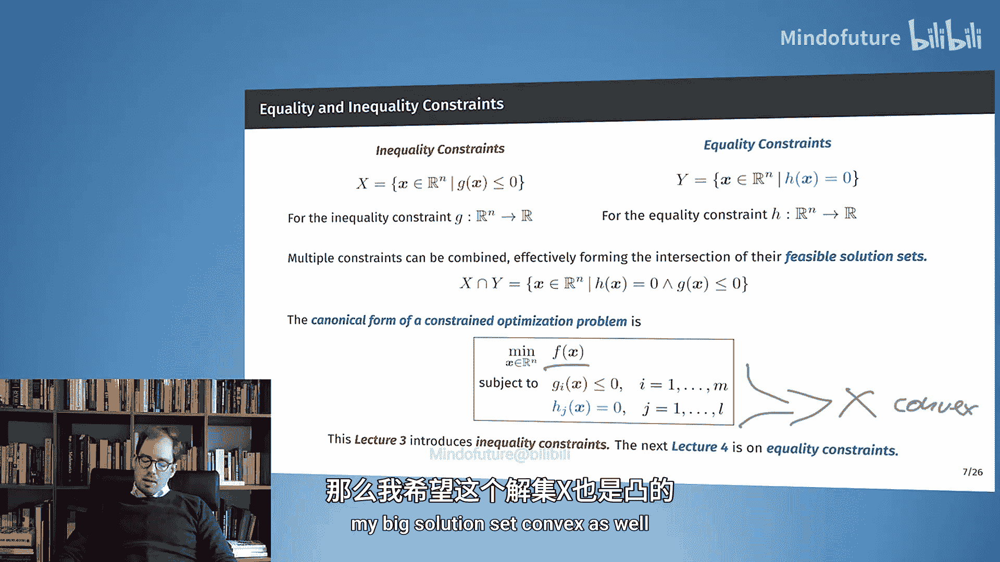

本节课中我们一起学习了不等式约束优化问题的引入与基本形式。我们从投资分配的例子理解了不等式约束的现实意义，并学会了如何用数学公式描述这类问题。我们明确了约束优化的目标是定义可行域，并将其转化为可求解的形式，同时了解了包含不等式与等式约束的规范形式。在接下来的课程中，我们将深入探讨求解这些约束的具体方法。