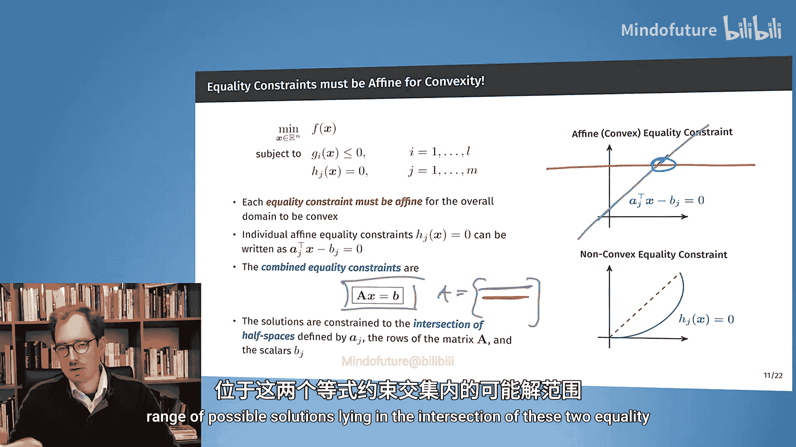

# 015：等式约束


## 概述
在本节课中，我们将学习带有等式约束的优化问题。我们将从一个历史案例——最优运输问题出发，理解等式约束的形式化表达，并探讨如何将其转化为标准形式的线性规划问题。我们将重点关注**线性**等式约束，以确保解空间的凸性，这是后续算法有效应用的前提。

## 历史背景：最优运输问题
上一节我们介绍了无约束和不等式约束优化。本节中，我们来看看等式约束。历史上，等式约束优化源于一些重要的应用问题，如今它们被归为最优运输问题。

以下是两个在历史上几乎同时期被提出的例子：

*   **康托维奇问题**：在第二次世界大战期间，一位红军将军希望以最小的代价将士兵从兵营运送到前线阵地。兵营有不同数量的士兵，前线阵地有不同的人员需求，目标是找到运输成本最低的方案。
*   **希区柯克问题**：一个农民合作社希望将农产品运送到不同市场。每个农民生产不同作物，每个市场有不同需求，目标同样是满足所有市场需求的同时，最小化运输成本。

这两个问题本质上是相同的，只是应用场景不同。在20世纪40年代，这类问题激发了广泛的研究兴趣。本课程将以康托维奇问题作为主要示例。

## 问题形式化：矩阵表示
现在，我们来看如何将上述运输问题形式化为一个优化问题。

假设我们有三个兵营（B1， B2， B3），士兵数量分别为60，000， 90，000和150，000。有三个前线阵地（P1， P2， P3），需求分别为120，000， 100，000和80，000。

我们可以用一个3x3的矩阵 **M** 来表示运输方案，其中元素 `M[i， j]` 表示从第 `i` 个兵营运送到第 `j` 个阵地的士兵数量。所有 `M[i， j]` 必须大于等于零。

同时，我们有一个成本矩阵 **C**，其中 `C[i， j]` 表示运送单位士兵从兵营 `i` 到阵地 `j` 的成本。

于是，优化问题可以表述为：寻找矩阵 **M**，在满足以下约束的前提下，最小化总运输成本。

**目标函数（总成本）**：
`总成本 = Σ_i Σ_j (C[i， j] * M[i， j])`

**约束条件**：
1.  **兵营供给约束（行和）**：从每个兵营运出的士兵总数必须等于该兵营的初始人数。
    *   对于兵营 B1：`M[1，1] + M[1，2] + M[1，3] = 60，000`
    *   对于兵营 B2：`M[2，1] + M[2，2] + M[2，3] = 90，000`
    *   对于兵营 B3：`M[3，1] + M[3，2] + M[3，3] = 150，000`
2.  **阵地需求约束（列和）**：运送到每个阵地的士兵总数必须等于该阵地的需求。
    *   对于阵地 P1：`M[1，1] + M[2，1] + M[3，1] = 120，000`
    *   对于阵地 P2：`M[1，2] + M[2，2] + M[3，2] = 100，000`
    *   对于阵地 P3：`M[1，3] + M[2，3] + M[3，3] = 80，000`
3.  **非负约束**：`M[i， j] >= 0` 对所有 `i， j` 成立。

这是一个**线性规划**问题，因为目标函数和所有约束（除了非负约束）都是线性的。

## 转化为标准形式：向量表示
为了便于算法设计和理论分析，我们需要将上述矩阵形式的问题转化为更标准的优化问题形式。

我们不再使用矩阵 **M**，而是将其**列向量依次堆叠**，形成一个9维的决策向量 **x**：
`x = [M[1，1]， M[2，1]， M[3，1]， M[1，2]， M[2，2]， M[3，2]， M[1，3]， M[2，3]， M[3，3]]^T`

同样，将成本矩阵 **C** 也按相同顺序堆叠成9维成本向量 **c**。

此时，目标函数可以简洁地写为：
`最小化 c^T * x`

接下来处理等式约束。每个约束（如 `M[1，1] + M[1，2] + M[1，3] = 60，000`）都可以表示为一个向量 **a_k** 与 **x** 的内积等于一个标量 `b_k`。例如，对于第一个兵营的约束，对应的向量 **a_1** 在 `M[1，1]， M[1，2]， M[1，3]` 对应的位置为1，其余位置为0。

将所有6个等式约束对应的向量 **a_k** 作为行，可以组合成一个6x9的矩阵 **A**，将所有右侧常数 `b_k` 组合成一个6维向量 **b**。于是，所有等式约束可以合并为：
`A * x = b`

最后，非负约束保持不变：
`x >= 0` （这里指向量的每个分量都大于等于0）

至此，我们得到了线性规划的标准形式：
```
最小化 c^T * x
满足 A * x = b
且 x >= 0
```

## 线性等式约束与凸性
我们刚刚看到，标准形式中的等式约束是线性的（`A * x = b`）。为什么我们只考虑这种形式的等式约束呢？

考虑一个非线性等式约束，例如 `x_1^2 = 1`。它的解是 `x_1 = 1` 或 `x_1 = -1`。这两个解之间的连线上的点（例如 `x_1 = 0`）并不满足原等式。因此，满足该约束的解集 `{1， -1}` 不是**凸集**。

本课程讨论的优化算法（如后续的梯度方法、内点法等）通常依赖于解空间的凸性来保证收敛到全局最优解。如果我们允许非线性的等式约束，解空间可能变得非凸，导致算法失效或只能找到局部最优解。

因此，在本课程中，我们只考虑**线性**等式约束。线性等式约束 `A * x = b` 定义了一个**仿射子空间**（或线性流形），它是一个凸集。任意两个满足该约束的解的线性组合（只要系数和为1）仍然满足该约束。多个线性等式约束的交集，即多个超平面或平面的交点，仍然是一个凸集（可能是一个点、一条线或一个平面）。



如上图所示，在二维空间中，两个线性等式约束（两条线）的交点是一个点（凸集）。在高维空间中，多个等式约束的交集可能是一个点、一条线、一个平面或更高维的仿射子空间，它们都是凸的。

## 总结
本节课中，我们一起学习了带有等式约束的优化问题。

1.  我们从**最优运输问题**的历史案例入手，理解了等式约束在实际问题中的来源。
2.  我们学习了如何将这类问题**形式化**为一个线性规划问题，并使用矩阵和向量进行表示。
3.  我们探讨了将问题转化为**标准形式**（`最小化 c^T*x， 满足 A*x=b 且 x>=0`）的过程，这为应用通用优化算法奠定了基础。
4.  最后，我们强调了只考虑**线性等式约束**的重要性，因为它保证了**解空间的凸性**，这是本课程后续许多优化算法能够正确有效工作的关键前提。


下一节，我们将开始探讨如何求解这种带有线性等式约束（和不等式约束）的优化问题。