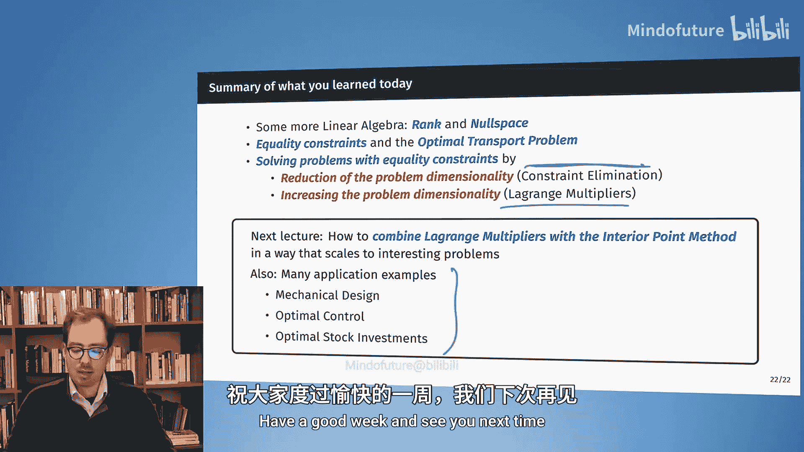

# 017：拉格朗日乘数法 🧮

在本节课中，我们将学习一种处理等式约束优化问题的重要方法——拉格朗日乘数法。与上一节介绍的约束消除法不同，该方法通过增加问题的维度来寻找最优解。

## 概述

到目前为止，我们已经学习了约束消除法，它通过降低优化问题的维度来求解。但还存在另一种截然不同的技术，它反其道而行之，即增加优化问题的维度。本节将详细介绍这种方法——拉格朗日乘数法。

## 问题引入与拉格朗日函数

假设我们有一个简单的优化问题：最小化目标函数 **f(x) = x₁² + 3x₂²**。若无约束，其最优解显然是 (0, 0)。但现在我们添加一个等式约束：**x₁ + 2x₂ - 1 = 0**。这意味着所有可行解都必须位于这条直线上。最优解 **x*** 也必须落在这条线上，并且是满足约束条件下目标函数值最小的点。

现在，我们引入拉格朗日乘数法。其核心是构造一个**拉格朗日函数**。拉格朗日函数是一个扩展的优化问题。对于原始问题 **min f(x)** 和等式约束 **h(x) = 0**，拉格朗日函数 **L** 定义为：

**L(x, λ) = f(x) + λ * h(x)**

这里，我们引入了一个新变量 **λ**，称为拉格朗日乘子。拉格朗日函数在原始目标函数的基础上，加上了拉格朗日乘子 **λ** 与等式约束函数 **h(x)** 的乘积。

## 求解方法：梯度为零

我们的目标是求解这个扩展后的优化问题。最优解出现在拉格朗日函数的梯度为零的点。回忆牛顿法，它在无约束凸问题中寻找梯度为零的点，该点即为极小值点。

在这里，我们采用类似的思路，但寻找的是拉格朗日函数 **L** 关于所有变量（包括 **x** 和 **λ**）的梯度为零的点。我们可以定义一个扩展向量 **z = [x; λ]**，然后要求 **∇ₓL = 0** 且 **∇λL = 0**。

让我们通过之前的小例子来具体求解。

首先，计算拉格朗日函数关于 **x** 的偏导数并令其为零：
**∂L/∂x₁ = 2x₁ + λ = 0**
**∂L/∂x₂ = 6x₂ + 2λ = 0**

由此可得：**2x₁ = -λ** 且 **6x₂ = -2λ**，简化后得到 **x₁ = 3x₂**。

接着，计算拉格朗日函数关于 **λ** 的偏导数并令其为零：
**∂L/∂λ = x₁ + 2x₂ - 1 = 0**

有趣的是，这恰好就是我们原始的等式约束。通过构造拉格朗日函数，对其关于 **λ** 求导，我们正好恢复了等式约束条件。

现在，将 **x₁ = 3x₂** 代入等式约束 **x₁ + 2x₂ - 1 = 0**，可以解析求解：
**3x₂ + 2x₂ = 1 => 5x₂ = 1 => x₂ = 1/5**
**x₁ = 3*(1/5) = 3/5**

因此，解析解为 **x* = (3/5, 1/5)**，这与我们在图中看到的最优点一致。

## 几何直观解释

为什么这种方法有效？我们可以从几何角度理解。

在等高线图上，目标函数 **f(x)** 的梯度 **∇f** 指向函数值增加最快的方向。在满足等式约束的直线上任取一点，其梯度方向通常不与约束线垂直。

约束线本身有一个法向量方向（与线垂直的方向）。对于约束 **x₁ + 2x₂ = 1**，其法向量为 **(1, 2)**。

拉格朗日函数关于 **x** 的梯度为 **∇ₓL = ∇f + λ * ∇h**。其中 **∇h** 正是约束的法向量。**λ** 是一个缩放因子。

关键点在于：在最优点 **x*** 处，目标函数的梯度 **∇f** 与约束的法向量 **∇h** 是平行的（方向相同或相反）。此时，我们可以通过选择合适的 **λ** 值，使得 **∇f + λ∇h = 0**。这意味着，在约束线上，你无法通过沿切线方向移动来改善目标函数值，因为任何微小的移动要么违反约束，要么不会降低函数值（梯度在约束方向的分量为零）。因此，该点就是约束下的最优点。

这是一种非常巧妙的方法，它通过增加问题维度（引入 **λ**），将一个带等式约束的问题转化为一个高维无约束问题，从而可以再次应用牛顿法等寻找梯度为零的点。

## 方法推广与数值求解

上述概念可以推广到更一般的情况。假设有多个等式约束：**Ax = b**，其中 **A** 是 m×n 矩阵。那么拉格朗日函数变为：

**L(x, λ) = f(x) + λᵀ(Ax - b)**

这里 **λ** 是一个 m 维向量。我们需要求解的条件是扩展的梯度为零：
**∇ₓL = ∇f(x) + Aᵀλ = 0**
**∇λL = Ax - b = 0**

在使用牛顿法数值求解时，我们需要计算扩展的梯度向量和黑塞矩阵。幸运的是，如果已知原始目标函数的梯度 **∇f** 和黑塞矩阵 **∇²f**，以及矩阵 **A**，我们可以快速构造出扩展系统的梯度 **G** 和黑塞矩阵 **H**：

**G = [∇f(x) + Aᵀλ; Ax - b]**
**H = [[∇²f(x), Aᵀ]; [A, 0]]**

现在，问题变成了一个 **(n+m)** 维的无约束问题，这很方便。但需要注意，这个扩展后的拉格朗日函数关于 **(x, λ)** 不再是凸函数（尽管关于 **x** 是凸的，关于 **λ** 是线性的）。然而，牛顿法仍然适用，因为它旨在寻找梯度为零的驻点（这里是一个鞍点）。梯度下降或线搜索法则可能不适用，因为它们试图最小化函数，而我们现在寻找的是鞍点。

以下是针对我们小例子的数值求解步骤概要：

1.  定义目标函数 **f(x) = x₁² + 3x₂²**，其梯度 **∇f = [2x₁; 6x₂]**，黑塞矩阵 **∇²f = [[2, 0]; [0, 6]]**。
2.  定义等式约束 **x₁ + 2x₂ = 1**，写成矩阵形式 **A = [1, 2]**，**b = [1]**。
3.  构造拉格朗日函数 **L(x, λ) = x₁² + 3x₂² + λ*(x₁ + 2x₂ - 1)**。
4.  构造扩展梯度 **G(z)** 和扩展黑塞矩阵 **H(z)**，其中 **z = [x; λ]**。
5.  将 **G** 和 **H** 代入牛顿法迭代公式。
6.  数值求解的结果将与解析解 **(3/5, 1/5)** 一致。

## 历史背景与应用

拉格朗日乘数法由约瑟夫-路易·拉格朗日提出。他在1788年出版的《分析力学》中引入了这一方法。这一成果影响深远，其价值在于“提出了一种通用方法，使得每个力学问题都可以表述为一个单一的代数方程。任何机械系统（例如太阳系）的完整历史都可以浓缩成一句话。”

这是一个在数值计算机出现前150年就发明的强大工具，最初作为分析工具用于变分法等领域，求解结果甚至是函数而非有限维向量。它在物理学、经济学、工程学和计算机科学中都有广泛应用。近几十年来，随着数字计算机的发展，拉格朗日乘数法在数值优化中也变得极其重要。

## 总结

本节课我们一起学习了处理等式约束优化问题的第二种关键技术——拉格朗日乘数法。

*   我们首先通过一个简单例子引入了该方法，并展示了如何构造拉格朗日函数。
*   我们理解了最优解对应于拉格朗日函数梯度为零的点，并给出了该条件的几何解释：在最优点，目标函数的梯度与约束的法向量平行。
*   随后，我们将方法推广到具有多个等式约束的一般情况，并给出了数值求解所需的扩展梯度与黑塞矩阵公式。
*   最后，我们简要回顾了该方法的历史背景和广泛的应用领域。

拉格朗日乘数法通过增加问题维度，优雅地将等式约束问题转化为无约束问题，为使用牛顿法等成熟算法铺平了道路。在接下来的课程中，我们将看到如何将拉格朗日乘子法与内点法结合，以解决同时包含等式和不等式约束的凸优化问题，从而形成一个完整的求解框架。