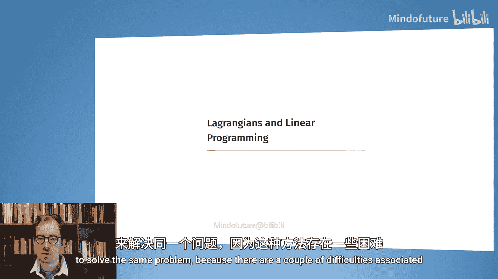
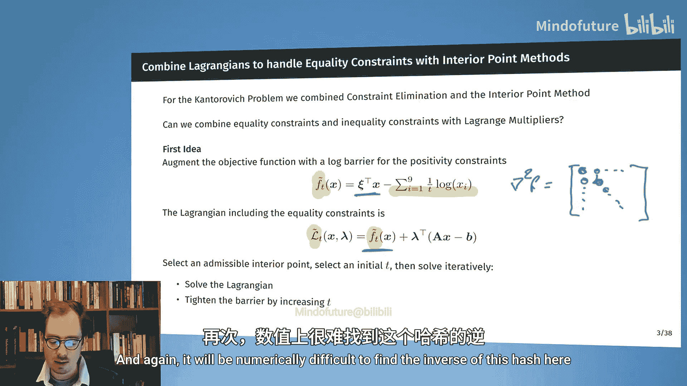
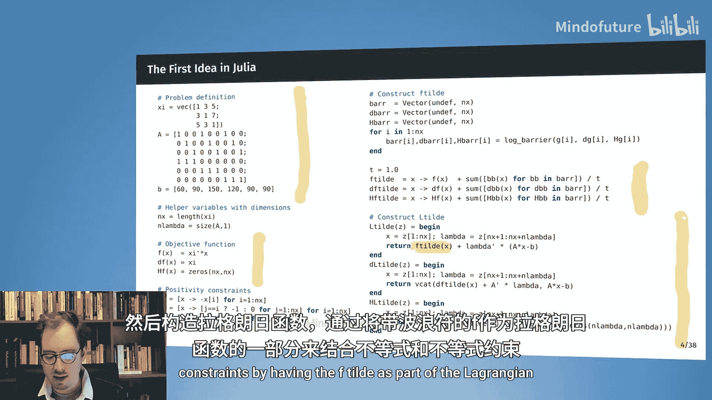
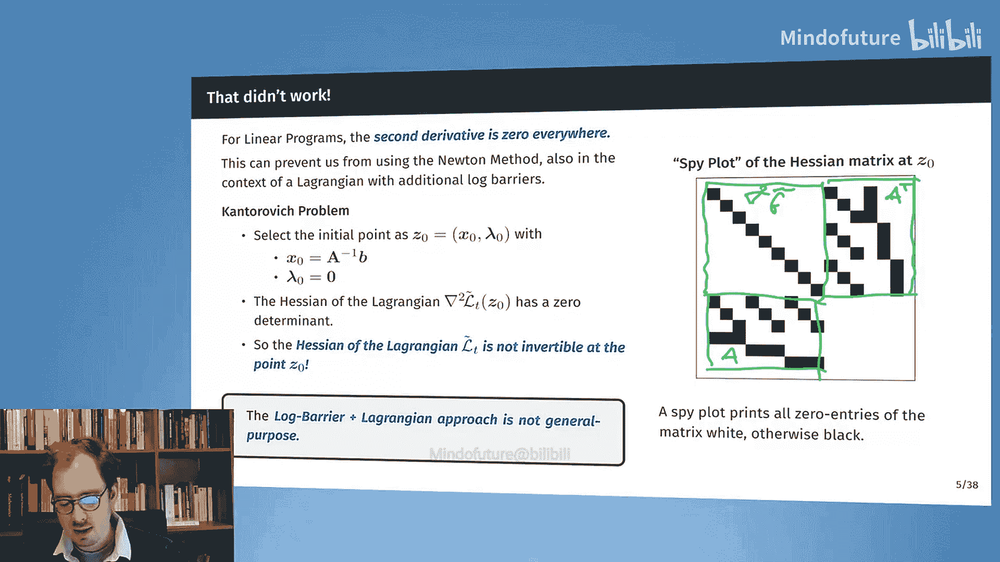
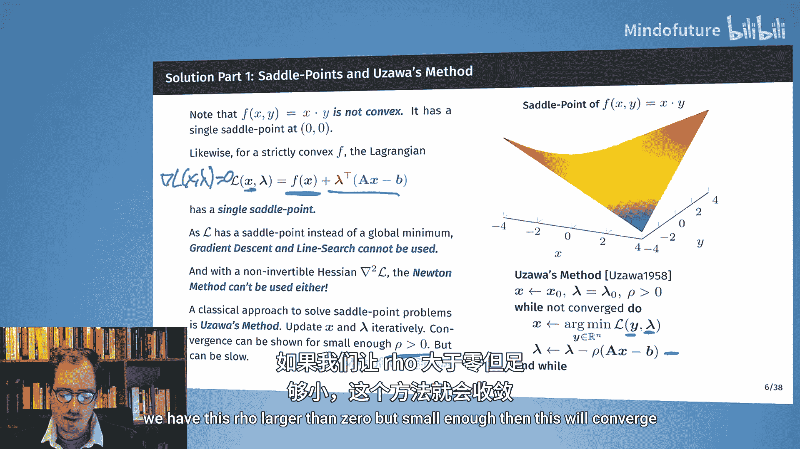
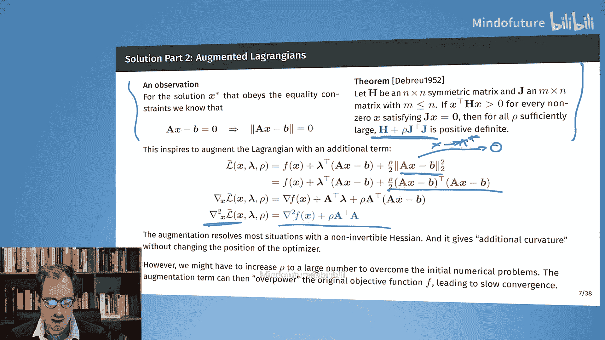
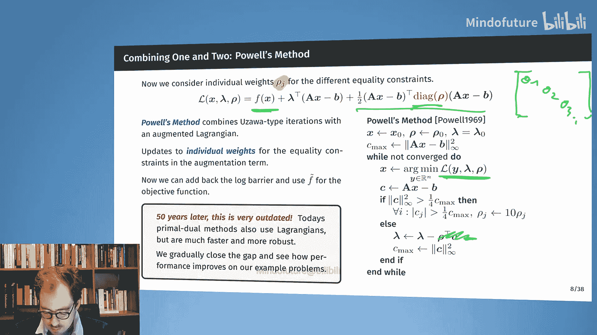
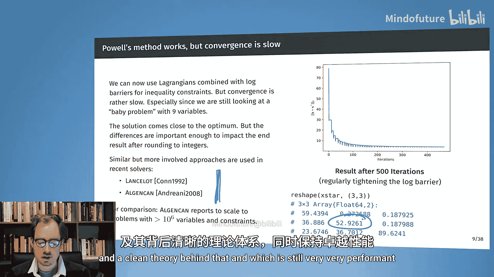

# 018：拉格朗日量与线性规划

在本节课中，我们将学习如何将拉格朗日方法应用于具有等式约束的线性规划问题，并探讨其中可能遇到的困难及其解决方案。我们还将简要介绍后续课程中将涉及的三个应用实例。

## 概述

上一节我们介绍了处理等式约束的两种方法：约束消除法和拉格朗日法。然而，当我们将拉格朗日法与处理不等式约束的内点法结合，用于求解线性规划问题时，会遇到一些数值上的困难。本节将详细分析这些困难，并介绍克服它们的关键思想，为后续学习更高效的通用求解器奠定基础。

## 拉格朗日法应用于线性规划的困难

我们曾认为，将处理等式约束的拉格朗日法与处理不等式约束的内点法结合是简单的。思路是构造一个包含原始目标函数和对数障碍函数的新目标函数 $\tilde{f}(x)$，然后将其代入拉格朗日函数 $\tilde{\mathcal{L}}(x, \lambda)$ 中，通过迭代求解并收紧障碍参数 $t$ 来逼近最优解。

然而，对于线性规划问题，这种方法存在一个根本性问题。原始目标函数 $f(x)$ 是线性的，其海森矩阵（二阶导数矩阵）处处为零：

$$
\nabla^2 f(x) = 0
$$

这意味着海森矩阵不可逆。虽然加入对数障碍项后，$\tilde{f}(x)$ 的海森矩阵在对角线上会有非零项，但当迭代点远离障碍边界时，这些项的值会非常小，导致整个拉格朗日函数的海森矩阵 $\nabla^2 \tilde{\mathcal{L}}(x, \lambda)$ 在数值上仍然接近奇异（不可逆）。这使得我们无法直接应用牛顿法等需要求逆海森矩阵的优化算法。

## 鞍点问题与优化方法

拉格朗日函数的优化目标是一个**鞍点**，而非最小值点。例如，函数 $f(x, y) = xy$ 在 $(0,0)$ 处有一个鞍点。对于凸优化问题，其拉格朗日函数存在唯一的鞍点，且该点对应原问题的最优解。理论上，牛顿法可以收敛到梯度为零的鞍点。

但由于上述海森矩阵不可逆的问题，我们无法直接使用牛顿法。因此，需要寻找替代的优化策略。

以下是解决此问题的几个关键思路：

### 1. Uzawa 方法
Uzawa 方法将联合优化问题分解为两个交替进行的步骤：
*   **第一步**：固定拉格朗日乘子 $\lambda$，仅对原始变量 $x$ 最小化拉格朗日函数 $\mathcal{L}(x, \lambda)$。由于固定 $\lambda$ 后，$\mathcal{L}$ 关于 $x$ 是严格凸的，这一步可以高效完成。
*   **第二步**：根据当前等式约束的违反程度更新拉格朗日乘子 $\lambda$。违反程度越大的约束，其对应的 $\lambda$ 分量更新幅度越大。

虽然这种方法能保证收敛，但收敛速度通常较慢。

### 2. 增广拉格朗日法
为了克服海森矩阵奇异性问题，增广拉格朗日法在标准拉格朗日函数中增加了一个惩罚项：

$$
\mathcal{L}_{\rho}(x, \lambda) = f(x) + \lambda^T (Ax - b) + \frac{\rho}{2} \|Ax - b\|^2_2
$$

其中 $\rho > 0$ 是一个惩罚参数。这一项在原问题可行解处（$Ax-b=0$）值为零，因此不改变最优解。但其二阶导数 $\rho A^TA$ 为正半定矩阵，加入到拉格朗日函数的海森矩阵中，可以使整体矩阵 $\nabla^2 \mathcal{L}_{\rho}$ 变得正定，从而可逆。

然而，如果 $\rho$ 值需要取得非常大才能保证数值稳定性，它可能会“淹没”原始目标函数 $f(x)$，导致收敛速度变慢。

### 3. Powell 方法（结合 Uzawa 与增广拉格朗日）
Powell 方法巧妙地结合了上述两种思想。它不再使用单一的标量惩罚参数 $\rho$，而是为每个等式约束分配一个独立的权重 $\rho_i$，构成一个对角矩阵 $D$。优化过程交替进行：
1.  固定 $\lambda$ 和 $D$，最小化增广拉格朗日函数 $\mathcal{L}_D(x, \lambda)$。
2.  根据约束违反情况，自适应地调整各个 $\rho_i$（增大违反严重约束的权重）。
3.  更新拉格朗日乘子 $\lambda$。

这种方法能更精细地控制不同约束的惩罚力度，避免单个大 $\rho$ 值带来的问题，提高了稳健性和效率。

## 与内点法结合及现状

我们可以将 Powell 方法中的目标函数 $f(x)$ 替换为包含对数障碍项的 $\tilde{f}(x, t)$，从而同时处理等式和不等式约束。通过迭代求解（不断增大障碍紧度参数 $t$），最终能收敛到原问题的最优解。

尽管这种结合了 Uzawa 思想、增广拉格朗日法和内点法的框架在概念上是完备的，并且是许多现代优化求解器（如 LANCELOT, IPOPT）的核心基础，但其早期版本的收敛速度可能较慢，且需要大量启发式策略来调整参数。

现代高性能求解器正是在这些基本构件之上，通过数十年的理论改进和算法工程（如更高效的线性系统求解、更好的步长选择和参数更新策略），才实现了对百万变量级别大规模问题的快速求解。在后续课程中，我们将逐步揭示这些改进是如何实现的。

## 总结

本节课我们一起学习了将拉格朗日法应用于线性规划时遇到的数值困难，即海森矩阵的奇异性问题。我们介绍了解决这一问题的三个核心思想：**Uzawa 的交替优化方法**、**增广拉格朗日法的惩罚项**，以及**结合二者的 Powell 方法**。这些方法构成了处理等式与不等式约束的通用凸优化求解器的基础框架。尽管早期方法在速度上有所不足，但它们指明了方向，现代高效求解器正是沿着这个方向，通过持续的理论与算法创新而发展起来的。