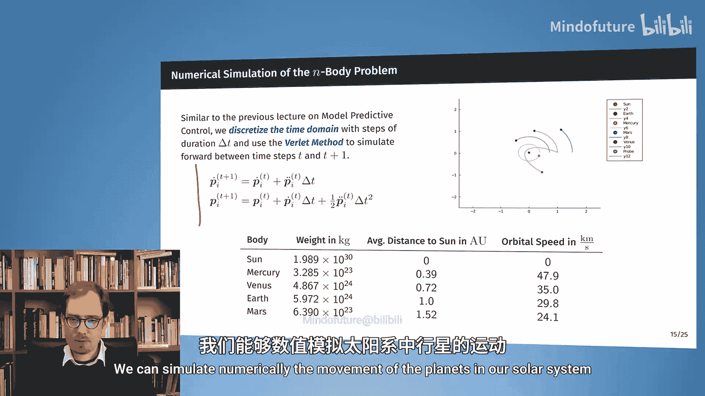
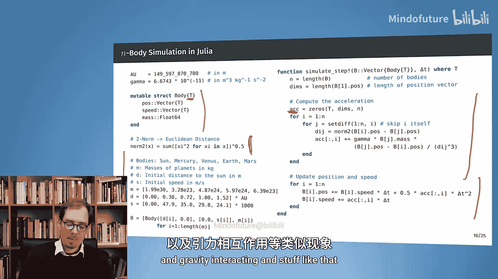

# 023：太空任务规划 🚀


在本节课中，我们将学习如何将优化方法应用于一个经典工程问题：太空任务规划。我们将模拟一个简化的场景，即从地球发射一枚火箭，使其飞掠火星，然后返回地球。通过这个过程，你将理解如何将复杂的物理系统建模为可优化的数学问题。

---

## 任务背景

上一节我们介绍了优化方法的基本概念，本节中我们来看看一个具体的应用：太空任务规划。

假设你读过或看过《火星救援》，其中一名宇航员被困火星。他能够进入火星轨道，但无法返回地球。因此，我们需要发射一枚火箭前往火星接他回家。为此，火箭需要飞掠火星，并尽可能接近火星表面而不撞击它。

为了简化问题，我们假设火箭必须降低成本，且不能在地球轨道外携带燃料。因此，火箭需要在地球轨道获得初始速度，然后进入弹道轨迹。此后，火箭将像炮弹一样运动，受到太阳系内不同行星引力的影响。我们只需设定其初始速度和方向，使其进入一条能前往火星并返回地球的弹道轨迹。同时，地球和火星也在运动，所有行星和太阳的引力都在起作用。核心问题是：**应向哪个方向发射火箭，才能成功接回宇航员？**

你的任务是设计这条轨迹。

## 历史背景与理论

在20世纪60年代，NASA的工程师们（其中许多是黑人女性，她们的贡献在电影上映时得到了认可）使用早期IBM计算机进行了类似的轨迹计算。她们使用的许多技术与我们将要使用的类似。如今，技术已大大进步，但本例中的简化方法仍然是现实且具有教育意义的。

要优化轨迹，首先需要描述行星的运动。这引出了**N体问题**：描述N个（N>2）通过引力相互作用的天体的运动。庞加莱已证明，该问题不存在封闭形式的解析解，只能进行数值近似。

描述天体运动的理论历经数百年发展：
*   哥白尼首先提出地球并非宇宙中心。
*   开普勒指出行星绕太阳的轨道是椭圆形的。
*   笛卡尔认为只有接触的物体才能相互作用，并假设存在“以太”作为行星相互作用的介质。
*   伽利略引入了所有物体都受引力加速的观点。
*   牛顿最终用万有引力定律和微积分解决了这一问题。

## 建立数学模型

现在，我们来看牛顿的万有引力理论，以及如何数值求解N体问题。

首先，我们有一组天体（行星、太阳）以及我们关心的火箭。每个天体由其质量 `m`、位置向量 `p` 和速度向量 `v` 描述。在物理学中，速度是位置对时间的导数：`v = ṗ`。

此外，我们还需要考虑加速度 `a`，它由引力产生。所有行星都会相互吸引，引力大小取决于它们之间的距离。距离通常用欧几里得范数（2-范数）`||p_i - p_j||` 计算，不考虑相对论。

两个天体之间的引力由以下公式给出：
`F_ij = G * (m_i * m_j) / ||p_i - p_j||^2`
其中 `G` 是引力常数。结合牛顿第二定律 `F = m * a`，我们可以计算出一个天体受到的加速度。

为了简化讲解和绘图，本课程仅考虑二维近似。但无论是2D向量还是3D向量，方程和代码在形式上是完全相同的。

## 数值模拟行星运动

为了数值模拟行星的运动，我们像上一讲处理现代巡航控制一样，将时间域离散化。同样，我们使用**欧拉方法**在离散时间步长间进行前向模拟。

对于所有行星（或我们考虑的子集），我们知道它们的质量、到太阳的距离、速度以及初始位置。这样，我们就可以开始数值模拟太阳系中行星的运动了。

在Julia语言中，实现如下：

```julia
# 定义运动天体的结构体
struct MovingBody{T}
    position::Vector{T}
    velocity::Vector{T}
    mass::T
end

# 定义模拟函数
function simulate_trajectory(bodies::Vector{MovingBody{T}}, dt, steps) where T
    # ... 初始化位置和速度数组 ...
    for step in 1:steps
        # 1. 计算所有天体间的引力加速度
        accelerations = compute_accelerations(bodies)
        # 2. 使用欧拉法更新每个天体的位置和速度
        for i in 1:length(bodies)
            bodies[i].velocity += accelerations[i] * dt
            bodies[i].position += bodies[i].velocity * dt
        end
        # 记录状态...
    end
    return trajectories
end
```

我们定义了一个包含位置、速度和质量的结构体 `MovingBody`。注意，这里使用了泛型类型 `T`，通常可以是 `Float64`，但之后我们可以方便地替换为**对偶数**，以便进行自动微分。



模拟函数首先遍历所有行星计算加速度，填充一个大的加速度矩阵，然后使用欧拉算法更新每个行星的位置和速度。

## 定义优化目标（损失函数）

我们不仅想模拟行星运动，还想让火箭朝正确的方向发射。为此，我们需要一个**损失函数**来评估某个发射方向的好坏。

回顾目标：首先，火箭要飞掠火星；然后，返回地球。



我们将火箭添加到模拟的天体列表中。火箭的初始位置设在地球位置附近，并带有微小偏移。其初始速度为地球速度加上一个由参数 `θ` 控制的偏移速度 `Δv`。这个 `θ`（或 `Δv`）就是我们要优化的变量。

然后，我们进行前向模拟。在模拟循环的每一步，我们记录火箭到火星的距离和火箭到地球的距离。

模拟结束后，我们得到两个数组，分别记录了每个时间步下火箭到火星和地球的距离。接着：
1.  找出火箭最接近火星的时间步。
2.  考虑所有在飞掠火星之后的时间步，找出火箭返回时最接近地球的距离。

我们最小化的损失函数由两部分组成：
*   火箭在全程中**到火星的最小距离**。
*   火箭在飞掠火星后**到地球的最小距离**。

这个目标函数是合理的，因为只有当火箭精确到达火星并随后精确返回地球时，该损失函数的值才为零。

## 利用自动微分进行优化

现在，我们有了一个以向量 `θ` 为输入、返回损失值的**目标函数**。

利用自动微分，我们可以简单地调用 `gradient(trajectory_loss, θ)` 来计算损失函数关于 `θ` 的梯度。这个梯度指明了 `θ` 应向哪个方向调整才能改进（降低）损失值。

使用前面幻灯片中的示例代码，这可以开箱即用，无需手动推导复杂的导数。

下图展示了不同 `θ` 值对应的损失函数曲面（由于我们假设了2D世界，`θ` 是二维向量，便于绘图）。可以看到，这是一个**高度非凸的函数**，甚至存在一些尖锐的峰。这些峰通常对应着火箭被某颗行星引力弹弓效应甩出太阳系的情况。

对于这种复杂的优化地形，我们可以：
1.  在 `θ` 的可能空间上使用规则网格进行密集搜索，但这在更高维空间中会非常昂贵。
2.  更有效的方法是：首先在较粗的网格上选取一些初始点，然后利用我们可用的**梯度信息**，从这些初始点出发执行**梯度下降**。这样能快速改进解的质量，并且对初始网格的精细程度不那么敏感，因为梯度下降会引导我们走向初始点附近更好的解。

在练习中，你将实现这个过程，并看到火箭飞行和行星运动的动态图表。

---

## 总结

本节课中，我们一起学习了如何将机器学习中的优化方法应用于太空任务规划这一复杂工程问题。我们首先回顾了相关的天体力学历史和N体问题，然后建立了描述行星和火箭运动的数值模型。通过定义以飞掠距离为目标的损失函数，并将火箭的发射参数作为优化变量，我们成功地将问题转化为一个数学优化问题。最后，我们探讨了如何利用自动微分计算梯度，并使用梯度下降法在这个非凸的损失函数景观中寻找最优的发射方案。通过这个实例，你看到了优化技术解决实际跨学科问题的强大能力。