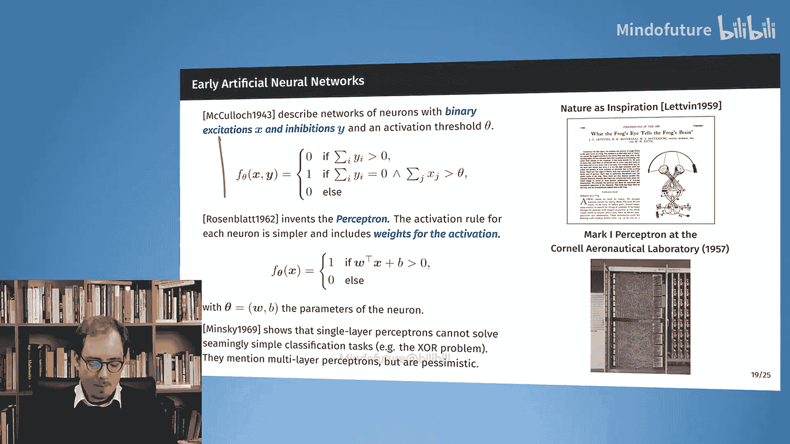

# 024：人工神经网络 🧠

在本节课中，我们将学习人工神经网络的历史、基本原理以及如何利用自动微分技术来训练它们。我们将从神经网络的生物学起源开始，逐步了解其数学模型的发展，并最终看到如何通过现代优化方法（如随机梯度下降）来高效地训练复杂的神经网络模型。

## 神经网络的历史起源

上一节我们介绍了自动微分在复杂优化问题中的应用。本节中，我们来看看人工神经网络这一重要领域是如何发展起来的。

神经网络的概念起源于自然界。对于科学界而言，最早描述神经元的是西班牙研究人员卡哈尔和戈尔季。他们发现，通过特定的染色技术，可以在显微镜下观察到神经组织和大脑中的神经元与突触。

一旦能够观察到一个现象，就可以描述它。他们是第一批能够描述神经元的人，这开启了一整个科学学科。

德国研究人员瓦尔德迈尔并未有新的发现，但他利用自己在科学界的声望，推广了卡哈尔和戈尔季的发现。他们两人在1906年共同获得了诺贝尔奖。卡哈尔关于神经元发现的诺贝尔奖演讲非常值得一读。

神经元并非独立存在，它们通过突触相互连接以传递信号。谢灵顿在19世纪末也描述了神经元放电的现象。然而，理解大脑如何学习花费了更长的时间。

我们一直知道大脑在学习。今天普遍使用的理论来自赫布，称为“赫布学习”。该理论认为“一起放电的神经元会连接在一起”。这意味着如果突触同时被激活，它们之间就有建立连接的倾向。如果突触被频繁使用，连接就会变得更加强大。赫布学习是解释人类和动物大脑如何工作和学习的生物学理论。

## 人工神经网络的早期模型

随着计算机的出现，人们开始尝试复制大脑的功能。人工神经网络在20世纪40年代由麦卡洛克和皮茨提出。

他们将每个神经元描述为一个数学函数，该函数根据接收的输入具有两种状态：0或1，即放电或不放电。

最初，他们考虑了兴奋性输入和抑制性输入。区别在于：如果任何抑制性输入是活跃的，神经元就会停止活动。对于兴奋性输入，它们需要达到一个特定的阈值（称为θ）。兴奋性输入的总和需要大于θ，神经元才会激活并再次放电。

对于麦卡洛克和皮茨而言，重要的是他们只考虑二进制信号。这里的输入X和Y是仅包含二进制输入的向量，所有值要么是0，要么是1。

大约15年后，人们发明了感知机。感知机以实数作为输入，然后构建输入的加权和（使用某个权重向量W）。同样，如果输入足够大（大于某个阈值），神经元就会激活。

这里的输入可以是实数。然而，神经元的输出是二进制的，存在一个跳跃，激活函数是离散的，输出要么是0，要么是1。

当时人们也对大脑如何与环境互动感兴趣，例如发送给肌肉的信号和从传感器接收的信号。有一篇著名的论文《青蛙的眼睛告诉青蛙的大脑什么》，麦卡洛克和皮茨也是该论文的核心作者。他们发现，青蛙的眼睛已经进行了大量的预处理，使其能够对飞过的苍蝇做出快速反应。他们发现，传输到大脑的并非原始信号，而是在眼睛之后直接发生了预处理。在当时，他们几乎被嘲笑，不得不逐个展示实验才被接受。

大约在同一时期，康奈尔大学研究感知机的人们已经构建了第一个感知机。他们使用光电二极管作为输入，接收20x20的图像（即400个像素输入）。如果你放大这张图片，会看到很多电缆，当时的一切几乎都是模拟的。他们使用电位计来改变权重等。在20世纪50年代，他们已经开始基于神经网络（当时称为感知机）进行物体检测。

## 研究的停滞与复兴

1969年，明斯基和佩珀特出版了一本书，展示了感知机的一些问题，一切研究都停滞了。

例如，感知机无法解决一些非常简单的基准问题，如异或问题。当时他们只研究单层感知机（没有隐藏层），而今天我们有深度神经网络。他们证明了这些单层感知机非常弱，无法解决一些基准问题。他们甚至对多层感知机持悲观态度。今天我们知道深度神经网络效果很好，但在当时，他们对多层感知机持悲观态度。

这基本上使神经网络的研究停滞了好几年。当时科学界也存在争论，明斯基和佩珀特属于希望进行符号人工智能研究的一派，即操作世界的符号表示，而不是亚符号的数值表示。当时他们占了上风，他们的书取得了巨大成功，人们随后摒弃了神经网络的想法，资金主要流向了符号社区的专家系统和逻辑推理系统。

## 反向传播算法与神经网络的现代化

然而，从那时起我们学到了很多，并且实现了从赫布学习（自然界的方式）到反向传播的跨越。

对于感知机，最大的挑战始终是如何训练它们。我们将在后面的讲座中看到感知机是如何训练的，但理解上的一个巨大飞跃发生在20世纪80年代，当时反向传播算法被广泛传播。人们之前就知道它，但直到80年代才被广泛传播。

反向传播算法的核心思想是将先前感知机神经网络中的阶跃函数替换为连续函数。

对于感知机，输出是0或1，因此这里有一个阶跃函数。显然，阶跃函数是不可微的。一个突破性的想法是使用Sigmoid函数来代替阶跃函数。

这里定义的Sigmoid函数是一个可微函数。通过缩放Sigmoid函数，我们可以使其看起来非常接近阶跃函数，但它仍然是可微的。这与对数障碍法的思想类似，我们也可以缩放对数障碍，使其越来越接近指示函数。这里我们是在近似阶跃函数，从0跳到1。通过缩放，我们可以定义逼近阶跃函数的程度。

有了Sigmoid激活函数，我们可以得到可微的神经元，然后将神经元耦合起来形成一个更大的神经网络。

这里我们看到一个神经网络，有绿色的输入层，蓝色的隐藏层（“隐藏”意味着它不直接与输入或输出连接），以及一个输出层。显然，我们还可以有更多的隐藏层。

我们假设网络是全连接的，这意味着层之间的所有节点都相互连接，并且有一个权重因子来描述这里的连接。

这可以通过矩阵乘法来描述。如果我想从绿色输入计算隐藏层接收到的信号，我只需要将输入向量X乘以一个大矩阵W，该矩阵代表了全连接层中的所有连接。除此之外，我们还在上面加上一些偏置。你可以将其视为神经元的默认状态，或者神经元最终激活需要多少“说服”。

因此，第一个隐藏层的输出就是输入乘以我们的大矩阵再加上向量，然后将整个结果送入Sigmoid函数。这里的粗体Sigmoid函数表示对每个元素应用Sigmoid，因此这里也会返回一个相同维度的向量。

然后，我们可以对第二层重复这个过程，再次乘以代表全连接的大矩阵，然后再加上另一个向量。这里的B2将只是一个单元素向量。

这就是全部原理。这些就是神经网络。还有不同的激活函数，不仅仅是Sigmoid，也可以使用其他函数。但基本上，神经网络是一个大型数学函数，它将输入（可能是高维的）映射到输出（输出也可能是多维的）。例如，在分类问题中，如果我想要不同类别的概率，那么我可以有多个输出神经元，每个输出神经元代表检测到某个类别的概率。

## 神经网络的训练与损失函数

现在我们有了一个大型数学函数，我们想用它进行回归或分类。为了训练，我们还需要一个损失函数。

这里的符号与第一和第二讲中的符号完全相同。我们有一个模型，该模型依赖于参数向量θ。在我们的例子中，参数向量包含定义神经网络突触的所有矩阵和向量。这个模型参数向量可能非常大，根据我们考虑的矩阵维度，其中可能有数百万个参数。

我们有一个仅依赖于这个参数向量的模型。现在我们迭代数据，并计算数据集中每个元素产生的损失，这就是损失函数。为了优化模型参数，我们希望对损失函数关于模型参数的梯度进行梯度下降步骤。

这里我们有损失函数，我们计算损失函数关于模型参数的导数，得到一个非常高维的梯度，然后我们沿着这个非常高维梯度的负方向前进一步。

在神经网络中，你可能听说过著名的反向传播算法。反向传播算法实际上归结为就是自动微分。

我们今天所做的就是，当遇到神经网络时，或者在TensorFlow中拥有神经网络的图表示时，我们将使用反向模式自动微分来获得关于模型参数的梯度。然后我们反复进行梯度下降步骤，随着时间的推移改进模型参数，以获得训练良好的模型，使其能够执行我们要求的分类任务。

长话短说，从20世纪40年代到今天，我们有很多历史，将近80年。今天我们可以将其归结为一些非常简单的东西，实际上可以放在一张幻灯片上，我们稍后会看到。

## 随机梯度下降与优化技巧

但我们需要更多的技巧，其中最重要的一个叫做随机梯度下降。

对于火箭轨迹的优化，我们可以进行网格搜索，然后通过额外的梯度下降来改进网格搜索的解决方案。

对于神经网络，这将复杂得多。因为当我们有数百万个参数，并且处于一个百万维空间时，我们完全无法进行网格搜索。我们正在优化一个非常非凸的函数，这会带来问题。在如此高度非凸的函数中，我们很快就会陷入一个不太好的解。

我们将进行梯度下降步骤，最终陷入局部最小值或梯度为零的鞍点。多年来，人们尝试过并陷入局部最小值，无法取得很好的效果。

这里我们看到最近一篇出版物中典型神经网络损失函数的图。这是投影到3D空间以便绘制，但即使在3D空间中，你也能看到它是高度非凸的，有许多峰和谷，并且有一个非常尖锐的最小值。如果我们从一个稍微不同的随机初始点开始，可能会错过这个尖锐的最小值，因此我们需要应用很多技巧来找到它。

二阶方法也不是很有帮助。因为牛顿法寻找驻点，它喜欢接近驻点，但我们想逃离鞍点。我们想找到最小值，而我们有许多不感兴趣的鞍点。此外，牛顿法要求我们计算海森矩阵，当我们有百万个模型参数时，海森矩阵将有一百万乘以一百万个条目，使用二阶方法在计算上不可行或不经济。

但有改进的方法，可以找到更好的解决方案，同时避免过拟合。神经网络中的过拟合是一个大问题，因为如果我们的模型中有数百万个参数，在某些情况下，我们可能只是死记硬背训练数据。然后，就像一个鹦鹉学舌重复句子而不理解一样，神经网络可能只是在训练数据上重复一个学到的答案，而没有真正泛化。因此，过拟合也是神经网络中的一个问题，但有些技术同时帮助我们找到更好的解决方案（获得更低的损失）并避免过拟合。

最重要的一个技术叫做随机梯度下降。

在随机梯度下降中，我们在训练步骤的迭代之间随机改变损失函数。我们多次重复训练，每次考虑一个稍微不同的损失函数，通过依赖训练数据的不同子集来实现，这些子集称为小批量。

SGD算法在右侧列出。它接收神经网络（或一般形式的模型）、训练数据、一些初始模型参数化、学习率η、批量大小B以及我们想要使用的训练迭代次数K作为输入。

然后，在每次迭代中，我们从训练数据中随机选择一个大小为B的子集，并用它来计算梯度。显然，梯度取决于我使用的训练数据，每次我选择不同的元素集合，因此在我的梯度上得到扰动或随机变化。但在期望上，我仍然会得到正确的损失函数。

这帮助我跳出局部最小值，绕过鞍点。我就像在这个损失函数中蜿蜒前进，越来越接近一个好的解。

这就是随机梯度下降。此外还有其他技巧，例如，即使没有海森矩阵，我也可以改进简单的梯度下降，可以考虑一种叫做“动量”的方法。这里我们也遇到了涅斯捷罗夫，这位著名的学者改进了内点法中的障碍方法。事实证明，同样的涅斯捷罗夫对于神经网络也极具影响力和重要性，通过他的梯度下降动量或结合梯度下降的思想。

最后但同样重要的是“丢弃法”，通过随机禁用一些神经元，我也可以从一个训练迭代到下一个改变拓扑结构或损失函数，这也有助于我收敛和避免过拟合。

## 神经网络的应用与实现

解释了很多，但我们能用这个做什么呢？我们可以近似连续的数学函数，也可以做更有趣的事情，例如检测图像上的手写字符。这是Yann LeCun在80年代还在美国AT&T工作时进行的一项著名应用。他们提出了卷积神经网络的想法。我们今天不深入细节。但这减少了处理图像数据时所需的模型参数数量。今天，Yann LeCun创建的MNIST数据集基本上已经解决了。以今天的计算机，解决MNIST任务没有太大困难。

一个完整的光学字符识别引擎需要更多的工作，因为我首先需要知道字符在哪里，然后才能分类，首先必须围绕每个字符绘制边界。但使用神经网络识别字符，就像是这样一个光学字符识别引擎内部5%的工作。有不同的方法可以不使用神经网络，但这种方法被证明非常成功。实际上，在练习中，我们打算仅使用自动微分技术从头开始构建一个MNIST求解器。

首先，让我们看看如何将神经网络与自动微分结合使用。首先我们定义一些需要的额外函数，这里是Sigmoid函数和Softmax函数。Softmax函数对于用神经网络训练分类器很重要，我们将在练习中看到更多细节，因为这里已经讲得够长了。

然后我们有一个神经网络。这里可能50行代码。这就是可以用来分类MNIST字符的整个神经网络。

这里的输入是我们的参数向量θ（包含神经网络的所有参数）以及图像。这个图像是一个20x28的矩阵，但我们将其重塑为一个向量。θ向量也被重塑。首先，我们从θ中提取第一个矩阵W1（根据公式）以及向量B1，然后我们可以定义第一层的数学函数。我们对第二层和第三层也这样做，然后将它们一个接一个地组合起来。在这大约50行代码中，我定义了一个神经网络。这是一个相当简单的全连接神经网络，但这是一个功能完整的神经网络，实际上足以在一定程度上解决MNIST分类任务。

现在很酷的是，我可以直接使用自动微分来获得我的神经网络和损失函数关于模型参数的梯度，用于随机梯度下降训练，以改进参数。你在这张幻灯片上看到的，包括加载MNIST数据，足以解决MNIST问题。这向你展示了自动微分的一些威力，它简化了很多工作，并且允许我们对整个算法进行微分。

如果我有一个非常复杂的模拟，可能无法在数学上定义导数，但有了自动微分，我甚至不需要更改代码，我可以直接使用对偶数来获得梯度。

## 总结

本节课中我们一起学习了以下内容：

*   我们看到了自动微分，以及如何在不进行数学推导的情况下获得导数，以及如何通过运算符重载来实现它。我们在Julia语言中看到了这一点，它在C++中同样有效，Python中也有提供此功能的包。
*   然而，使用对偶数时，如果我们要微分的算法中有复杂的控制流，我们必须小心，因为在条件分支中可能存在实际上没有导数的情况，但根据我们在控制流中采取的实际路径，对偶数无论如何都会给出一个导数。
*   然后，我们使用自动微分来优化两个高度非凸函数的例子，并且不得不引入额外的技巧来获得好的解。
    *   对于往返火星的空间任务规划，我们必须进行领域网格扫描，然后基于这些初始起点进行梯度下降。
    *   对于神经网络的另一个想法是使用随机梯度下降，即随机扰动我们的目标函数（损失函数），以绕过鞍点和逃离局部最小值。
*   我们看到，反向传播或神经网络的训练算法实际上只是反向模式自动微分的应用。

希望你能相信，如果你未来从事机器学习工作，或者留在工程领域，这将为你的工具箱增加一些非常有用的东西，因为它消除了对数学导数的需求，而我们常常要么没有它们，要么有点懒惰。现在我们可以推导任何算法，只需要对边缘情况稍微小心一点。

本节课到此结束，下周第七讲我们将学习向量空间，到时见。

