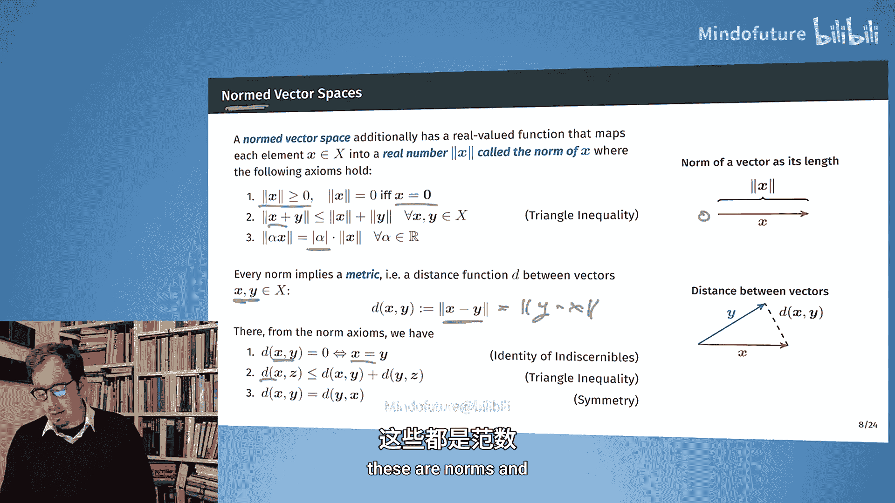
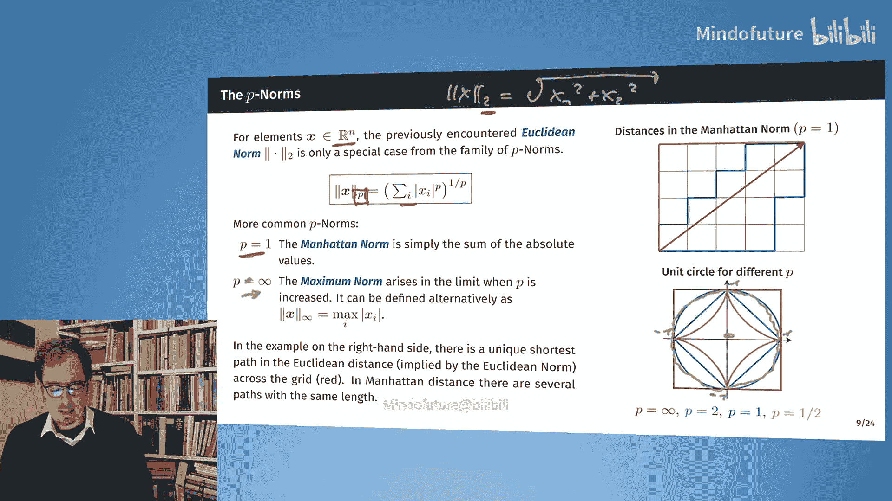

# 026：范数与巴拿赫空间 🧮

在本节课中，我们将学习向量空间中的一个核心概念——范数，并由此引出更完整的数学结构——巴拿赫空间。我们将了解如何定义向量间的“距离”，以及这种结构如何为优化算法的收敛性提供理论基础。

## 范数：定义与性质

上一节我们介绍了向量空间的基本概念。本节中，我们来看看如何为向量空间引入“长度”或“距离”的概念，这通过定义**范数**来实现。

一个**赋范向量空间**本质上是一个向量空间，并额外配备了一个实值函数，该函数将每个向量映射到一个实数，我们称之为范数。范数必须满足以下三条公理：

1.  **非负性**：对于任意向量 **x**，其范数 **\|x\| ≥ 0**，且 **\|x\| = 0** 当且仅当 **x** 是零向量。
2.  **三角不等式**：对于任意向量 **x** 和 **y**，有 **\|x + y\| ≤ \|x\| + \|y\|**。
3.  **齐次性**：对于任意标量 **α** 和向量 **x**，有 **\|αx\| = |α| \|x\|**。

一旦定义了范数，它自然导出一个距离函数。对于两个向量 **x** 和 **y**，它们之间的距离可以定义为 **d(x, y) = \|x - y\|**。这个距离函数同样满足非负性、对称性和三角不等式。

## 常见的范数示例

以下是几种在 **R^m** 空间中常见的范数，它们都属于 **p-范数** 家族：

*   **曼哈顿范数 (p=1)**：向量的各分量绝对值之和。`\|x\|_1 = |x_1| + |x_2| + ... + |x_m|`
*   **欧几里得范数 (p=2)**：我们熟悉的向量长度。`\|x\|_2 = sqrt(x_1^2 + x_2^2 + ... + x_m^2)`
*   **最大值范数 (p→∞)**：向量分量中绝对值的最大值。`\|x\|_∞ = max(|x_1|, |x_2|, ..., |x_m|)`

不同p值对应的“单位圆”（即所有满足 \|x\|_p = 1 的点构成的集合）形状各异。例如，p=2时是标准的圆形，p=1时是菱形，p→∞时是正方形。这说明了范数的选择是一种设计决策，但后续在赋范空间中发展的理论结果通常独立于具体的范数选择。

## 序列收敛与柯西序列

有了距离的概念，我们就可以严格定义序列的**收敛**。设 {x_n} 是赋范空间 X 中的一个序列。我们说该序列收敛于极限 y，如果当 n 趋于无穷时，距离 **\|x_n - y\|** 趋于 0。更精确地说，对于任意小的正数 ε，总存在一个索引 N，使得对于所有 n > N，都有 **\|x_n - y\| < ε**。

与收敛紧密相关的另一个概念是**柯西序列**。一个序列 {x_n} 被称为柯西序列，如果对于任意小的正数 ε，总存在一个索引 N，使得对于所有 m, n > N，都有 **\|x_m - x_n\| < ε**。直观上，这意味着序列中的项彼此之间越来越接近。在赋范空间中，每个收敛序列必然是柯西序列。

## 完备性与巴拿赫空间

并非所有柯西序列都收敛。如果一个赋范空间 X 中的**每一个**柯西序列，其极限点也都在 X 内，那么我们称这个空间是**完备的**。一个完备的赋范向量空间就称为**巴拿赫空间**。

让我们看一个不完备空间的例子：考虑定义在区间 [0,1] 上的连续函数空间 C[0,1]，并赋予最大范数 \|f\| = max_{t in [0,1]} |f(t)|。我们可以构造一个连续函数序列 {f_n}，它们逐渐逼近一个阶梯函数。这个序列是一个柯西序列，但其极限（阶梯函数）不是连续函数，因此不在原空间 C[0,1] 中。所以，C[0,1] 在这个范数下不是巴拿赫空间。

## 为什么完备性重要？压缩映射原理

完备性（即成为巴拿赫空间）是许多优化算法收敛性证明的关键前提。一个核心工具是**巴拿赫不动点定理**（或称压缩映射原理）。

设 S 是巴拿赫空间 X 的一个子集，映射 **F: S → S** 是一个**压缩映射**，即存在常数 α ∈ [0, 1)，使得对于所有 x, y ∈ S，有：
`\|F(x) - F(y)\| ≤ α \|x - y\|`

该定理指出：如果 F 是一个压缩映射，那么它在 S 内存在**唯一的不动点 x***（即满足 F(x*) = x* 的点）。并且，从任意起点 x_0 ∈ S 开始，通过迭代公式 **x_{k+1} = F(x_k)** 生成的序列都将收敛到这个不动点 x*。

在优化算法的语境下（如梯度下降法），我们可以将迭代更新步骤视为一个映射 F。证明该算法收敛到最优解，常常需要证明在最优解附近，这个映射 F 满足压缩映射的条件，并且解空间具有完备性。幸运的是，我们通常处理的有限维空间 **R^m** 在任何范数下都是完备的（即巴拿赫空间），因此我们无需额外证明这一点，可以直接应用相关理论。

## 总结

本节课中我们一起学习了：
1.  **范数**的定义及其三条公理，它为我们提供了衡量向量“长度”和“距离”的工具。
2.  常见的**p-范数**家族，包括曼哈顿范数、欧几里得范数和最大值范数。
3.  序列**收敛**和**柯西序列**的严格数学定义。
4.  **完备性**的概念以及**巴拿赫空间**（完备的赋范空间）的定义。
5.  完备性的重要性，特别是通过**巴拿赫不动点定理**（压缩映射原理），它为迭代优化算法（如梯度下降）的收敛性提供了理论基础。对于有限维空间，完备性是自动满足的。