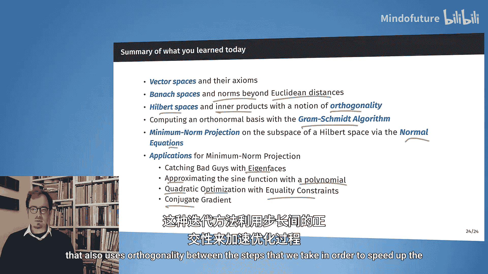
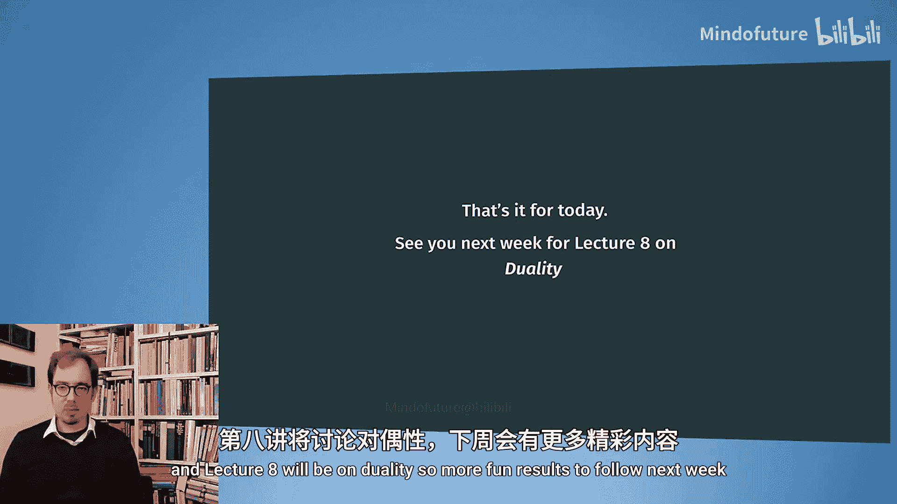

# 028：投影应用

在本节课中，我们将学习如何利用最小范数投影来解决一系列实际问题。我们将看到，投影的概念不仅适用于几何向量空间，还能应用于函数空间和优化问题，为解决复杂挑战提供了强大的工具。

## 从特征脸到罪犯识别

上一节我们介绍了如何计算最小距离和投影。现在，我们来看看第一个应用实例：特征脸。

特征脸是一种历史悠久的计算机视觉技术，用于人脸识别。其核心思想是将人脸图像投影到一个由“特征脸”张成的低维子空间上，从而用少量系数描述一张人脸。

以下是其工作原理：
1.  首先，从大量人脸图像中计算出一张“平均脸”。
2.  通过特征分解等方法，得到一组“特征脸”（E1, E2, ...），它们构成了一个正交基。
3.  对于任何新人脸图像，先减去平均脸，然后将其投影到特征脸张成的子空间上。
4.  投影得到的系数向量（例如100维）就是该人脸的紧凑描述符。

通过比较数据库中所有人脸描述符与新输入人脸的描述符（例如使用最近邻查找），可以快速判断该人是否已在数据库中存在。尽管如今有更先进的方法，但特征脸清晰地展示了如何在高维向量空间（如图像像素空间）中利用投影进行高效计算。

## 用多项式逼近正弦函数

现在，让我们切换视角，看一个通过设计内积来解决优化问题的例子：用多项式函数逼近正弦函数。

计算机直接计算正弦函数可能耗时且不精确。我们的目标是找到一个多项式，使其在某种度量下尽可能接近正弦函数。我们定义函数空间 **H** 为区间 [0, 1] 上所有满足 ∫₀¹ f(t)² dt < ∞ 的连续函数。在该空间上定义内积为：
`<f, g> = ∫₀¹ f(t)g(t) dt`
对应的范数为 `||f|| = sqrt(<f, f>)`。

正弦函数 `g(t) = sin(πt)` 是 **H** 的一个元素。同时，所有最高 `n` 次的多项式构成了 **H** 的一个子空间 **P_n**。我们的问题转化为：在子空间 **P_n** 中，找到在给定范数下最接近 `g(t)` 的多项式 `f_n`。这本质上就是函数 `g` 到子空间 **P_n` 的投影。

通过选择多项式基（如 `1, t, t², ...`），利用格拉姆-施密特正交化获得正交基，再求解法方程，即可得到最佳逼近多项式的系数。有趣的是，许多计算机数学库中的 `sin` 函数内部正是通过类似方法计算的多项式来逼近的。

## 带等式约束的二次优化

接下来，我们看一个更接近传统优化问题的例子，并展示如何用投影得到闭式解。

考虑以下优化问题：
最小化 `xᵀQx`
约束条件为 `Ax = b`
其中 `Q` 是一个正定矩阵。

首先，等式约束 `Ax = b` 定义了一个线性簇 **V**。其次，目标函数 `xᵀQx` 定义了一个内积 `<x, y>_Q = xᵀQy` 及其对应的范数 `||x||_Q = sqrt(xᵀQx)`。

于是，原优化问题可以重新表述为：在线性簇 **V** 中，找到在 `||·||_Q` 范数下最接近零向量的点 `x*`。

求解步骤如下：
1.  找到任意一个满足 `Ax = b` 的点 `v`。
2.  找到矩阵 `A` 的零空间 `N(A)`，它张成的子空间 **H** 是线性簇 **V` 平移过原点的版本。
3.  在由内积 `<·,·>_Q` 定义的 **H** 空间中，计算向量 `v` 到 **H** 的投影 `h`。
4.  最优解为 `x* = v - h`。

这种方法为这类特殊的二次规划问题提供了闭式解，无需使用梯度下降等迭代方法。一个经典应用是“门海”芯片的布局设计，即在满足输入/输出端口位置约束下，最小化晶体管间连线的总长度（或能量），这正好符合上述问题形式。

## 共轭梯度法

最后，我们简要介绍共轭梯度法，它是一种利用正交性来加速优化的迭代算法。

在标准梯度下降中，搜索方向（负梯度）可能产生“之”字形路径。共轭梯度法在每一步对梯度进行修正，使其与之前所有搜索方向关于 `Q` 内积正交（共轭）。这样，在 `n` 维空间中，对于二次优化问题，最多只需 `n` 步即可收敛到精确解。

虽然牛顿法一步即可解决二次问题，但需要计算并求逆海森矩阵。共轭梯度法避免了这一开销，并且对于非二次问题也常常表现良好。其核心思想正是利用了在由问题结构定义的内积空间中的正交性。

## 总结

本节课我们一起学习了向量空间、范数、巴拿赫空间和希尔伯特空间的核心概念。重点掌握了如何利用内积定义的正交性，通过格拉姆-施密特算法和法方程来计算最小范数投影。

我们看到了投影的多种应用：
*   在图像空间中进行人脸识别（特征脸）。
*   在函数空间中用多项式逼近复杂函数（逼近正弦函数）。
*   求解带等式约束的二次优化问题，并获得闭式解。
*   构建更高效的优化算法（共轭梯度法）。

这些例子表明，投影是一个基础而强大的工具，能够将高维问题简化、将复杂函数近似，并为特定优化问题提供优雅的解决方案。