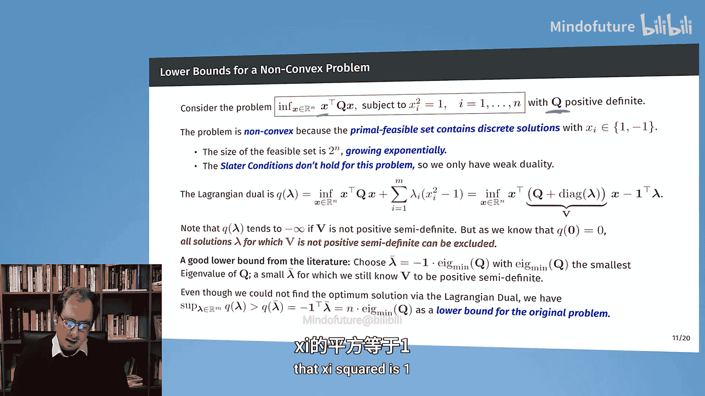

# 029：拉格朗日对偶性 🧩

在本节课中，我们将要学习优化理论中的一个核心概念——对偶性。我们将从拉格朗日对偶性入手，探讨其对偶问题、强弱对偶性，并通过实例理解其对优化问题的帮助。

## 课程概述

对偶性通常用于描述一个具有两种等价表示形式的对象，并且可以在两种表示之间转换而不丢失关键信息。在优化领域，计算一个优化问题的对偶问题，可以得到原问题解的一个下界，这有助于我们评估解的质量、实现提前终止，甚至通过暴露额外的结构实现降维和加速收敛。

上一节我们介绍了优化问题的基本形式，本节中我们来看看如何利用对偶性来分析和求解这些问题。

## 拉格朗日对偶性

拉格朗日对偶性是优化中一种特定的对偶性。为了深入理解，我们将从博弈论的角度来构建这个概念，这能提供一些独特的见解。

博弈论由约翰·冯·诺依曼创立。他关于极小极大定理曾言：“就我所见，没有这个定理就不可能有博弈论。我认为在极小极大定理被证明之前，没有什么值得发表的。” 这一定理在优化中也至关重要。

让我们从第一个等式开始，即**极小极大不等式**：
对于函数 ψ: X × Y → ℝ，有：
`sup_{y∈Y} inf_{x∈X} ψ(x, y) ≤ inf_{x∈X} sup_{y∈Y} ψ(x, y)`

这里，上确界 `sup` 和下确界 `inf` 分别是最大值 `max` 和最小值 `min` 算子的推广，关键区别在于 `inf` 和 `sup` 可以包含趋于极限的值。这个不等式总是成立。

然而，冯·诺依曼发现，如果集合 X 和 Y 是**紧致**（闭且有界）且**凸**的，并且函数 ψ 关于 x 是凸的、关于 y 是凹的，那么上述不等式变为等式，即**极小极大定理**成立。此时我们可以使用 `max` 和 `min`。

这可以理解为一个**两人零和博弈**。玩家 X 希望最小化 ψ，玩家 Y 希望最大化 ψ。不等式左边相当于玩家 Y 先行动，右边相当于玩家 X 先行动。定理表明，在所述条件下，行动顺序不影响最终结果，即存在一个**鞍点**。

## 从博弈到优化

现在，我们将视角转回优化。考虑一个带等式约束的优化问题：
`inf_{x∈ℝ^n} f(x) subject to c(x) = 0`

我们可以定义一个**示性函数** `I_X(x)`，当 x 在可行集 X 内时为 0，否则为 +∞。这样，原约束问题可以等价写为无约束问题：`inf_{x∈ℝ^n} f(x) + I_X(x)`。

一个关键的洞见是，我们可以用另一个表达式替换这个示性函数：
`I_X(x) = sup_{y} y^T c(x)`
因为如果 `c(x) ≠ 0`，通过选择 y 可以使上确界趋于 +∞；如果 `c(x) = 0`，则该项为 0。因此，原优化问题等价于：
`inf_{x∈ℝ^n} sup_{y} [ f(x) + y^T c(x) ]`

当约束为线性 `Ax - b = 0` 时，这个形式就变成了我们熟悉的**拉格朗日函数** `L(x, λ) = f(x) + λ^T (Ax - b)`。寻找原问题的最优解等价于寻找该拉格朗日函数的鞍点。

## 对偶问题与强弱对偶

基于极小极大不等式，我们可以交换 `inf` 和 `sup` 的顺序，从而定义**拉格朗日对偶问题**：
`sup_{λ} inf_{x} L(x, λ) = sup_{λ} q(λ)`
其中 `q(λ)` 称为**对偶函数**。λ 被称为**对偶变量**或拉格朗日乘子。

根据极小极大不等式，对于任意 x 和 λ，有：
`q(λ) ≤ f(x)`
这意味着对偶函数的值总是原问题目标值的一个**下界**。这被称为**弱对偶性**。原问题最优值 `p*` 与对偶问题最优值 `d*` 之间的差 `p* - d*` 称为**对偶间隙**。

如果对偶间隙为零，即 `p* = d*`，则称**强对偶性**成立。强对偶成立时，我们可以通过对偶问题来求解原问题。

那么，何时强对偶成立呢？**斯莱特条件**给出了一个充分条件：如果原问题是凸问题（即 `f(x)` 凸，可行域 X 凸），并且存在一个严格可行的内点（即存在 x 使得所有约束在不等式情况下严格成立），则强对偶成立。

## 应用实例

以下是两个应用对偶性的例子：

**例1：二次规划（强对偶）**
考虑问题：`min_x (1/2) x^T x subject to Ax = b`
其拉格朗日函数为 `L(x, λ) = (1/2) x^T x + λ^T (Ax - b)`。
1.  首先求解对偶函数 `q(λ) = inf_x L(x, λ)`。通过令梯度 ∇_x L = 0，得到 `x* = -A^T λ`。
2.  代入 `q(λ)`，得到 `q(λ) = -(1/2) λ^T A A^T λ - b^T λ`。这是一个关于 λ 的凹函数。
3.  求解对偶问题 `max_λ q(λ)`，再次令梯度为零，得到 `λ* = -(A A^T)^{-1} b`。
4.  由于问题是凸的且满足斯莱特条件，强对偶成立。将 `λ*` 代回 `x*` 的表达式，即可得到原问题的最优解 `x* = A^T (A A^T)^{-1} b`。对偶性帮助我们得到了闭式解。

**例2：二元二次规划（弱对偶）**
考虑问题：`min_x x^T Q x subject to x_i^2 = 1, for all i`，其中 Q 正定。
约束 `x_i = ±1` 使得可行域是一个离散的超立方体顶点集，有 2^n 个点。这不是一个凸集。
1.  写出拉格朗日函数：`L(x, λ) = x^T Q x + Σ_i λ_i (x_i^2 - 1)`。
2.  可以重写为 `L(x, λ) = x^T (Q + diag(λ)) x - 1^T λ`。
3.  对偶函数 `q(λ) = inf_x L(x, λ)`。为了 `q(λ)` 不趋于负无穷，需要矩阵 `V = Q + diag(λ)` 保持正定。
4.  一种常见的选择是令 `λ = -λ_min(Q) * 1`，其中 `λ_min(Q)` 是 Q 的最小特征值。这样可以保证 V 正定。
5.  此时，`q(λ) = n * λ_min(Q)`。这给出了原问题最优值的一个**下界**。虽然只有弱对偶，但这个下界对于指导启发式算法（如搜索离散解）和判断终止条件非常有价值。

## 总结

本节课中我们一起学习了拉格朗日对偶性的核心内容。我们从博弈论的极小极大定理出发，推导出拉格朗日函数及其对偶问题。我们理解了**弱对偶性**总是成立，而对偶间隙提供了原问题解的下界。在满足凸性和斯莱特条件时，**强对偶性**成立，使得我们可以通过对偶问题高效求解原问题。最后，通过两个例子，我们看到了对偶性在获得闭式解和为困难问题提供下界方面的实际应用。对偶性是理解优化问题结构和设计高效算法的重要工具。