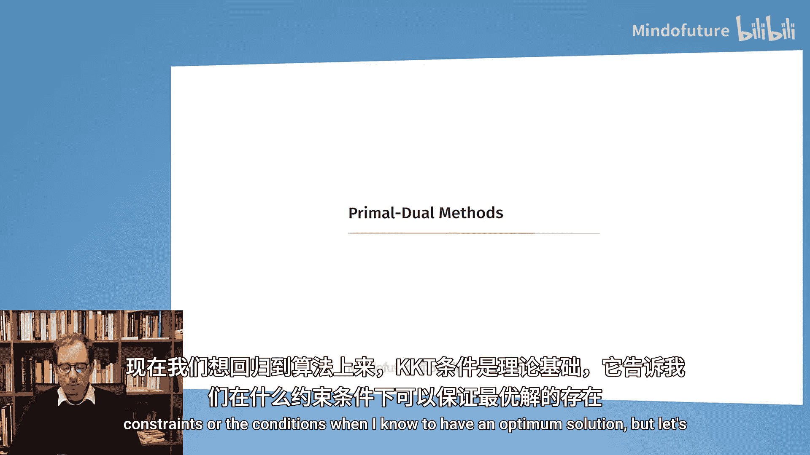
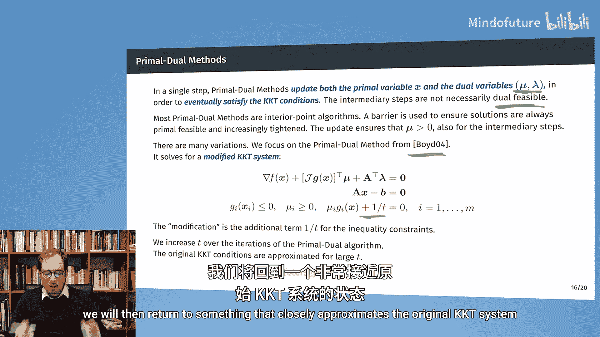
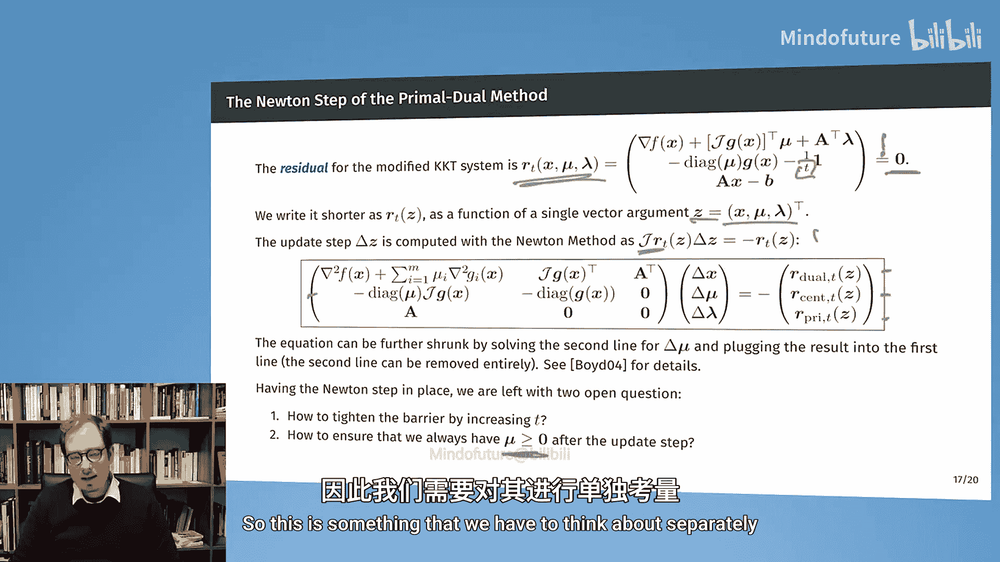
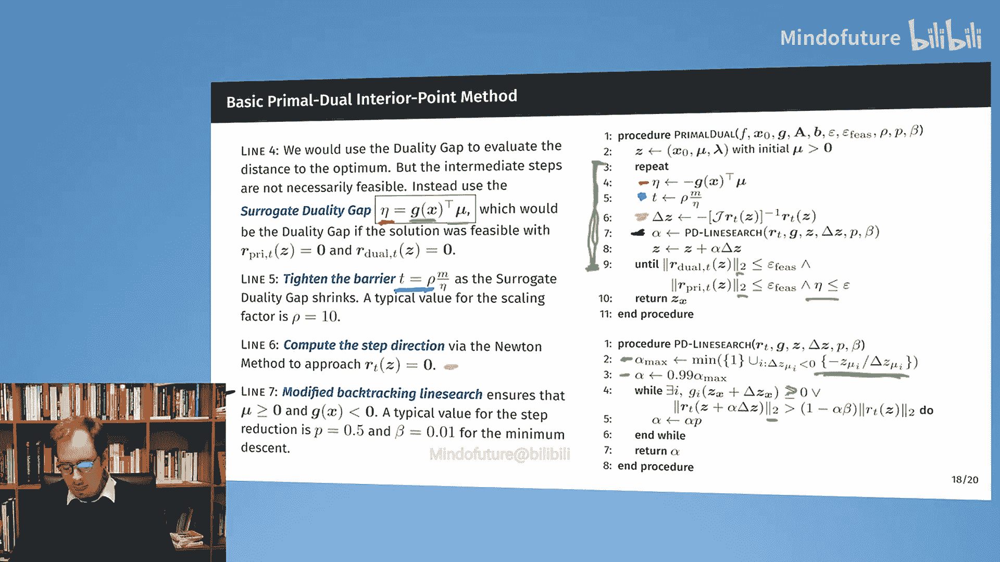
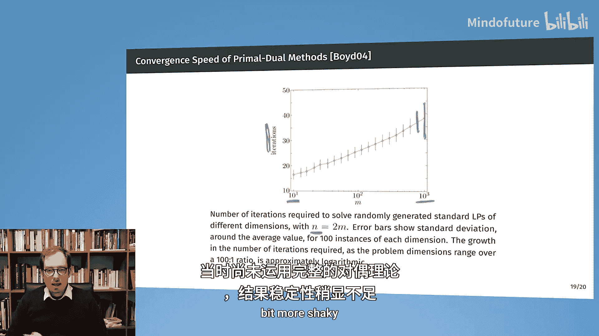
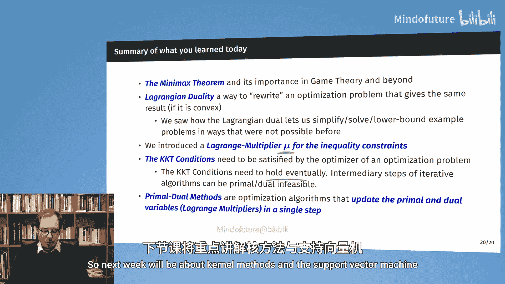

# 031：原始-对偶方法 🧮

在本节课中，我们将学习原始-对偶方法。这是一种用于求解优化问题的迭代算法，它同时更新原始变量和对偶变量，旨在高效地逼近KKT条件所描述的最优解。

## 理论回顾与算法动机

上一节我们介绍了KKT条件，它从理论上描述了最优解需要满足的约束条件。现在，我们希望基于此理论来构建可计算的算法。

原始-对偶方法基于我们之前见过的拉格朗日函数（包含拉格朗日乘子λ和μ）进行运算。它在单一步骤中同时更新原始变量和对偶变量（μ和λ）。这是一个迭代算法，最终将收敛到满足KKT条件的解。然而，其迭代的中间步骤不一定是对偶可行的。

之前我们看到的算法是交替进行的：先优化x，再优化λ。而原始-对偶方法在一步中完成所有更新，这将对我们的运行时间产生非常积极的影响。

## 修改的KKT系统与牛顿法应用

存在多种原始-对偶算法，这里我们采用Boyd著作中介绍的一种特定方法。该方法求解一个经过修改的KKT系统。

在这个修改的系统中，我们引入了一个额外的项 **1/T**。这个项的作用类似于我们在第一个内点法中看到的障碍函数。这里的T会随着时间推移而增大，当T非常大时，修改后的系统将非常接近原始的KKT系统。

现在，我们进入所谓的“残差世界”。对于当前解，残差描述了它与求解这个修改后KKT系统的接近程度。我们希望这个残差达到零。这可以描述为一个求根问题，对此我们可以应用牛顿法。

我们应用牛顿法，并将这个残差函数的雅可比矩阵表示为一个包含所有原始变量和对偶变量的单一变量**Z**。这样我们就得到了一个可以执行的牛顿步。

我们可以进一步简化这个方程。因为我们可以从第二个方程中解出Δμ（牛顿步要求我们走的步长），并以封闭形式将其代回，从而实质性地降低这个矩阵的维度。这很有意义，因为在牛顿法中，大部分时间都花在求解或甚至求逆这个矩阵的步骤上。

不过，我们不会深入推导这一步，你可以参考Boyd的著作了解具体做法。

## 算法实现细节与步骤

有了牛顿步之后，我们仍面临几个开放性问题。第一个是公式中仍然存在的参数**T**，我们需要决定如何随时间增加T。第二个问题是如何确保μ始终大于或等于零，因为这也是KKT条件的要求之一，但它并未包含在残差项中，需要我们单独考虑。

以下是原始-对偶算法的实现方式，其中重复执行的步骤（第3行到第9行）是关键。

首先，我们总是希望关注对偶间隙。从拉格朗日对偶中我们知道，对偶间隙是我们可能距离最优解的最大距离。我们想利用这个对偶间隙，但在原始-对偶算法的中间步骤中，我们无法直接获得它，因为这些步骤不一定可行。

不过，我们可以访问所谓的**代理对偶间隙**，其公式为 **η = x^T μ**。如果解是可行的（即Ax - b = 0），那么这就是对偶间隙。实际上，我们将得到一个满足Ax - b = 0的解，因此在极限情况下，代理对偶间隙将完全等于对偶间隙。这也将作为我们停止算法的条件。

以下是算法的主要步骤：

1.  **计算代理对偶间隙**：在算法中，我们首先计算这个值。
2.  **收紧障碍参数**：代理对偶间隙越小，我们就将障碍参数T设置得越大。这里通常使用一个缩放因子（例如10），具体取决于问题。
3.  **执行步长更新**：接着，我们执行牛顿步，这给出了我们想要前进的方向。
4.  **特殊线搜索**：我们不能使用通常的线搜索，因为必须额外考虑μ_i保持大于零以及g_i保持小于零的条件。因此，我们采用一个特殊的回溯搜索步骤。这个步骤首先计算一个最大步长α_max，以确保μ_i保持非负。然后，我们取一个严格小于α_max的值，并重复减少步长，直到所有g_i都小于或等于零，同时检查残差是否确实有所改善（即是否更接近零向量）。

我们重复整个过程，直到得到一个足够接近的解：原始和对偶残差都非常接近零，并且对偶间隙η也非常接近零。这里的ε值可以选择得非常小。

## 算法性能与总结

让我们看看这个方法的收敛速度。下图展示了对随机生成的线性优化问题的测试结果，问题规模从10个不等式约束到1000个不等式约束不等。

结果表明，对于具有10个不等式约束和20个变量的问题，大约需要16-17次迭代。对于具有1000个变量的问题，大约需要30-39次迭代。虽然存在一些标准差，但原始-对偶方法所需的额外迭代次数仅随优化问题中变量和约束数量的增加而**近似对数增长**。这是非常好的性质。

现在，我们拥有一个扩展性良好、性能可预测的算法，可以预期在特定时间范围内得到结果。这与我们之前在Julia中编写的一些算法相比是一个巨大的进步，那些算法尚未利用对偶理论，表现不太稳定，对某些问题有效而对其他问题则不然。

## 本节课总结

本节课我们一起学习了以下内容：
1.  首先，我们了解了**极小极大定理**，这是博弈论中最重要的定理之一，以及它如何应用于发展拉格朗日对偶理论。
2.  拉格朗日对偶是一种重写优化问题的等价方式，它让我们能够利用一些额外的问题结构，通过简化、降低维度、为解提供下界等方式来解决问题。
3.  接着，我们探讨了如何为不等式约束引入额外的拉格朗日乘子μ，以及如何在KKT条件中使用它来描述达到最优性的条件。
4.  KKT条件最终必须成立，但在中间步骤中，我们可以暂时偏离可行性。
5.  最后，我们学习了一种迭代减少相对于KKT条件误差并逼近它们的算法。该算法在求解凸优化问题时表现出相当好的速度。

原始-对偶算法的一个优点是它在单一步骤中同时更新原始变量和对偶变量，无需在优化原始变量和对偶变量之间交替进行。总体而言，我们获得了一个快速且具有良好预测行为的算法。

今天的课程就到这里。我们虽然只讲了20页幻灯片，但其中一些内容相当密集。下周我们将再次深入机器学习中的具体问题，主题是核方法与支持向量机。