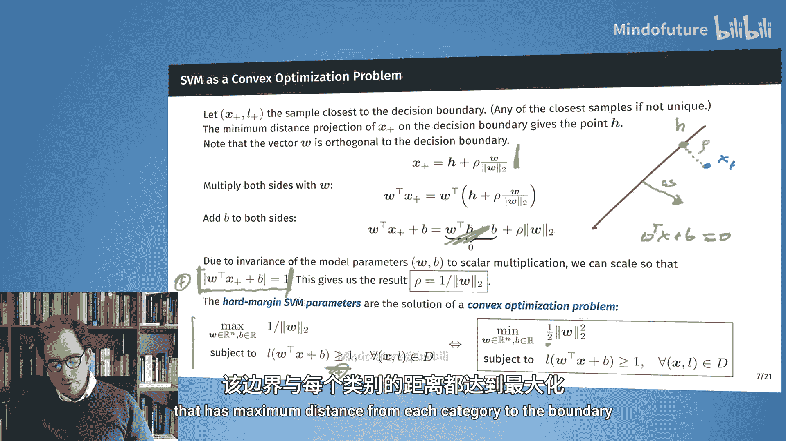

# 032：线性分类 🎯


在本节课中，我们将学习机器学习中的分类问题，特别是线性分类方法。我们将从分类的基本概念开始，介绍感知器算法，并最终深入到支持向量机（SVM）的原理。这些方法构成了许多现代机器学习应用的基础。

## 线性分类

上一节我们介绍了课程概述，本节中我们来看看线性分类的基本概念。

分类是许多科学领域的核心任务。历史上，亚里士多德等哲学家就曾尝试对世界万物进行分类，创建了“相互排斥且完全穷尽”的分类法。在现代机器学习中，我们希望通过算法自动完成这一过程。

我们首先关注**二元分类**问题，即数据只属于两个类别。通常，我们将这两个类别标记为 **+1** 和 **-1**。我们的训练数据集 **D** 包含多个样本，每个样本由一个特征向量 **x** 和其对应的真实标签 **y** 组成。

线性分类器通过一个简单的线性函数进行决策：
`f(x) = w^T x + b`
其中，**w** 是权重向量，**b** 是偏置项。分类边界就是 `f(x) = 0` 这条直线（或超平面）。对于一个新的样本 **x**，我们根据 `f(x)` 的符号来预测其类别：
- 若 `f(x) > 0`，则预测为 **+1**。
- 若 `f(x) < 0`，则预测为 **-1**。

判断一个分类是否正确也很简单。对于一个样本 `(x_i, y_i)`，如果 `y_i * (w^T x_i + b) > 0` 成立，则说明分类正确。

## 感知器算法

了解了线性分类的基本形式后，我们来看一个经典的训练算法：感知器。

感知器是一种简单的神经网络，也是训练线性分类器的一种方法。其核心思想是：**迭代地修正分类错误的样本**。

以下是感知器算法的步骤：

1.  **初始化**：将权重向量 **w** 和偏置 **b** 设置为 0。
2.  **循环**：只要数据集中还存在分类错误的样本，就重复以下步骤：
    a. 从所有错误分类的样本中随机选取一个 `(x_i, y_i)`。
    b. 更新参数：`w = w + y_i * x_i`， `b = b + y_i`。

感知器算法有一个重要的性质：如果训练数据是**线性可分**的，那么该算法保证会在有限步内收敛，找到一个能完美分类所有训练样本的线性分类器。然而，如果数据不是线性可分的，算法将永远不会停止。

此外，线性分类器的决策只依赖于 `w^T x + b` 的符号，而不关心其具体数值大小。这意味着权重 **w** 和偏置 **b** 可以同时乘以任何一个正数 **C**，而不会改变分类结果。这个性质有助于我们在实际计算中避免数值过大或过小的问题。

## 从感知器到支持向量机

上一节我们介绍了感知器算法，但它有一个明显的缺点：结果不唯一且可能不鲁棒。

我们以经典的鸢尾花数据集为例。使用感知器算法，每次运行都可能得到不同的分类边界（如下图红线所示）。虽然这些边界都能正确分类训练数据，但它们对数据微小扰动的抵抗能力不同。

我们更希望找到一条“最稳妥”的边界，即让边界离两边的数据点都尽可能远。这个想法催生了**支持向量机**。

支持向量机的目标是找到一个分类边界，使得边界到最近的数据点（即**支持向量**）的距离最大化。这个距离被称为**间隔**。最大化间隔能使分类器在面对新数据或噪声时更加鲁棒。

我们首先考虑**硬间隔SVM**，它要求所有数据都必须被正确分类，且间隔最大。

为了将这个问题形式化，我们需要计算间隔。可以证明，从分类边界 `w^T x + b = 0` 到任意一个支持向量 `x_+` 的距离 **ρ** 为：
`ρ = 1 / ||w||`
其中，`||w||` 是权重向量 **w** 的欧几里得范数。

因此，最大化间隔 `ρ` 等价于最小化 `||w||`。同时，我们需要满足所有样本都被正确分类的约束条件。对于一个支持向量 `x_+`，我们有 `w^T x_+ + b = 1`；对于另一侧的支持向量 `x_-`，则有 `w^T x_- + b = -1`。对于所有其他样本，要求 `y_i (w^T x_i + b) >= 1`。

于是，硬间隔SVM的优化问题可以写为：
```
最小化： (1/2) * ||w||^2
约束条件： y_i (w^T x_i + b) >= 1, 对于所有 i = 1, ..., m
```
这里将目标函数写成 `(1/2)||w||^2` 是为了数学上的便利，它与最小化 `||w||` 是等价的。

这是一个凸优化问题，我们可以用之前学过的优化方法（如梯度下降、二次规划等）来求解。最终，SVM会找到一条位于两类数据“正中间”的分类边界，如图中黑色实线所示，它比感知器得到的边界（红色虚线）具有更大的间隔和更好的鲁棒性。

## 总结

本节课中我们一起学习了机器学习中线性分类的核心方法。

我们首先介绍了分类问题的背景和线性分类的基本模型。接着，我们学习了**感知器算法**，这是一种简单直观的线性分类器训练方法，但其结果不稳定。

为了获得更鲁棒的分类器，我们引入了**支持向量机**的概念。SVM通过求解一个凸优化问题，寻找能够最大化分类间隔的决策边界。我们推导了硬间隔SVM的优化目标 `(1/2)||w||^2` 及其约束条件 `y_i (w^T x_i + b) >= 1`。



理解线性分类和SVM是进入更复杂分类模型（如非线性SVM）的重要基础。在接下来的课程中，我们将探讨如何利用核函数将SVM扩展到非线性分类问题。