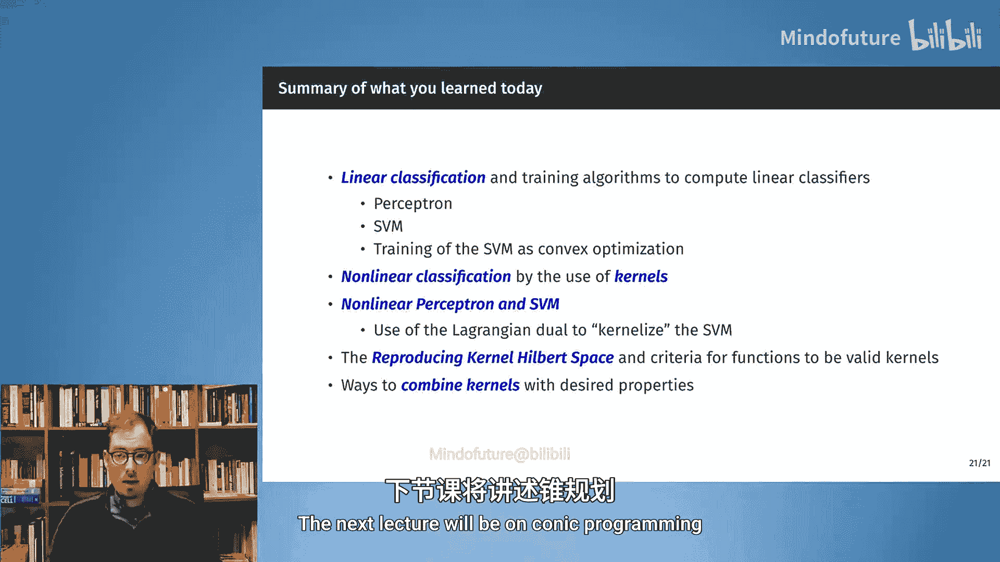

# 034：再生核希尔伯特空间 🔬

在本节课中，我们将学习一个在机器学习中至关重要的概念——再生核希尔伯特空间。虽然名字听起来复杂，但其核心思想非常强大。我们将从核函数的正式定义开始，逐步理解其性质，并最终揭示“再生”特性的含义。

## 核函数的正式定义

首先，我们来看看什么是核函数。一个函数 **K** 被称为核函数，当且仅当它满足以下两个条件：
1.  它是对称的。
2.  存在某个希尔伯特空间 **H** 和一个映射 **Φ**，使得对于任意输入 **x** 和 **x‘**，有：
    **K(x, x‘) = <Φ(x), Φ(x‘)>_H**

这里的输入空间 **X** 可以非常广泛。它可以是实数向量空间，也可以是像“红、蓝、绿”这样的类别数据，甚至是图结构等复杂对象。只要我们能定义一个满足上述条件的核函数，就可以在这些数据上应用核方法。

## 核矩阵及其性质

上一节我们介绍了核函数的定义，本节中我们来看看如何将核函数应用到数据集上。

给定一个数据集，我们可以计算所有数据点对之间的核函数值，从而得到一个**核矩阵**（或称Gram矩阵）。对于一个包含 **n** 个点 **{y₁, …, yₙ}** 的数据集，核矩阵 **K** 是一个 **n × n** 的矩阵，其第 **i** 行第 **j** 列的元素为 **K(yᵢ, yⱼ)**。

这个矩阵具有一些重要性质：
*   **对称性**：由于核函数 **K** 是对称的，核矩阵 **K** 也是对称的。
*   **半正定性**：如果函数 **K** 是一个有效的核函数，那么由其构造的核矩阵 **K** 总是半正定的。这个性质可以在几行内证明。

## 从核函数到特征映射

我们已经知道，如果有了特征映射 **Φ** 和希尔伯特空间的内积，就能构造出核函数。但反过来呢？如果我们已经有了一个核函数 **K**，如何证明存在一个对应的特征映射 **Φ** 和内积？这是本节的核心。

关键在于一个称为“部分求值”的技巧。对于固定的 **y**，我们将核函数 **K(y, ·)** 视为一个单变量函数。这个函数将输入 **x** 映射到实数 **K(y, x)**。

现在，我们进行一个关键的构造：
*   **特征映射**：我们将特征映射 **Φ** 定义为 **Φ(x) = K(x, ·)**。注意，映射的结果不再是一个向量，而是一个**函数**。
*   **目标空间**：我们进入了一个**函数空间**，其中的元素是从 **X** 到 **R** 的函数。
*   **内积定义**：在这个函数空间上，我们定义一个特殊的内积。对于由数据点 **x** 和 **y** 生成的两个函数 **Φ(x) = K(x, ·)** 和 **Φ(y) = K(y, ·)**，它们的内积定义为：
    **<Φ(x), Φ(y)> = K(x, y)**

然而，仅由有限个数据点生成的函数集合并不构成完整的向量空间。为了得到一个真正的向量空间 **G**，我们考虑所有这些函数的**所有线性组合**（即加权和）。这样，**G** 就包含了所有可能的这类函数，并且对加法和数乘封闭。

最后，我们将上面定义的内积自然地扩展到整个空间 **G** 上。可以验证，只要原始的核函数 **K** 是对称且正定的，这样定义的内积就满足希尔伯特空间内积的所有公理（线性性、对称性、正定性）。

## 再生核希尔伯特空间

上一节我们构造了一个函数空间 **G** 及其内积，本节我们来理解“再生”特性的含义。

设 **F** 是一个由 **X** 到 **R** 的函数构成的希尔伯特空间。如果存在一个核函数 **K**，使得对于任意 **x ∈ X**，函数 **K(x, ·)** 都属于 **F**，并且满足以下**再生性质**：
**对于任意 f ∈ F，有 <f, K(x, ·)>_F = f(x)**
那么，我们称 **F** 为一个**再生核希尔伯特空间**。

我们之前构造的空间 **G** 恰好就是一个RKHS。我们可以简单地证明其再生性质：对于 **G** 中的任意函数 **f**（它是基函数的线性组合），将其与 **K(x, ·)** 做内积，利用内积的线性性和定义，最终结果恰好等于在 **x** 点处求函数值 **f(x)**。

有一个重要的定理（Aronszajn定理）指出：**每一个对称正定的核函数 **K**，都唯一对应一个再生核希尔伯特空间。** 这完美地连接了核函数的代数条件（对称正定）和其背后的几何结构（RKHS）。

## 核函数的组合规则

既然核函数如此有用，我们自然会问：如何构造新的核函数？以下是几种保持核函数性质的组合规则，可以像“烹饪手册”一样使用：
*   用一个正常数乘以核函数。
*   给核函数加上一个常数。
*   将两个核函数相加。
*   将两个核函数相乘。
*   取核函数的正系数多项式。
*   取核函数的指数函数。

当你在使用支持向量机等算法，并为寻找合适的核函数以刻画决策边界而苦恼时，这些组合规则和“核技巧手册”会非常有帮助。

## 总结

本节课中我们一起学习了以下核心内容：
1.  **核函数的定义**：对称且能表示为某个特征空间内积的函数。
2.  **核矩阵**：由数据集计算的核函数值矩阵，具有对称和半正定的性质。
3.  **RKHS的构造**：通过将数据映射到由核函数本身张成的函数空间，并定义特殊的内积，可以从一个对称正定的核函数构造出唯一的再生核希尔伯特空间。
4.  **再生性质**：RKHS的关键特性，即用核函数与空间中任意函数做内积，可“再生”出该函数在特定点的值。
5.  **核函数的组合**：可以通过一系列运算（如相加、相乘）从已知核函数构造出新的有效核函数。

核方法使我们能够高效地在高维甚至无限维的特征空间中进行线性分类（如使用支持向量机），从而处理复杂的非线性问题，这是现代机器学习中一项强大的技术。