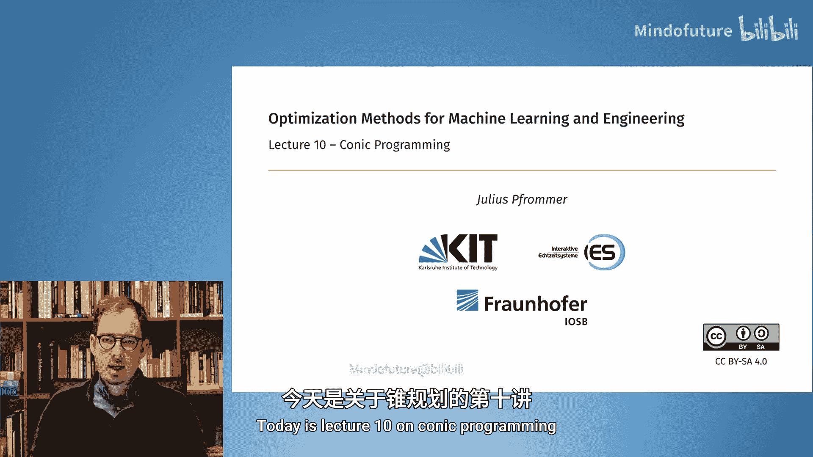
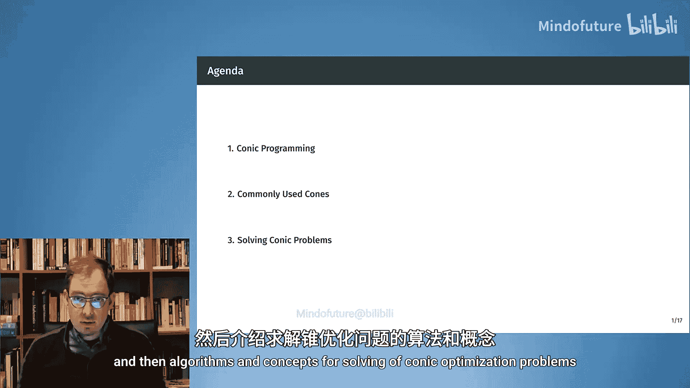
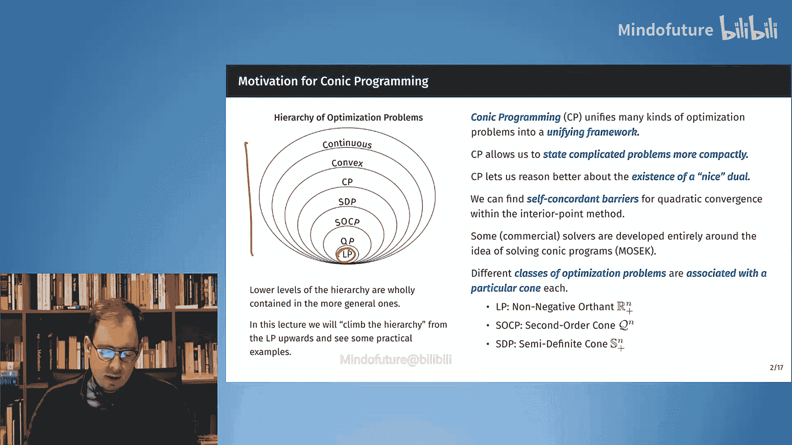
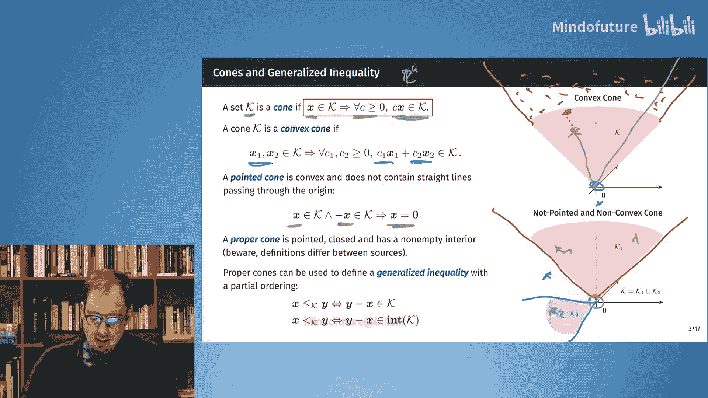
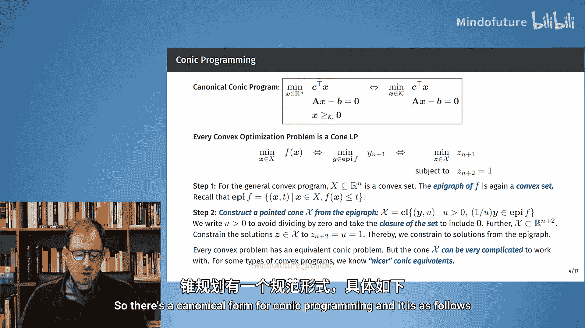
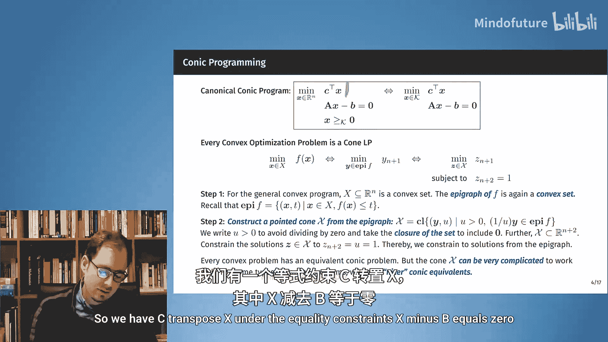
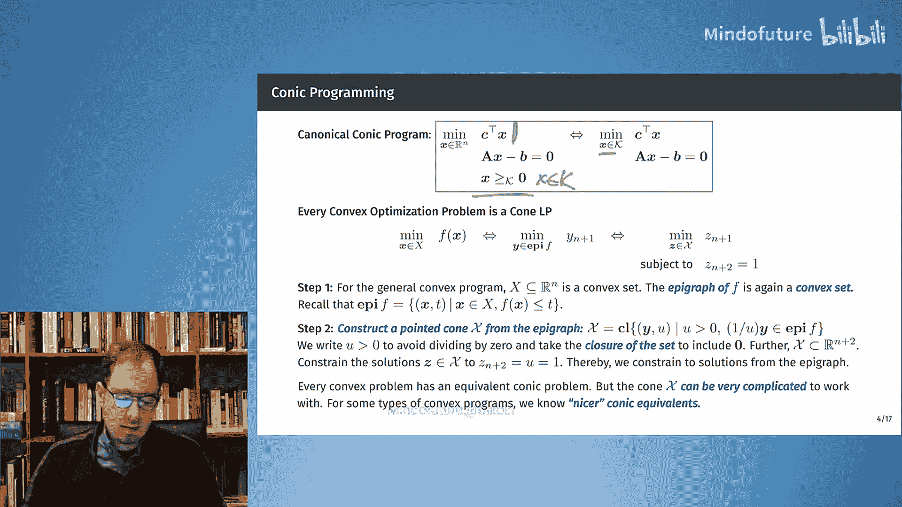
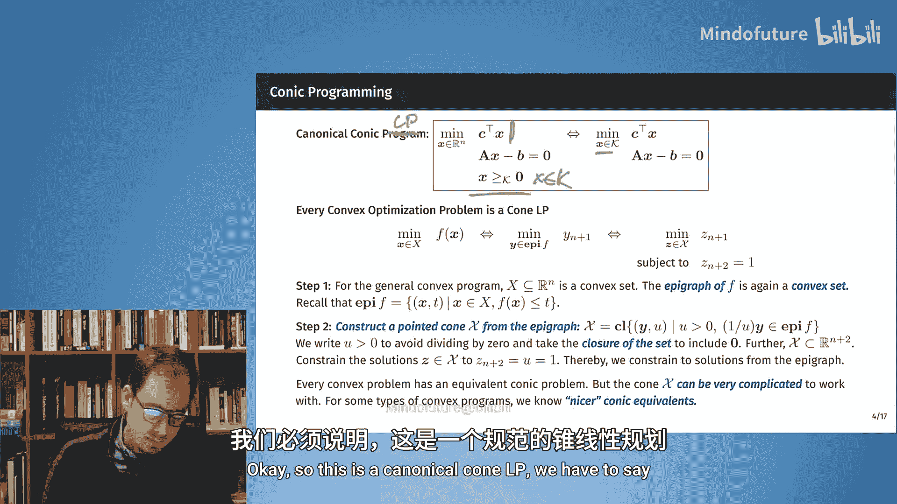
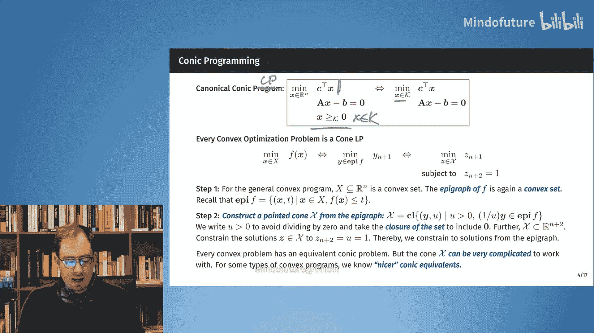
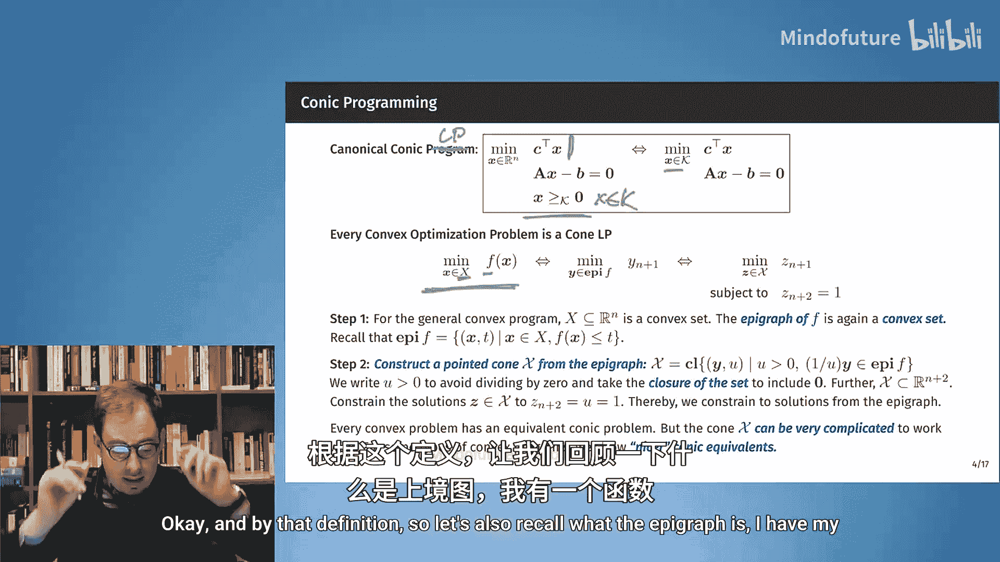

# 035：锥优化 🧊

在本节课中，我们将学习锥优化。锥优化是一种强大的数学框架，它能统一描述许多优化问题，包括线性规划、二次规划和半定规划。通过使用锥的概念，我们可以更简洁地表述复杂的优化问题，并利用其结构设计高效的求解算法。

---

## 锥的定义与动机

上一节我们介绍了课程概述，本节中我们来看看锥优化的核心概念——锥。

一个集合 **K** 被称为锥，如果对于集合中的每一个元素 **x** ∈ **K**，以及任意正标量 **α > 0**，其缩放后的结果 **αx** 仍然属于 **K**。用公式表示为：

**∀ x ∈ K, α > 0 ⇒ αx ∈ K**

直观上，锥就像一个从原点向外无限延伸的“冰激凌筒”形状。如果锥内任意两点的加权和（权重为正）仍在锥内，则该锥是凸锥。我们主要关注的是**正常锥**，即同时满足**闭集**、**尖**（不包含穿过原点的整条直线）且**内部非空**的凸锥。

对于正常锥，我们可以定义**广义不等式**。表达式 **x ≼_K y** 等价于 **y - x ∈ K**。这是一种方便的记法，用于表示一个元素属于某个锥。特别地，当锥是非负象限时，这个定义就退化为我们熟悉的向量逐元素不等式。

---

## 常见的锥类型

了解了锥的基本定义后，本节我们来看看在锥优化中常用的几种具体锥形。以下是三种最重要的锥：

*   **非负象限锥 (R_+^n)**：这是最简单的锥，由所有元素非负的向量构成。它对应着线性规划问题。
*   **二阶锥 (Second-order Cone / Lorentz Cone)**：这个锥由满足特定二次不等式的向量构成。它对应着二次约束二次规划和鲁棒优化等问题。
*   **半正定锥 (S_+^n)**：这个锥由所有半正定矩阵构成。它对应着半定规划，能够描述更广泛的一类优化问题。

这些锥构成了一个层次结构，越往下，锥所描述的优化问题类别越广泛，但可利用的结构也越多，从而能设计出更高效的算法。

---

## 锥规划的标准形式与算法概念

上一节我们介绍了具体的锥类型，本节中我们来看看如何用锥来表述一个优化问题，即锥规划。

锥规划有一个标准形式，类似于线性规划：

**最小化 c^T x**
**约束条件： Ax = b, x ∈ K**

其中，**K** 是一个正常锥。这个形式非常紧凑。事实上，**任何一个凸优化问题都可以等价地转化为一个线性锥规划问题**。证明思路是利用函数的**上图**来构造一个特定的锥。虽然这种构造在理论上是完美的，但得到的锥可能非常复杂，没有简洁的表达式，因此对实际算法设计帮助有限。

因此，锥优化的核心价值在于：**针对那些具有“好”的锥（如非负象限、二阶锥、半正定锥）的优化问题，我们可以开发出高效、统一的求解算法**。许多商业优化求解器（如MOSEK）的核心就是基于锥优化框架。

对于锥规划，我们可以研究其对偶问题，并且通常能得到漂亮的闭式对偶结果。此外，锥还为内点法提供了天然的**障碍函数**，使得我们可以设计出多项式时间复杂度的算法来求解这些看似复杂的问题。

---

本节课中我们一起学习了锥优化的基础知识。我们首先定义了锥和正常锥，并介绍了广义不等式的概念。然后，我们探讨了三种最常用的锥：非负象限锥、二阶锥和半正定锥，它们分别对应着不同类别的优化问题。最后，我们介绍了锥规划的标准形式，并理解了所有凸优化问题本质上都是锥规划，但实际中我们更关注那些具有简洁锥形式的、可高效求解的问题。锥优化框架的强大之处在于其统一性和为算法设计提供的清晰结构。