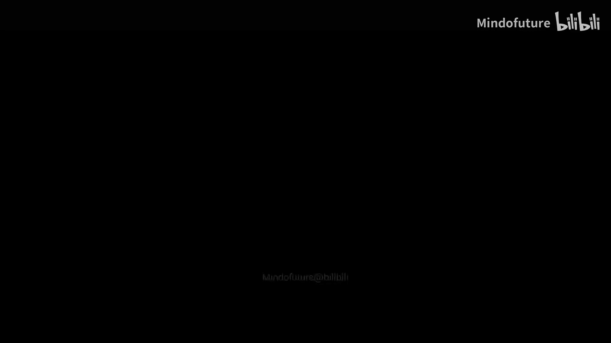
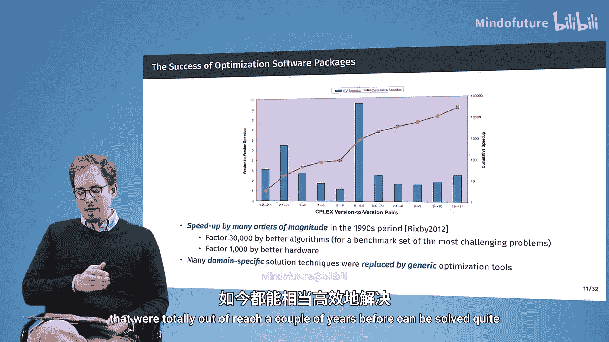

# 【凯尔大学】机器学习优化方法 ｜ Optimization Methods For Machine Learning And Engineering 2021 p01 P01_1.1_动机与历史背景 -BV1C6SwBqEp7_p1-

Welcome to the lecture on optimizationim methodsthod for Mach learning and Engine。In this course。

 you will learn how to use new superpowers because in this course you will learn how to take optimal decisions。

 not just any kind of decision， but really the best decision。

And this has applications in many different fields， so， for example， in daily life。

 how to best invest your money or in an engineering context。

 what are the best control settings for an airplane， but also in a machine learning context。

 for example， what is the best model for a given set of observations。

So optimization is the main topic of this lecture and we will have many different application examples to guide you through the theory。

 but always to have it accompanied with a lot of examples that are hopefully exciting and that you will like as much as we did in preparation of this lecture。

My name is Yulis Fman， I'm head of a research group at F for USB in Carlswell。

 prior to that I did my PhD in computer science and before that my original topic of study was engineering the economics。

And what we do in my research group is we apply artificial intelligence methods to achieve improvements in the real world。

 so we are mostly interested in physical systems or cyber physical systems that are， for example。

 large scale production systems and we want to learn something about these types of systems and then use the models to make decisions and to have a real worldor impact and optimization is a major part of that for the learning of models but later then also for the decision- making atron time。

So today， the agenda for today is to have a motivation and historical perspective on optimization。

 so how old is this topic and how was it developed over the years。

 what are some of the major challenges and the major applications that were solved with the tools for optimization。

We will have a section on the course organization， so what are you expecting not only today but for the next 14 lectures？

Then we will have a small refresher on mathematics and especially analysis today。

 so this will be not a complete course in mathematics。

 but it will remind us some of the topics from our earlier studies and we'll also introduce the notation that is used in this course。

And then we have two final topics， the first one on convexity。

 convexity is one very important characteristics of optimization problems， and gradient descent。

 gradient descent will be the first tool， the first algorithm。

 we will learn how to solve actual optimization problems。

So jumping into the first chapter on motivation and historical perspective。

 what you see here is one of the first examples where actual optimization was used and also in the mathematical sense and also where machine learning was used。

So this topic goes bay many， many years， goes back many years to the early 19th century。

 so in around 8 beginning 1800 something。Where Gieppe Piazzi published observations of a newly discovered planet or dwarf planet called Ces。

 and he had several observations on different days where he found the planet in the sky。

 and then Ces was lost。And the big question was whether astronomers were able to predict the orbit so that they could recover or refine service when it came back into view from the Earth。

And Kfigaos， a famous mathematician， he was able to compute the orbit of service。

 so he was able from the observations to compute a model that predicted the new location。

And as you may know， all planets are on an elliptic orbit around the sun。

 so their orbits are pretty simple， the problem is that Earth is also on an elliptic orbit around the sun and therefore the movement of seres from the point of view of the Earth looks a little bit random and you see this here depicted in the upper right image。

But Gaus actually was able to do the calculations to fit a model onto these noisy observations and for this he invented a method that we call today the least square method。

 and this is an important tool in optimization and in general what he did fitting observations or fitting model parameters to represent well given observations today we call this empirical risk minimization and this is also one of the categories of machine learning that researchers are talking about。

So many machine learning techniques are actually solutions or algorithms that solve and optimization problems。

 and sometimes this is explicit， sometimes this is a little bit hidden in the background。

 but having this understanding and having this perspective helps us a lot in getting an intuition intuition what these tools do。

So going forward a couple of years， we are now in the early 20th century。

 the USM was interested in developing low cost diets to keep the soldiers alive。

So the big question is if we know how many nutritions the soldiers need every day， how many calories。

 how many proteins， how much calcium， and so on， how can we feed them with a combination of ingredients that is as cheap as possible。

 but lets the soldier live？And there were at the time lists of the ingredients。

 the different ingredients and what they contain， so for example， meat on milk or grain on mice。

 how much protein， how much calcium， and so on does it contain？

And there were previous attempts to do this kinds of optimization。

 and they came to publish diets that cost about $100 per year。In the day。

 so back in the day in the early 1930s。And then George Ster approached this with a mathematical perspective。

 and he looked at this as something that we call today a linear optimization problem。

 where we're looking for a linear combination the different ingredients that are just barely above the minimum for all the different categories of nutritions that we need or that the soldierss need。

And George Stigler worked on this together with nine clerks。

 so people who were doing the calculations by hand and they worked on this for 120% days and came up with a solution that is actually pretty close to the global optimum so today we have improved this a little bit。

 there were some slight errors in there， but they came about to a cost of about $40 per year。

So they had a more than two times improvement of the previous published result and you see here a stick solution。

 so a lot of wheat flour and a lot of milk， cabbage， spinach and dried heavyvy beans。

 the solution is a little bit different if we allow that meat is contained because then there will be liver involved liver is very high in iron and therefore the solution if we allow meat also contains some liver。

And today this kind of optimization problem， a linear problem， can be solved really in milliseconds。

 so our computers barely break into a sweat to solve this kind of a problem。

 which back in the day took 120% days to solve。And this is really interesting。

 so we see how an actual problem that has importance because when there are hundreds of thousands of soldiers feeding them cost a lot of money。

 how such problems can be cast in a mathematical way and then solved。

The problem here is that the solution is correct， so you are actually fulfilling the minimum requirements for the soldiers for every day。

However， there are some some side conditions that cannot be captured in the medical model here it's for example。

 that the solution was never applied because it's just bad for morale if you're eating the same every day and it's mostly beans then。

Life is no fun and so this has then a side constraint that couldn't be integrated into the mathematical model and there's a somewhat funny account of that so a paper by George Danzig that you see here below where he he recalls during the development of the optimization algorithms how he told his wife to cook him daily a meal with the results from his computer and the different mishaps that were generated there。

In general， optimization has become a tool， so not only to compute optimal diets。

 but in many different fields of engineering， we are interested in the best solution and we have actually ways to express our problem in a mathematical way。

And especially engineers are using this and a very common optimization problem there is to say。

 for example， we want to minimize cost so what you see here in the upper example。

 this is a bridge crossing over a river for example， and the green arrows pointing down。

 these are the loads， so gravity and trains going over the bridges and so on and the bridge has to hold at least this load。

And the question then is， how light can we make the bridge and how cost effective can we make the bridge so that it holds the load doesn't break down。

And here we have performance constraints， so we are minimizing cost。

 the cheapest solution would be to have no bridge at all， but we have some constraints。

 we want to be above the requirement that the given loads are held。

 so the minimum solution is what you're seeing here and computing this bridge will be one of the examples that you will see in the exercises that you will solve practically with your own hands and on your own computers。

A second category of optimization problems is to maximize performance so in the lower example of what you see here。

 this is taken from a publication that tries to find trajectories to send out a satellite as far out from our solar system as possible so they have a certain budget of fuel that they can load onto the rocket and the satellite and the question is with the given budget of fuel what is the best trajectory how can they maybe slingshot around the sun and so on to give as as much speed as possible to the satellite and here we are now maximizing performance under the constraint of some cost and this is also very common in engineering？

We can also trade off between these two， so there can be situations where you say you are accepting you accept willing more performance for a given cost and somehow you have weights so you say that much more performance is okay for that much more cost and this is the the third example here。

 the cost performance trade off and there the big question is how do we do the trade off and is there maybe some alpha involved where we can give a weight through the cost and how is the selected。

So far we have seen problems that were more or less static。

 so we look at our problem or we look at the world， we cast it in an optimization problem。

 we solve that， we apply that and then it holds forever so to speak。

But there are also domains where we have to be really fast in taking decisions and one of the domains where we need to be really fast is in control。

 so control in the sense in Germany you would say regular technique。

 where you have to take decisions that impact a dynamic system at runtime。

And the first example I'd like to show you is here this inverted pendulum。

And what you see in the video is that the pendulum is。

Swinging up and the pendulum is held upright and as you can imagine。

 a human is not even possible to swing up the pendulum let alone keep it upright。

 but a computer is and for this the computer many times per second is solving an optimization problem to compute his best movements so the computer solves the problem of his best movements it is then executing the first steps。

And then is waiting or then is receiving additional input。

 so there are of course external random inputs that are perturbing the actual behavior so there's a loop where the controller or the computer receives new measurements about the current system state so the position and the speed of the different angles and so on and then is doing an optimization is applying the results and then the loop continues with new measurements。

 new optimization applying the results and so on and this happens many hundreds to thousands of times per second and therefore we perceive it as a fluid behavior and this is what optimum control is doing and the scientific term for this is model predictive control so we have a model that we can use to predict the future and then we can optimize our actions in this model simulation and applied back into the real world。

Another example here on the left side， this is the autonomous control of a small radio control vehicle and as you see the car is really drifting around the corners and always driving on the perfect line and so on。

 and this is possible because he's planning ahead and he know when the curve is coming and is doing a constant optimization knowing the current state of the car itself and of its environment。

So these are all optimization problems and optimization problems of this type will also be solved in the practical exercises of this lecture。

Or the course， not not today。Another domain that we will see in the course later on is computer visions。

 and it might seem unintuitive， but many problems that are solved in computer vision are also optimization problems or can be expressed as optimization problems。

The first of which I want to talk about here is stereo matching。

 so stereo matching is the question when you take two pictures that are a couple of centimeters apart。

 like the human eyes are a couple of human centimeters apart。

By the deviation of the pixels between the two images。

 can you figure out how far away the objects are on the images。

 so this is stere matching and what is done is you define a so- calledled energy function。

And the energy function describes how close the model prediction or the depth image that you compute。

 how close it corresponds with the deviation between the two images。

And the energy function is to be minimized， we try to find a configuration of minimum energy。

 so this has an origin in physics where also systems try to get into a minimum energy state and here this is an analog to that and we solve the optimization problem to get through the minimum energy state and you see depicted that actually the scene and the depth of the sea was recovered quite nicely for this case。

 so this is a very famous example it's called asuba from Japan。Another example is image denoising。

 in a similar way we can construct an energy function。

 minimize that and then recover an image that is dennoized that resembles more closely to what we expect to be the ground truth behind the noisy image。

And then the last example。The last example is image de blurring and this is also something that might seem unintuitive。

 we can actually invert the blur that has been applied to an image。So do not。

Confiund this with maybe some unrealistic movies where the FBI or the CIA can zoom into an image and where there's a pixelated image and they can zoom in infinitely and then find out the phase of the gangs and so on。

 this is not possible if you have a pixelated image， it's really difficult to recover anything。

But if the image is blurry。Then oftentimes， this is an invertible operation and we can find out by which operation the image has been blurred and then we can apply the inverse operation。

And also image to blurring will be an example that at the end of this course。

 you will be able to implement for yourself。Now， optimization， as we've seen it so far。

 these were all manmade models and manmade problems that were solved。

But also optimization happens quite naturally in the physical world。

 so there are quite a few examples where nature is doing an optimization without any human involvement or human invention。

 for example， light is always traveling the fastest path and depending on the speed that light can travel in a certain material it will take a slightly different path and this is called Fermont's principle and you see this quite nicely on the image with the straw in the glass。

Another example are soap films， so if you create a soap bubble or a soap firm。

 it will return to a shape of minimum surface because there is a surface tension and it wants to reduce to the minimum surface。

This has been used， for example， by Faotto in his very famous design of the Munich Olympic Park。

And actually， this is a quite difficult optimization problem and nature is doing this。

Without thinking about it， quote un important。The last example that you see on the right side。

 this is energy minimization for protein folding。 So the proteins in well， your body， for example。

 DNA， they are folding in a way that the free energy。Is is minimized。

 It wants to get into a very stable state where all the energy has been dissipated and。

The the problem here is that there are many， many different ways that a protein can fold and nature is finding a way to get to this minimum energy state and for humans it's actually very difficult so there are large computational programs where people try to find out what are the actual foldings of certain proteins to characterize their properties and they need really years and years of CPU time to do this computation for one protein because there are so many different folds possible and nature is doing this quite easily and really fast so optimization happens every day around you and well it's actually more a principle that we can use。

Now let's have a look at the very big picture of what we will see in this course。

 so this slide it contains the basically the entire course。

 everything that we will see in the coming lectures。

So what we are interested in is to optimize a certain objective function。

 so here this is called F of x。And well， the optimization。

 we can cast it as a minimization or as a maximization the are equivalent because it can take just the negative of a function to switch from a minimization to a maximization。

Well， usually we will see a minimization if it's not strongly suggested by the application example that we want to maximizeim something。

 so here we are minimizing and the notation here， this argument it returns the argument that is minimizing F so in that case the minir is X star。

And for this input， F achieves its lowest point。And the idea behind convexity is that。

If a function is convex， then it has only one minimizer so if it's strictly convex。

 then a function has only one minimizer and that is unique and in this course at the very end we will see some different examples but mainly we are handling convex optimization problems because they have nice properties that can be exploited than in algorithms that we develop for solving the actual optimization problems。

So we care about convexity because it has only one minimizer and because when we want to find this minimizer。

 we can just， well， quote unquote， walk downhill。Here you see on the left side a convex function。

 this one is good， we want to have convex functions on the right hand side this is a non convex function and as you can imagine we would need many。

 many more examples that we take or samples that we take from the domain in order to find the minimum。

And you will find out that convexity， it looks easy here。

 but if you go into problems of very high dimensionality。

 then a lot of things can be expressed by convex function and there is a large bag of tricks to approximate real life optimization problems that are maybe not convex from the start with a convex optimization problem and also have bounds to say how close we can get to the actual solution of maybe a nonconvex original optimization problem。

So convexity is the name of the game， and we will see a more mathematical。

 a more formal definition of convexity later today in the course。

There's a hierarchy by of optimization problems and the example that you saw initially with a stickler diet。

 this is a so-called linear programming problem and this is today one of the easiest optimization problems that we know about and then going up in the hierarchy the linear optimization problems is still contained so we open the space of possible optimization problems and at the end we then have a so-called con problems this is where we will end in this course with the chronic optimization problems that contain everything every level below so semidefinite programming second autocone programming quaric programming these are all。

Terms that might sound difficult， but you will get to learn them gradually over this course and then in the end we will have a small outlook also on non convex optimization problems at the very end of the course。

So the solution techniques that are developed are exploiting as much structure of the problems as possible and for the LP。

 so the easiest problem， we have the most structure that we can exploit and the fastest solution algorithms that can be designed and then going up in the hierarchy we have more we have less and less exploitable structure and therefore the algorithms are also generally getting slower but the algorithms are getting faster every year and there has been a huge development that has happened over the last 25 to 30 years。

 so we are many orders of magnitudes faster today than we were a couple of years back and that means that also a lot of specialized solution techniques that some application domains might have developed today they are completely replaced by some of the general optimization tools that we will。

See later in the course。So here you see a graph that shows this explosion of efficiency of the optimization software。

So this comes from CLX， CX is a software package by IBM。

And they have been starting this graph in the early 1990s and then what you see here as the blue columns is the version to version improvement so from one release from one software release of IBMCplex to the next。

 how much faster are the algorithms on the benchmark problems so the benchmark problems they contain very difficult problems obviously and what you see here is that quite astonishingly over many years。

 they had at times three at times5 at times nearly 10 improvement in the speed of the algorithms and this is accumulating so you have to multiply these speed improvements in order to get the cumulative speedup and in a span of maybe 10 years overall there was a 30000 times speedup just on the algorithm side。

And in addition to that， hardware became also better in the 1990s so by about a factor of 1，000。

 that means overall， we had a 30 million times speedup。

That means a problem that in the early 2000s could be solved within seconds would have taken month or even years in the early 1990s。

 and some of the scientific fields and also engineering practices were a little bit late in jumping on the bandwagon but now many have discovered that if they use the commercial and also the open source optimization packages。

 many problems that were totally out of reach a couple of years before。

 can be solved quite efficiently today。

