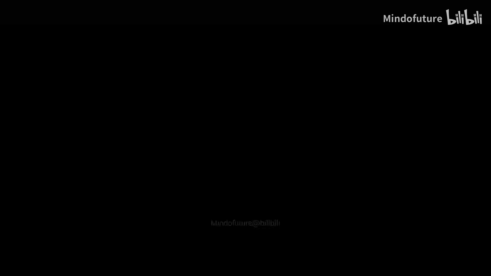
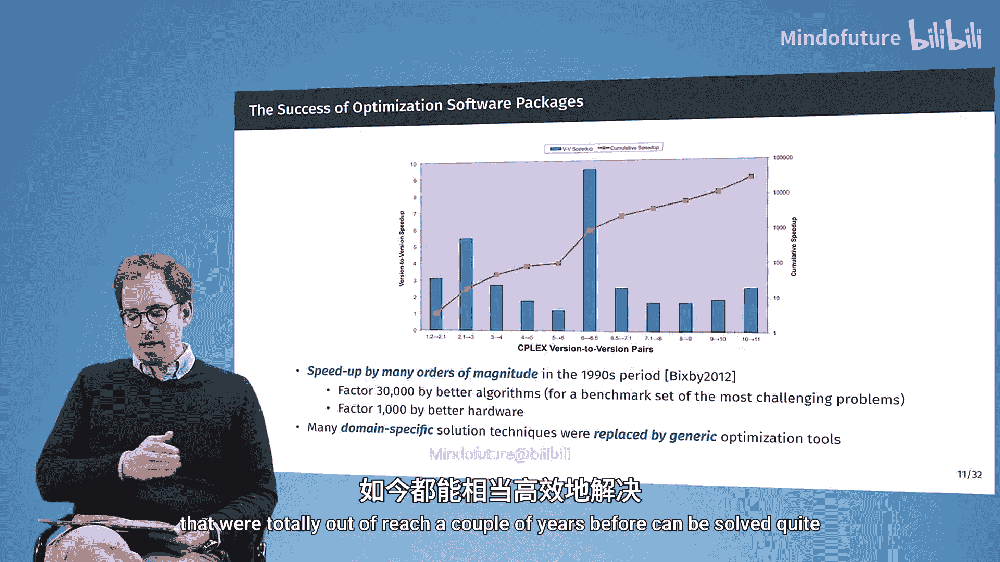

# 机器学习优化方法：1：动机与历史背景 🚀

在本节课中，我们将学习优化方法的基本概念，了解其历史背景、核心动机以及在不同领域的广泛应用。优化是寻找最佳决策的科学，它在工程、机器学习乃至日常生活中都扮演着关键角色。

## 动机与历史背景

优化是一门古老的学科，其应用可以追溯到几个世纪前。本节我们将回顾几个关键的历史案例，以理解优化问题是如何被提出和解决的。

### 早期应用：高斯与最小二乘法

第一个在数学意义上使用优化和机器学习的例子可以追溯到19世纪初。1801年，朱塞佩·皮亚齐发表了对新发现的小行星（或矮行星）谷神星的观测数据。他记录了谷神星在不同日期的位置，但随后谷神星在视野中消失了。天文学家面临的关键问题是：能否预测其轨道，以便在其再次进入地球视野时重新定位？

著名数学家卡尔·弗里德里希·高斯解决了这个问题。他从观测数据出发，计算出了一个能预测谷神星新位置的模型。众所周知，所有行星都围绕太阳做椭圆轨道运动。问题在于，地球本身也在绕太阳做椭圆运动，因此从地球视角看，谷神星的运动轨迹显得有些不规则。

高斯通过计算，将一个模型拟合到这些带有噪声的观测数据上。为此，他发明了一种我们今天称为**最小二乘法**的方法。这是优化领域的一个重要工具。总的来说，他将拟合观测数据或模型参数以良好表示给定观测数据的过程，我们今天称之为**经验风险最小化**，这也是机器学习研究的一个类别。

许多机器学习技术实际上是解决优化问题的算法。有时这是显式的，有时则隐藏在背景中。理解这一视角有助于我们直观地理解这些工具的作用。

### 20世纪的应用：斯蒂格勒饮食问题

时间推进到20世纪初，美国军方希望开发低成本饮食方案以维持士兵生存。核心问题是：如果我们知道士兵每天所需的营养（如卡路里、蛋白质、钙等），如何以尽可能便宜的组合食材来喂养他们，同时保证士兵存活？

当时已有各种食材及其营养成分的列表（例如，肉类、牛奶、谷物等含有多少蛋白质和钙）。此前有人尝试解决这类优化问题，并公布了每年成本约100美元的饮食方案（在20世纪30年代初）。

乔治·斯蒂格勒从数学角度处理了这个问题。他将其视为我们今天所称的**线性优化问题**：寻找不同食材的线性组合，使其恰好满足士兵所需各类营养的最低要求。斯蒂格勒与九名职员（手工进行计算）共同工作了120天，提出了一个非常接近全局最优解的方案（今天看来其中有一些小错误），成本约为每年40美元。

他们的方案比之前公布的结果改进了两倍多。该方案包含大量小麦粉、牛奶、卷心菜、菠菜和干芸豆。如果允许包含肉类（肝脏富含铁），方案会有所不同。如今，这类线性优化问题可以在毫秒内解决，而当年却需要120天。这展示了如何将一个具有重要实际意义的问题（喂养数十万士兵成本高昂）转化为数学模型并求解。

然而，该方案存在一个无法在数学模型中捕获的约束：它从未被应用，因为每天吃同样的食物（主要是豆类）会严重影响士气。乔治·丹齐格在一篇论文中幽默地回忆了他在开发优化算法时，让妻子每天用计算机结果为他做饭的经历。

### 工程中的优化问题

总的来说，优化已成为一种工具，不仅用于计算最优饮食，还广泛应用于工程等多个领域，以寻求最佳解决方案。

工程师们尤其常用优化。一个常见的优化问题是**最小化成本**。例如，图中是一座跨越河流的桥梁。绿色向下的箭头代表载荷（如重力、火车通行等）。桥梁必须至少承受这些载荷。问题是：在满足载荷要求、不坍塌的前提下，我们如何使桥梁最轻、最具成本效益？这里存在性能约束：最便宜的方案是没有桥梁，但我们有约束条件（必须承受给定载荷）。计算这样的桥梁将是练习中的一个例子。

第二类优化问题是**最大化性能**。例如，图中是一项研究，旨在寻找将卫星送出太阳系尽可能远的轨迹。他们有一定预算的燃料装载到火箭和卫星上。问题是：在给定燃料预算下，最佳轨迹是什么？他们是否可以借助太阳引力弹弓等效应，为卫星提供尽可能大的速度？这里是在一定成本约束下最大化性能，这在工程中也很常见。

我们也可以在这两者之间进行权衡，即**成本-性能权衡**。这里的关键问题是：如何进行权衡？是否涉及某个权重参数α，让我们可以权衡成本与性能？

### 动态优化与控制

到目前为止，我们看到的问题大多是静态的：我们审视问题或世界，将其转化为优化问题，求解并应用，然后结果就固定了。

但有些领域需要非常快速地做出决策，其中之一就是**控制**领域（在德国称为 Regelungstechnik）。例如，图中是一个倒立摆。在视频中，摆锤被摆动起来并保持直立。可以想象，人类甚至无法摆动起摆锤，更不用说保持其直立了，但计算机可以。为此，计算机每秒多次求解一个优化问题，以计算其最佳动作。计算机求解其最佳动作的问题，然后执行前几步，接着等待或接收额外输入（当然存在扰动实际行为的外部随机输入）。这是一个循环：控制器或计算机接收关于当前系统状态（如不同角度和速度的位置）的新测量值，然后进行优化，应用结果，接着循环继续，接收新测量值、进行新优化、应用结果……这每秒发生数百到数千次，因此我们感知为流畅的行为。这就是**最优控制**所做的，其科学术语是**模型预测控制**：我们有一个可用于预测未来的模型，然后可以在模型模拟中优化我们的行动，并将其应用回现实世界。

另一个例子是小型无线电控制车辆的自主控制。如图所示，汽车在弯道漂移，始终行驶在完美路线上。这是可能的，因为它能提前规划，知道弯道何时到来，并根据汽车自身及其环境的当前状态进行持续优化。

这类优化问题也将在本课程的实际练习中解决。

### 计算机视觉中的优化

我们将在课程后期看到的另一个领域是**计算机视觉**。这可能看起来不直观，但计算机视觉中解决的许多问题也是优化问题，或者可以表述为优化问题。

第一个要讨论的是**立体匹配**。立体匹配的问题是：当你拍摄两张相距几厘米的照片时（就像人眼相距几厘米），能否通过两幅图像之间像素的偏差，计算出图像中物体的距离？为此，我们定义一个所谓的**能量函数**。能量函数描述了你计算的深度图像（模型预测）与两幅图像之间的偏差有多接近。我们需要最小化这个能量函数，试图找到能量最小的配置。这源于物理学，系统也试图进入最小能量状态。我们通过求解优化问题来达到最小能量状态。如图所示，该场景的深度被很好地恢复了。这是一个非常著名的例子（日本浅草寺）。

另一个例子是**图像去噪**。我们可以用类似的方式构建一个能量函数，最小化它，然后恢复出一幅更接近我们预期的、隐藏在噪声图像背后的真实图像。

最后一个例子是**图像去模糊**。这看起来可能也不直观，但我们实际上可以逆转应用于图像的模糊操作。请注意，不要将其与一些不切实际的电影场景混淆（如FBI或CIA可以无限放大像素化图像并找出帮派面孔）。如果图像是像素化的，恢复任何信息都非常困难。但如果图像是模糊的，这通常是一个可逆操作。我们可以找出图像被模糊的操作，然后应用逆操作。图像去模糊也将是本课程结束时，你将能够自己实现的一个例子。

### 自然界中的优化

正如我们目前所见，优化都是人造模型和解决的人造问题。但优化也相当自然地发生在物理世界中。有一些例子表明，自然界在没有人类参与或发明的情况下进行着优化。

例如，光总是走最快的路径。根据光在特定材料中的传播速度，它会选择略有不同的路径。这被称为**费马原理**，在吸管插入玻璃杯的图像中可以很好地看到这一点。

另一个例子是**肥皂膜**。如果你创造一个肥皂泡或肥皂膜，它会恢复到最小表面积的形状，因为存在表面张力，它希望减少到最小表面积。例如，弗雷·奥托在他著名的慕尼黑奥林匹克公园设计中就运用了这一原理。实际上，这是一个相当困难的优化问题，而自然界“不假思索”地就做到了。

最后一个例子是**蛋白质折叠的能量最小化**。例如，你体内的蛋白质（如DNA）会以自由能最小化的方式折叠。它希望进入一个所有能量都已耗散的非常稳定的状态。问题在于，蛋白质有许多不同的折叠方式，而自然界找到了一种达到这种最小能量状态的方法。对人类来说，这实际上非常困难。因此，有一些大型计算程序，人们试图找出某些蛋白质的实际折叠方式以表征其特性。他们需要多年的CPU时间来计算一种蛋白质，因为可能的折叠方式太多了。而自然界却相当轻松且快速地做到了这一点。因此，优化每天都在你身边发生，它实际上是我们可以利用的一个原理。

## 课程全景图

现在，让我们看看本课程的整体概况。这张幻灯片基本上包含了整个课程，即我们将在未来讲座中看到的所有内容。

我们感兴趣的是优化某个**目标函数**，这里称为 **`f(x)`**。优化可以表述为最小化或最大化，两者是等价的，因为我们可以取函数的负值来在最小化和最大化之间切换。通常，如果没有应用示例强烈建议我们要最大化某物，我们会看到最小化。这里的符号表示返回最小化 `f` 的参数，即最小值点是 **`x*`**。对于这个输入，`f` 达到其最低点。

**凸性**背后的思想是：如果一个函数是凸的，那么它只有一个最小化点（如果是严格凸的，则最小化点是唯一的）。在本课程的最后，我们将看到一些不同的例子，但主要处理凸优化问题，因为它们具有可以被我们开发的算法利用的良好性质。

我们关心凸性，因为它只有一个最小化点，并且当我们想要找到这个最小化点时，我们可以简单地“下山”。图中左侧是一个凸函数，这是我们希望拥有的。右侧是一个非凸函数。可以想象，我们需要从定义域中采集更多样本才能找到最小值。你会发现，凸性在这里看起来很简单，但如果你进入高维问题，许多问题可以用凸函数表达。并且有一大堆技巧，可以用凸优化问题来近似最初可能非凸的现实生活优化问题，同时还能给出我们距离原始非凸优化问题的实际解有多近的界限。

因此，**凸性是关键**。我们将在今天的课程中看到凸性更数学化、更正式的定义。

优化问题存在一个层次结构。最初看到的斯蒂格勒饮食问题是一个所谓的**线性规划问题**，这是今天我们已知的最简单的优化问题之一。沿着层次结构向上，线性优化问题仍然被包含在内，但我们扩展了可能的优化问题的空间。最后，我们到达所谓的**锥优化问题**，这是本课程结束时将达到的层次。锥优化问题包含其下所有层次（如半定规划、二阶锥规划、二次规划等）。这些术语听起来可能很难，但你将在本课程中逐步学习它们。最后，在课程结束时，我们也会对非凸优化问题做一个小展望。

所开发的求解技术尽可能多地利用问题的结构。对于最简单的LP问题，我们可以利用最多的结构，设计出最快的求解算法。沿着层次结构向上，可利用的结构越来越少，因此算法通常也会变慢。但算法每年都在变得更快，过去25到30年发生了巨大的发展。我们今天比几年前快了多个数量级。这意味着，一些应用领域可能开发的许多专门求解技术，今天已经完全被我们将在课程后期看到的一些通用优化工具所取代。

图中显示了优化软件效率的爆炸式增长。这来自IBM的软件包CPLEX。该图表始于20世纪90年代初。蓝色柱状图表示版本间的改进，即从IBM CPLEX的一个软件版本到下一个版本，算法在基准问题上的速度提升了多少。基准问题显然包含非常困难的问题。令人惊讶的是，多年来，他们有时有3倍、5倍，甚至近10倍的速度提升。这是累积的，你必须将这些速度提升相乘才能得到累积加速。在大约10年的时间里，仅算法方面就有30,000倍的加速。此外，20世纪90年代的硬件也变得更好了，大约有1,000倍的提升。这意味着总体上有3,000万倍的加速。

这意味着，在21世纪初几秒钟内可以解决的问题，在20世纪90年代初需要数月甚至数年才能解决。一些科学领域和工程实践在跟上这一潮流方面有些滞后，但现在许多人发现，如果他们使用商业和开源的优化软件包，许多几年前完全无法解决的问题，今天可以相当高效地解决。

在本节课中，我们一起学习了优化方法的基本动机和历史背景。我们看到了从高斯的最小二乘法到斯蒂格勒饮食问题，再到现代工程、控制和计算机视觉中的广泛应用。优化不仅是寻找最佳决策的数学工具，也是自然界和许多技术领域的核心原理。理解优化问题的基本形式（如最小化目标函数 `f(x)`）和凸性的重要性，为我们后续深入学习具体的优化算法和应用奠定了坚实的基础。