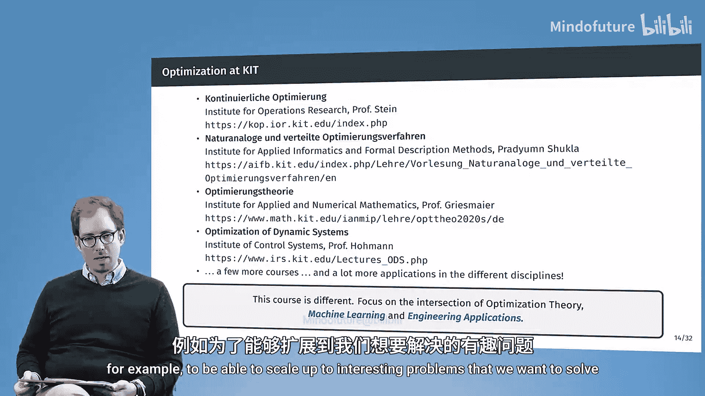

# 【凯尔大学】机器学习优化方法 ｜ Optimization Methods For Machine Learning And Engineering 2021 p02 P02_1.2_课程组织 -BV1C6SwBqEp7_p2-

Okay， now we go into the course organization。And here is the syllabus of the what different topics you will discover in this lecture。

 and there are 14 different。Lectures and every lecture is accompanied by a practical exercise session。

So the lecture will be recorded as a video and made available to you together with the slides。

And in addition to that， we make available exercise sheets and also Jupyter notebooks。

And there you will have some predefined problems with some of the critical points left out。

 where it is your task， for example， to implement a small algorithm that we have seen in the lecture or to solve one of the optimization problems。

And it is useful but not required to bring a laptop to the exercise sessions。

 but actually we expect that you are also doing the work or to solve the Jupyter notebooks because a lot of the learning and a lot of the practical。

Application understanding will， will come from that。Now。

 let me just go over some of the major points in the syllabus。So in the first couple of weeks。

 in the four weeks we will learn about the major building blocks of optimization。

 so the major algorithms in also ways how to treat different constraints or conditions that we can impose on a solution so this will be the first four lectures。

Then we will have one lecture completely dedicated to practical examples。

 so we will have practical examples throughout， but here the lecture five it will be dedicated only with two two examples in mechanical design for motor predictive control and also finance application for stock investments。

Then we will get into further topics we will learn about automatic differentiation that will make your life a lot easier because it resolves some of the mathematical burden where its much easier to develop methods and models。

 we will learn about vector spaces which is another a new perspective than on optimization problems and in the second half of the course。

 we will be refining the tools that we have seen prior in order to solve， for example。

 larger scale optimization problems and there will be also a new range of very high- dimensional optimization problems from computer vision for example。

 or very high dimensional machine learning problems。

There are two main references that are the source and the inspiration for the material in this lecture or of the course。

 the first one is optimization by vector space methods。

 this is quite an old book by David Luomberger but it's widely cited and in many in many ways it is a pretty advanced book because back in the time the computational power was not as today。

 so they were thinking more analytically about optimization problems than maybe some of the newer references。

And the other example， the other book， Convict optimization by Stephen Boyd and Le Vannerberg。

 this is a modern classic， it has been cited today， I think more than 50，000 times。A real classic。

 and basically everyone in the field has those book on his shelf。

But I don't require you to have the books on your shelves。 So sometimes if you are interested。

 maybe in proof that is not covered in depth in the lecture， you can， you can go to these references。

 but you don't have to buy and。Follow these books to follow the class。

 These are just references in general。 If you want to take a deeper dive。At KT。

 this is not the only electron optimization， there are also other scientific fields concerned with that。

For example， operations research， this comes from the departments for engineering and Economics。

 so operations research is basically optimization in an organization or in a business context。

Then there is also a lecture on nature inspired optimization methods， this is by IFB。

 so it's a little closer to computer science， but it's still with the Department of Economics and Engineering。

And we have， of course， the mathematicians that have the lectures on theory for optimization。

The difference to this lecture is in mathematics， they go a lot deeper in the proofs。

But they do not learn the same。Broad range of tools that are available。

 so here we will see proofs where they are relevant。

 but in many areas there will be just reference to the proof and what you need to understand is to understand why。

with maybe all the technical machinery and the important algorithms will be implemented。

 but this is maybe a lecture if you are very interested from even more mathematical background to go there。

And then also some of the engineering fields like electrical engineering。

 they have lectures where they do a lot of optimization and one example here is the lecture by Professor Oman。

Okay so optimization at KT exists in a couple of different contexts。

 but here we will have a very unique view， we will focus on applications from machine learning and from engineering and take this perspective also as a motivation。

 why we need certain algorithmic improvements， for example。

 to be able to scale up to interesting problems that we want to solve。

