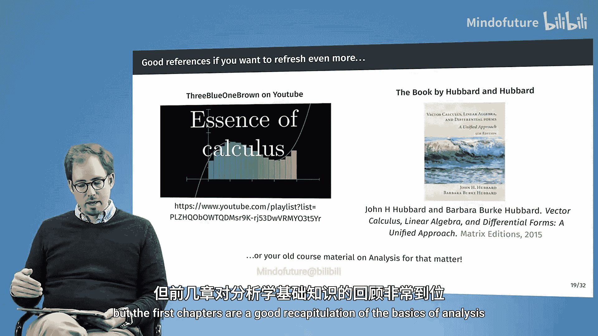

# 【凯尔大学】机器学习优化方法 ｜ Optimization Methods For Machine Learning And Engineering 2021 p03 P03_1.3_符号与分析回顾 -BV1C6SwBqEp7_p3-

This section is on mathematical notation and refresher on some of the concepts from analysis。

 so not a complete course on course on mathematics。

 but just to recall the notation and the basic principles and so on。

So on this slide there is an overview on the conventions for the mathematical notation that we will use in this course。

 so how do we write down a scalar， how do we write down a vector。

 what does a matrix look like in the notation and so on and if you have difficulties understanding one of the formula。

 you can go back to this slide and see if the notation is helping you？

But you can also approach us in the example， in the exercise sessions or try on EliliaIS in the fall。

Now going forward here， we have also a notation for sets， for example。

 this big A is a set and small A is an element of that and we can have then containment or subsets of these sets。

 we can have unions， intersection， we have the empty set。

And something that will be quite important later on is。

A set with a certain constraint over the condition。

 So here we have the set of all x squared of all x where x squared equals to1。

 So this set will contain exactly one and minus-1。 and well this is just a notation that you might not be familiar with that occurs later on。

There are some abbreviations that happen on the slides to shorten the text a little bit， for example。

 if and only if。Its appropriate as I F and right hand side， left hand side。Is abbreviated。

 but usually in the presentation of the slides， I will indicate everything once more and if you follow the videos。

 everything should be well。어 be open。Now， to the first concept from mathematics to recover some of the mutation。

 what you see here is the definition of a derivative。

 so most of you have learned that already during the A levels before the Api tool in Germany。

And the basic definition is that when we have x an open subset of R and F goes from x to R。

 then F is differentiable at every point and we have a derivative if the limit that is indicated here exists so you can think about this as having selected a certain point and then taking forward a small step H and then the question is how much does the response of the function change when you are adding a little step H in front of that and what we then do is we make the H smaller and smaller and smaller and if this converges to or if the limit then exists if this results in a number then this is derivative。

And we can show this for a small example， so f of x equals 2 x plus 3 x squared。

 I will not go over this in the same detail now， but you can try to follow along and do this on your own on the slide。

So， besides the。The derivative that we've just seen， the gradient is an important topic。

 and the gradient is an optimization in several dimensions。 So if you don't have an F from。

Some x that is a subset of the real numbers to R， but when we have r to the power of n to R so when the input in several dimensions。

 then we can also take the derivative in each of the input dimensions so oftentimes we are abbreviating the notation here。

 so when we have f of x comma y， then this can be abbreviated by having a single vector as input in that case here you see the x is written with a bold notation so this is a column vector and we can take the derivative to every element of this column vector。

And this is expressed here， so we have the gradient and the gradient then is the derivative first to x1。

 the first element of the vector then to x2， the second element of the vector and so on。

And we can look at this from a visual perspective how this looks like。

 so if this red dot here in the example on the right side is the point X。

 then we have a gradient going out from that point and we have the derivatives in the different directions so first in the X direction and then in the y direction and they are defining like a plane like a plane that is touching the function at that point and this tangent in the direction of of the derivative。

And we have also the notation to take the gradient to just a subset of the input。

 so if you have a function F that takes two vectors as input， for example。

 we can take the derivative to just the first input vector and here this is then expressed as gut F to gut X of F。

Now， besides the first derivative， there is also the second derivative and the first derivative。

 it gives us the gradient and the second derivative it gives us the Hesian matrix。

And in the Hasian matrix， the first entry here is derived twice for x1。And then here。

 the second entry， it would be derived once for x1 and then for x2。

 so the second element of the input vector and so on。And this then continues。And the Hassian matrix。

 it is actually symmetric so we can take the transpose of it and it will stay identical because the order of the differentiation does not matter。

 So if we first derive by x1 and then by x2 or first by x2 and then by x1。

 the end result will be identical。And again， let's mention or let's take a visual perspective on how this looks like here we have the point X somewhere on the yellow plane。

 so the yellow plane is the original function， and then we do a so-cal tailor expansion。This point。

 So we have first of F of x。 So the the result of the function at that point。

Then we have the gradient and here this would give us a plane that goes through F of x。

And then with the second degree Taylor expansion， we are adding how to say like a bowl that is exactly the second degree derivative at the point F of x。

And in the second degree Taylor series or by going then into third， fourth and so on degree。

 we more and more closely approximate this function， given of course。

 that the fact is that many times differentiable。And。

What is important here that the Hesian that you see here the heemmatics， for this example。

 it results in an upward curved bowl and this can be characterized and we will see that later on as a socalled。

Positive definite hassian matrix and this is important to see if we are minimizing if for example。

 we will reach the bottom of the Taylor series or if maybe it doesn't have actually a minimum because it is bent downwards and then this situation then it not possible if we are trying to find the minimum。

So there are further good references， so if you want to refresh even more there's a really good course on the essence of calculus on YouTube by three blue1 Brown。

 so if the previous slides were maybe a little bit confusing for you or maybe if your analysis course is already a few years back and if you want to refresh with the YouTube video I can recommend three blue1 Brown and there's also a book by Habbd and Habbard it goes a lot deeper than this but the first chapters are a good recapitulation of the well the basics of analysis。

