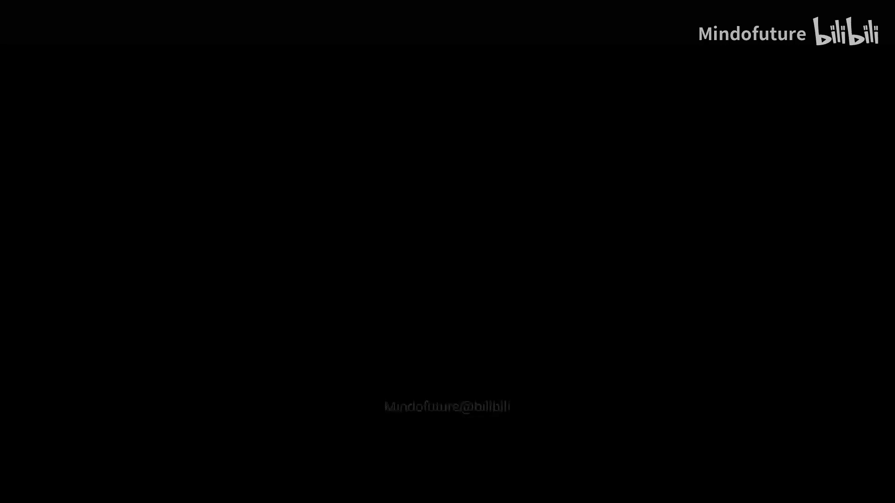
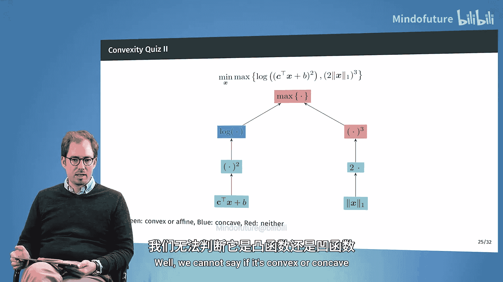

# 【凯尔大学】机器学习优化方法 ｜ Optimization Methods For Machine Learning And Engineering 2021 p04 P04_1.4_凸性 -BV1C6SwBqEp7_p4-

Okay， in this session we will learn about convexity。

 one of the most important properties of optimization problems that we regard in this lecture。

And first of all， we look at convexity of sets and then go into convexity of functions。

So convexity of sets is actually really simple， so convexity of sets。

What you require that if you take two points into。The set。Or from the set。

 And then you draw the line segment between these two points。

 Then you remain entirely within the set。 So the example that you see here。

 this is a non convex example。Because in the middle here we have a point that is on the line segment。

 but actually outside， and so it does not hold the constraint that we have for convex sets。

If we have a set， what we can do is we can construct a convexhull and that means we take the combination of all points that lie within or between points that are originally contained so here we have all these small。

Black dots， and we take the convexhu around that。 and this is then the smallest convex set that contains all the original points。

beside convexity of sets， we are interested in convexity of functions。

And there are a couple of equivalent definitions， what convexity of a function is。

And the first of them is that the epigraph of the function should be a convex。

So what is the epigraph？The epigraph is here all the points that lie above。The function。 and。

This would be a convex set。 In that case， it is not because we have。A point here and a point there。

 And if you draw the tangent light in between， it will be outside。 So in that case。

 this is the epigraph of non convex function。Then an equivalent requirement is Ynen's inequality。

 where we require exactly that the tension that we draw between two points that are on the function。

Are above the function， so here we have two points that are on the function X and Y。

And then if we draw the the line segment above that， then it has to be above the center point。

That lies here， the center point between x and y， and we have a certain alpha that where we can freely choose any point between x and y and the line segment always has to be above that。

And another condition we have just prior seen the definition of the Hasian matrix and another requirement is that the Hessian matrix is positive semi deffinite if the function F is twice differentiable and then we have like a bathtub shape that is open on the top and that then gives us also convexity。

So all these conditions， one and3 are equivalent。 If one of them is true。

 then the others must be true as well。SoS gradientds are a notation that will occur a couple of times。

 so this is why we are introducing it here really quick。

 if we have a point X that we have selected and then we draw the tangent line that is actually in the direction of the gradient of the function。

Then we get the socal sub gradientient。And if F is convex。

 then the function is always above of the sub gradientraient。

That's also why it's called the upgraded。And theres also the possibility that F is not everywhere differentiable。

 and then we can also form a sub gradientdient， but not only one。

 then there can be a whole set of sub gradientds at a different point。

 that all uphold the condition that they are below the function everywhere。

 but there can be several of them at the same time。So if we now see a function。

 how can we find out if it is convexed everywhere， So the conditions we have seen before。

This is something that has to be true at every point x or between every point2 between every point x and y on the function。

 but we want to have some conditions where we can just look at the function and know that this is true and we don't have to check in every possible location if the convexity conditions are true。

And there's a way to combine convex function where we do not lose the property of convexity。

 so we can have like Lego blocks， we can have small bricks。

 like Legos that can be combined and integrated and we know that the result will still be a convex function and this is a very helpful tool later。

And there are a couple of the smallest legal blocks， so to speak。

 that are known to be convex or that are known to be concave， and if they are concave。

 then we can take the negative of that function and it will be convex。

And here there's a list of them。 So， for example， a transposed x plus B。 So a is a fixed vector。

 We transpose it multiplied with x plus B。 This is what we call an fine function。

 So linear plus an offset。This is known to be conve。Then x log x is known to be convex。

 then x transpose px for p positive semidefinite this convex。

 so here p is a matrix and this notation here it says that P shall be positive semidefinite。

And whenever we have a norm， so the Euclidean norm or the max norm and so on， for every norm。

 the norm of x will be a convex function。And yeah， so the maximum。 So the， the the infinite。Noorm。

 the maximum is is by， by definition from the above， also convex。

And then a couple of known concave functions， so x to the power of P for P between the right one。

 the logarithm of x。The square root of x。Than x transposed Px for P a matrix that is positive negative semi deffinite。

 and then the minimum of x is also a known concai function。 There are a couple more。

 but these are the most important building blocks。And how can we combine these。

 we can do a composition where we say we have a bigger function F or a function F that we are integrated in。

 and we are using one of the known quote unquote LeO blocks as input or as components to this F。

We will see a couple of examples on the next slide。

And if F is convex and F is increasing if the argument I is increasing。And G of I is convex。

 then the result will be convex as well。Or if F is convex and F is decreasing in the argument I and G is concave。

 then the result will also be convex。And so we have known primitive functions， known Lego blocks。

 we have a composition rule that preserves convexity。And now we can begin to bigger structures。

And show also for other functions from a problem domain。

 if it is fitting the mold where we can just by looking at it， can describe how convexity arises。

But attention， these composition rules are sufficient to show convexity。

 but there are also problems that do not fit the mold and are still convex。So no， it'squiz time。

With what you have seen on the previous slide， let's have a look at this function and decide whether this is convex or not。

So I give you a couple of seconds to decide， and then we will solve the puzzle together。

So first of all， we can decompose this function into well its structure。

 we can create a tree structure that shows how these building blocks are integrated into a bigger hole。

And let's start at the very bottom， so first of all， x minus y。

 this is looking very much like an Fine function or a linear function， and this one is convexed。

Then if we are squaring this， if we take a convex input and square it， will still be convex。

 All is good。On the other hand， the maximum of two inputs will be convex if both inputs are convex。

Then，1 minus。An input， this will generate a concave result。 So the the lower element here max of X Y。

 this one is convex， But then by taking the negative of that， the result will be concave。

But don't worry， in the end， we will use this concave element in a place where the function is diminishing where it's getting smaller if this part is increasing。

 so overall here we have a convex function。Let's move on。 Let's move to the second example。

Min Max lock and so on， looking quite complicated and again we will create the tree from which that decomposition of this function is visible and we go over it one by one to show if it's convex or not。

Now， again， giving you a couple of seconds to think of this ahead of time。Convexity or not。

And the time is up。We will talk about this。 So the first element is Fine convex。 That's pretty clear。

The second element， again， we take the square of a convex input will be convex， everything is fine。

 then we take the logarithm， This is known to be concave， so here we have a concave facade。

Then on the other side， we take the one norm of the vector big X。Then we multiply that by two。

Stillchool not a problem。 still convicts。But then we go to the third power and the third power。

 this one is neither this one is neither concave nor convex。

 So I think you all recall the shape somehow。 So this third power。

 this will look something like this。 and there are parts of it that are convex and there are parts of it that are concave。

 but overall， we have neither of them。Okay， so the entry site。

 we cannot recover from here by taking the maximum of a concave and of a。

Neither concave nor convex input， well， we cannot say if it's convex or concave， well。

 we can say that it's neither of them。

