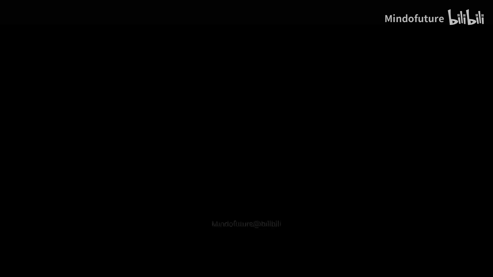
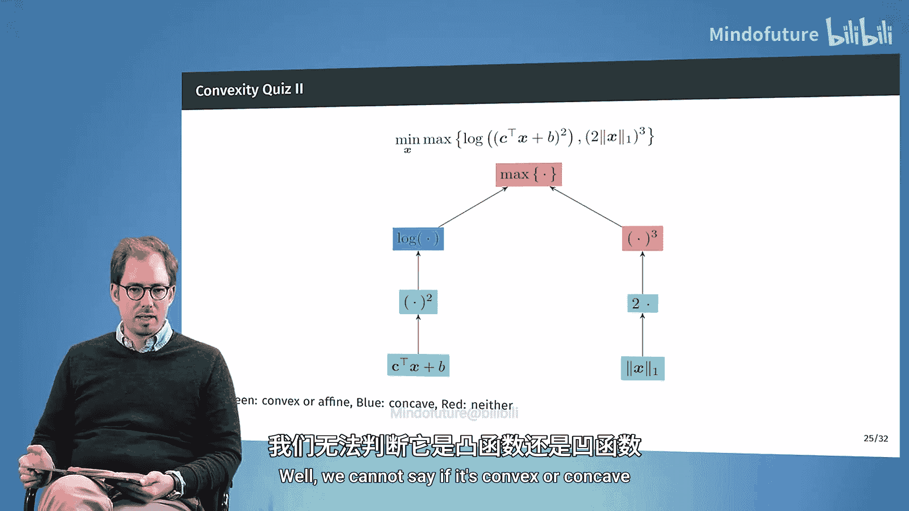

# 机器学习优化方法：1.4：凸性 🧠

在本节课中，我们将学习**凸性**，这是本课程所讨论的优化问题中最重要的性质之一。我们将首先了解集合的凸性，然后深入探讨函数的凸性。

## 集合的凸性

上一节我们介绍了优化问题的基本形式，本节中我们来看看凸性的概念。集合的凸性定义非常简单。

对于一个集合，如果取集合中的任意两点，连接这两点的线段上的所有点都仍然包含在该集合内，那么这个集合就是凸集。

下图展示了一个**非凸**集合的例子。因为线段中间有一个点位于集合外部，这违反了凸集的定义。

对于任意一个集合，我们可以构造它的**凸包**。凸包是指包含原集合中所有点的最小凸集。例如，图中所有黑色小点，其凸包就是围绕它们的最小凸多边形。

## 函数的凸性

了解了集合的凸性后，我们转向函数的凸性。关于函数凸性有几个等价定义。

第一个定义是：函数的**上境图**必须是一个凸集。上境图是指函数图像上方的所有点构成的集合。如果这个集合是凸的，那么该函数就是凸函数。图中展示了一个非凸函数的上境图，因为连接两个点的线段有一部分落在了上境图外部。

第二个等价定义是**詹森不等式**。它要求对于函数上的任意两点 `x` 和 `y`，以及任意介于0和1之间的参数 `α`，连接 `(x, f(x))` 和 `(y, f(y))` 的线段上的点，其函数值必须大于或等于该点处原函数的值。用公式表示为：
**f(αx + (1-α)y) ≤ αf(x) + (1-α)f(y)**

第三个条件是针对二阶可微函数的：如果函数 `f` 的**海森矩阵**处处是**半正定**的，那么该函数是凸的。这对应着函数图像像一个开口向上的“浴缸”形状。

以上三个条件是等价的，满足其一则必满足其他。

## 次梯度

次梯度是一个在凸优化中频繁出现的概念。对于凸函数 `f` 上的一点 `x`，沿着梯度方向（或某个特定方向）可以画出一条切线，这条切线被称为**次梯度**。凸函数的特性是，整个函数图像都位于其次梯度的上方。这也是它被称为“支撑梯度”的原因。

即使函数在某些点不可微，我们仍然可以定义一组**次梯度集合**，集合中的每一个向量都满足“处处在函数下方”的条件。

## 如何判断函数的凸性？

我们已经知道了凸性的定义，但如何快速判断一个函数是否处处凸呢？逐一检查每个点是不现实的。

幸运的是，存在一些已知的“乐高积木”式的基本函数，它们本身是凸的（或凹的），并且通过特定的组合规则，可以构造出新的凸函数，而不会丢失凸性。

以下是几个重要的基本凸函数和凹函数“积木块”：

**已知凸函数：**
*   **仿射函数**：`aᵀx + b` （其中 `a` 是固定向量，`b` 是标量）
*   **负熵**：`x log x` （定义域 `x > 0`）
*   **二次型**：`xᵀPx` （其中矩阵 `P` 是半正定的，记作 `P ≽ 0`）
*   **范数**：任何范数 `||x||`（如欧几里得范数、最大值范数）都是凸函数。

**已知凹函数：**
*   **幂函数**：`xᵀ` （其中 `p ∈ [0,1]`，`x ≥ 0`）
*   **对数**：`log x` （`x > 0`）
*   **平方根**：`√x` （`x ≥ 0`）
*   **负定二次型**：`xᵀPx` （其中矩阵 `P` 是半负定的，记作 `P ≼ 0`）
*   **最小值函数**：`min(x)` 是凹函数。

## 凸性的组合规则

有了基本积木块，我们来看看如何组合它们。主要规则是关于复合函数 `h(x) = f(g(x))` 的：

*   如果外层函数 `f` 是**凸**且**非递减**的，内层函数 `g` 是凸的，那么复合函数 `h` 是凸的。
*   如果外层函数 `f` 是**凸**且**非递增**的，内层函数 `g` 是凹的，那么复合函数 `h` 也是凸的。

这些规则为我们提供了一种通过观察函数结构来判断其凸性的强大工具。但请注意，这些规则是**充分条件**而非必要条件。有些函数不符合这些规则，但仍然是凸的。

## 实例分析

现在，让我们运用所学知识来分析两个函数。

**例1：`f(x, y) = (x - y)² + 1 - max(x, y)`**

我们可以将其分解为树状结构：
1.  `(x - y)` 是仿射函数（凸）。
2.  `(x - y)²` 是凸函数的平方（凸，因为平方函数在非负区间非递减）。
3.  `max(x, y)` 是最大值函数（凸）。
4.  `1 - max(x, y)` 是常数减去一个凸函数。因为 `1 - z` 关于 `z` 是线性递减的，而 `max(x,y)` 是凸的，所以这部分是**凹**的。
5.  最后，将凸函数 `(x - y)²` 与凹函数 `1 - max(x, y)` 相加。两个函数的和，如果一个是凸的，另一个是凹的，则无法直接判断整体凸性。需要更精细的分析（例如求二阶导数）。仅凭组合规则无法断定此函数整体凸性，但可以分析各部分。

**例2：`f(X) = max( log( (aᵀX + b)² ), 2||X||₁³ )`**

我们同样进行分解：
1.  `aᵀX + b` 是仿射函数（凸）。
2.  `(aᵀX + b)²` 是凸函数的平方（凸）。
3.  `log( (aᵀX + b)² )`：对数函数 `log(z)` 是凹函数且递增。当内层 `z = (aᵀX+b)²` 是凸函数时，根据规则（凸且非递增对凹函数），复合结果**无法直接判定**。实际上，`log` 是凹函数，`log(凸函数)` 不一定是凸或凹。
4.  `||X||₁` 是L1范数（凸）。
5.  `2||X||₁` 是凸函数的正常数倍（凸）。
6.  `(2||X||₁)³`：三次方函数 `z³` 在整个实数域上既不是凸函数也不是凹函数。
7.  最后，取 `log(...)` 和 `(...)³` 两者的最大值。由于其中一个分量（三次方项）既非凸也非凹，因此整体函数 `f(X)` **既不是凸函数，也不是凹函数**。

## 总结

本节课中我们一起学习了**凸性**这一核心概念。我们首先从**集合的凸性**入手，理解了凸集的定义。然后重点学习了**函数的凸性**，掌握了其三种等价定义：上境图、詹森不等式和海森矩阵半正定。我们还引入了**次梯度**的概念，它对于理解非光滑凸函数至关重要。

为了实际应用，我们介绍了一系列已知的凸函数和凹函数作为“基本构建模块”，并学习了保持凸性的**函数组合规则**。最后，通过两个实例分析，我们实践了如何运用这些规则和模块来分解和判断复杂函数的凸性。记住，这些组合规则是判断凸性的有力工具，但并非唯一方法。