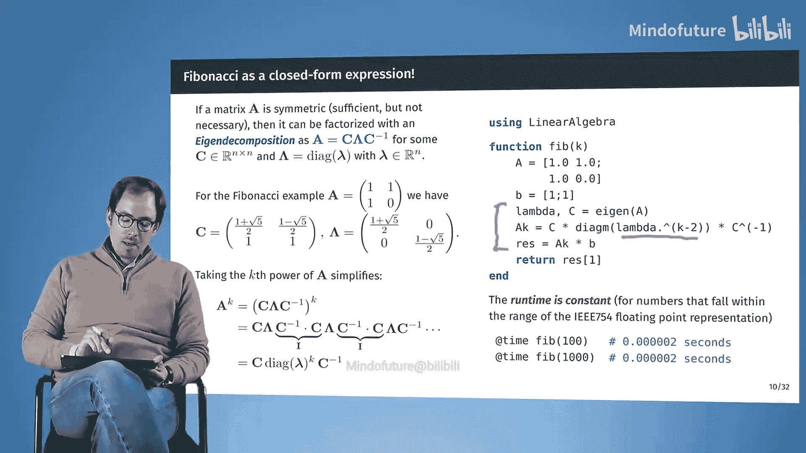

# 【凯尔大学】机器学习优化方法 ｜ Optimization Methods For Machine Learning And Engineering 2021 p06 P06_2.1_线性代数复习 -BV1C6SwBqEp7_p6-

Welcome for the second lecture of the course optimization methodsth for machine learning and engineering。

 Today's lecture is on the new method， loss functions and regularization。

So the topic for today is first， we will see a repetition of some basic concepts of linear algebra that you will need in the courses going forward。

We will look at Newton's method in detail， which will result in great speed improvement compared to gradient descent。

 which we had seen last time。And then we will go further into model fitting as optimization。

 this perspective on machine learning with a couple more applications and for example。

 also how to fit probability distributions in an uncertain environment。So first of all。

 let's have a look at linear algebra。 and these are basic concepts that you should recall from your prior。

Stud， so linear algebra one probably you all had that during your Bchelor and now let's have a look at some of the notation that will be used and also how to implement linear algebra concepts in a computer program and there we will use a particular programming language that is commonly used today in machine learning environments。

 the programming language is called Julia。Don't fear another programming language it will be quite basic what we are seeing today。

 but it's quite suited and it provides us with the syntax that we need to do linear algebra without having to call into dedicated libraries or other complicated things so linear algebra will be built into the programming language and it's all a lot easier than it might sound right now。

So first of all， how I want to motivate the section of linear algebra is by the Fibonacci series might sound strange。

 but hopefully everything will be resolved in the end。

 so the Fibonacci series is a recursive rule that defines a sequence of numbers and the sequence is 112358。

132134。And the idea behind that is that you always sum up the two preceding numbers。

So to get to the two。You sum up1 and one。To get to the three， you sum up two and one and so on。

 so you take the sum of the two preceding entries in the series。

And this is a quite famous sequence or series， it was first published in the Western world in 120002 in a book called Libba Abaki。

 and this book was author by Leonardo D Piza later he was known under the name Fiubbonacci。

And this book is famous for introducing the Hindu Arabic numer systems so that we have numbers 0 to9。

And then and that's the difference from the Roman numbers that existed before。

 So this book originally introduced the Hi Arabraic numeral system in the Western world and also introduced the Fibonacci series and here you see the original text and the first original mention of the Fibonacci series。

This is also a pattern that occurs in nature， so you can see that in certain types of plants。

 how the seeds are arranged in a flower， but you can also see this， for example。

 in a family tree where if you go back a certain number of steps in your family tree。

 the number of male ancestors will be from the Fibonacche series。In computer science。

 it's also important。 So there are algorithms that can be described or their runtime can be described by the Fibonacci series。

 Sos it's quite versatile。 And if we go back even before Libba Avaki， the series has been。

Looked at and studied in Sanskrit poetry， so on the Indian subcontinent， even 450 before Christ。Ok。

 how can we compute the Fibonacche series。What you see here on the right hand side。

 this is a piece of Julia code where we define a function flip of K。And if K is smaller than two。

 we return one， so this is at the very beginning of the Fibonacci series and otherwise we recurse and we take the tool or we compute the two preceding entries in the Fibonacci series and return that。

The problem here is that the runtime of this little algorithm is exponential。

Because when we increase k by1， we effectively double the or nearly double the amount of computation that has to be done。

And doubling the runtime or nearly doubling it with every k。

 this is exactly the exponential runtime where soon runtime will really explode。

 so you see that for the initial elements of the series。

 we can compute that in micro to milliseconds。For 49 entries or the 49th entry。

 we need 27 seconds and then going back one more step， one additional entry， we're up to 44 seconds。

 so about double of course there are other influences in your computer what your operating system is scheduling and so on so it's not exactly double here but you get the idea so if we were to increase this further soon we would run into computational limits even on the fastest computers。

How can we improve this， The first technique that we will see is memization。

Where we do not recompute a result that we already know。

 So if we already know the 49th and the 48th entry。

Why would we have to recompute everything to calculate entry 50。So actually。

 the runtime should be linear， and this is exactly done here。

What you see in the code is that we generate an array or a vector with the with enough space to store the Fibonacci entries in the in the series before。

 so here we have the。We have here the the first entry  one then one then2 then three。

 And by stepping through the list that way， we have a linear runtime in the number of elements。

 So this is quite。Straightforward， what you're seeing here。

 So the runtime is now linear and if we want to go from 1000 elements to 10，000 elements。

 we have an about by 10 computation time。How can we get even faster。

And we can get a lot faster than linear。 And for this， we will now invoke our。

Recapitulate some of the basic concepts of Leil algebra that you all have probably heard。

 but we will refresh this just to have them in memory again and to also see how the syntax in the Julia language compares to that。

What you see on the top part of the slide， this is just the mathematical notation for a vector column for a column vector。

So。The column vector is basically just a set of， of numbers arranged in a column， and in。In Julia。

 we can express that quite easily， we say v equals 123。

 put that all into square brackets and we put the semicolon， you can also use a comm up。

 or here we use the semico in between them to indicate that these are all the entries of the vector that we are creating here。

And Julia will return this element to us and also indicate some some type information and here the type is that it's an in 64 array of one dimension。

ok。And we can turn this column vector into a row vector by taking the transpose。

 So this symbol that you see here， this is the symbol for for taking the transpose。

And so instead of arranging it in a row， a column， we now arrange it in a row。And in Julia。

 the syntax is quite similar， but now we only use a space between the elements。

 and that gives the indication that here we want to have a row vector。1。

 one difference here is Julia now returns to us an array of dimension 2。So actually。

 what Julia does behind the scenes is when you give him a row vector。It will make it a matrix。

 And here it will be a 1 by three matrix， so。1 rows and three elements in that row。

And we can also directly in Julia take the transpose， so here this prime symbol is used for that。

 so v prime is exactly the transpose of the column vector that we had initially。

When we have a column vector and a row vector， we can multiply them。

And the idea is that if you take a row vector and multiply it with a column vector。

Then there is an element wise multiplication and addition。 So here。

 the first element of the row vector and the first element of the con vector。 These are multiplied。

And then this is repeated for the second elements， and the respective results are。

 are added together。 So this is just。嗯嗯。A convention for how row and column vectors are multiplied。

This doesn't work if we switch the order of the row and the column vectors。

 so this is just the convention how it is to be done。Later in a later lecture。

 we will see more of the definitions from vector spaces which are a generalization of this concept then everything will make will be more grounded in a formal mathematical sense but for now this is the rule and you can just apply the rule we can do this as well in Julia so here v transpose times the v is exactly a row vector times a column vector and。

This is 14。 And you can just check that result for yourself。And so on the next slides， also。

 we will see the Julia code and the results so that you can also debug your thinking and you can follow the code and see if your understanding of the mathematical expression matches to the given results。

One important thing in this course， unless otherwise stated。

 all vectors will be row vectors and the vectors will always be printed in fat font sort in a bold font and by that you can get some metterada on the formula to see that okay here it's a vector or it's a row vector that is multiplied with something else and the convention is a bold lowercase。

 symbols will always indicate vectors and they will be column vectors if not stated otherwise。ok。

Going forward， we will see matrix vector multiplication。 So I assume you all know what a matrix is。

 So it's basically a grid of numbers。and。More really mathematical details follow than later for the vector spaces。

 but for now it's just a a grid of numbers。 and what we can do is multiply a matrix with a column vector。

And what we essentially do is we turn the matrix into row vectors。

And then multiply each of the row vectors with the column vector。

And this will then result in one entry of the resulting column vector。

 So if I take a matrix and a column vector and I multiply the two， I will get a column vector out。

AndSo here I'm taking the first element and this vector。

 and this gives me the first entry of this recit column vector。

The Julia code is what you probably have expected， so the notation for the matrix is that we use spaces to indicate the rows and then a semi column and maybe also a new line but the new line is not required to indicate that we are now moving over to the next row。

And the V is a column vector as as before。 And we can just multiply the two。

 So a star V here is the syntax for multiplication。O。

 we can also multiply the roll vector under the matrix。And again， here， the order is different。

 So if you have a roll vector， you have to put it。In front of the matrix for the multiplication。

And here we think about the matrix as being consisting of column vectors。

And now we can take the row vector and multiply it with each of the column vectors and get the matching result。

In the output roll vector。 So in this case， the output will be a aero vector。In Julia。

Its the matrix that you see here is the same， but now we take a vector that we transpose to have a raw vector and multiply that with a and we get out this result here and you can just follow along to see whether your understanding of the mathematical formula leads to the same result。

We've seen matrix and vector modification， but we can also multiply two matrices。

And the idea behind that is that we split the。The the left hand matrix into row vectors and the right hand matrix into column vectors。

 and then we we mix and match and take the first。Raw vector and the first column vector and this gives us the first entry in the result matrix。

 and then we can take the first row vector， which indicates also the role in the result matrix with the second column vector and get this output and here the result will be a matrix and the dimension of the result matrix is obviously determined by the dimension of the input matrices。

And for the input matrices， they need to match up。 So if I have as the on the left hand side an n times k matrix。

Then on the right hand side， I need to have a K times n matrix so that the K is matching up。

The algorithmic runtime of this is n times k times M then， so it's getting quite expensive over time。

What is important here or which might come up from time to time is that if I take the the transpo of a times B。

And then I can remove the the brackets。But then I have to also switch the order。

 then I have to multiply B transposed times a transposed。

 so a matrix can be transposed just as a vector just by flipping it over。

And why this has to be done becomes quite clear when we are looking at the dimensions。

 So here then I would have an n times K matrix times a K times n matrix so that again。

 the K dimension is matching up as it did before。诶。Okay。

There are additional algebrabra rules for matrix multiplication。 So first of all。

 matrix multiplication is associative。 It is not important how I put in in the brackets。

 This will not change the result。 You see this here with an example， but this holds in general。

And second matrix multiplication is not communative， so in general。

 you cannot switch the order of two matrices that you will multiply and again here you see an example where this is the case。

 There are some examples where you can commute， but these are rather special cases。Why do we care。

 Why have we now spent so much time on algebra when all we wanted to do is compute the Fibonacche series fast。

And for this， let me show you how computing the Fibonacci steps can be turned into a matrix vector multiplication。

So the first two elements of the Fibonacci series， these were one and one。

 and here we have a column vector that exactly contains the first entries one and one。And。

What we now do is we always consider two elements of the Fibonacci series like a small window of the Fibonacci series。

And then we slide that window one over， and when we slide that window one over。

 we want to sum up the preceding elements。And only take the。

Second element of the preceding little window， so if the window was here，1，2，3，4，5。

 this is the first part of the Fibonacci series and thenops now we also have here one more one at beginning。

And then， our window is initially。This part。 and then we slide over the window and then we get to this part and sliding over the window is exactly a matrix vector multiplication。

 So we have the matrix here。 And when we do the multiplication， we have the first entry time plus。

One time。 the second entry。And then here down below。

 we have one time the first entry of the of the column better。 and then we get out to one。

So here we have one one， now we have two one and we can repeat that we can always take the current element that we have the current window of the Fibonacci series。

Multiply that with a matrix and move the window one over。So。We repeat that。

 and the next entry would be 3，2。 and this is exactly what we are expected。

And now we can do it many times。And now here we have repeated the matrix multiplication two times。

And we can just take the power series of this matrix， so we take the matrix here to the power of k。

 multiply that with the first two entries， and that gives us then a certain window later on in the Fibonacci series。

And the basic trick。At this time is that taking the power series can be done a lot faster。

Because assume that we wanted to take the eighth power。

Then we only have to square the matrix three times。

 so the power of2 times the power of2 times the power of2 gives us the8 power。And now， by。

This is different when， for example， it would be to the seventh power， but with some tricks。

 we get down to approximately lock K steps for taking the the case power of of this matrix。

 So now we no longer have a linear runtime。 Now we have a logarithmic runtime。

And this gives us great efficiency improvements。What we do here is this is all written in Julia。

 the code should be more or less selfexplanatory， so here we take the power of the matrix and multiply them with the row vector and return the first element of the resulting vector。

And the computation time is now a lot faster。 So before computing the thousands Fibonacci number。

 we can have a look how much time that did take。We have to go。Quite a lot。The thousands element。

Took something 7。 And now were at。Something。Something too。

 and but the idea is that you going forward and taking the millionth Fibonacche element and so on。

 this will be computed a lot faster than just by taking the linear algorithm。But can we。

 can we be even better。Now we have had logarithmic runtime。 and in computer science。

 usually when it's logarithmic， we are already really happy， but can we do even better than that。

 And actually we can。😊，We have seen that we can take the cave power of a matrix。

But can this K actually be negative。And， yes， it can be。 And this gives us a new concept。

 which is the inverse of a certain matrix。😊，So not all matrices have an inverse。

 we will see in another lecture details on that， but many matrices do have an inverse。

 and the idea behind that is if I multiply a matrix with its inverse，Then I get the identity matrix。

 which only has diagonal entries。And the diagonal entries are all one。

And all other other entries are 0。So this is the definition of the diagonal matrix。

 So here we have the one vector and take the diagonal matrix of that。

 And this is the identity matrix。 And if you see an expression like this with a with a old font one or or this I matrix here。

 then this indicates。A matrix of the appropriate dimension。

 so in some cases we do not state explicitly the size of the dimension of vectors and matrices because these are things that occur oftentimes and we just assume that from context it is clear that how long this one vector。

 for example， has to be in order to result in the identity matrix that has the same time。

 the same size as a times。The inverse of。嗯。In order to make this happen。

 the matrix a has to be square。 So this is something that is an absolute requirement for the existence of of an inverse。

So the identity matrix， it does nothing actually， So if we if we multiply a matrix with its identity with an identity matrix。

 then we will just get the same result back So a times identity is a。

And the inverse is actually something that does commute。

 So a does commute with its inverse because the result in both cases will be the identity。

There are some computational tricks to compute the inverse fast。

 but the fastest methods that we have available still have a runtime of and to the power of2 point something。

And for large matrices， this will become prohibitive， so we can compute the inverse。

 but when the matrices are really big， we have 10，000， 100，000 entries in every dimension。

 then computing the inverse is just no longer really feasible and also when we get to big optimization problems。

 this can become an issue。In Julialia the notation is quite easy。

 so having a matrix the inverse is just in of a， and if we multiply that with a。

 we get back the expected result， so this is just the identity matrix with ones on the diagonal。Now。

 we come to the。To the slide that finalizes the section of the Fibonacci series where we'll see how we can compute Fibonacci in constant runtime。

So and this requires some more linear algebra trickery， but if you not。

 it will be hopefully self explanatory。If a matrix， a is symmetric。So this is a sufficient condition。

 but it's not necessary， so there are also non symmetric mates， well this is the case。

But when a matrix a is symmetric， then it can be factorized by a so called identityigcomposition。

And we get out two matrices， C and big lambda。For which we have a is C times big lambda times the inverse of C。

And。우 유 이렇게。嗯。Let's take our matrix A that we have used for the Fibonacci series in there the eigen composition results in these two matrices。

 C and Bda。And the importance of big lambda here is that it only has diagonal entries。

 so here we find again， this notation for the diagonal entries only。And。

You don't have to understand where the eigen decomposition is coming from。

 but this is the only part that is surprising on this slide you just assume that for this matrix。

 there is this eigen decomposition and it can be found。And when we have the aic composition。

 we can increase the speed even further。Because if we take the ca power of a。

We take the case power of the identity composition。But now what we do is we are multiplying C。

With its invoice。 So here this part is the identity。It does nothing。

 so we can just scratch that one out。And so in the beginning， we have the matrix C。

Then we have the matrix big Lada and this matrix big Lada， it is repeating k times。

And then we get C invoice。But we know that big lambda has only entries on the diagonal。

 and otherwise it's 0。And when we take the power of a matrix that only has entries on the diagonal。

Then。It is a lot easier because then we can just element wise。Take the power。

 So we then have a matrix where we have。1 plus。Square root of5。Divided by2， here is a0。 heres a 0。

 and then one minus the square root of 5 divided by2。

And now we can just take the power of each diagonal element individually。How this goes。

 you can visualize it quite easily when you are multiplying this matrix with only diagonal entries。

And this can be really fast。So what we now see is the the cooldi grass。

Fibbonacci has a close form expression， which will be the high point and also the end of this last section on linearar algebra。

We can actually compute the fibonnaary series in constantant time or the some element of the fibonnaary series in constantine。

And for this， we need some trick。Some trick that might be surprising to you that you don't have to fully understand。

 but there is only one trick and from that on it will all follow with the usual linear algebra concepts that we have already seen。

The trick here。Is the socal called a decomposition and if a matrix is symmetric。

 there are other conditions that might suffice， but here our matrix is symmetric， so this is enough。

If the matrix A is symmetric， then we can find an eigantic composition into three other matrices where a is the product ofsymmetric C。

Some， some matrix， big Lada and the inverse of C。And what is important here is that the elements of big Lada are only on the diagonal。

 so there is some vector small lambda， which forms the diagonal entries of big lambda。

And for our Fibonacci matrix， which is a metric， we can compute this or we can have the computer find the result of the eigiccom this is related to the eigenvectors and eigenvalues of the matrix。

 but we won't go there today。So we have here this matrix and when we have this decomposition。

This simplifies the power series of a by quite a bit。And how does that work。

 So if we here have the K power of a and we replace that with the eigen decomposition。Then。

 and we then unroll， so to speak the multiplications。

Then we find that we can scratch the C multiplied by its inverse because it will be the identity that does nothing。

 So here all these elements they are removed。And what remains is C。

Times big lambda to the case power。Times the inverseice of C。And so， this expression here。

Because big Lada has only elements on the diagonal。We can further simplify the computation。

 So here we have the lambda。And with some entries on the diagonal。

And if we want to take the case power of this matrix。We can just take the individual power。

Of the entries on the diagonal。 And you can see that quite easily if you compare with the matrix matrix multiplication。

 what is going on there， you will see that only the diagonal entries are multiplied with each other。

 So the rest series is none it doesn't count。And this expression here can be computed really fast。

Because taking the power of a scalar is something that is natively supported by the process of architectures。

 and we can do this in constant time or about constant。So in Julia once again。

 our code changes a little bit， so only this middle part here。

 these three lines are changed compared to the previous example where first we have the eig decomposition。

And then we do， we compute the element wise power。Of the entries of Lada。 So here。

 this dot dot and then and then some operator， this indicates in Julia that it is an element wise operation to be performed on on a vector or some other collection。

So here we can compute a to the cave power in constantstantine。

 and as you see here in the runtime examples， this is not changing even if we go up to very large numbers provided that everything still fits into the range of the I3E754 floating points。

Okay， so to reitulate where have we started the first algorithm that we saw。

 it had exponential runtime， then we reduced that to linear。

 then we reduced that to logarithmic and now we are down to constant runtime。

And what you will see that with a little bit of mathematics。

We can get quite substantial improvements in the runtime of algorithms and this will also translate into the optimization algorithms last time we saw gradient descent and today we will see Newton's method and they already we will have quite a substantial improvement in the runtime by invoking a little bit more powerful mathematics。

 but that is still quite intuitive and not easy to understand。

 but you will all be able to understand it by having the right perspective and also visual explanation for what is going on。

If you want to refresh your lineage algebra skills some more， I can refer you to these references。

 so the first is once more， the YouTube channel by3 Bluelu1 Brown。

 the videos are really well done and give a good visual explanation of what is going on and the back book by Habbt and Habbard。

 the first chapters will give you also a formal background in the Lineage algebra。

