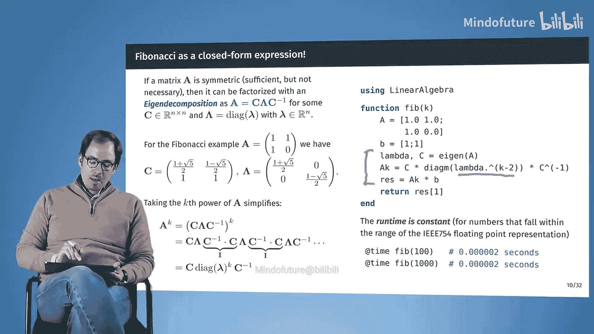

# 凯尔大学机器学习优化方法：P06：线性代数复习 🧮


在本节课中，我们将复习线性代数的基本概念，这些概念是后续课程的基础。我们将从斐波那契数列的计算问题入手，逐步展示如何运用线性代数知识，将算法的运行时间从指数级优化到常数级。这为我们理解后续更高效的优化算法（如牛顿法）奠定了数学基础。

## 线性代数基础回顾

上一节我们介绍了课程的整体安排，本节中我们来看看线性代数的基础知识。这些概念在机器学习和工程优化中至关重要。

### 向量与矩阵表示

在数学表示中，我们通常用粗体小写字母表示**列向量**。例如，一个列向量 **v** 可以表示为：
```
v = [1; 2; 3]
```
其转置 **v^T** 则是一个行向量：
```
v^T = [1, 2, 3]
```
在编程语言Julia中，我们可以直观地表示和操作它们：
```julia
v = [1; 2; 3]  # 列向量
v_row = [1 2 3] # 行向量，或使用 v' 进行转置
```

### 矩阵与向量乘法

矩阵 **A** 与列向量 **v** 的乘法规则是：将矩阵的每一行视为一个行向量，分别与列向量 **v** 进行点积运算，结果构成新的列向量。
公式表示为：**A * v**
在Julia中，乘法运算同样直接：
```julia
A = [1 2 3; 4 5 6; 7 8 9]
v = [1; 0; -1]
result = A * v
```

行向量 **u^T** 与矩阵 **A** 的乘法规则是：将矩阵的每一列视为一个列向量，分别与行向量 **u^T** 进行点积运算，结果构成新的行向量。
公式表示为：**u^T * A**
Julia代码示例如下：
```julia
u_row = [1 0 -1]
result_row = u_row * A
```

### 矩阵与矩阵乘法

两个矩阵 **A** 和 **B** 相乘时，需要满足维度匹配条件：若 **A** 是 `n x k` 矩阵，则 **B** 必须是 `k x m` 矩阵。结果是一个 `n x m` 矩阵。
其运算规则是：结果矩阵中第 `i` 行第 `j` 列的元素，等于 **A** 的第 `i` 行与 **B** 的第 `j` 列的点积。
公式表示为：**(AB)_{ij} = A_{i:} · B_{:j}**
矩阵乘法满足结合律 **(AB)C = A(BC)**，但不满足交换律，即 **AB ≠ BA** 在一般情况下成立。

## 从斐波那契数列看算法优化 🐇

现在，让我们运用这些线性代数知识来解决一个经典问题：高效计算斐波那契数列。我们将看到数学如何带来巨大的性能提升。

### 问题定义与初始方案

斐波那契数列的定义是一个递归序列：`F(0)=1, F(1)=1`，且对于 `k>=2`，有 `F(k) = F(k-1) + F(k-2)`。
一个直接的递归实现代码如下：
```julia
function fib_recursive(k)
    if k < 2
        return 1
    else
        return fib_recursive(k-1) + fib_recursive(k-2)
    end
end
```
这种方法的问题是运行时间呈**指数级**增长，计算 `F(50)` 就需要数十秒，效率极低。

### 优化一：线性时间复杂度

第一种优化是使用**记忆化**或迭代法，避免重复计算。
以下是迭代方法的实现：
```julia
function fib_linear(n)
    f = ones(n+1) # 初始化数组，F(0)=F(1)=1
    for i in 3:n+1
        f[i] = f[i-1] + f[i-2]
    end
    return f[n+1]
end
```
这种方法将运行时间降低到了**线性级** `O(n)`。

### 优化二：对数时间复杂度

我们可以将斐波那契数列的递推关系转化为矩阵运算。定义向量 **x_k = [F(k+1); F(k)]**，则递推关系可以写为：
**x_{k+1} = A * x_k**
其中矩阵 **A** 为：
```
A = [1 1; 1 0]
```
因此，要计算 `F(n)`，我们只需要计算：
**x_n = A^n * x_0**，其中 **x_0 = [1; 1]**
计算矩阵的 `n` 次幂可以通过**快速幂算法**实现，其运行时间为**对数级** `O(log n)`。
```julia
function fib_log(n)
    A = [1 1; 1 0]
    x0 = [1; 1]
    x_n = A^n * x0  # Julia 支持矩阵的幂运算
    return x_n[1]
end
```

### 优化三：常数时间复杂度

对于对称矩阵 **A**，我们可以进行**特征分解**：
**A = C * Λ * C^{-1}**
其中，**Λ** 是一个对角矩阵，其对角线元素是 **A** 的特征值。
那么，**A^n** 可以简化为：
**A^n = C * Λ^n * C^{-1}**
由于 **Λ** 是对角矩阵，计算 **Λ^n** 只需要对其对角线上的每个元素（标量）进行 `n` 次幂运算，这可以在常数时间内完成。
对于斐波那契矩阵，其特征值为 `(1±√5)/2`。利用这个性质，我们可以推导出斐波那契数列的闭式解（比奈公式）：
```
F(n) = (φ^n - ψ^n) / √5，其中 φ = (1+√5)/2, ψ = (1-√5)/2
```
这样，我们就能在**常数时间** `O(1)` 内计算出任意项。
```julia
function fib_constant(n)
    φ = (1+√5)/2
    ψ = (1-√5)/2
    return round((φ^n - ψ^n) / √5)
end
```

以下是不同算法的时间复杂度对比总结：
*   **递归法**：指数时间复杂度 `O(2^n)`
*   **迭代/记忆化**：线性时间复杂度 `O(n)`
*   **矩阵快速幂**：对数时间复杂度 `O(log n)`
*   **闭式解**：常数时间复杂度 `O(1)`

## 总结与过渡

本节课中我们一起学习了线性代数的核心概念，包括向量、矩阵及其运算，并通过斐波那契数列这个生动的例子，见证了如何运用矩阵分解等数学工具将算法效率从指数级提升到常数级。这个过程中，**特征分解**和**矩阵幂运算的简化**是关键思想。

下一节，我们将把这些强大的数学工具应用到优化领域，学习**牛顿法**。你将看到，通过利用目标函数的二阶导数信息（以海森矩阵形式表示），牛顿法能够比上节课所学的梯度下降法收敛得更快，这背后的原理与我们今天学习的矩阵运算密切相关。



---
**延伸阅读**：如果你想进一步巩固线性代数知识，推荐以下资源：
*   **3Blue1Brown 的“线性代数的本质”系列视频**：提供出色的可视化直观解释。
*   **《线性代数及其应用》（David C. Lay 著）**：教材前几章提供了扎实的形式化基础。