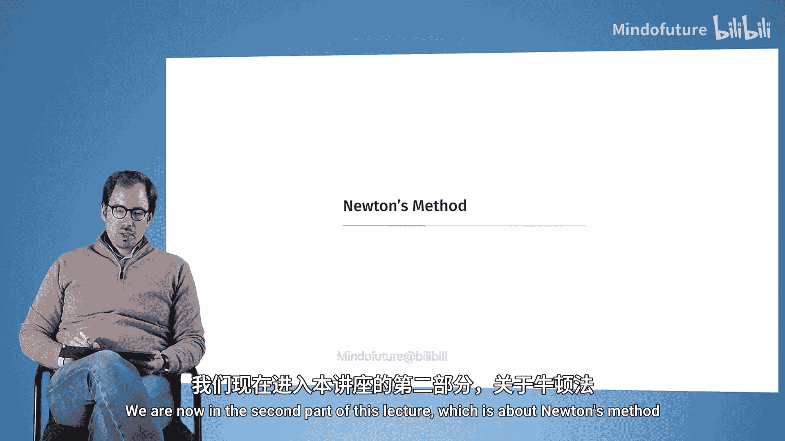
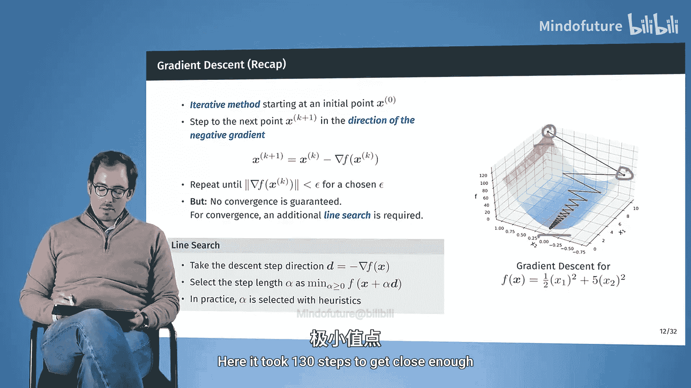
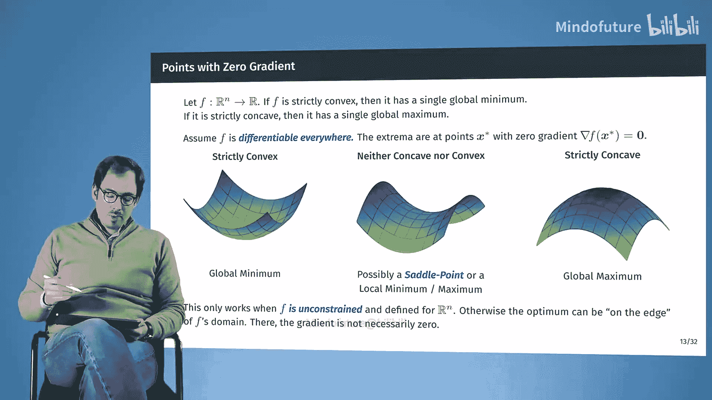
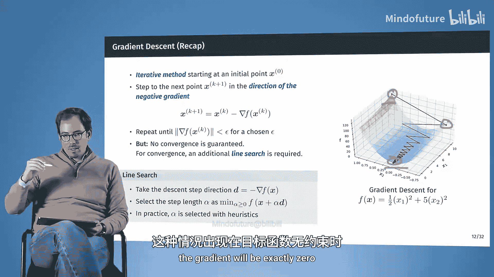
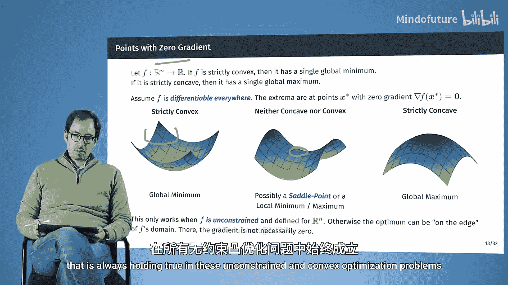
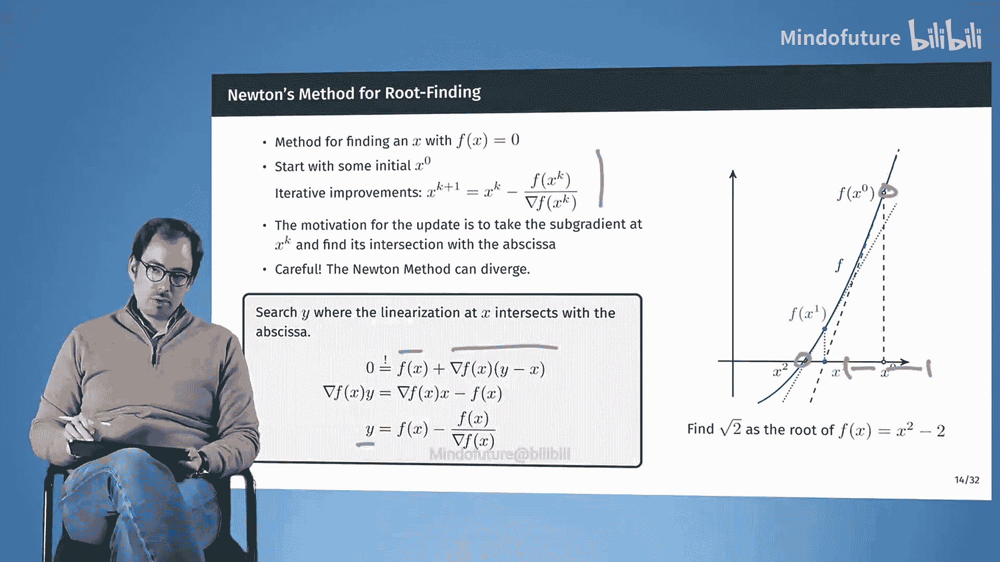
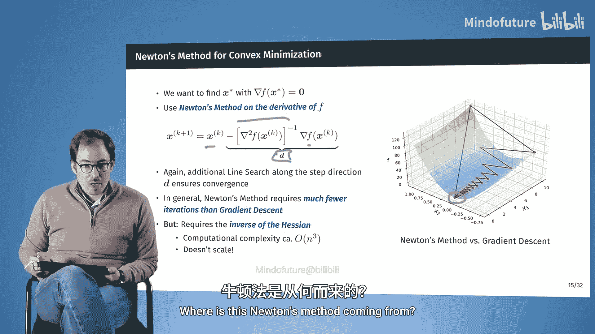
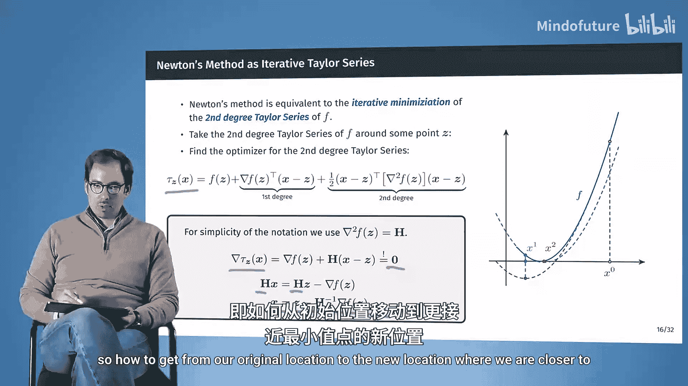

# 【凯尔大学】机器学习优化方法 ｜ Optimization Methods For Machine Learning And Engineering 2021 p07 P07_2.2_牛顿法 -BV1C6SwBqEp7_p7-

We are now in the second part of this lecture， which is about Newton's method。

And last time we saw gradient decent， so we start with some initial point x0。

 and then we move to the next point x1 by going into the direction of the gradient at this point。

And we use line search to guarantee convergence by not overstepping but not walking uphill on the other side of the valley quote unquote and we get some additional performance improvement by doing this line search still here in this example it takes about 130 steps to get to the solution down to a sufficiently small epsilon that was predefined but keep this number in mind here it took 130 steps to get close enough to the minir。

The idea behind gradient， behind Newton's method is that we not only want to walk downhill。

 we also want to find a point where the gradient is0。

So if if you look here， if you are exactly downhill。

 then in a very local region around the minimizer， the gradient will be exactly 0。

And this is the case if we have an unconstrained target function。

 So if the target function here goes from R R to the power of N to R。And if it is unconstrained。

 then it is and if it is strictly convexed， and we know that it has a single global minimum。

 So there's only one point where the minimum is achieved。And if the function is strictly concave。

 then we know there's a single global maximum。If it's neither of them。

 then there can be also locations where the gradient is exactly0。

 which would be here this set point in the middle， but which is not a minimum or a maximum。

But if we assume convexity， then we know that the minimizer must exist and that at the position of the minimizer。

 the gradient will be exactly 0。If there there are additional constraints。

 So if we have to say that that the solution has to lie in a certain region of。Of a subset of R2N。

 then it is no longer the case that at the minimizer， the gradient will be zero。

 but here we are still unconstrained and therefore this is something that is always holding true in these unconstrained and convex optimization problems。

Now， if we are looking for a point where a function becomes 0。嗯。

This is something that people hundreds of years ago have already thought about and the canonical method to do so is nuance's method。

 so this is also called root finding so for a function to find exactly where it is intersecting with the obs systemum and where the function becomes zero。

And what Newton's method does， it is also an。An iterative method。

Is to start at some initial location and then do a sequence of steps that brings you closer and closer to the route。

And what happens here is we start at some original 0。0， and for this function here。

 this is actually for finding the root of two。So we have here the function x squared minus-2。

 and at the position where this function is 0。We have exactly x equals the root of  two。

 and we want to get closer and closer to the root of 2。So what is done， we are at the place x0。

 we have f of x0， so the height of the function at that point。And then we take。

 then we linearize the function around this point， and here we have the gradient going down。

And now we take the intersection of the gradient or of the sub gradientient at at this point。

 the intersection of the sub gradientdient with the asisum and select this as the location of the next point we will evaluate。

 and this is repeated and repeated until we get really close to the actual route。

And since here we have linearized or we have taken the sub gradientdient doing the computation of finding here the intersection with the a system for the sub gradientdient。

 this can be done really fast。And how can this be computed。

 So the sub gradient will be here F of x plus the gradient times the step that that we did away from the point that was selected in this iteration。

So here xx is fixed， so x is the point where we are evaluating and the y is the new location on the sub gradientdient where we want to evaluate the well the value of the sub gradientdient at this point。

 so here we have f of x this is constant this is the point that was selected。Plus。

 the gradient times， the distance from from the original context。And we want this to be 0。

And now we can switch around。 We can move the gra Fx times y over to the other side and simplify a little bit。

 and we get back this expression。 So the next point that we are selecting where the subd becomes 0。

 So this。Epsilon is selected as f of x minus F of x divided by the gradient F。X。

And then we do this iteratively， so up here you see how this is performed iteratively and quite fast。

 we will get to the location where the route。OrIn this case， the square root of two is located。

Newton's method can also diverge， but for today we will ignore that part in most cases。

 Newton's method will converge rapidly， we will later have a bit better characterization of how fast Newton's method can converge。

And now what we do is we apply Newton's method to find the place where the derivative of the function that we want to minimize is 0。

So we know that in the location where where the minimizer is。The gradient is 0。

 and now we use nus method to get close。To this point。

And the formula you saw on the preceding slide is now a little bit more complicated。

 So now here we have taken the inverse of the Hesian at the current point。On the next slide。

 we will see exactly where this is coming from。 So here we have the original point minus the Hesian at that point。

The taking the inverse of that Hassian。Times the gradient at that point。 And again， this D here。

 it gives us a A a direction in which to step， and we can further refine the step size by applying the line search on that step direction。

And in general， Newton's method requires a lot fewer iterations than gradient descent。

 so originally we had 130 steps we had to take to get here to close to the minimizer。

And with Newton's method， it took us exactly one step。And so we are a hundred and30 times faster。

However， each iteration is now a little bit more expensive because we have to evaluate the the hesian。

And we have to invert the hesian and in large dimensional problems this。

Quickly becomes computationally difficult。 So for this low dimensional problem， it is always better。

 better to directly use Newton's method but for very high dimensional problems where we can no longer easily compute the inverse of the hesian。

There it becomes interesting to look at alternative methods， but if that wasn't the problem。

 then Newton's method is what would be preferable。Okay。How， where is this nus method coming from。

 How is this motivated。

We saw before that for finding the square root of two， we were taking the sub gradientdient。And here。

 this is no longer the case。Here， first of all， we take the the second degree tailor expansion of the target function that we are looking at。

 So here we have our target function F。And we select our initial starting point x 0。

And now we do a tail expansion at this point。 So this is the point。 And the Taylor expansion。

 we saw that。Last week already consists of the position or the value of the function at that point。

Then we add to that， the sub gradientient。In addition to that， we are adding the hesian。Enter times。

 the distance transposed in front and the distance at the end。

And what this tele expansion has as a property is that its first and second derivative。

Are exactly the first and second derivative of the function F at this book location 80。

And so this is a quite good， or in many cases， quite good approximation of the underlying F。

And what the Newton method does here。Is in every location。

To find because we are now no longer trying to find where this is intersecting with the Epsisor。

 we are looking now for the location where the gradient of the tail expansion becomes0。And。

So here we have selected now the location where the tail expansion。

 where the gradient of the tail expansion is 0。 Select this new point。

 do a new tail expansion around that point。 select the point where。

The gradient is 0 and so on and so on。 And quite rapidly， again。

 we will converge to the point where the gradient of the original function F is 0。

 and this is exactly our minimizer。And here's the the derivation。

 So there's one step that is a little bit more complicated to compute the gradient of this tele expansion Here。

 It's tau of X at the location。Is that。And。诶。To get to this gradient。

 you have to recall that the Hesian is symmetric and then it should be quite straightforward forward to get from this expression to the gradient and now we expect this gradient to be exactly0 now here equal to a vector of0 and then by applying the appropriate linear linear algebra transformation and multiplying this expression here with the inverse。

Hassian and add the inverse Hasian on the left hand side of both sides of the expression。

We get to our step for the Newton method， so how to get from our original location to the new location where we are closer to the minimizer。

There is a。A body of work that has looked into the conversionvert speed of the newde method。

And there was one very important theorem by Katoovvich。

 who proved in the late 40s the supercongence of the Newton theorem。Kantorovch， he is interesting。

 he was a renowned Russian mathematician， and he was also behind a lot of the effort in Russia to centrally plan the economy and the methods he developed and the optimization tools he developed were famously used for central planning of capacity and which resources to invest where and so on。

But he well not only had this role in the state， but before that he was already。

 he produced some quite important results in mathematics and one of this is the superconversions of Newton's method。

So here we say that our F is assumed to be twice differentiable with RN as the domain。

 so we can compute the Hesian at every location。And if this hassian is positive definite。

 so if the function is upward bent， so to speak， and if we can bound the curvature or how fast the gradient of the function changes if we can bound that with some number。

 this is called the lipss number， and if we are close enough to the initial guess。

 then we can show or he showed that there is a superconvergence to the minimizer。

And the conversiongs is of a runtime of the order of locklog 1 over epsilon。

 so Epsilon here is the remaining  error that is still allowed and lock lock 1 over epsilon is really good convergence because if we reduce the error by times 1000 in many cases this only increases the number of Newton step Newton method iterations that we need to take by one or maybe two so due to this supercons if our initial location is close enough to the minimizer。

 then by only two or three iterations of the Newton method。

 we will be as precise as we can still represent the solution in our floating point numbers on our computer。

But however， we need to be close enough initially to achieve the superconvergence。

 so you can think of this like a baar of supercons。

 So here we have our minimizer and there's this basar of supercongs around that。

 And if we if we find our way into the baar of superconvergs， then the Newton method in just。

A few steps will， will converge to them。