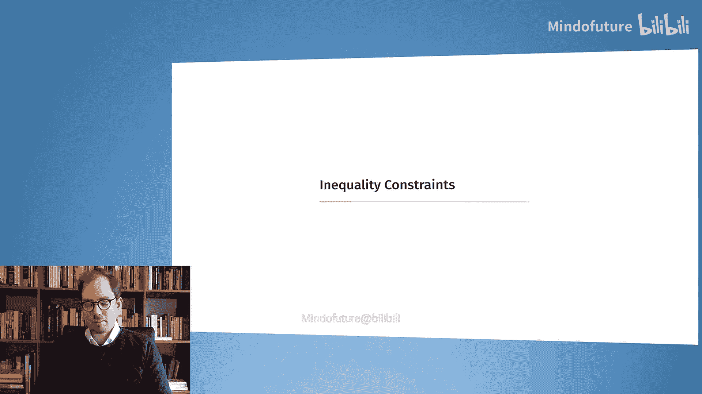

# 【凯尔大学】机器学习优化方法 ｜ Optimization Methods For Machine Learning And Engineering 2021 p09 P09_3.1_拓扑学基本概念 -BV1C6SwBqEp7_p9-

Welcome today's third lecture for optimization methods for Ma learning and engineering today will be on inequality constraint optimization。

So the agenda for today is to first see some notions of topology， which is a topic from mathematics。

 we will see just some basic elementary definitions there that we need later on。

Then we dive into the definition and the interest in inequality constraints while we want to deal with constraint optimization problems。

Then we see a solution methods for solving inequality constraint problems， the interior point method。

And then we see also the connection to linear programming and linear programming will relate us back to some of the examples that we have seen in the first lecture in the historical background。

And at the very end， we will see some outlook with soft equality constraints and this will be then a motivation for the next lecture lecture4。

 which will then be about equality constraints， but today inequality constraints。

This will enable a lot of very interesting applications。

 so at the very end you will see how your superpowers have increased and how there are already a lot of new applications that come into possibility to be solved by the methods you learned here。

Okay， some notions of topology。What you see here is a blue circle that shall represent an open set。

And an open set is a set that does not include。Quote unquote， it's boundary。

 and we have to make this more， more precise what we need by boundary。

And so here we have all the points， X and y in the 2D plane that are less than one away from the zero point。

So we have here all the points inside of our circleca。

 but not the points that are exactly on the boundary。

And what is the definition of the open set is that if I take a point inside of my set。

I can always find some very small epsilon。Whereas circle or a ball of rad' epsilon is completely contained in the set as well。

 so here big P will be our blue circle。And for any point that I select here inside my blue circle。

 I can find some epsilon and the point around or the epsilon ball around that point will be fully contained inside P as well。

And of course， if I take a point on the boundary， a point that would be exactly one distance apart from zero。

 there it would not be possible to find such an epsilon。

 but the boundary is not included and therefore this works for all the points that are part of the setBP。

Okay so here we have the notation a new notation for this boP and this is just a set of all points that are less than epsilon away from the center point for some norm。

 so what you see here this notation， this is a norm and this is you can consider that a distance metric and we will see the exact definition and the difference between norm and distance metric in the lecture on vector spaces。

But from all， this mo suffifies。And so these are the open sets and they are also closed sets。

 so now on the right side， the closed set is the blue circle that does contain the border。

 so the difference here is that we have a smaller or equal than symbol。

 so all the points that are less or equal to one distance apart from zero。And， well。

The definition of the close set is here that if I take the complement and the complement is all the points that are outside of my set。

If I take the complement， then the complement is an open set。

 so for the all the points in the complement。And can find again。

 an epsilon such that the epsilon ball around that point is fully contained in the points outside of P。

Okay and here again we have some new notation here， the complement PC， so this small C up there。

 this is indicating the complement in our course。And well from the definition。

 it's clear that the complement of an open set is closed and also vice versa。

And why are open and closed sets important to us， they are important for two points。

 first of all it comes in with a definition of being continuous。

But also we have to look at the limit points， so we are looking at iterative algorithms where over several iterations。

 we are converging closer and closer to some optimum。

And the nice property of a convet or of a closed set is that it contains its limit points。

What is meant by that？So for every converging series that I have inside of my IP。

The point to which this series is converging is also inside of myCP。

Okay that's maybe a little difficult to let me expand it with a small example。

 so here consider the series PN where the points PN are1 over n and so I'm increasing n going from one to2 to three and so on and creating thus a series one。

 a half， one third and so on。And now let's assume that we have our set P equal to the points between0 and 1 where0 is not included。

 so here this normal bracket on the left side， this indicates that the zero is not included but the one with a box bracket。

 the one is included in our set。And now we can see very easily that all our points are included in that set because I can increase my n to some very large number and still I will get some result one over n。

Where this point is included in my SPP。However， it is converging to the point0。

 so0 is the limit to which the series is convergent but0 is exactly at the border and is outside of my setBP so here we have an example where we have a series where all points are a convergt series where all points are in P but it converges to something outside of P。

Okay。And what are the properties of open closed sets。

 or what are the operations that we can perform on open and closed sets？

So for the open sets I can take some finite number of open sets and form the intersection of them now so if you recall the intersection is all the points that are in both sets。

 so here I have my set one and I have my set two and then consider these are open and then the points in the intersection of these。

And if I take any finite number of open sets and compute the intersection between all of them。

 it will still be an open set。If I consider now the union。

 so the union are the points that are in either of these sets。

 so here this is my first set and I have my second set and then the union would be all the points that are in at least one of these sets。

And if I take the union of any number of open sets， then the resulting set will also be open。O。

But here you see the difference in one case， we said that we can take the union of any collection of open sense。

And in the other case， it only worked for the intersection of a finite number of open sets。

And so only for a finite number of open sets， we have a guarantee。

That the intersection would also be open。And why we cannot guarantee this for an infinite number of sets that we are intersecting。

This is shown in the following example Now here we construct。

A series of open sets so here we have our set AN and the set AN are the points between minus1 over n and1 over N。

But the border here is excluded， so all the points that are within this range， but not at the border。

And now if we let this n go to infinity， the range will get smaller and smaller and will go closer and closer to the zero point。

So if we now here take the union of an infinite number of sets n equals one going to infinity。

 then there will be only one point exactly that is contained in all of these sets。And that is0。

And by definition or what you see here is that zero is a close set。

Because for all points that are in the complement， I can draw this epsilon ball and this can be proven。

 so here we have a counter example where we take an intersection of an infinite number of open sets and the result is a closed set。

And therefore， this top one here， it only works for a finite number of open sets。Okay。

What are the operations that we can perform on the closed sets so again here we can look at the intersection at the Union。

 the intersection of any collection of closed sets is closed。

 so also an infinite number of closed sets if I take the intersection I know the result will again be closed。

And for the union of closed sets， I can take a finite number of close sets and take the union of them。

 and the result will also be closed， but I only have to guarantee if I do this for a finite number of close sets and again here's a small counterex。

 let's look at the close set theN that is the range of points between one over n and1 minus one over n。

And now let's do the union and what you see here is the borders or quote unquote borders。

 or the set is increasing and it becomes larger and larger and it more and more fills the space between 0 and1 but it never exactly reaches the 0。

0 to be included and it never exactly reaches the 。1 to be included。

 so here the union of an infinite number of these open sets of these closed sets will be an open set and this is a counterex therefore we don't have the guarantee that an infinite union or a union of an infinite number of closed sets will remain closed。

Okay。But so far it might have looked as if open and closed were contradictory properties so if I take the complement of an open set。

 it is closed and vice versa， but there are actually not contradictory。

 there can exist in parallel and there can also be sets that are neither open nor closed。

 for example here， this set that is open on one end or the range that is open on one end and closed on the other end。

 this total set is neither open nor closed。And there are also examples of sets that are both open and closed。

 so for example， the empty set。And you can just run this through the definition of open and closed set。

 and you will see that the definition is holding in both cases。Okay。

So far I've talked about the quote unquote order， but this is not the mathematical term。

 what we should talking about is the closure and the interior。

So the closure of a set P is the smallest closed set that contains P。

 so if I imagine that I have here some open set。While the bar is not included。

 therefore I draw this with a dotted line。And then the closure is the smallest closed set。

That totally includes all the points in the blue set。

So all the points here in my blue set have to be included in the green close set。

 and I'm looking for the smallest close set that contains all the points。And on the other side。

 the interior of a set is the biggest open set that is。Contained inside P。

And there can be also cases where the interior is empty。

 meaning I have a set that is somehow well defined and contains a lot of points。

 but if I'm looking at the interior so if there's an open set， there is fully included。

 then I only find the empty set。And let's see here at some examples。For example， here。

 I have a set with only one point。So here the set P， it only contains 1。

 lip and if I try to draw an epsilon ball around that， I will find out that I can choose Epsilon。

 however small I can， and the Epsilon ball will not be fully included in my set P。And therefore。

 I can the only open set that I that is smaller than P is the empty set。And well。

 this obviously is also true if I have many points that are somehow sparse in space。

 so I can imagine that there are more points inside here。

 but the set is not densely filled and then again this set has an empty interior。

And an example for that will be the discrete numbers。

Or than the natural numbers so let's imagine I am looking I'm doing an optimization and I'm only looking at whole numbers。

 so I only accept one and2 and three。 so whole numbers， but I don't accept。

Real numbers that are somewhere in between。 And then here I have a sparsely。

Fed grid or I have a grid with a lot of space in between and the interior of this solution set。

 or this interior of the set of possible solutions will be empty。

 and this has consequences for the optimization algorithms for many of the optimization algorithms that we will encounter it on。

But there are also other examples of sets with an empty interior。

 for example here we have a set that is constrained to lie on some diagonal， so I have two x's。

 I have x and Y。And the set P， I'm looking at， these are all the points that that lie on the diagonal。

And of course， there are many points lying on the diagonal and it's also in some way densely populated。

 but again， I cannot draw such an epsilon ball around any point in there where the epsilon ball is totally included。

Because it's like I have flattened out this space or have compressed and I've taken away one dimension and this leads to the fact that in the original embedding space。

Where my set lives， I cannot find an epsilon ball surrounding my point P that where the Epsilon ball is fully included in my set。

 big P。And we will later see a couple of constraints where， for example。

 I want to do an optimization and I apply the constraint that I'm only looking at points on the diagonal or points that fulfill some other condition。

 and then it can also happen that my solution set has an empty interior and this has consequences。

