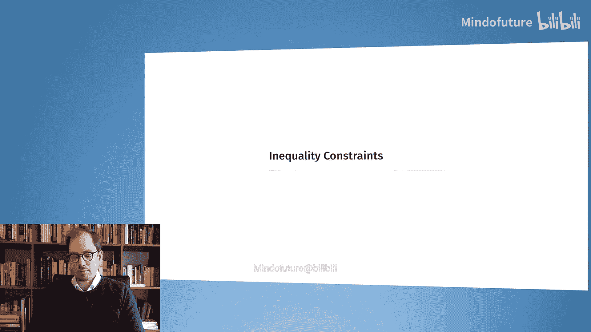

# 机器学习优化方法：P09：不等式约束优化

在本节课中，我们将学习不等式约束优化的基本概念与求解方法。课程将从拓扑学的基本定义开始，逐步深入到不等式约束问题的定义、求解方法（内点法），并探讨其与线性规划的联系，最后展望软等式约束，为下一讲做铺垫。

## 拓扑学基本概念 🔵

上一节我们介绍了课程的整体安排，本节中我们来看看一些必要的拓扑学基本概念。拓扑学是数学的一个分支，这里我们仅介绍后续优化方法中需要用到的基础定义。

### 开集与闭集

以下是开集与闭集的核心定义。

*   **开集**：一个集合是开集，如果对于集合内的任意一点，你都能找到一个以该点为中心、半径为 ε 的小球（或邻域），使得这个小球完全包含在该集合内部。这意味着开集不包含其“边界”。
    *   **公式表示**：设集合 P 是开集，当且仅当 ∀ x ∈ P， ∃ ε > 0， 使得 { y | ||y - x|| < ε } ⊆ P。
*   **闭集**：一个集合是闭集，如果它的补集（即所有不在该集合中的点构成的集合）是一个开集。闭集包含其所有“边界点”。
    *   **公式表示**：设集合 P 是闭集，当且仅当 P 的补集 P^C 是开集。

开集和闭集之所以重要，主要有两点原因：首先，它们与函数连续性的定义有关；其次，它们关系到极限点的性质。在迭代优化算法中，我们通过一系列迭代点逐步逼近最优解。闭集有一个很好的性质：它包含其内部所有收敛序列的极限点。

### 极限点示例

为了理解极限点的概念，我们来看一个例子。

考虑点列 P_n = 1/n，其中 n 从 1 开始递增，得到序列 1, 1/2, 1/3, ...。现在假设我们的集合 P 是开区间 (0, 1]（即 0 不在集合内，1 在集合内）。显然，序列中的所有点 P_n 都属于集合 P。然而，这个序列的极限是 0，而 0 恰好位于 P 的边界上，并且不在 P 内。这就构成了一个反例：序列中的所有点都在 P 内，但其极限点却在 P 外。

### 集合运算性质

了解了基本定义后，我们来看看对开集和闭集进行并集与交集运算时，结果会如何变化。

以下是开集的运算性质。

*   **有限交**：有限个开集的交集仍然是开集。
*   **任意并**：任意多个（包括无限个）开集的并集仍然是开集。

需要注意的是，“有限交”只对有限个开集成立。为什么不能保证无限个开集的交集仍是开集呢？请看以下反例。

构造一系列开集 A_n = (-1/n, 1/n)，即从 -1/n 到 1/n 的开区间。当 n 趋于无穷大时，这个区间会越来越小，无限趋近于 0。如果我们取所有这些开集的交集（即 n 从 1 到无穷大），那么唯一一个同时属于所有 A_n 的点就是 0。而单点集 {0} 是一个闭集。这就证明了无限个开集的交集不一定是开集。

以下是闭集的运算性质。

*   **任意交**：任意多个（包括无限个）闭集的交集仍然是闭集。
*   **有限并**：有限个闭集的并集仍然是闭集。

同样，“有限并”只对有限个闭集成立。无限个闭集的并集不一定是闭集。反例：考虑闭集 B_n = [1/n, 1 - 1/n]。当 n 增大时，这些集合逐渐填充 (0, 1) 区间，但始终不包含端点 0 和 1。这些闭集的无限并集是开区间 (0, 1)，这是一个开集。

### 开与闭的非互斥性

开集和闭集并非完全互斥的性质。一个集合可以同时是开集和闭集（例如空集），也可以既不是开集也不是闭集（例如半开半闭区间 [0, 1)）。此外，还存在一些集合，其内部可能是“空”的，这引出了闭包和内部的概念。

### 闭包与内部

为了更精确地描述集合的边界性质，我们引入闭包和内部的概念。

*   **闭包**：集合 P 的闭包，记作 cl(P)，是包含 P 的最小闭集。你可以把它想象成给 P 加上其所有边界点。
*   **内部**：集合 P 的内部，记作 int(P)，是包含于 P 的最大开集。你可以把它想象成从 P 中去掉其所有边界点。

一个集合的内部可能是空的。例如，单点集 {1} 的内部是空集，因为无法围绕这个点画出一个完全包含在集合内的小球。由离散点（如自然数集）构成的集合，其内部也是空集。另一个重要例子是低维空间嵌入到高维空间的情况，例如在二维平面中，约束在直线 y=x 上的所有点构成的集合。虽然这条直线上点很多，但在二维平面中，你无法围绕其中任意一点画出一个完全落在该直线上的二维圆盘，因此该集合在二维空间中的内部是空集。

在优化问题中，如果我们施加了等式约束（如 x=y），那么可行解集就可能具有空内部，这会对许多优化算法的应用产生影响。

本节课中，我们一起学习了拓扑学中开集、闭集、闭包和内部的基本概念，并通过例子理解了极限点和集合运算的性质。这些概念是理解后续约束优化问题，特别是处理具有“空内部”可行域问题的基础。下一节，我们将正式进入不等式约束优化的定义与意义。