# 【凯尔大学】机器学习优化方法 ｜ Optimization Methods For Machine Learning And Engineering 2021 p10 P10_3.2_不等式约束 -BV1C6SwBqEp7_p10-

Okay， now moving on， finally， to the inequality constraints。

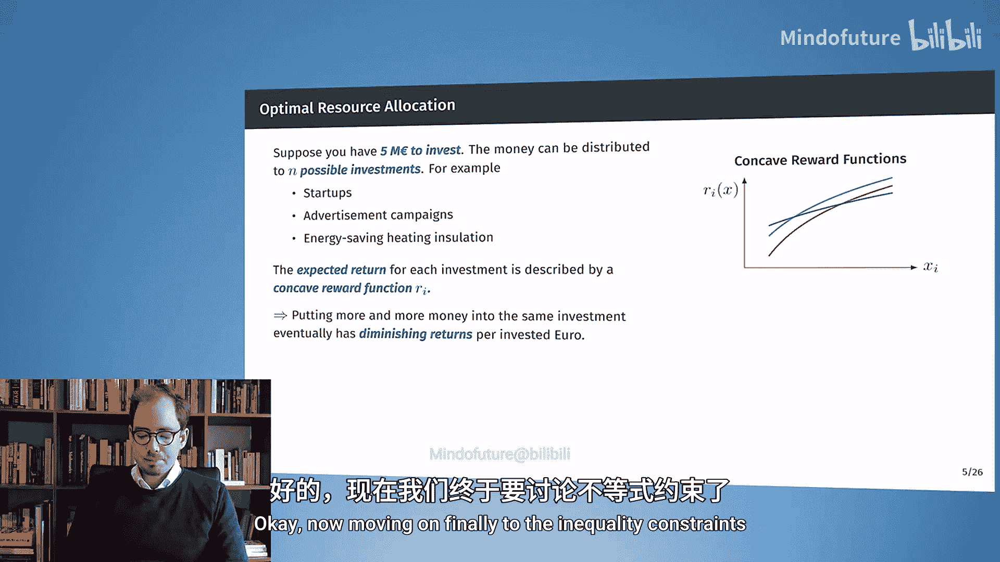

Let me motivate this with some example。So imagine you have。

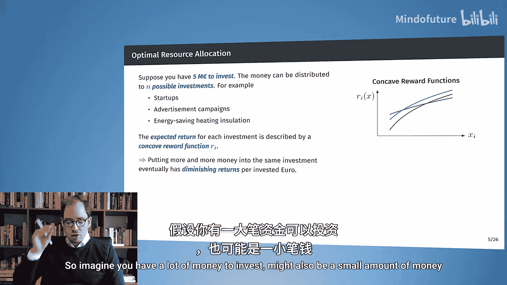

A lot of money to invest might also be a small amount of money but you have money to invest and you can distribute the money between in possible investments so you can invest in startups or you can maybe invest in an advertisement campaign for your company or you can at energy savingaving heating insulation to your house and so these are all examples where it is realistic to assume that the reward function。

 so how much return you get back from your investment that the reward function is concave。

And such a concave revolt function， it hints at what are called diminishing returns。

And what do I mean by diminishing returns so imagine you're installing heating insulation on your house or imagine you are managing a company and the company has many houses。

 public housing projects for example and then you want to install a heating installationsulation and you see that。

You invest some amount of money and over the next years in every winter you spend less and you will have some rewardt and there's a positive incentive for the investment and now I imagine you do the investment and you attach 10 centimeters of insulation to every house。

And this improves the energy efficiency of the house and you have to spend less money on heating and so on。

And so you have some return for investment。And the question is。

 whether after you have installed 10 centimeters of insulation。

 it makes sense to install another 10 centimeters of insulation。

And probably the energy efficiency will improve a little bit。

 so you will have some additional value by adding another 10 centimeters。

 but the increase in energy saving will not be as big as the first time。So here we have on this axis。

 the number of money we invest in one of our projects and then for the heating insulation。

 let's assume that we invest two amounts of money and we get some rewardvolt back so up here and then the question is what happens when we double the insulation and the question is whether this would be a totally uniform and linear increase so that we end up up here。

But that's probably not the case， probably adding another 10 centimeters of insulation will be less。

Advantageous as the first time around， so we end up somewhere here。And then the the resulting。

Rewardt function has a concave shape。And a concave shape works quite nice for us。

Because we are maximizing here， so we want to maximize our revolt。

And then we can just take the negative revolt function and then the negative ret function is convex and now we are minimizing a convex function and this is what our algorithms are all doing very well。

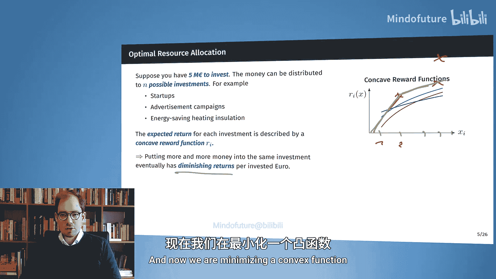

Okay， so the question is how much to put into every investment and if there were no constraints。

 if you had infinite money， then you wouldn't have to think a lot about this。

 but usually we are constrained， we have limited resources and we have to allocate our resources。

 we have to think about whether we put them and the problem you see here is called the optimal resource allocation problem。

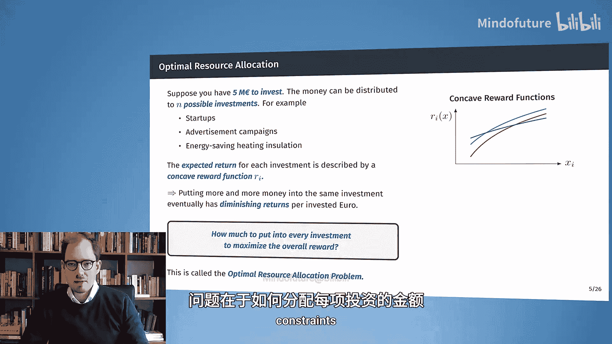

And we can cast it in a mathematical way， so we now have an optimization problem with constraints。

What we want to maximize is the sum of the returns。

So here we take the sum over all the possible investments and I get some rewardt back depending on the money XI that I have invested。

But I am constrained， so in this case， we said initially that we only have 5 million euro available to invest。

 so I have to ensure that the sum of my investments does not exceed 5 million。

And obviously we cannot do negative investments， so here we exclude the case that you could take a bank loan or something here you can only invest cash that is at hand and we have additional constraints that all our investments have to be equal or greater than zero and this is very important because otherwise we can have also very degenerate solutions where you take money out instead of investing and putting in somewhere else and we exclude this possibility。

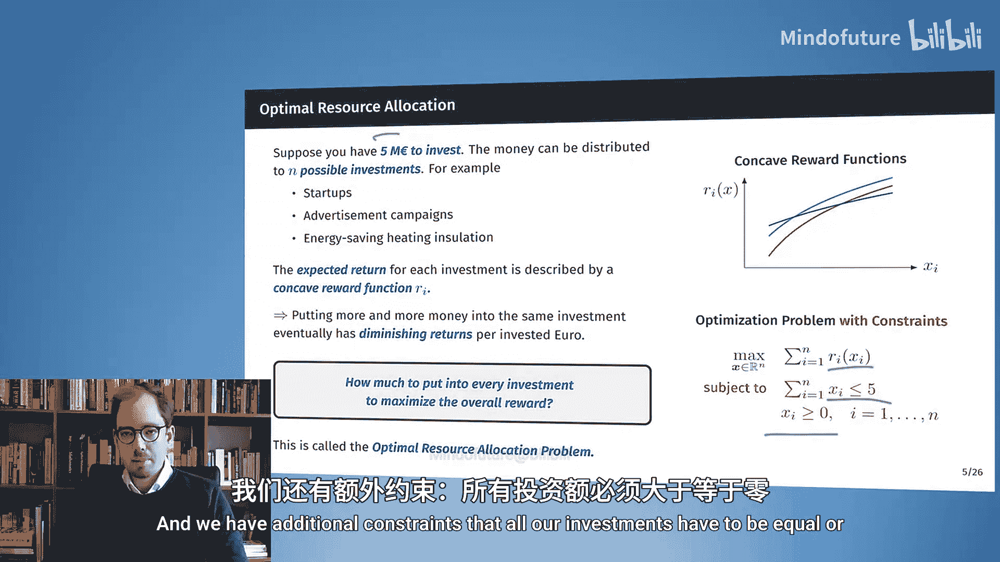

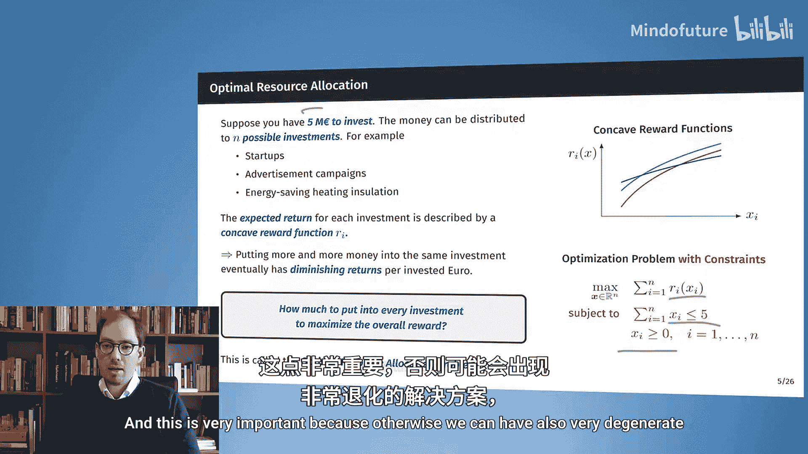

O。So this is the type of constraint we are looking at in this lecture。

 so here we have inequality constraints， so here you see this smaller than symbol and this is exactly a type of inequality constraint so the two need to be unequal so the left hand and the right hand side or。

They could be equal in this case， but this is still called an inequality constraint。

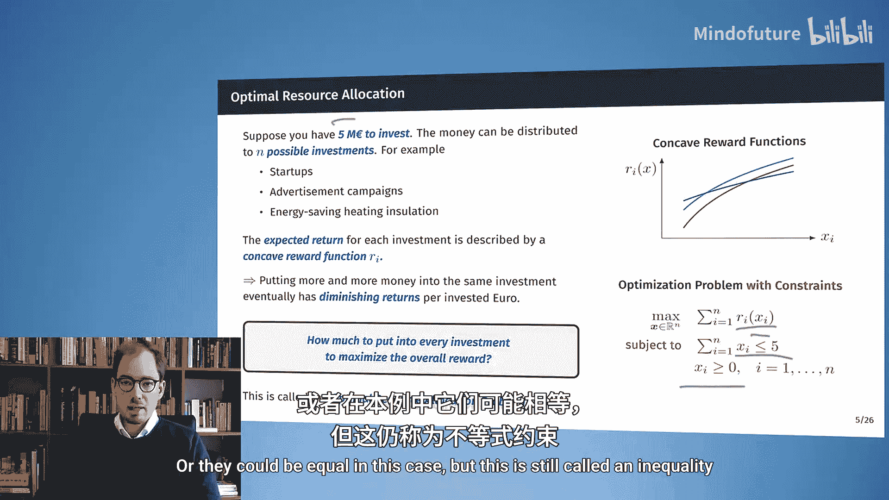

Okay， in general， constraint optimization means that we are somehow imposing limits。

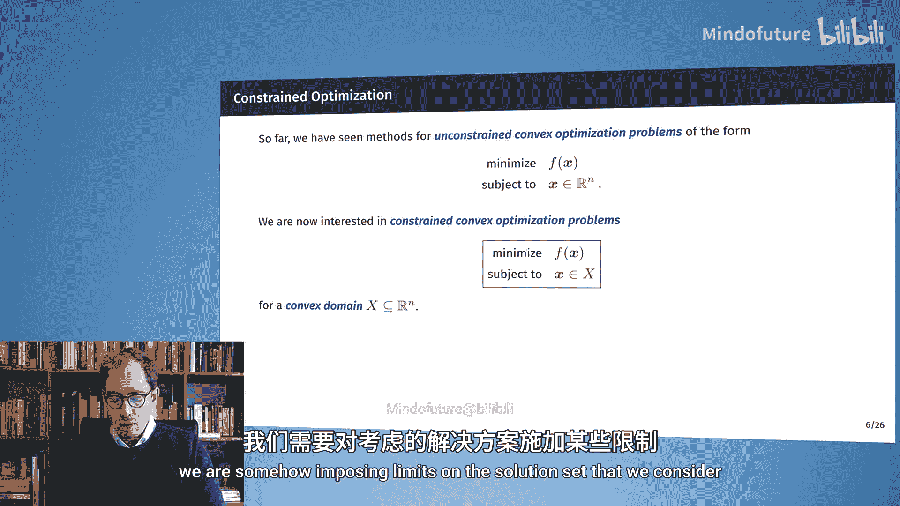

On the solution set that we consider。So far， we have done optimization。

 also multivariate optimization in a space RN。And every solution from RN is feasible。

 and so this is the unconstrained optimization form。And now we are constraining this。

 so now we say we have a。Domain， a big X。That is a subset or that is included in RN。

 but which can be substantially smaller and also， more complicated with some structure。

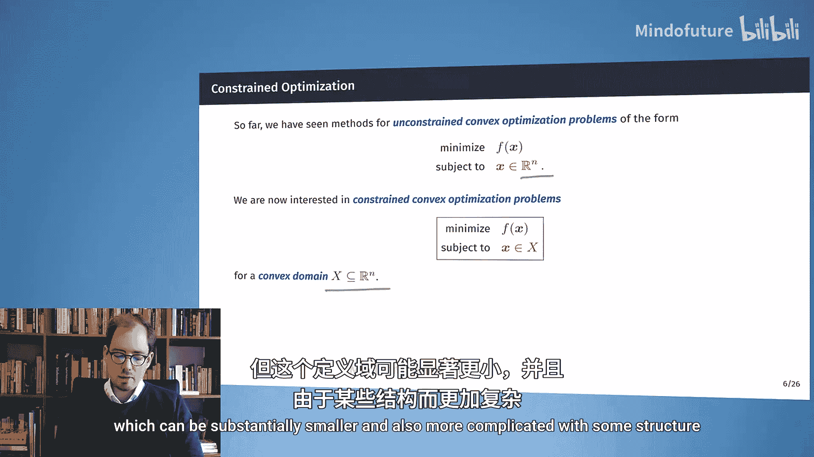

And so this is done。That general additional limitation that we are adding to our optimization problems。

And the main idea is to take this constrained optimization problem where we need solutions to be in the set big X and to transform this optimization problem into an unconstrained form or in an equivalent representation that we can solve with the algorithms that we saw in the previous lectures。

 so in the previous lectures we saw gradient descent and line search we saw the newde method and so on and what we try to do here is to transform the constraint optimization problem into something that we can solve with gradient descent or the newton method。

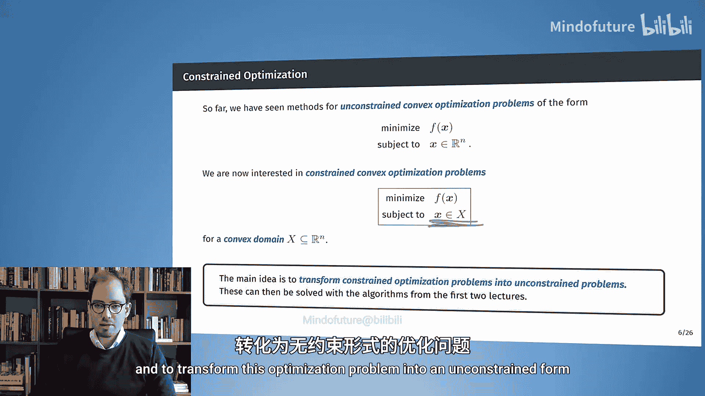

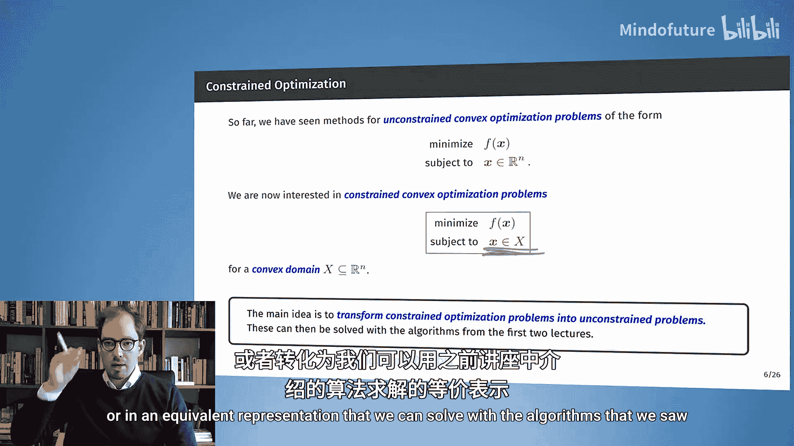

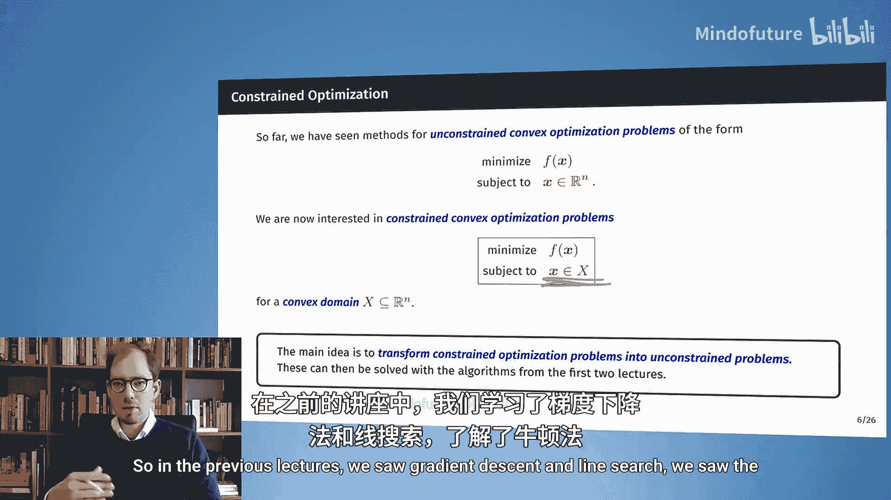

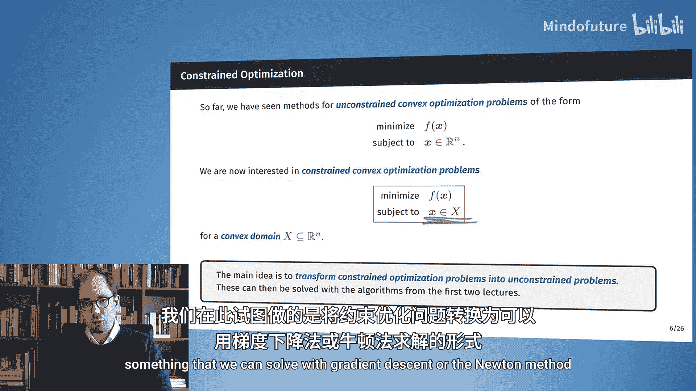

And how this is done for the inequality constraints。

 this is exactly what you will learn in this lecture。

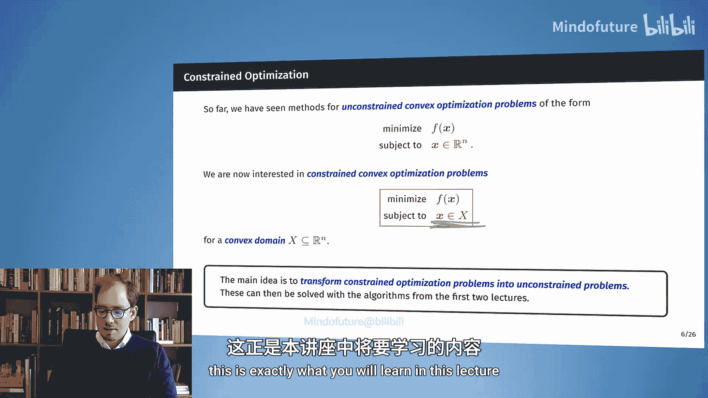

Okay。So besides the inequality constraints， we can also have equality constraints and now I'm juxtaposing the tool just to give you the complete picture first and then going into the details so here we have a。

One inequality constraint and here we have smaller than sign， we can also have the equal sign。

 and then this is an equality constraint。

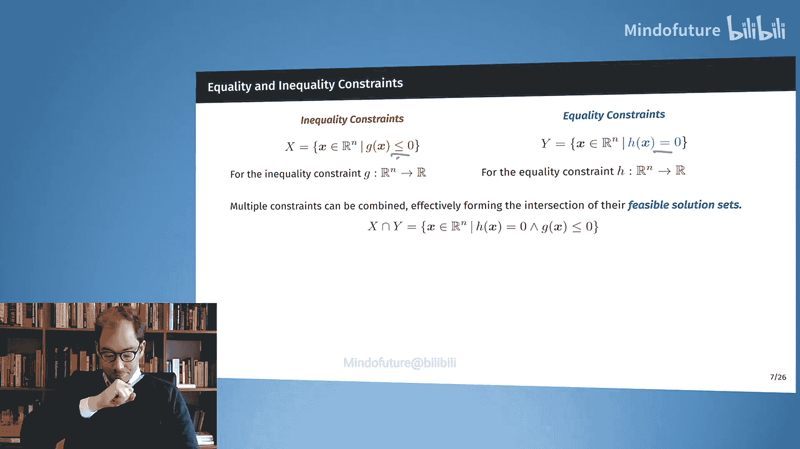

Further on in the lecture at the very beginning。We looked at open and close set。

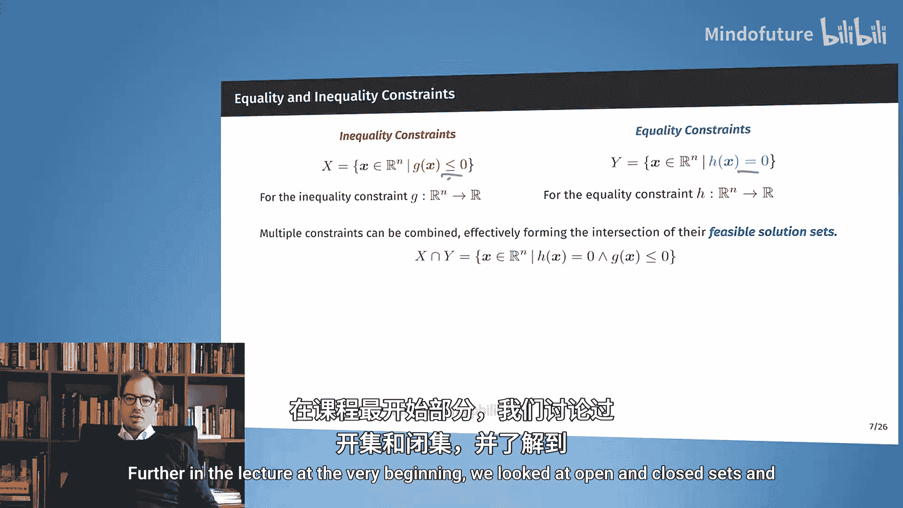

And we saw that we can also take the intersection of open and closed sets。

And we can also do the same with solution sets or with a space of possible solutions for our optimization。

So if we have two constraints， let's say we have one inequality constraint where the result has to lie in x。

 and we have one equality constraint where the result has to lie in y。

 then we can also take the intersection of the two sets where the possible solutions can lie for either of these constraints。

And for the intersection there we exactly have all the solutions that are feasible for both of the constraints。

So all the points that lie in the intersection for those， H of x is0 and G of x is smaller than0。

And now we can compose the constraints。

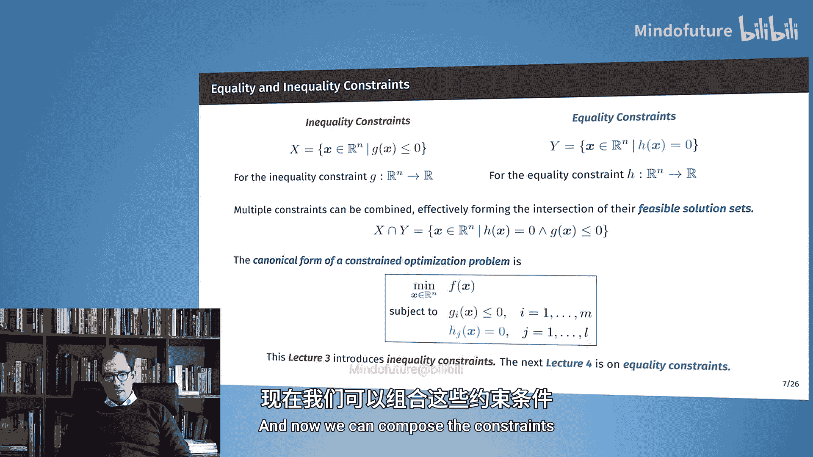

And now the canonical form of a constraint optimization problem and this is a canonical form that will be used and reused over and over over the coming lectures。

 so the canonical form is that I have some convex optimization problem f of x that I try to solve and I have additional constraints GI of x equal less than zero for some I and I have also some。

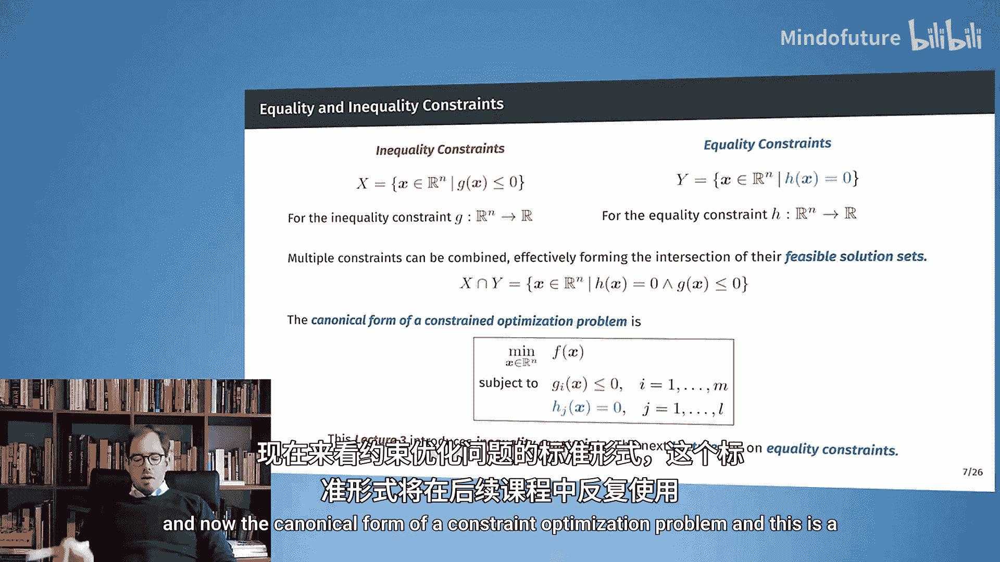

Equality constraints hj of x equals to0。And we are looking at the solution methods for inequality and equality constraints first separately。

 but then we will obviously also combine the solution methods to solve problems of this general canonical form of a constraint optimization problem。

And in this lecture we always make sure that we have a convex optimization problem and here that means that if I take the constraints together and if I construct my solution set big X。

 where the results are fulfilling all of the constraints， then I want to have my big solution set。

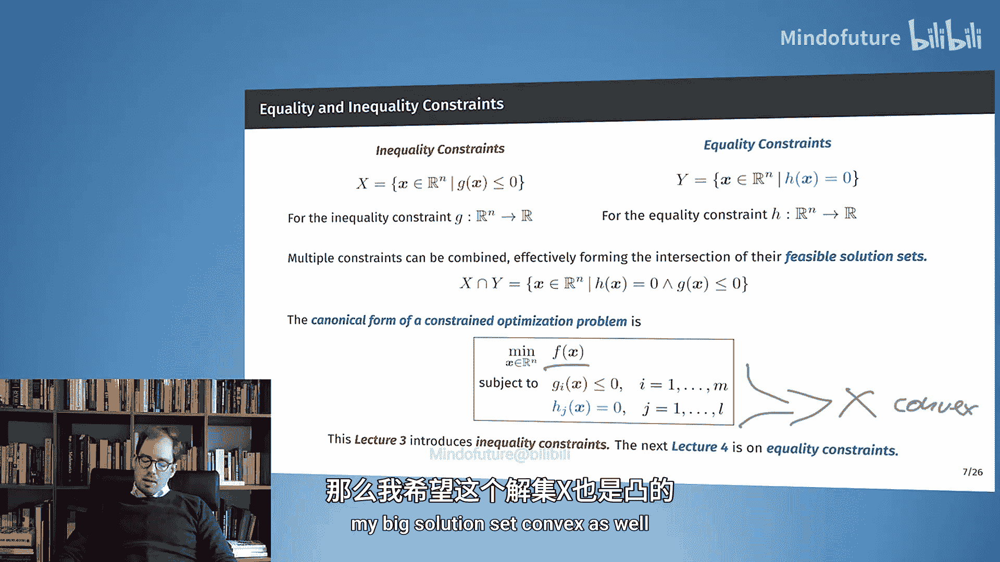

Convex as well。