# 【凯尔大学】机器学习优化方法 ｜ Optimization Methods For Machine Learning And Engineering 2021 p11 P11_3.3_内点法 -BV1C6SwBqEp7_p11-

Now we are in the third part for today the interior point method。

And the interior bond method is the main way or one of the important ways to solve inequality constraint problems。

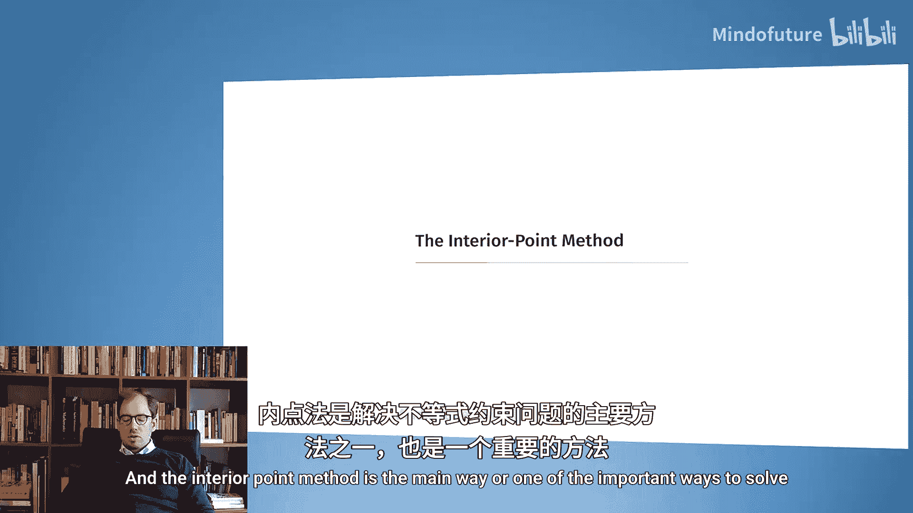

What you see here is the definition of an indicator function。

And an indicator function is defined as such I have a set X and for all points that I feed into my indicator function that are included in my set big x。

 I will turn0。And for other points that are outside of big X， I return infinity。Okay。

 and together with this indicator function。

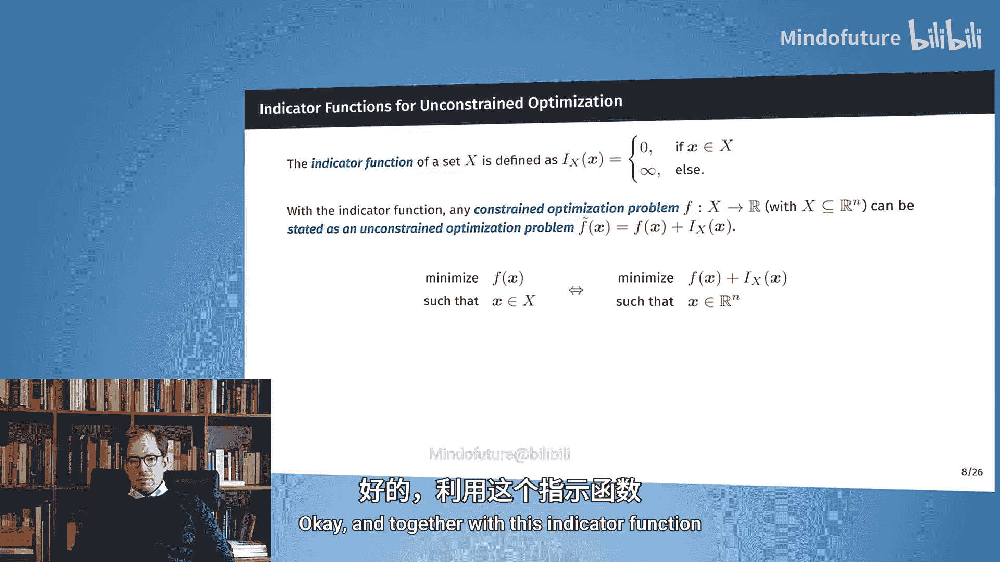

I can transform a constraint optimization problem。

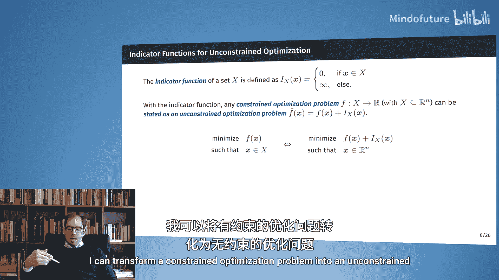

Into an unconstrained optimization problem。With other properties that we have to get rid as well。

So if I have here my function， f of x， my convex function， I want to optimize f of x。

And it goes from big x to R。Then I can transform that and write it as an unconstrained optimization problem。

F tiity of x equals to f of x plus the indicator function or for the big x。And actually。

 the two are equivalent in the sense that if there exists a solution。

If there exist a solution that is minimizing f of x。

Then this will also be the solution that is minimizing activity。

So if my solution for my unconstrained， so on this side， I have an unconstrained f of x。

And for all the solutions that are outside of my set big X。

 I will get infinity here from the indicator function。

 so the indicator functions will explode quote unquote。And therefore。

 I'm excluding all of the results that are outside of my big X。

Given that there are some feasible solutions within bigX。

So this is a rather trivial and straightforward way to transform a constrained optimization into an unconstrained optimization。

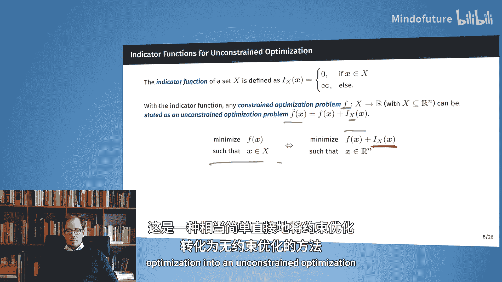

But it is also not very useful because the optimization algorithms that we are using。

 they cannot deal nicely with the indicator function。 So the problem here is that。If x is。呃。嗯。

Let's put it differently， the problem is that the function that I'm optimizing。

It might no longer be differentiable， so even if we had a nice function。

 so like some square that was differentiable at every point。

 if I am now suddenly imposing some constraints， so for example again I have my square。

But I am now excluding all the points larger than a certain value。

Then suddenly I am here jumping to infinity。And so then my function suddenly looks like this and here it goes against the wall and explodes quote unquote and at this point exactly my function is no longer differentiable and this is problematic if I end up up at exactly that location with。

With a new method of gradient descent， then I had no longer computed a gradient。

And this is problematic because it could be that my solution wants to exactly get very close to this border again let's take the same example here I have a nice square。

But now we're excluding more points， so now all the points larger than， for example。

 minus1 are excluded。And then my optimization algorithm has pressure to go against this barrier and to go against this area this place where my indicator function goes to infinity so again here my indicator function goes to infinity at that place and it's highly likely that I end up in this place or I must end up in this place for this type of problem。

And。Earlier with the newde method， we have assumed that at the optimum， the gradient will be0。

 so the main idea。Behind the newde method was that I no longer do the gradient steps but I try to find the place where I know that the gradient would be zero。

 but in the constrained case， we no longer have a guarantee that the optimizer will be at a place when the gradient is equal to zero and hence overall adding the indicator function it's nice and it the problem into transforms it into an unconstrained optimization problem that doesn't happen really because our optimization algorithm are not suited to dealing with this kind of change。

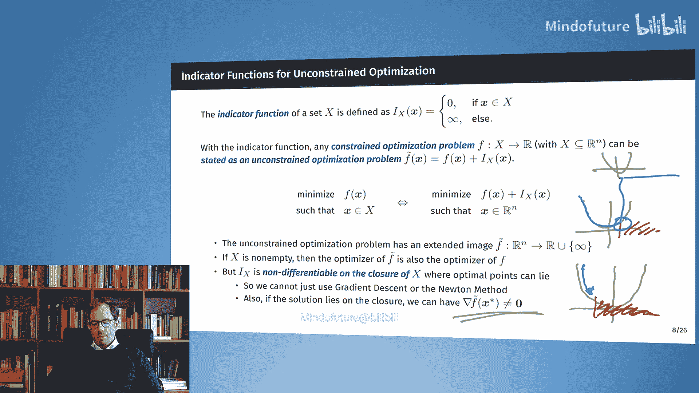

And how can we get around that？The idea to get around that is to approximate this barrier or to approximate the indicator function。

And we do that by introducing a logarithmic barrier。

And now I have to explain a little bit more what what this means。Imagine a simple case。

 we have a convex function f of x that we want to minimize and we have some constraint。

G of x smaller or equal than zero， and well in this course implicitly。

 well always assume that the set of possible solutions will be con。Okay。

 and now I take again my function f of x， but instead of adding directly the indicator function。

 I am adding a logarithmic barrier and the logarithmic barrier is this guy here。

 so minus1 over t I will explain what t is in a minute。-1 over t， the logarithm。

 which in our case is also is the logarithm natural， we will not write LN but lock。

And so the logarithm of minus g of x。And what is the shape of this indicator function。

 So if we look at the way the the logarithm is defined and at the graph of a couple of logarithms。

 then this barrier function here， it will。Approach。

The place where I am moving from some negative value to a positive value。

 and at the place where I get closer and closer to zero， my logarithm will go to infinity。

And but the logarithm is undefined over here， so if then if we then want to plug in a positive value。

 which becomes negative because I'm inverting。Then then the logarithm is no longer defined。

 so this only works when I'm on the negative side， but then I can approach the barrier。

 get closer and closer to the barrier and the barrier will actually go up to infinity as I get closer to zero。

And now what does the T do， so this T here。This is a way to tune how。

How well the approximation of the barrierial function should shall be。

 so if I turn up this T and if I choose T very large。

 so a million or a billion or something very large。Then my barrier function will look very。

 very similar to the barrier and it allows me then to get really close to the beginning of the constraint。

O。So now we have an approximation of the barrier function and this approximation of the barrier function is actually differentiable given that I'm inside。

 so the approximation does not even evaluate when I'm outside of the feasible set。

 but as long as we are inside the barrier， as long as we are in the interior of the solution set。

As long， we can find a derivative and maybe also a second derivative depending on the F。

 and then use our proven methods with a gradient descent or the new method。

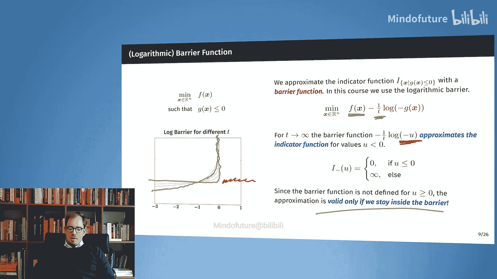

O。So what we have to compute for the newde method is the gradient and the hesum and so these。

These formulas might look。Intimidating， but they're actually quite simple。

 so this is just the way how the derivative of the lock barrier is formed。

But we will usually not do that by hand because we quickly go to interesting optimization problems that have many dimensions that I can no longer solve by hand。

 so this is just the formula that we have to plug into the computer and to get the gradient and the hesian and then we can have our function extended by the logarithm barrier to cover the inequality constraints and solve it with the newton method for example。

Okay， but we need to have an admissible point with which we start。

 so we need to have a point in the interior of the solution set。That must be inside。

 so the initial point with which we start cannot lie exactly at the boundary of the constraint because again。

 at that point I wouldn't get a gradient。Okay， and now once more。

 we have the nice property that the minimize them， so the solution that is minimizing overall will also have a zero gradient in the extended function with the lock barrier。

And now this is not exactly an unconstrained optimization problem because outside of the logarithmic barriers。

 the function is undefined， however， as long as I stay inside the feasible solution set。

 it looks like an unconstrained optimization and I can also apply。

The gradient decent in the Newton method， I only have to be a little bit careful， for example。

 with line search and so if by line search， I end up at a place outside of the barrier。

I have to cover that and well handle that special case， otherwise the gradient descent method。

 for example， it works really nice。But how should we set the team so now if we have this logarithmic barrier？

And we can tune the T to say how。Precise we want the barrier to beam。

 how should we actually set that T？And if we set the T too small。

 then we might have a solution that is far away from the optimum because the barrier is too。

Extended or it's not a precise enough approximation。And if I set my T to big。

 then I might run into some numerical issues because then in the gradient that I get back， I cannot。

I don't see where the barrier will begin， and I will need many， many steps。 Yeah。

 because my my algorithm has no indication how the the barrier will。

It will change his course that he should take。But we get around the straight off by not choosing a fixed T。

 but by increasing the T over time。So the term for this is sequential unconstrained optimization。

 and this goes back more than 50 years now。

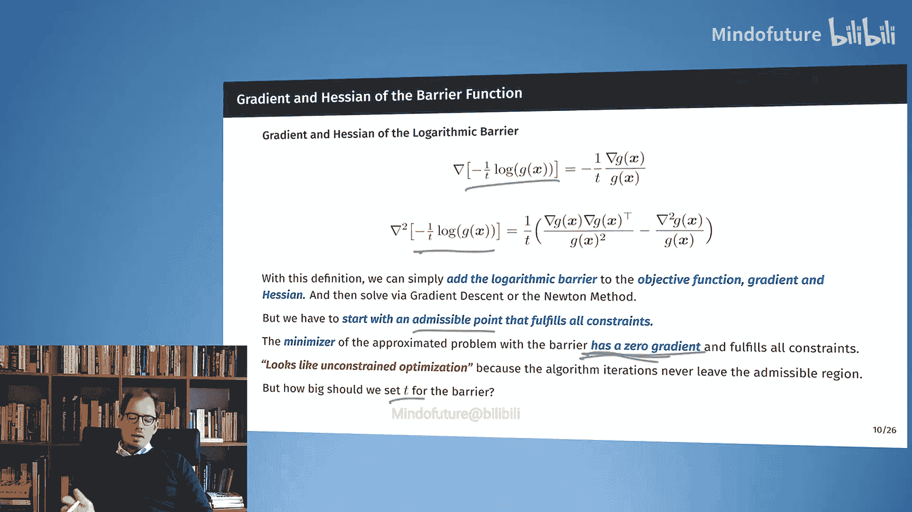

And。What they do here is we have now several inequality constraints。And in the image here。

 the inequality constraints are indicated as。Hyperplans or or half spaces and all the points that are behind such a plane are then excluded。

 and then we have the intersection of all the points that are。On the right。

Site of my inequality constraints， all the points in the intersection are then still contained。

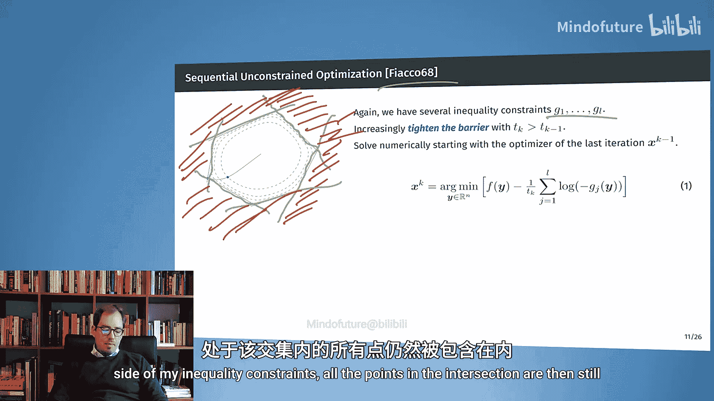

And in addition here you see these isSO lines that indicate where our barrier lies and then we start with some initial interior point and then we do the optimization and as we then increase our T over time。

 our barrier will get tighter and tighter and for every T that we choose we do an optimization and then the first step we might end up here。

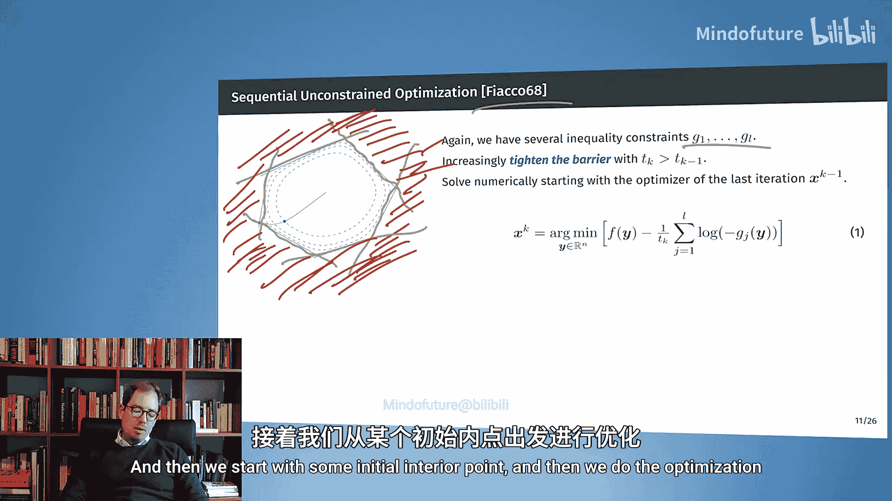

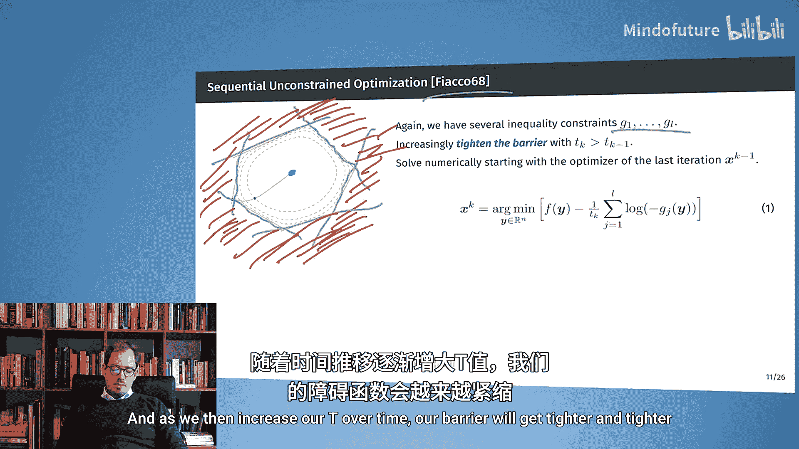

Then we increase the barrier a little bit， redo the computation， then we end up here。

 then we increase the barrier a little bit， do the computation and end up here。

 and therefore by sequentially solving optimization problems where the barrier is tightened more and more we no longer have the problem of running into numerical issues where the barrier is too tight initially。

 but when we are already at a place that is really close to the barrier。

 then if we tighten that a lot it doesn't hurt us as much。

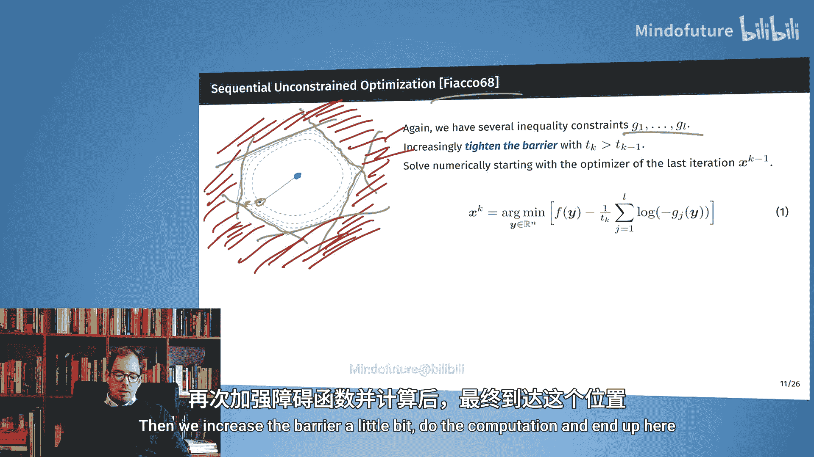

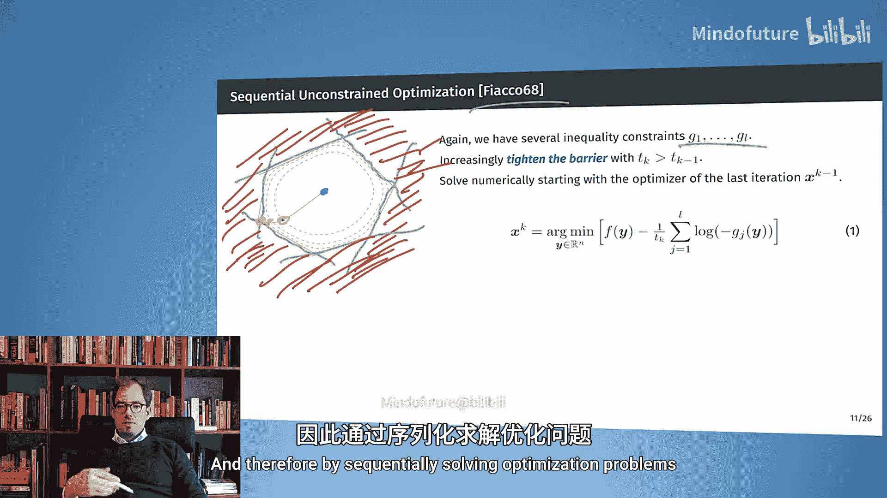

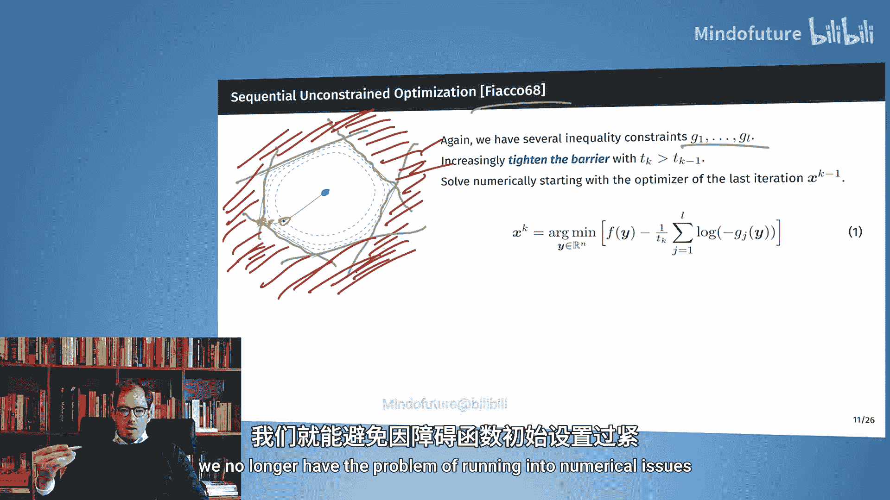

O。So now it's again， an iterative method。And so we have。

We are solving this optimization problem here。And the idea is that we take the reside Xk and use the Re Xk as the starting point。

For the optimization in the next iteration K+。

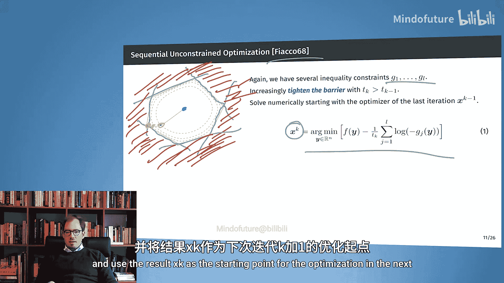

Okay， so now we have basically a two step approach with an inner iteration and an outer iteration。

So the inner iterations are for example， the gradient descent steps are the newton method steps for solving this optimization problem where the t is a fixed number。

 and then we have a result for that or we are close enough then we do an outer step and increase the T so we then go from K to K plus1 and we are increasing our T and we are tightening the border。

The barrier。And then we recompute this inner optimization problem。Starting at the last solution。Okay。

 but still how should we select the T and there are a couple of rules for that。

 but just just the basic idea is when I increase my T too fast。

Then I might have a big distance between the last point that was the solution of the optimization problem and the next point that I'm looking at。

 so in a sense it is preferable to have a couple of intermediate steps。Because then I can。

 for example， profit from the superconvergence of the newde method。

 So because if I'm actually rather close to the solution， my new method will。Converge super linearly。

 and I can profit from this superconvergence if my solutions are not too much apart by going from1 TK to the TK plus one。

However， if I increase my T too slow， then I will need many， many。

 many of these intermediary steps and then overall I will also lose。

 so the idea is to balance this out and to find an increase of the barrier tightening that well leads me to the solution the fastest。

And there's a nice theory for that， so there's a book by Nisrov and Nemirovsky that got published in 1994 and that triggered a small revolution in optimization。

And they define the theory of socalled selfconcordant functions， and they can。

 by that increase the TK maximally fast so that they always stay inside this persona of superconvergence for the newde method。

However， the material from Nrov and Hemirovsky is too advanced for this course and it's even far too advanced for this course so we know that this theory exists and we can also apply it in some special cases where we know some properties of the function F we are minimizing。

 but we will not go into the details and into the proofs。

 so this is from a mathematical level quite advanced and you would do that if you were doing a PhD in mathematics concerning optimization。

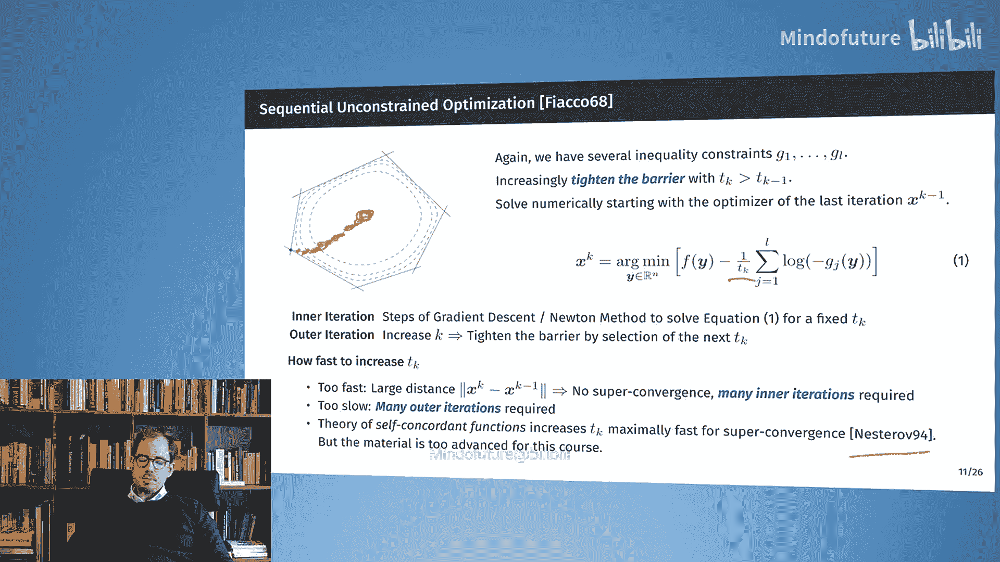

Okay。Now this was quite a lot of theory now let's look at the optimization problem that we wanted to solve initially and let's make it a bit more concrete with some real examples。

We want to solve the optimal resource allocation problem。

Now consider that you want to spend the 5 million euro on advertisement。

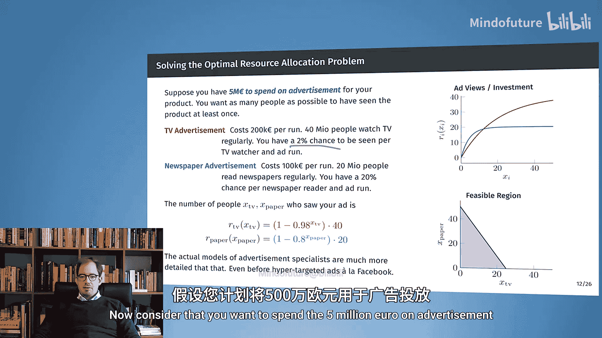

So you run a company， you have some kind of product， you want to sell a lot of these products。

 and the idea is to spend the 5 million euro in a way that the most number of people possible have seen your advertisement at least once。

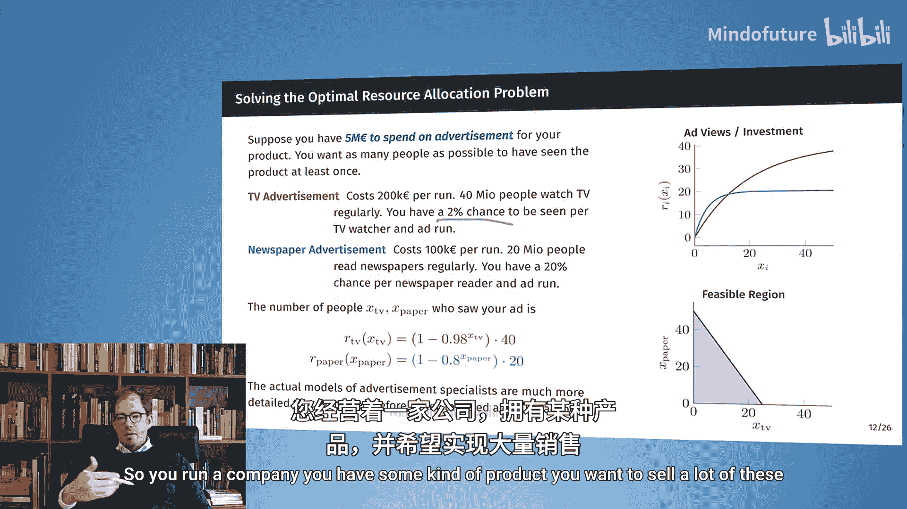

So an actual advertisement agency， they want people to see the advertisement multiple times。

Because when you see advertisement multiple times， you will。Be have remember the product。

 you will remember the song of the advertisement and things like that and。

They want to get into the general consciousness of society， so to speak。

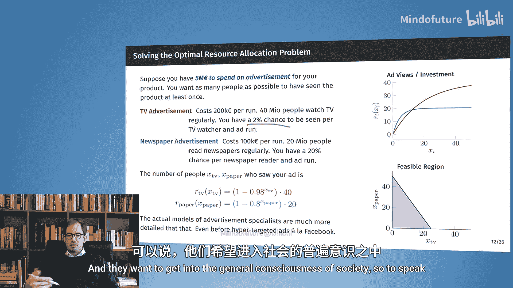

But in this case， for sake of the optimization problem。

We just want as many people as possible to have seen。

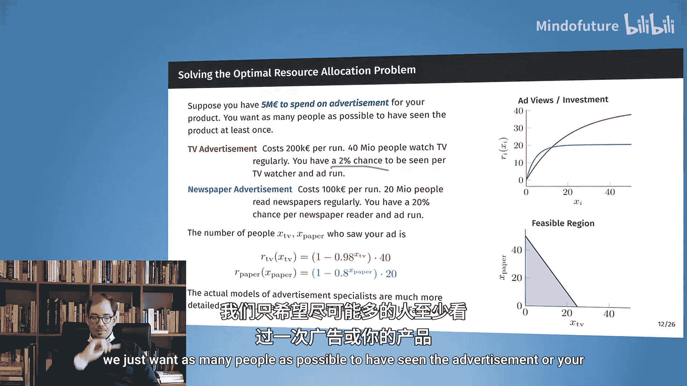

And the advertisement of your product at least once。

AndNow further assume that we have two possible channels for advertisement available。

 the first channel is TV advertisement and when you have 40 million people watching TV in the assumption and there's a circle costs so you have to pay 100。

000 to be shown at the time before a nice movie， something like that。

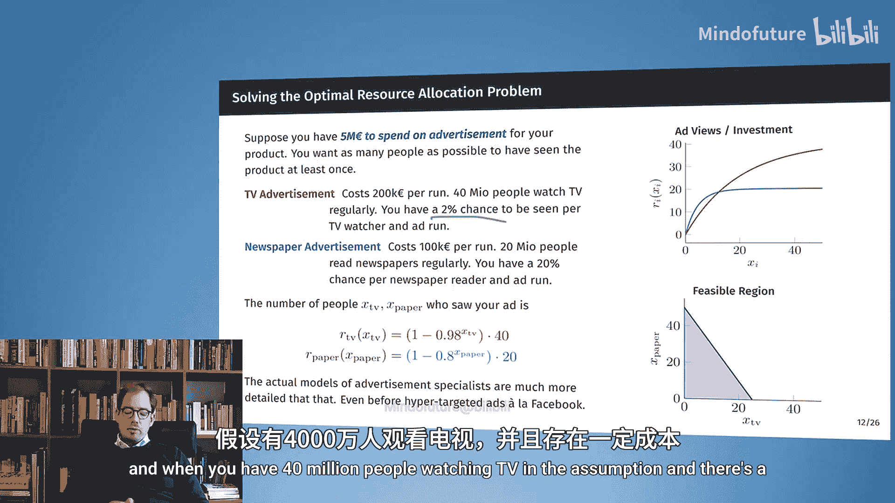

And then you also consider that you have a 2% chance that your advertisement is seen。Per TV。

 watchher and run。So if you on the first day， if you run your ad。

You have 2% of 40 million people in expectation seeing the advertisement。

But if you then repeat the advertisement。Then you assume that 2% have already seen the advertisement。

 so there now only are。98% of 40 million people times 2% remaining that can see the ad for the first time on on the second day or whenever you show the ad a second time。

 and therefore we have the。

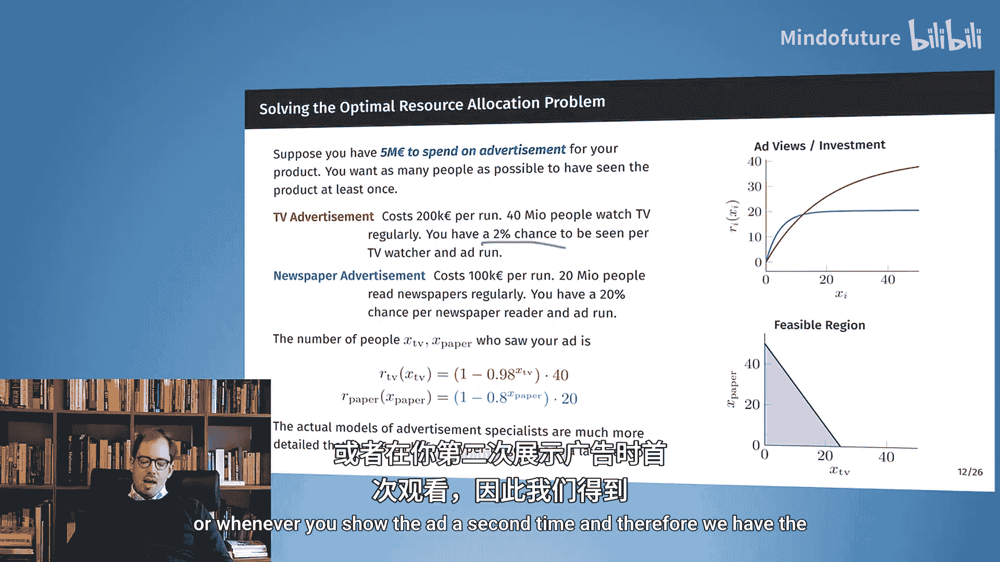

We have the decrease or the diminishing return and now we have here this。

 this red function that shows by if you run the a。

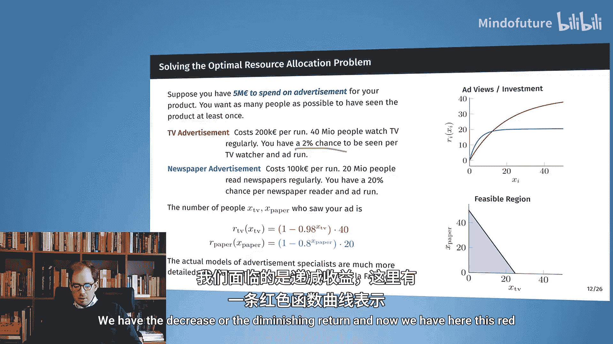

XI times how many people will have seen the？Okay and the other advertisement possibility that we have it's the newspaper advertisement and now we say it costs 100。

000 euro for every run， you have the possibility or you have 20 million readers and again。

 but then you have an increased chance the newspaper reader to have seen the ad so the congence here is a little bit faster and it also here it converges to 20 million people that at most can see your ad because on the second day only 80% of the 20 million remain that might see your ad for the first time。

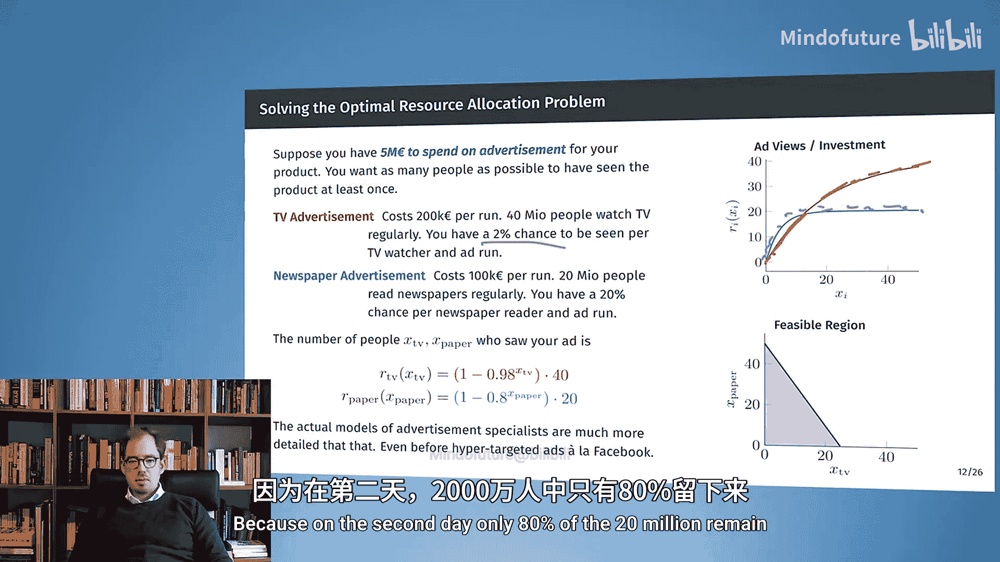

Okay。And now the number of people who saw your a。It can be expressed with these two formulas。

 so for TV it's 1 minus 98 to the power of XtV。Times 40。So this is just the formula expressing here。

 this curve that you see converging here。

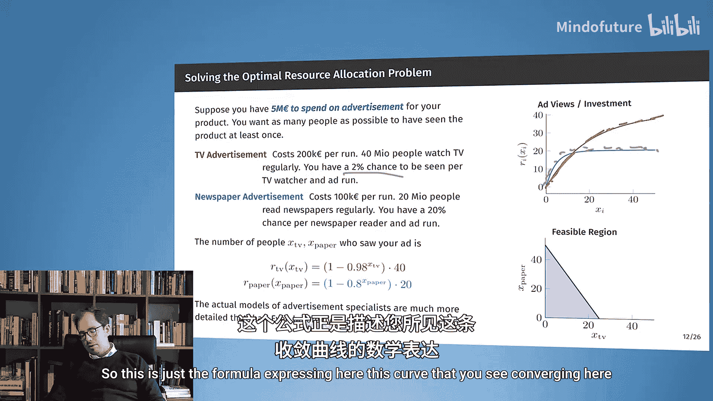

So。Or there's a slide。Confusion here， so XTv and X paperper is the number of times you run the a。

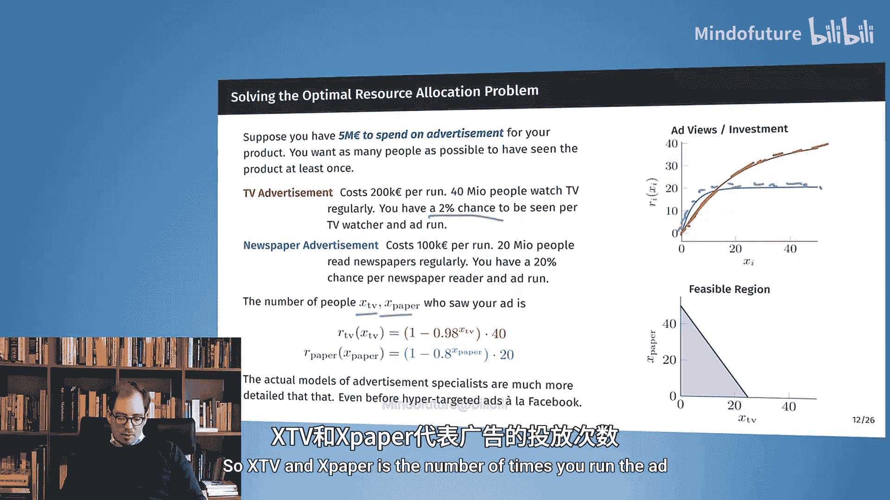

And then the result R TV and our paper， this is the number of people who have seen your ad。

So the actual models for advertisement by advertisement specialists they are a lot more detailed than that。

 they do optimization， they do that also quite a lot。

 but they have much more detailed model and now if you go then to Facebook and hyper targeted advertisement then they go much more into detail of target groups and how people might influence each other and stuff like that so that's a lot of。

Optimization also going on in the ad space， but here we have a simplified model that might have been realistic a couple of years ago。

 but today the industry is much more advanced。

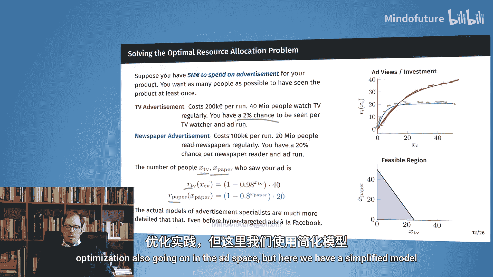

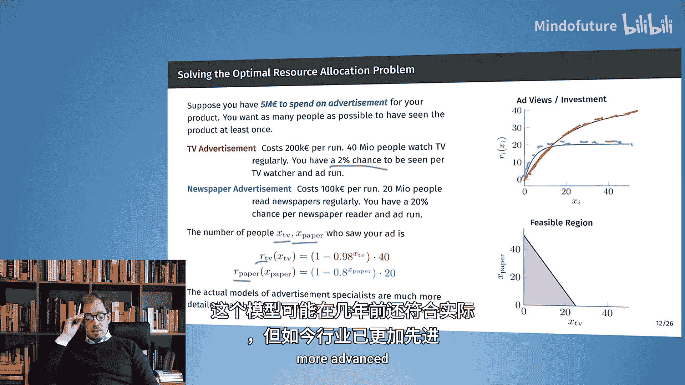

But now we only have 5 million euro available， so we have limited money and we can at most buy 25 TV advertisement campaigns so here if we look at the feasible results so then we can buy between zero and 25 and we should do that in rent between  zero and 25。

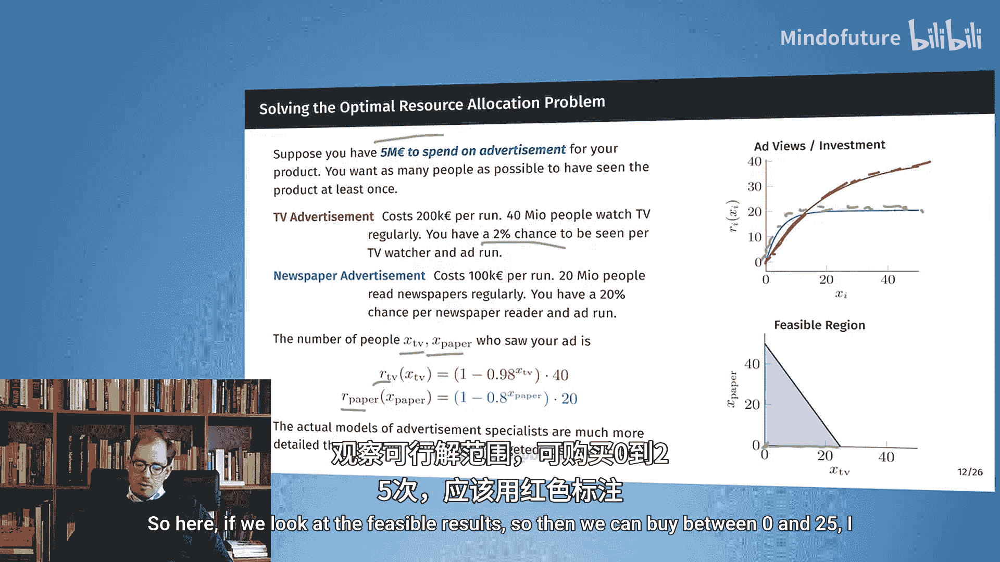

TV advertisement campaigns can be run。

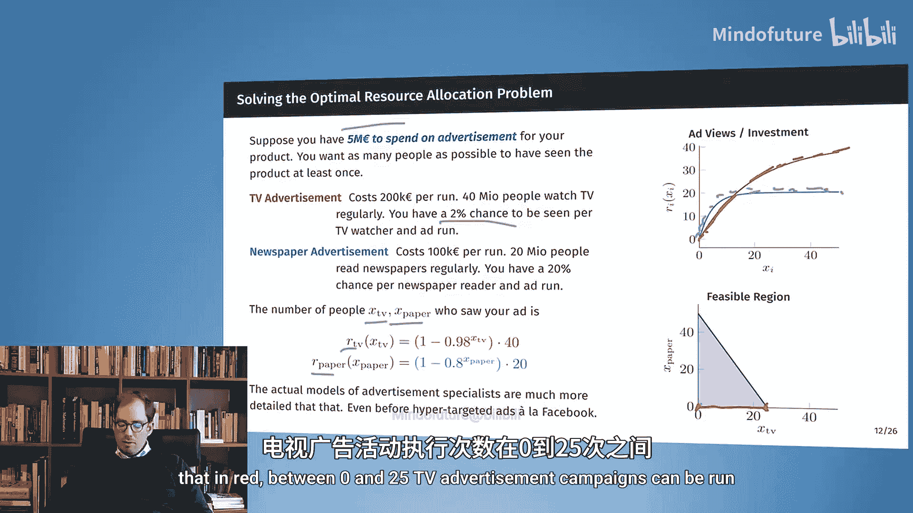

And because the newspaper advertisement costs less。

 I can buy up to 50 runs of the newspaper advertisement。But I can also。Run a combination of them。

So any point that is inside of this shaded area would be a feasible solution。

 so then I would even spend a little bit less money than I have available。

ButAnd if you look at this line over here， these are exactly the combinations of ats where I am spending the full 5 million。

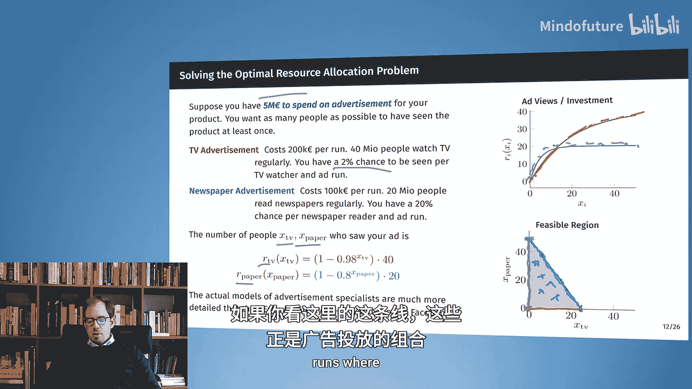

And what we expect is that our optimization problem will try to push us out here so that the optimization problem will try to make us spend as much money as possible to reach the most number of people。

 but we have this condition here that the maximum number of investment is bounded。

And while we now have to see where we actually end up。

 how much money we should add on or put into the different advertisement channels。Okay， read with it。

First of all we write down our optimization problem。

 so here we are maximizing a concave function and this is just the two advertisement channels how much people they can reach now the notation is a bit shorter we say X1 for TV and X2 for the newspaper。

And now we are adding the inequality constraints， so in total we must not spend more than 5 million euro and we can only spend a positive number of money on each advertisement channel。

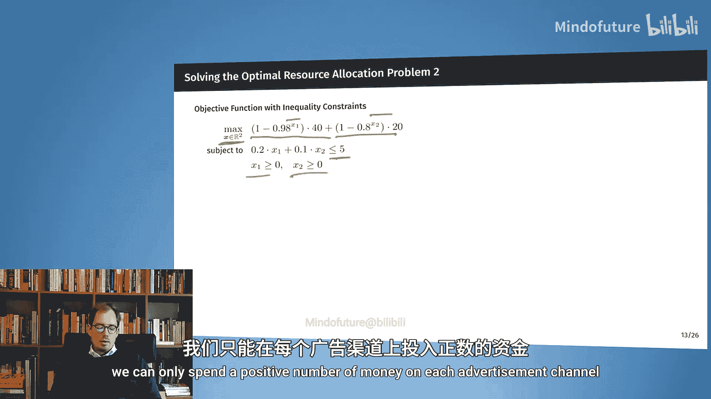

And now we convertverge this problem by adding the logarithmic barrier。

 so now we are removing the inequality constraints and we are pushing them into a logarithmic barrier each so now here we have a logarithmic barrier that we want to spend less than five million so if I'm here increasing x1 and x2 too much then this value inside the brackets will get negative and then the logarithm is no longer defined but if I get closer and closer to0 for the expression here in the brackets。

 then I'm only approaching the logarithmic barrier。嗯。Okay。

 and obviously I then have also the two constraints for positivity， so x1 and x2 need to be positive。

And I have to find out one initial point with which I want to start， so I select some random point。

 let's say one and1 or 10 and 10 for x1 and x2 as the initial point。

 and then I can employ gradient descent of the group。

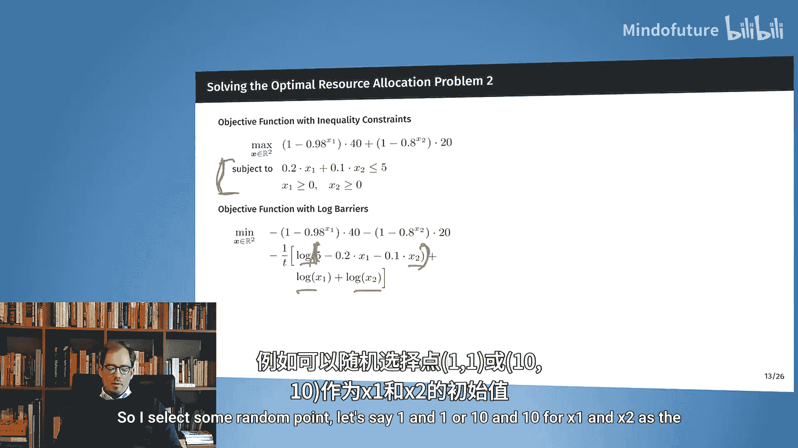

And now what is happening， I get an optimization problem that depends on this T。

 the factor that is tightening the logithic barrier。

And now let's see what happens when I'm increasing T。So we start with some very small tea， let's say。

0 do one。And what do you see on this。S here on the right hand side。

 these are the contour lines of the optimization problem。

 so this is like looking at the optimization function at the target function from the top and then seeing the isSO lines like on a map when you go to the mountains and you have a map showing you the heightline of the mountain。

And now the optimum， it will be somewhere here in the middle。

So our barriers are very appxi and we are pushing our optimum solution to the middle。

And now we tighten the barrier and we see that when we tighten the barrier。

 we will move slowly to the edge。And then when we tighten the barrier more and more。

 we get really close to the edge and now T is at most 100 here so we can still see something visually。

 but of course numerically this is not yet very advanced so we can also push T out to like 10。

000 or a million or a billion or something like that。

 this has some limits but we can really tighten the barrier quite a bit。Okay。

 and now we are converging and the solution to which we are converging is here to have 18。

7 TV advertisement runs and to have 12。4 newspaper advertisement runs。

it might be possible that you can only do complete runs and that you don't allow real numbers here。

 but this is again a relaxation， so to speak， if only if we were constrained to complete advertisement runs。

 so to natural numbers， then this would be a so called mixed inte problem。

 but again that is not part of what we consider the convex optimization problems for this lecture。

 therefore we just allow here the results to be real numbers。Okay。

 so we have found our optimal solution， it lies。Here， visually。And with this， we reach about 31。

38 million people that have seen our advertisement for our product at least once。

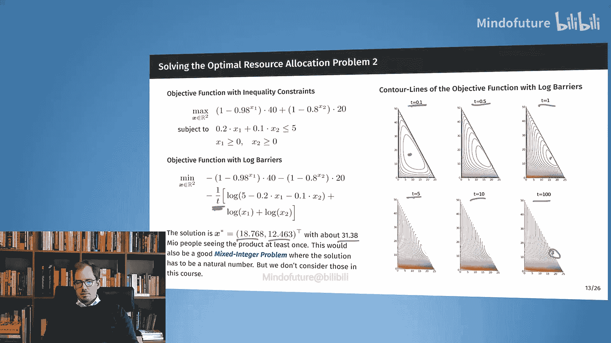

O。For this example， we had just decided on some initial feasible points。

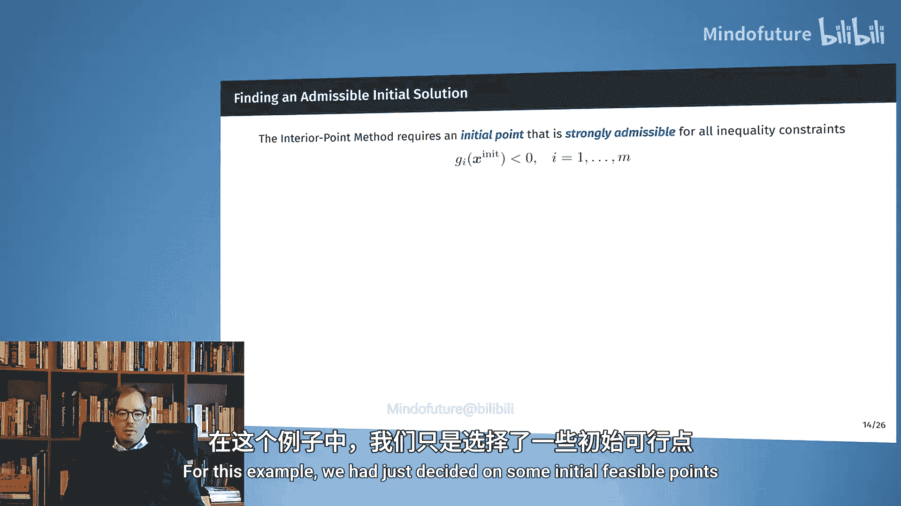

And because we were only in two dimensions， we could select additional an initial admissible point but just looking at the problem and this will not be possible when we go to higher dimensions。

 so when we go to really high dimensions， it might be complicated even to find a point that is inside our admissible set。

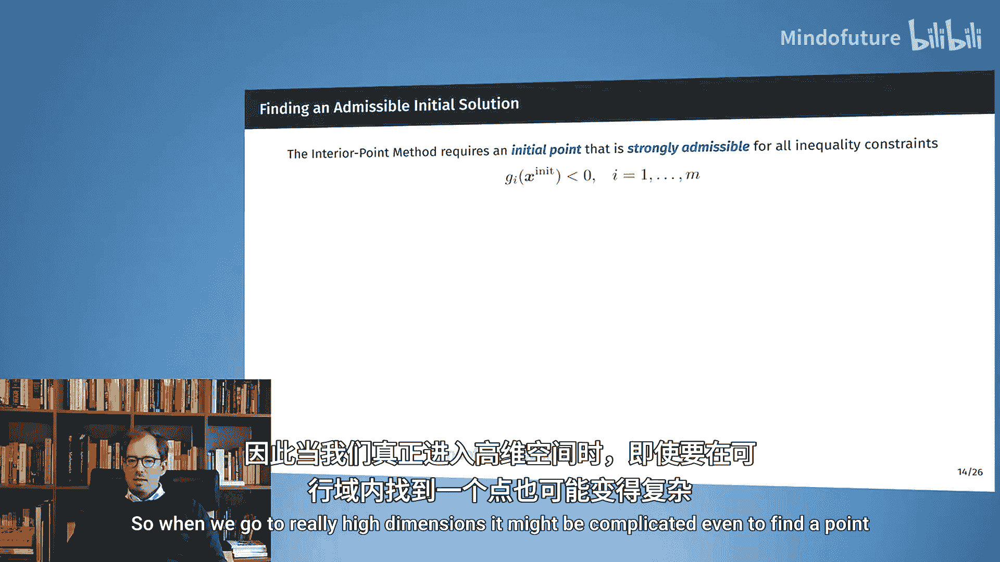

And we have to use a dedicated method to find our first initial point。

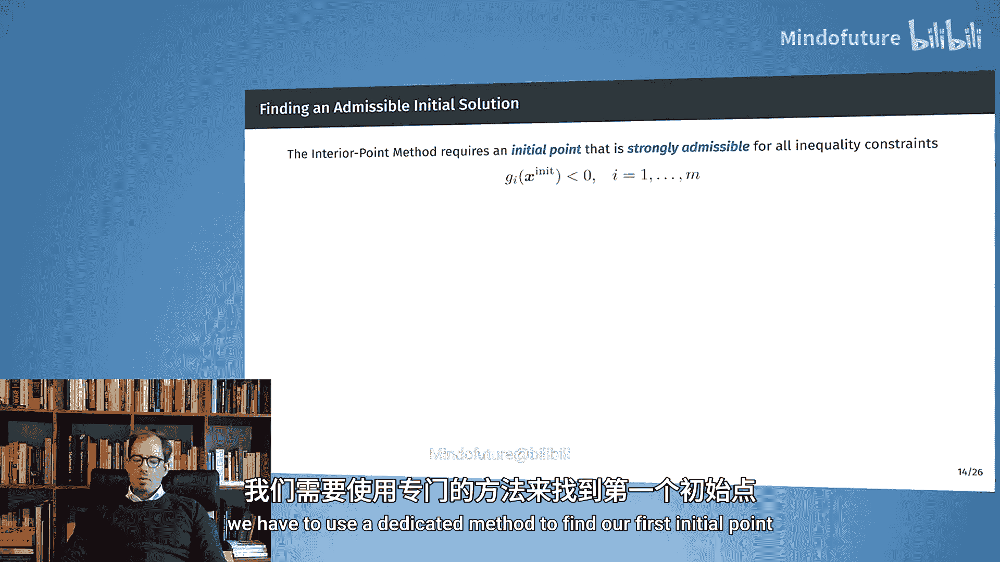

So we want initial point that is strongly admissible and strongly admissible here means that it is holding all the inequality constraints。

 meaning that the point is on the interior of the admissible set。

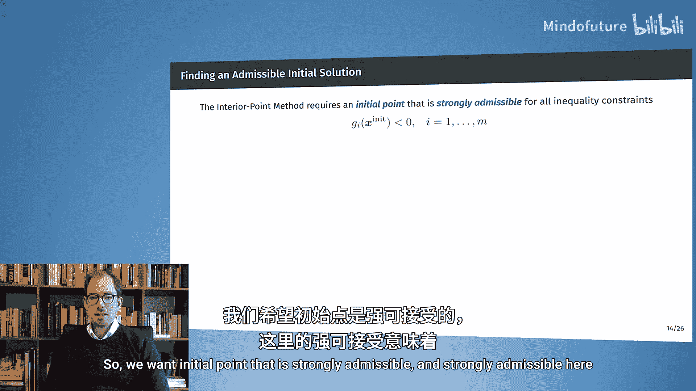

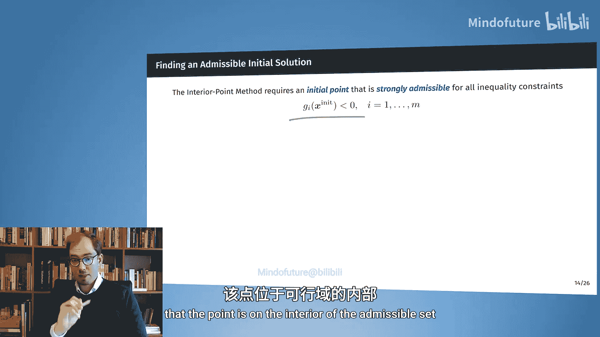

And how we do that？We are solving a smaller optimization problem。

So we have a number of different constraints， so we have the constraint。GI of x smaller or equal to0。

 and we have the constraint G2 of x smaller or equal to0 and so on。

And what we now do is we introduce what is called a Slack variable。

So we don't know initially where the feasible points are。

 so we define an unconstrained optimization problem with what we are calling a slacklack variable because now we introduced the slacklack variables we are calling it S。

And now we have G1 of x。Minus S should be smaller than 0 and then also G of x minus S。

Smaller than the rh。And when we have a solution where the slacklack variable。Is。

Where the select variable is smaller than zero， or then we have exactly found an admissible point。

Okay， but initially， we set the slacklack variable larger than the maximum of all the inequality constraints。

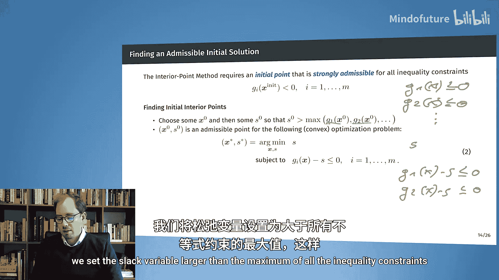

So that we are sure to have found an initial point that is feasible。

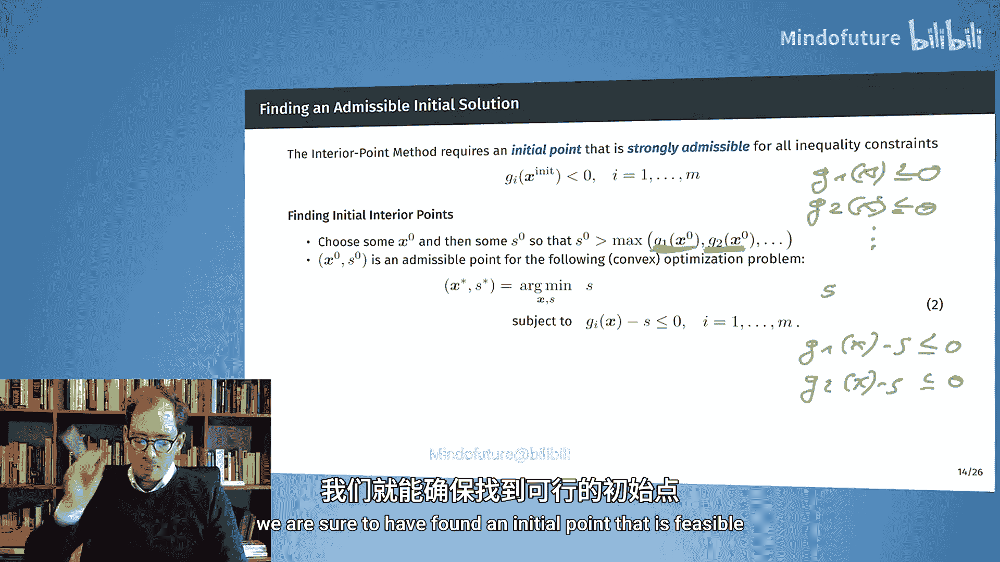

嗯。Oh， I said initially that we construct an unconned optimization problem， we construct an easier。

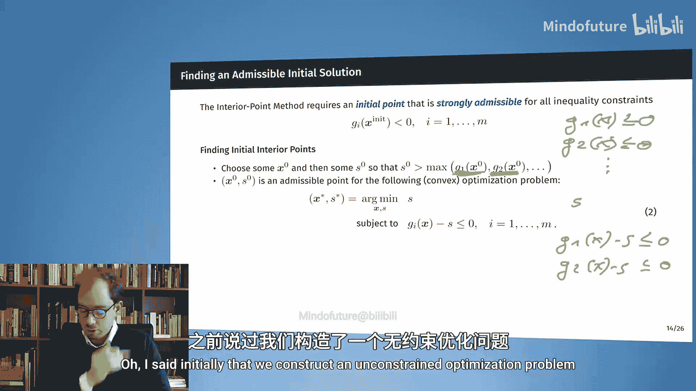

Constrain optimization problem where we exactly know where the initial point has to be。

 so we select any x0， any starting point for the original problem。

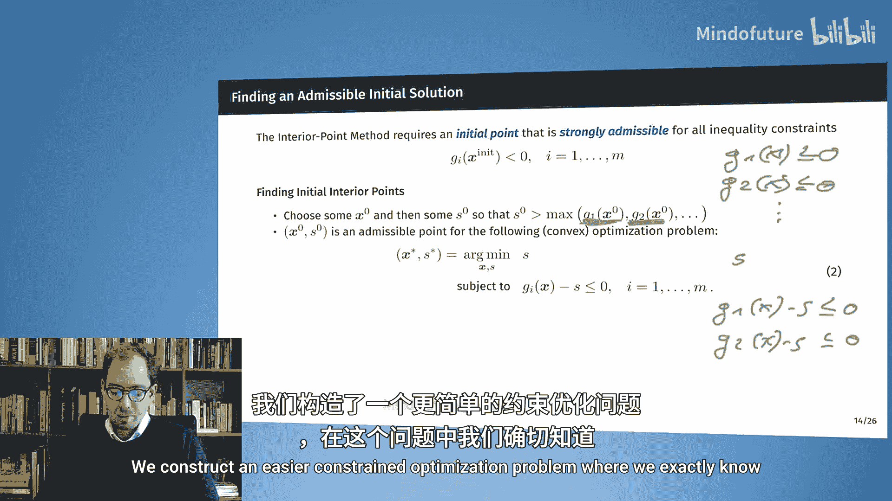

And then an S， our slackla variable， such that it is bigger。

 then the constraint that is violating the most。

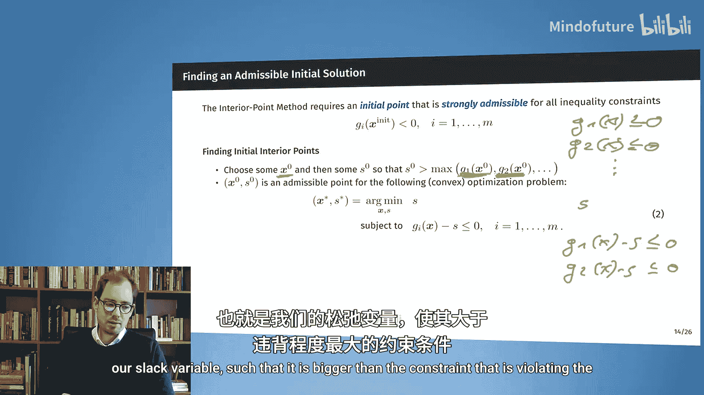

Okay， and then we have our select variable so that well these the terms here are all smaller than zero。

And now for this。New optimization problem。 What you're going to do is we want to minimize S and to get S as small as possible。

 and as soon as we have found a solution。

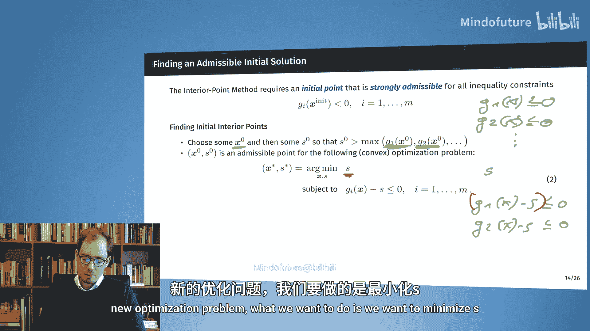

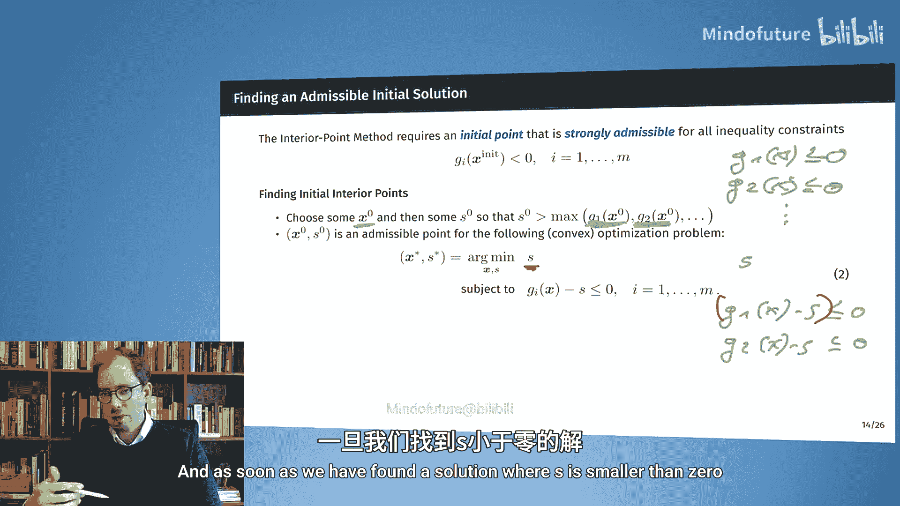

Where S is smaller than zero and for the current x， also all the constraints are holding。

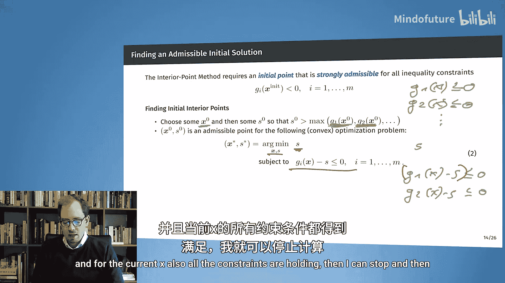

Then I can stop and then I know that I have found a combination of points X。

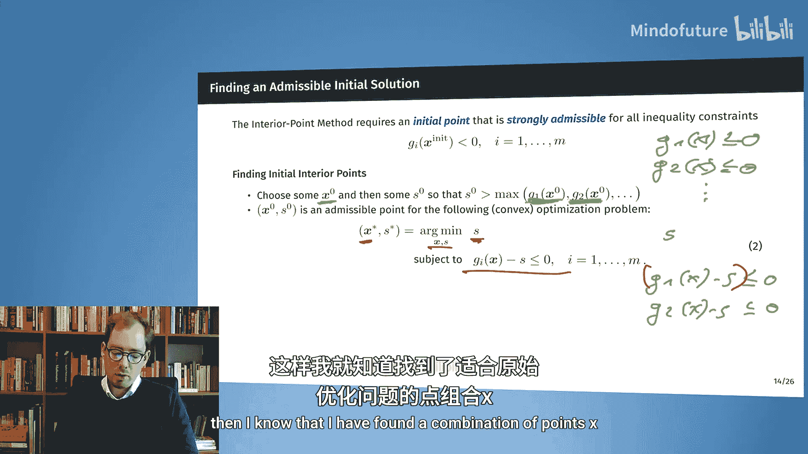

That is feasible for the original optimization problem。Okay。

 and now we can solve this optimization problem， this simplified optimization problem with the interior point method I have a way to construct the initial point where I know that I know that it is admissible。

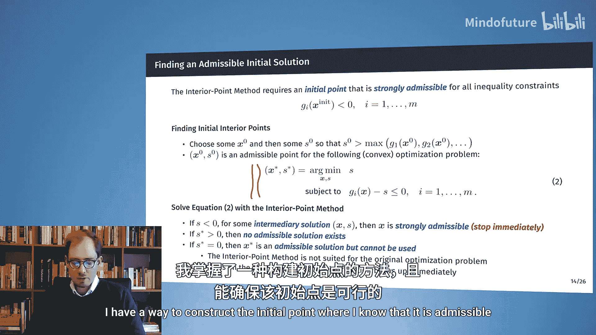

And I can then apply some other iterative method， gradient descent。

 newde method and so on for optimization， and as soon as I found a solution where the S。

 the select variable is smaller than zero， then I can stop and I have already found my solution my corresponding X。

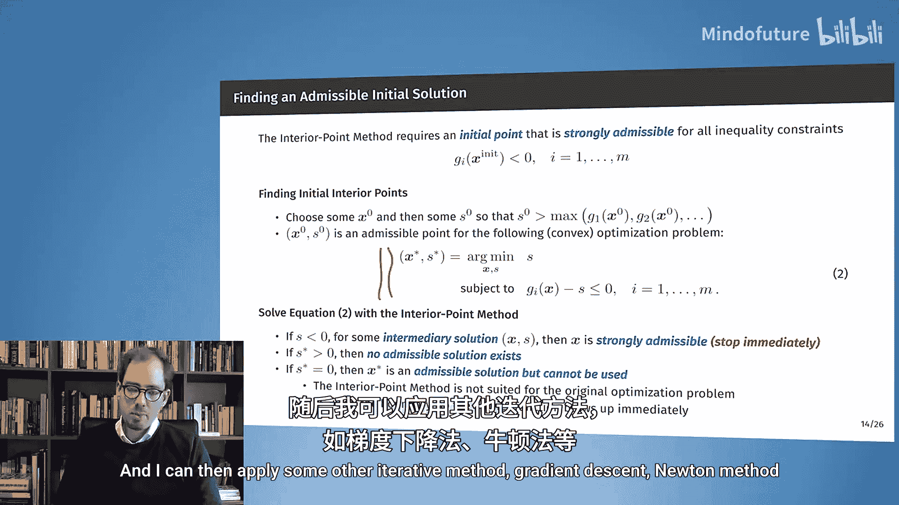

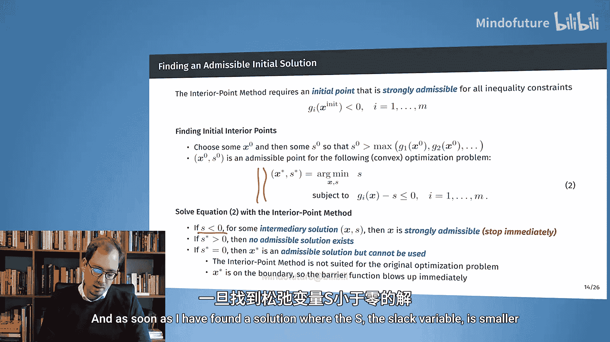

That is strongly atmiss。

When I am converging with this method， when I am solving this optimization problem。

 I am converging and the S is still bigger than zero， then I know that no admissible solution exists。

Then I know that my inequality constraints。So。Let's draw this。

Let's say here I have two inequality constraints and the feasible solution set would be here in the overlap。

Or in the intersection。But it could also be the case that there is no overlap could also be the case that in here at no point to the tool。

The solutions for the individual inequality constraints overlap。

 and then there is no admissible solution， then the interior， or then yeah。

 there is no admissible solution。

And then I can already stop because the original problem is unsolvable。

Okay， but there's also a third case where I'm optimizing and in the optimum S is exactly equal to zero。

And this then indicates that there is a solution to the original problem。

 but that the solution is not on the interior， but that the solution lies exactly on the boundary。

And that happens if I have the inequality constraints that I hear exactly touching。

So they have their。For each inequality constraint， the solution set。

 and there is a solution that fulfills all the constraints。

There can also be several possible solutions， so if the inequality constraints here would intersect on a line。

 for example， then there could also be several solutions， but there is no interior。

for the intersection， and that means I cannot use the interior point method because without the interior。

 I cannot find a gradient because I'm already at a point where my logarithmic barrier has gone up to infinity。

Okay。So now we have a method of finding an initial point。

 an admissible point that is on the interior， and we can then use the barrier method or the logarithmic barrier where we are tightening the barrier more and more to converge to the point of the constrained optimization problem。

