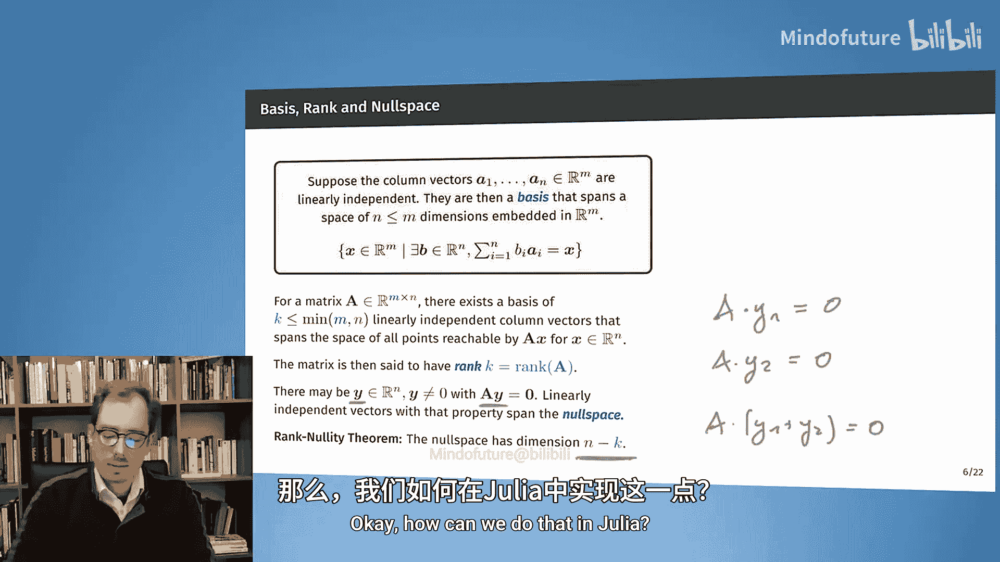

# 【凯尔大学】机器学习优化方法 ｜ Optimization Methods For Machine Learning And Engineering 2021 p14 P14_4.1_更多线性代数知识 -BV1C6SwBqEp7_p14-

Welcome to the fourth lecture on this course for optimization methods for machine learning and engineering。

 today's lecture will be on equality constraint optimization。

But before we dive into the main topic of today， let's have a look at some recent example where we see the effects of overfitting。

 overfitting which we saw earlier in the course。So there was this year a publication in Nature。

 so the most prestigious genre。That there was evidence now for phosine gas on the planetar venus。

And this was a small sensation because the first fan guess could not have been of a normal origin on Venus。

 but it was a hint towards life being present on Venus。

And so the researchers were looking at the spectral signature coming from Venus。

 and they were fitting a 12 order polynomial， and there found evidence for the presence of phosphe gas。

However， there was now a rebutter， so people have been looking at this fitting of the 12th auto polylynomial and didn't find the evidence that was claimed so here we had an example of an overfited result being published in a very prestigious journal and people on our backtrackking on the results and it seems that there is no life in Venus and that the phospha gas that appeared to be there was a phantom and not really there and fitting a 12th auto polylynomial is。

Quite wild， you have to take precautions to prevent overfitting。

And apparently those were not present in this publication。

 so here again we have a slide or a small figure from an earlier lecture that shows you the problems of overfitting by going to polynomials of too high an order。

And to give you also a small。A small historical remark， John Franron Neiman， John Fneumman。

 a famous mathematician， he said that with four parameters he can fit an elephant and with five parameters he can make the elephant wiggle his trunk。

So you have to be careful that you do not use too many parameters， nothing good can。Okay。

 now what will be the content of today's lecture， the agenda。

 we will see some more concepts of linear algebra that we will need today。

Then equality constraints will be introduced with an example and also with some formal definitions。

And later we will two ways to work with equality constraints， so first of all。

 constraint elimination how to get rid of constraints to get to a optimization problem that has a reduced dimensionality。

And then La multipliers who are a way also of solving problems with equality constraints。

 but by increasing the dimensionality of the problem。

 and we will see the differences and problems and advantages of each there。Okay。

 first diving into linear algebra， so everything I'm explaining today。

 you should have heard that already in your linear algebra courses in your bachelor studies。

 but anyway， let's remember some of these concepts。So first of all。

 what we want to do oftentimes is solve a linear equation。So given some matrix， big A and the vector。

B， we look for some x that is solving this linear equation here， so ax equals B。

 and we want to solve for this x。And the simplest way to do that is by inverting the matrix B。

 and then we can just add a inverted to the left side of the equation， so here we can add。

A to the minus1 and here we add a to the minus1 and then effectively the a inverted times a is canceling out and we have x equals a to the minus1 times B。

And this obviously can be done when a is invertible。

But in the usual numerical solvers that we are using。

 what they do in the background is they solve a smaller or they solve an easy optimization problem。

 meaning they solve for ax minus B and then taking the norm of that and minimizing it and as you recall this norm becomes only zero when ax minus b is exactly the zero vector。

And it cannot get smaller than that， so there's one unique solution if H minus b equals0 can be achieved and this is also then the solution to this optimization problem。

This is a more robust way of solving for this linear equation。And we have several possibilities here。

 So if there's a single solution。Then this minimization problem will exactly return the x for which the norm is0。

but there are also cases where there are infinitely many solutions。

 so if our matrix is defined in a way that there can be more than one x solving for ax minus B。

 then automatically there are infinitely many solutions because any linear combinations of these possible x's would then also be a solution。

But by solving this optimization problem， most implementations will then from this。

Collection of this space of infinitely many possible solutions here in the second case。

 they will return to us the solution that has itself minimal norm。And okay。

 so there are obviously several norms that we could have， so usually it will be the true norm。

And most implementations will then return to us among the solutions we'll select a unique solution that has minimum norm。

And there are also cases where there is no solution。

 so there are cases where I cannot find an X where I exactly get the result equal to B。

But then the most libraries solving for this kind of problem will then return to me the solution that is closest。

 so the x that will then minimize here， the norm distance and again this is equal to solving this small optimization problem one。

There are many specialized solution techniques for this， so if I know that my matrix is sparse。

 that my matrix has only entries on the diagonal， if my matrix is upper or lower triangular。

 they are very specialized solution techniques for that。

And actually many implementations also first do effect factorization of my matrix A to get it into a form that is up a lower triangular。

 for example， with a Kleski decomposition， and this will then be used as the basis for solving this linear equation。

 but we will not get into such d。What is however important is the relation to the Newton method。

 so for the Newton method， the direction that we are taking， so the direction of the Newton step。

Is the inverted Hasian of F at x， so inverted times the negative gradient of F。E X。

And this is actually just a transformed。Linear equation that we want to solve so again。

 if we then left multiply both sides with the Hessian and here we have the Hasian。Of F。Times D。

 this should be the negative gradient f of x。 So here this can also be the Hasian of Fx times D。Plus。

 the gradient。Equals to0， so thes zero vector here。And again。

 we use some existing libraries usually that can solve these types of problems for us。

 and Julia has this already built in。And how do we actually solve that now。

 let's use a small example， so this makes it maybe a little bit more more vivid。

So imagine that we have two types of colors， we have a bodeaux color and indigo color and Bodeaux is mostly red with a little bit of blue。

And the indigo color， it's mostly blue with a little bit of red。So here in Bdux。

 we have 20% of blue pigment and 80% of red pigment。And for the ingo color。

 we have 90% of blue pigment and then 10% of the red pigment。

And from these two colors that we have available， we want to make a mixture and we want to get violet and violet should contain exactly 50% of the blue and 50% of the wrapping。

And the question is， how can we？Combine and by which fractions should we combine the two Bddo and indigo colors to get exactly violet out。

And we can write this down so we can here write this down as our matrix and the matrix entries are here exactly the first column for the Bux color and the second column for the inco column and by multiplying this matrix by some x。

 so here we have a times x this exactly equates to making a mixture。

 making a mixture of the first and the second column so taking weights of the first and the second column and then adding that back。

And the big question here is by which x should we multiply our A so that we get out exactly 0。

5 and 0。5。Okay， and this is in our form AX equals B and we are solving for that and in Julia we have this backslash operator and the backslash operator is exactly finding the solution to this optimization problem one。

 this midn problem and will by well by by definition and also solve for AX equals B if there is a solution to that。

And by running that， we get out the following result， so to get the violet color， we should take 0。

57 of the Boux content and then 0。42 of the illegal content。And。Well， obviously this work quite nice。

 but now let's give the the problem back to you for you to solve at home。

 what if we wanted to get a mixture of paint that has only blue pigment so here we could then also solve for a times x equals。

诶。1 dot 0 and 0。So to have only blue pigment and no red pigment。And well， the question for you is。

Can we do that and what would be possible problem here？Moving on。Determinants of a matrix。

 so the term determinant is mentioned oftentimes in scientific fields but。

Most of the time it is assumed that students already know what is meant by determinants and what the properties are。

 we will reccapulate this here really quick。So。Let a， our matrix A B square。

And then the determinant of this square matrix is the volume of a parallelogram that is spent by the vector's AI。

 and what do we mean by that？Here we have our Netflix big A。

And we want here our matrix to consist of all column vector。

 so we have here column vector A1 column vector， A2， column vector A3。And these column vectors。

We can imagine them if we are in the three space as vectors here。

 so this is the a1 vector going from zero to some location。

 and then we have the a2 vector going from zero to some location。

 and then we have the three vector going from zero to some location here。And。

By combining these three directions， we can span a parallelogram。

And the determinant is then the volume of this parallelogram。What is important here。

 the volume can also be negative， so just depending how you arrange these vectors。

 there can in principle， also be negative volume here。And there can also be zero volume。

 so if you imagine that this is a one vector that it was moved really closely to the location of A22。

Then we would like compress out the volume and finally if H A1 and82 are directly on top of each other or are just a multiple of the other one。

 then we would have flattened out this parallelogram， we would have one dimension less quote unquote。

And we would then have a determinant of volume zero。

And this is important because a matrix can only be inverted if its determinant is nonze。

And there are a couple of rules for determinants。Ptty easy to remember。

 so determinant of a times the determinant of B。Its the determinant of a times B and also the transpose and the inversion of matrices also then translate into the same operation performed on the determinant。

 or here the transpose doesn't do anything and then if I have take the determinant of a inverted。

 then it is one over determinant of a。Okay。And well， for us， obviously because in the newde method。

 we want to take the inverted of the matrix of the Hasian。

 it is important to us that we can take this hessian and therefore this determinant has some value to us of that being on zero。

And the determinant being nonze， it also is closely related to the concept of linearly independent vectors and to the concept of a basis。

So the determinant is non zero。If these column vectors， a1 a2， a3， or however many we have。

 we call them a1。If they are linearly independent to one another。

And linear independence has the following meaning。If I have my vectors AI。

And I want to combine them in a way then I get the zero vector。

There is no non trivial way of combining them to get the zero vector， what is meant by that？

Imagine here I take vectors B from RM， so I have n column vectors。

And now I'm looking for a vector that I'm multiplying each of the column vectors with to get out the zero vector when I then sum over them。

 so here I take them the sum over all my column vectors。

 each of my column vectors is multiplied by scalar B。

 and then I'm combining all of them together and I want to get the zero vector out。And if all my。

Colum vectors are linearly independent， then the only solution to that is to have b equal to the zero vector。

But we have to be careful。诶。Yeah， because if we don't have linear independence。

 then theres other there are other bees that also lead to the zero vector in the end by combining our AI。

Okay in Julia it's pretty easy， in Julia we have a lot of modules or a lot of library functions already implemented for finding the basis and also for computing the determinant。

 so obviously there are some rules for finding the determinant。

 but we will not do that here in this course because we can just rely on Julia for that for the purposes that are important as far as this lecture goes。

Okay。Next concept，Deiteness of a matrix， we already have heard about that a couple of times but now let's see at the formal definition。

 so again we have a symmetric matrix a from R2 n times n。

And the definition of positive definitiveness is that for all my vectors x。

They are not the na vector， so here I'm excluding the na vector。

If I take x transposed times a times x， then the result will be larger than 0。And。

The definition of positive semidefiniteness is closely related。

 so again for on my x that are not the zero vector， if I take x transpose times a times x。

 I have to be larger or equal to0。And we have some shorthand notation for that。

 so this will turn up in the course from time to time we write a。Funny， smart。

 larger than zero for a positive semi definitely。And of course， I can。

Take the negative matrix and then go from a positive semidefinite matrix to something that is negative semi definite and vice versa。

And the identity matrix， AI is always positive semi deffinite。

or always positive definite and yeah sometimes we make use of the property by adding， for example。

 a multiple of the identity metrics by choosing the multiple in a way that we are ensured in the end to get something that is positive definite。

ok。Now， a visual image of that is always helpful， so here we show again the tail approximation of a function at a point x and the hasselian of this function is positive。

Definite for this case at the point X and we see that because the Taylor expansion。

 it is upwards curved and that is always designed to us that the second derivative or that the Hesian is positive definite。

Okay， but this function does not have a positive definite hasian everywhere if we choose another point。

 so if we go to a point over here， for example， then the second derivative probably would not be positive definite just by looking at the picture。

 it doesn't look that。That way， okay。And again， one important property。

 if a function is strictly convex and if it's also twice differentiable。

 then everywhere will I have the Hasian positive definitionin。Bases， rank and not space。

Now we are getting into territory that we will use for an interesting optimization problem later on in the course。

 so here it's a little bit of theory we have to bear with that but we have an immediate use for the concepts on this slide later on in the course I hope this will be interesting or'm pretty sure this will be interesting。

So suppose I have a bunch of column vectors， I have A12 A column vectors。

And all of these column vectors are linearly independent。Recall maybe what we heard about the。

The determinant and matrices being invertible， now we don't necessarily have a matrix here just we say。

 okay， we have column vectors a1 to A。And if these are linearly independent。

Then I call them a basis for some space that spans n dimensions that are embedded in RM。

 So here my column vectors， my AI。They have elements， AI 1 down to AI， AI。

So each of these column vectors has M entries。Okay。

And if n of these column vectors are linearly independent。

 then they span some n dimensional space that is embedded in RM。

 meaning I have all the vectors x from RM。That I can reach。

By taking some linear combination of my column vectors， so here I'm choosing there exists some B。

Such that I can take the linear combination of。The AI multiplied by the elements of B。

 such that I recover X。So x are all the points that are reachable。

By taking some combination of the column vectors AI。Okay。

But there are also points that are not reachable， so it could be that I have the AI are in a 100 dimensional vector。

 so I have my AI here and they go from AI 1 to AI 100。But I only have， let's say。

 two or three of the AI， so I only have a1， a2 and a3。And then I would effectively have。

 if they are linearly independent， I would have a three dimensional subspace。Of R to 100。Okay。

Now going back to matrixes， now let's say I take a matrix A that is from R2 n times n。

 so here I have my matrix。And the size of my matrix here is then。I have。M。Rose。make it blue。

So I have M roles。And I have n。Columns。red。And new columns。And。

If then I look at all the column vectors in my matrix， so here then I have my A1。

 let's see the column and my A2， here the column and so on。And then if these are a basis。For some。

Some space that has dimension K and the dimension K has to be smaller than M or N。嗯。So。Or rather。

 if I take if I look at all the points that I can reach by multiplying a times x for some x that I'm choosing。

Then I will find out that all the points that I can reach by a times x。

 they live in a k dimensional space， and this k depends on whether the column vectors are linearly independent。

Or to how many linearly independent column vectors I can reduce them。

So it could also be that in my matrix， I have a couple of nonlinely independent vectors。

 but then I only consider the existence of some linear combination or some combination of column vectors that are linearly independent。

 who can reach the same points as I can reach with a big a times x。Okay。

 and I'm calling this the rank of PA so the rank of PA is the dimensionality of the space of all the points that I can reach by going through a by having a times x。

Okay。But there can also be vectors y that if I multiply a with y， then I get to0。And the points， why？

That get me to zero by multiplying them with big a。

 they are also forming a space or they are also yeah， they are forming a space because if I have a。

Let me select this guy here if I have a times y1 equals to0 and I have a times y2 equals to0。

 then I know that a of y1 plus y2。ul also equal to0 and I can then take any linear combination of y1 and y2 and so these are then effectively also forming a space of all the points that get me to zero and this is called the Nile space of bigA。

And there is now a theorem， the theorem is that the n space has dimension n minus k。

 where n is the number of columns of my matrix and k is the rank of my matrix。Okay。

 how can we do that in Julian， so here we have a matrix big a and this is a2 by4 matrix。

 so a lives in R2 the2 times 4。

And here the rank of a is 2 and this is also the maximum rank that a could have。

 so I can have at most or I can have at most two elements in the basis that spans the same space that I can reach with a because if I multiply some vector with a or a multiplied by some vector I only get a two dimensional vector out。

 so the rank can be at most two and Julia also tells me here okay the rank is 2。

Okay and now Julia also has a built in functionality for computing in the Nile space。

 so here I say n equals the Nile space of a and I get outer matrix。

 so this is something Julia does for convenience but actually I'm looking here at the columns or the column vectors that make up the basis of the N space so here I have my first column vector。

With four entries and here I have my second column vector with four entries and if I take any of these column vectors and multiply a by that I get zero out so here this syntax here is selecting all the elements of the first column。

And if I multiply a by that， I get exactly zero out。

 so effectively that is an element of the nu space。

