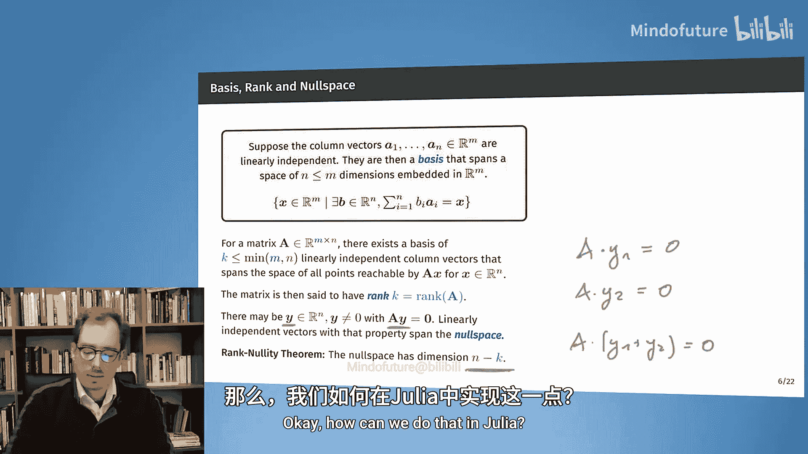

# 机器学习优化方法：4：更多线性代数知识


在本节课中，我们将学习一些关键的线性代数概念，这些概念对于理解后续的等式约束优化至关重要。我们将回顾线性方程求解、矩阵行列式、矩阵正定性以及向量空间的基、秩和零空间等概念。

上一节我们介绍了无约束优化的基本方法，本节中我们来看看解决优化问题时需要用到的一些核心线性代数工具。

## 线性方程求解

我们经常需要求解形如 **Ax = b** 的线性方程组。其中 **A** 是一个矩阵，**b** 是一个向量，我们需要找到满足等式的向量 **x**。

最直接的方法是计算矩阵 **A** 的逆矩阵 **A⁻¹**，然后得到解 **x = A⁻¹b**。但这要求矩阵 **A** 必须是可逆的。

在实际的数值计算中，更稳健的方法是将其转化为一个优化问题来求解：

```math
\min_x \|Ax - b\|
```

当 **Ax - b** 的范数为零时，我们便得到了精确解。数值求解库通常会处理以下三种情况：
*   存在唯一解：优化问题会返回使范数为零的 **x**。
*   存在无穷多解：优化问题会从所有解中，返回范数最小的那个 **x**。
*   无解：优化问题会返回使范数最小的 **x**，即最接近的解。

许多求解器会利用矩阵的特殊结构（如稀疏性、三角性）来提高效率。例如，牛顿法中求解步长方向 **d** 的方程 **H(x)d = -∇f(x)**，本质上就是一个需要求解的线性方程组。

以下是一个混合颜料的具体例子：

假设我们有两种颜料：波尔多红（含80%红，20%蓝）和靛蓝（含10%红，90%蓝）。我们希望混合出紫罗兰色（含50%红，50%蓝）。设混合时波尔多红的比例为 **x₁**，靛蓝的比例为 **x₂**，则可建立方程：

```math
\begin{bmatrix} 0.8 & 0.1 \\ 0.2 & 0.9 \end{bmatrix} \begin{bmatrix} x_1 \\ x_2 \end{bmatrix} = \begin{bmatrix} 0.5 \\ 0.5 \end{bmatrix}
```

使用求解器（如Julia中的反斜杠运算符 `\`）可得解：**x₁ ≈ 0.57**, **x₂ ≈ 0.42**。即需要约57%的波尔多红和42%的靛蓝。

**思考题**：如果我们想混合出纯蓝色颜料（100%蓝，0%红），即求解 **Ax = [0, 1]ᵀ**，是否可行？可能会遇到什么问题？

## 矩阵的行列式

对于一个方阵 **A**，其行列式 **det(A)** 的几何意义是由其列向量张成的平行多面体的“有向”体积。

行列式的重要性质包括：
*   **det(AB) = det(A) det(B)**
*   **det(Aᵀ) = det(A)**
*   若 **A** 可逆，则 **det(A⁻¹) = 1 / det(A)**

行列式是否为零与矩阵的可逆性紧密相关：
*   若 **det(A) ≠ 0**，则矩阵 **A** 可逆，其列向量线性无关。
*   若 **det(A) = 0**，则矩阵 **A** 不可逆（奇异），其列向量线性相关。

在牛顿法中，我们需要计算海森矩阵 **H(x)** 的逆，这就要求 **H(x)** 的行列式非零，即 **H(x)** 必须是可逆的。

## 矩阵的正定性

对于一个对称矩阵 **A ∈ ℝⁿˣⁿ**，其正定性定义如下：
*   **正定**：对于所有非零向量 **x ≠ 0**，都有 **xᵀAx > 0**。记作 **A ≻ 0**。
*   **半正定**：对于所有非零向量 **x ≠ 0**，都有 **xᵀAx ≥ 0**。记作 **A ≽ 0**。

类似地，可以定义负定和半负定。

单位矩阵 **I** 是正定矩阵。在优化中，我们有时通过给海森矩阵加上一个倍数 **λI** 来确保其正定性，从而保证算法稳定。

从几何上看，如果函数在某点 **x** 处的海森矩阵 **H(x)** 是正定的，那么函数在该点的二阶泰勒展开近似是一个向上开口的“碗状”曲面，表明该点是一个局部极小值点。

## 基、秩与零空间

这些概念对于处理带有等式约束的优化问题至关重要。

假设我们有一组列向量 **{a₁, a₂, ..., aₙ}**，每个向量 **aᵢ ∈ ℝᵐ**。如果这些向量线性无关，那么它们构成了 **ℝᵐ** 中一个 **n** 维子空间的一组**基**。该子空间中的所有向量 **x** 都可以表示为这些基向量的线性组合：**x = Σ bᵢaᵢ**。

现在考虑一个矩阵 **A ∈ ℝᵐˣⁿ**，其列向量即为 **a₁, a₂, ..., aₙ**。
*   **列空间/值域**：所有形如 **Ax**（**x ∈ ℝⁿ**）的向量构成的集合。其维度称为矩阵 **A** 的**秩**，记作 **rank(A) = k**。它等于 **A** 中线性无关列向量的最大数目，且 **k ≤ min(m, n)**。
*   **零空间**：所有满足 **Ay = 0** 的向量 **y ∈ ℝⁿ** 构成的集合。

一个重要定理是：**零空间的维度 = n - k**，即列数减去矩阵的秩。



在Julia中，可以方便地计算这些值。例如，对于一个 **2×4** 的矩阵 **A**，其秩可能为2（最大可能值）。计算其零空间，会得到一组基向量，这些向量与 **A** 相乘结果为零。

本节课中我们一起学习了线性方程求解、行列式、矩阵正定性以及基、秩和零空间等核心线性代数概念。下一节，我们将利用这些工具，正式引入等式约束优化问题。