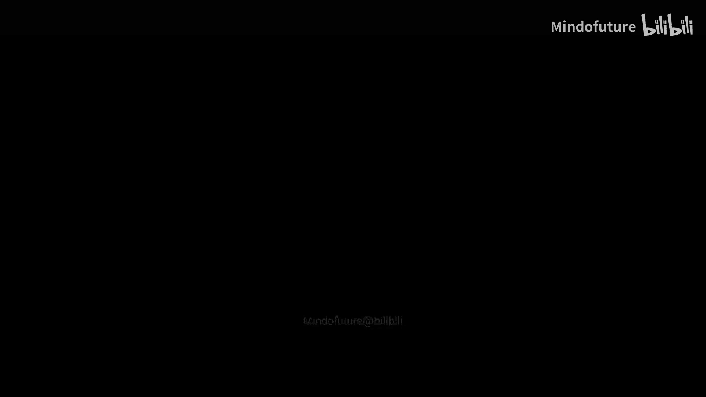
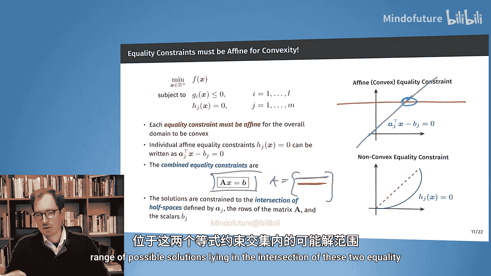

# 【凯尔大学】机器学习优化方法 ｜ Optimization Methods For Machine Learning And Engineering 2021 p15 P15_4.2_等式约束 -BV1C6SwBqEp7_p15-

Finally， we are with the equality constraints， we have seen a little example for that with the soft constraints last time for fitting the ellipse and today we will look at hard equality constraints where I am not fuzzy and I allow some small deviations today we have equality constraints we need the solution to be exactly。

Constrained by some equality in an equation。Let's motivate this， historically。

So historically there have been a couple of important examples that is today。

Subsumed under the category of optimal transport problems。

And let's look at two examples that were developed at roughly the same time。

So the first one is called the Kantovich problem we already heard about Kantoitch a couple of times again。

 this is the same Kantogoch and in this problem the Red Army general so we are in the second World War and the Red Army general he wants to move his troops from the barracks to the front line with minimal effort。

So here we have the barracks where the soldiers are trained and here I have 60，000 soldiers here。

 I have 90，00， I here of 150，000。And then there are a couple of front line positions and I want to move the train soldiers to the frontline positions。

And the question is， what is the most effective way of moving these soldiers？

So think about this like a problem of planning trains。

 so maybe you need one train for every thousand soldiers or something。

 and then how many trains do you need and how can you effectively transport that？

A very similar problem was。It was published by Hitchcock。And this is a little bit more peaceful。

 so he's talking about a farmers's cooperative and they want to deliver their produce to different markets。

 so one of the farmers is making carrots and the other farmma is growing cabbage and then we have different needs at different markets and somehow they also need to transport their goods around and want to fulfill the market demand at every location with minimal transport costs or transport overhead。

And this is both of them are examples of the optimal transport problem。They are pretty similar。

 they're actually the same problem， but from a different application perspective。And in the 1940s。

 people were very interested in solving these kinds of problems。

So we will for this lecture follow the Ktoovvich problem as a motivating example。

 if you are pacifist， I'm sorry for that， this is more of an unhappy problem but it's a historical motivation for a lot of things and this is for us just an application example and also in the historical development。

 oftentimes it were examples like that， that permitted researchers then to have the funds to develop something much much more general。

Okay， so how can we formalize this optimization problem？So again。

 we have the barracks with the numbers of soldiers， so 60，90 and 150。

000 and our fighting positions where we have certain requirements。

And then I am just giving them an index， so the barracks I am calling them B1， B2 and B3。

 and likewise for the positions I'm calling them P1， P2 and P3。And then， I can。

Express how many soldiers are moved from。A certain barrack to a certain position in a matrix so here I find matrix M and then I can express how many soldiers are moving from the first barracks to the first position or from the second barracks to the third position and so on so I can just fill this matrix with with the soldiers that are moved obviously all the entries should be larger than zero。

And in addition， I have certain costs， so the first position and the first barracks they are very close to one another so my cost is only one。

 but if I then would move soldiers from the second barrack to the third position。

 they are far away or the train line is not so good and then I imagine to have a cost of seven units there。

So here we are expressing our costs and also the possible solutions by matrices。Okay。

 and now we have to stage the underlying optimization problem。

So we are looking for a three by three matrix。That is minimizing our movement cost and for all the barracks and for all the positions。

I'm multiplying here the number of soldiers moved between the barrack and the position time the cost for that movement。

So here， effectively I have nine entries here for the I and the J all going from one to three。

So I'm effectively summing over nine entries， multiplying the number of move soldiers times to cost。

And then I have certain equality constraints， so things that have to hold for all the possible solutions。

So here I say I'm looking for three by three matrix。

But I'm not looking for any three by three metrics。

 I'm constraining it with a couple of equality constraints。For example。

 if I sum over all the soldiers moving out of the first barrack。

So these are the entries of the matrix M in the first row。

Then this has to be equal to the sum of these entries has to be equal to zero。And likewise。

 for the second rule 90 for the Federal row 150 and so on。And。In addition to that， the soldiers。

 what I was sec， was this correct？Oh no， of course here， I'm summing over the first。

Yeah over the first row okay and then the soldiers moving into P1 so the soldiers moving into the first position I want to have 120 soldiers at this position。

 so if I sum over all these entries in the first column that has to be 120。Okay。

 so here I have a bunch of equality constraints so that in the end all the soldiers are moved and all the final positions are fulfilled。

 and I cannot take more soldiers out of the first barracks then are initially there and in order to make to ensure that I also have T constraint that all the movements have to be larger than zero。

Okay， and this is a linear program because here the objective function， the objective term up here。

 this is a linear term。And now let's bring this into a more standard form。

 so now this is looking quite complicated， I have a lot of different constraints and let's bring this in standard form that makes it more easy to reason about that and to develop algorithms for that。

嗯。Okay。What we do now is we get away from the matrix representation。

And we write down this as an optimization problem for a nine dimensional vector。

So we had our matrix M， which was a three by three matrix。

But now to get this problem into the standard form。

We instead represent it as a nine dimensional vector to x。So here we have our elements。M11， M12， M13。

 but then also M21， and so on。Okay， and but here let's think about what we usually do because the Julia language is doing that for us is in our matrix。

 we have the column vectors。And we are stacking the column vectors on top of each other。

 So actually what I would have here。Just here I have M11， then I have M21。M3，1。

 and then continuing by M。One，2 and so on， so here we are taking the columns of our matrix and we are stacking the columns on top of each other for our vector representation and now we have a nine dimensional vector and we are optimizing in this nine dimensional space。

Okay， and the same we do for the cost matrix， so then we have a nine dimensional cost vector and the end our target function or objective function is just our cost vector transposed times x and this is again a linear optimization problem subject to a couple of constraints。

And what do we do with the constraints， so here we have this sum of all the soldiers moving from the first bars has to be equal to 60 and so on。

And this can be represented by also some vector multiplication。

 so now we are only looking here at the first row of this matrix。

And the first row of this matrix here。It has entries one。At the places。

Where I have the soldiers moving out of the first barracks in my solution vector X。

So if I multiply the first。Column of this matrix。By x。

I get exactly all the soldiers moving out of the first barracks in the solution X。

 and I constrained this to be equal to 60。the same I can also do for all the soldiers moving out of the second barracks or all the soldiers moving into the first fighting position。

 things like that。And then I have this matrix vector multiplication for my equality constraint。

 and I in the end have one remaining inequality constraint so that all my x elements or the elements of my solution x have to be greater or equal to zero。

Okay。What we have seen right now with this matrix spectrum notification。

These an Eine equality constraint。So in general， in the most general setting。

 we could say that we have an optimization problem， f of x。

 and we have some inequality constraints we saw them last time。

 and today we also add a couple of equality constraints。And we could say， well。

 the equality constraints there can be whatever。If we didn't have a need for convexity， for example。

 then we could say we have a constraint that we have our x1。

So an element of the solution squared should be one。So this is a possible。

 or then we could write this down a little bit differently。We could then write down。To say h1 of x。

Is x1？Squad， -1。And this then should be zero， so this could be an equality constraint。However。

 this doesn't work for us because the solution space would no longer be convex。

Because there are here， we have two possible solutions for that。So here we have the solution。

X1 equals one。And here we also have the solution。X1 equals -1。

And this is a nonconvex solution space that is remaining here because I cannot take a combination。

 a linear combination in between these two possible solutions and our algorithms that we're exploring in this course would no longer hold so whenever I have a noncavex constraint。

So that here my my。The possible solutions lie here in some space， but the space is noncom。

 then I have a problem with the algorithms developed in this lecture。Therefore， we only allow。

Fine equality constraints and Fine here means I have some e vectorome Aj transpose times x minus bj equals to zero。

 and all my equality constraints have to be in that form。

That means I here define effectively some subspace on which or this is sometimes called a linear variation。

And my solutions have to lie on this space， therefore I can take any combination lying between the two and those will also be valid solutions so my solution space remains complex。

Okay。But since I'm only allowing these Fine equality constraints。

 I can combine all my Fine equality constraints into a single equation AX equals to B。

 so I can compress all my equality constraints into one single constraint exactly of that form。

And you can think about this as the solutions being constrained to the intersection of half spaces。

 so let's say here this is my first。The first row of my matrix。

 so here I have my matrix A and here I'm my first。Rar of the matrix here is the green line and then the second line raw of my matrix together with some scalar BJ is the second equality constraint and it would look like this and now effectively I would have constrained my solution to be exactly here。

But of course， in a higher dimensional solution space， these would not be lions。

 but these would be planes or hyperplanes and therefore I would still have some range of possible solutions lying in the intersection of these two equality constraints。

