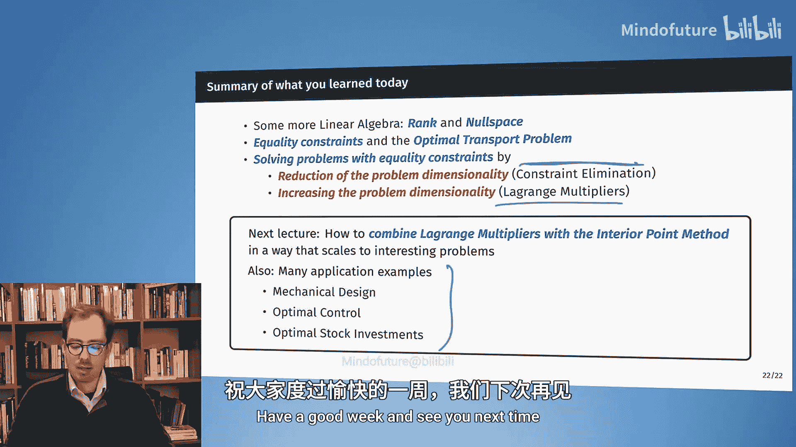

# 【凯尔大学】机器学习优化方法 ｜ Optimization Methods For Machine Learning And Engineering 2021 p17 P17_4.4_拉格朗日乘数法 -BV1C6SwBqEp7_p17-

So far， we have seen the constraint elimination method to reduce the dimensionality of the optimization problem。

But there's also a different technique that goes the other way around that is increasing the dimensionality of the optimization problem。

And how does it do that？Let's say we have a very simple optimization problem。

 we want to minimize x1 squared plus 3 x2 squared。And the trivial solution for that would be just zero and zero。

 but here we are adding an equality constraint， we have x1 plus 2 x2 minus1 equals 0。

Meaning we have an S line。We have an Fhan equality constraint and the solutions they all have to lie on this line。

And it is already indicated here， so the optimum solution x0， it lies exactly on this line。

 it has to， and this is the point that is the lowest point that you can find on the ISO lines so looking at the optimization problem from the top。

The lowest point that lies on this plane are from my equality construct。

And now we get to LaOS multipliers。So。What we do is we construct a so called lag order。

The Laotian is an extended optimization problem。So our original optimization problem here it is F ofX。

And my Laorian。It adds another variable， so my Laor here is adding。The Lambda variable。

And what I have now is my original optimization problem。Plus lambda times。

 and this is here what comes out of the equality constructstraint。

So I take the equality constraint equals zero and I plug that in here。

 and I have lambda times the equality constrain and I'm adding that。

And now I want to solve my optimization problem and the optimum solution lies at the point where the gradient of the lagguardig is zero。

So you remember back， the new method what the Newde method does。

 it finds the point where the gradient of the function is zero and in an unconstrained problem。

The an unconstrained convex problem， the only point where the gradient is0 is in the minimizer。

And here we do something that is similar to that， so we look for a point where the gradient of the Lagoian is zero。

 but not only the Laotsian with respect to x， but also the Laorsian with respect to lambda。

Or we could also imagine that a little bit differently。

 we could also say that now we have an extended vector， we call let's call that at。

So the extended vector here is it contains my x and it also contains my lambda。

And now I'm taking the derivative with respect to Z， so both X and lambda。Of my Laorion。

 and I want that to be zero。Okay， and before I explain what is going on here。

 let's look at how to solve this small example that we have at hand。So first。

 we derive our likeor by x and we get out this equation here and we want it to be equal to0。And by。

 by just。Well taking this equality here from this， I can construct that 2 x1 should be minus lambda and that 3x2 should be minus Lada。

 so this is an immediate result here from this equality constraint from the derivative to。Okay。

 and now I derive my La Washington by Lada and I get out x1 plus 2 x2 minus1 equals0。

And this is really interesting here because here what we effectively get out。

Is my equality constraint。 So if I look at this line up here， I it blue。

If I look at this line up here。And this guy down here， this is exactly the same， so by the way。

 I have constructed this Laorian。If I take the derivative by lambda。

 I get back exactly my equality constraint。And I say I want them to be equal to zero。

Byers saying can hear the derivative。With respect to Lambva or piio。Okay。

And now I can plug in the original results。So now I can plug in here， for example。

 I can derive this guy here by2， then I have x1 equals32s times x2 and I can plugl that into this lower equation and then just analytically solve that and the analytical solution is x1 equals3/7 and x2 equals 27。

Okay， and this is exactly the point。X star that we have seen up here。

And now I want to give you a little bit of more a visual explanation why that works。

So we have four on these isolate liness， if we take some point x here on the isolatelines。

We have the gradient。Pointing towards the optimal so here we have guard F pointing in that direction。

And if I'm up here， then I have got x cut F pointing in the direction。And if I'm here。

 I have got F pointing in that direction。And now。Let's remove those to have a little bit more space。

Now let's select a point that obeys the equality constraint， so here we are on this point here。

And we have the gradient。Pointing one。In that direction， roughly and if I'm here。

I have the gradient pointing in that direction roughly。Okay。And now if I look at the first gradient。

 so at the gradient up here。Then I would prefer to move them a little bit towards that direction。

Because by moving my solution in that direction。I。I am improving the result。

 so by moving in that direction， I find a solution where the objective function is smaller。

And I'm still obeying the equality constraint， so by moving in that direction。I am still。

On the constraints。And I'm reducing my objective function。

And if I look at the gradient on this side over here， I would like to move in that direction。

And I would obey still my equality constraint and。Will get a better solution on the objective function。

O。And now， let's。Again， make a little bit more spacecing。So the question is。

 when have I reached a point？Where I can no longer improve。And for that。

Let's have a look at the normal of my equality constraint。So here are my equality constraint。

It has a normal direction and the normal direction is this direction here。

 so it's the direction that is orthogonal to the plane defined by the equality constraint。And here。

Though。The direction。Of the of the normal。Is one tool。So that direction is one to meaning。

 if I go one step in the direction x1， I have to go two steps in the direction x2。Okay， and no。嗯。嗯。

I'm here， I'm using the red color。And you find the red color also over here。So what do you find here？

If I derive the Laorian by x。Here at the end， I will have my original gradient plus lambda and down here my original gradient times2 lambda。

And the Lada is， for us， it's a scaling factor。So。Depending on how I choose Lambda。

I get here something that is either very large or something that is rather small or that could also point into the other direction。

But it always， I have this red part of my term down here。

This always points into the normal direction of the equality constraint。And now comes the funny part。

There is one point。Where the normal direction of my equality constraint goes into the direction of the gradient。

So here。If I am in， let's say， if I am。In this location。If I am in this location。Then。

The normal direction and my gradient， they point into different directions。But there was one place。

Where they are pointing into the same direction and that is exactly at the optimizer so here at the optimizer。

My normal goes in that direction。And my。Rradian goes in that direction。

It must not point directly towards the optimum because well that's just how gradient go。

 gradients go， but in this place I can scale my lambmbda。

 so here now I'm scaling my lambda I'm choosing lambda in such a way that the gradient。

And the normal direction times lambda。Exactly， cancel out。And so here I have the gradients。

 the green part。And lambda times the normal， and they shall exactly cancel out and give me zero。

And this point here is the only point where this happens。

So if I'm constrained to stay on the line of the equality constraint or on the。

On the plane of the equality constraint， then this is the only place where this happens and this means that I cannot move in that direction and get an improvement and I cannot get in that direction to get an improvement I have to stay here。

And this is the best point that is available to me。And so。This is a really clever way。

To increase the dimensionality of my optimization problem to get to something where I can again employ the new method。

To get to a point where the gradient is zero， but now the gradient has to be zero on the extended optimization problem。

And at that point， my equality constrain will hold and I will be at the point at the lowest possible point on the intersection of hyperplanes where my equality constraints hold。

Okay， so this was quite a dense slide， but we will see a numerical example of that also in quite a bit。

So。The origins of the Lago multiiers were obviously Joseph Willgoche， he's not French。

 he's originally Italian from Tin， he worked also in Germany and in France。

 he died in France and already before the。French revolution。He revolutionized not only mathematics。

 but also astronomy。And there is a nice quote about his work， I will read that out。

 so the value of his book Mechanic Ananalytic， which was published in 1788。

Where he is introducing the La of multiplierers。The value of this book consists in the exposition of a general method by which every mechanical questions may be stated in a single algebraic equation。

The entire history of any mechanical system， as for example。

 the solar system may thus be condensed into a single sentence。So like往 really。

Cracked a really hard problem。 And with his language omal players。

 he was interested in the movement of the stars and。

Similar to how he condense all the equality constraints into one single equation。

 he could do that for mechanical systems and also the solar system and express everything about the solar system in a single equation with his Laos multipliers and。

People who were really smart at the time， not only today。

 and this is a result that has big impact even today， especially on physics。

 so people are using it in economics， in engineering， in computer science， but especially in physics。

So。This was invented。150 years before numerical computers appeared。

And people have used it as an analytical tool。And not as something in conjunction with numerical methods。

So in his original problem statement or statement of the language multipliers。

 this was in the setting of variational analysis where the result of the optimization problem is not a。

finite dimensional vector where the result of the optimization problem is a function。

 a continuous function， and that is even harder and even more amazing。

 we will see a small glimpse of that in lecture7 on vector spaces。And in physics。

 they have relied on these like automaticpls in many， many， many cases。

And as a way to derive analytical solutions and now since the last 50 or 60 years with the advent of numerical computers or digital computers。

L Auto multi players were also immensely useful and important in numerical optimization。Okay。

 but now let's generalize the example that we have just seen two higher dimensions。

 so imagine that we don't have only one equality constraint but several equality constraints again here we have our matrix A and B such that AX equals B。

And now we can still work with the Laotians， but now our vector Lada here。

It has higher dimensionality， and we have then an M dimensional language multiplier if we have M equality constraints。

And now when we want to use Newton's method to solve the resulting optimization problem。

 we need the gradient and we need the hesian， but luckily there are shortcuts and we we can find them pretty fast if we know the original gradient as well as A。

 so this is the formula to compute the gradient of the Laorian with respect to x and lambda。

And this is the definition or yeah this is the Hesian of the lagorion with respect to x and Lada。

 so we are increasing the dimensionality of our optimization problem and hence also our hesian has increased dimensionality。

Okay， the problem now is an n plus n dimensional unconstrained problem， which is nice for us。

The problem we have is this is no longer convex。And why is this no longer convex。

 the problem here is that we are optimizing for the when we find the the point where the gradient is0。

We want to do that over the Lagosian for x and lambda and here in the middle of our Lagosian。

 something depending on x and lambda are multiplied by each other and the resulting Lagoian is no longer a convex of the mass problem。

 it is still conves in x， and it is linear in lambda。But it is not conveyx in X and Lambda combined。

However， Newton's methods still applies because Newton methods wants to find stationary points。

 meaning points where the gradient is0 so if we don't have。

nuummerical problems or dis from Newton's method， if it converges it converges to the correct location。

 which is then a saddle point so the Lagoian has a single saddle point and this is the place where the gradient with respect to x and lambda is0 and this is the place where our optimalimum solutionize but we can no longer just use gradient descent and we can no longer just use line search because they would。

Try to minimize the problem where we are not looking for the minimum any longer。

 but only for a stationary point where the gradient is0。Okay。

 and now let's solve this numerically and let's solve the the small problem that we saw in this section numerically。

 so here we have f of x， which is x1 squared plus oh this should be。Times 3 plus 3 x2 squared。

Then here we have our first derivative， which is then 2 x1 plus here， this should be6。X2。

And here we should then have two and six for the hasst function。

And our equality constraints are x1 plus 2 x2 equals1。Here we have x1。Plus2 text2。minus1 equals zero。

 and we can just put the minus1 on the other side and then have for our B。

 we then have the entry one。And we want this in matrix form。

 so we have a matrix with only one row and the vector B with only one element。O。And now here again。

 we have some helper variables for our dimensions so we have。呃。Two dimension， original problem。

 and to that we are adding one dimension because we have one equality construct。

Now we construct the lagorian。So the Laguardian is depending on x on Z。

 so Z is our augmented vector and we are deconstructing our Z into an element Z and an element Lada。

 so we just take the first couple elements from Z for our x and the last couple elements from Z for our Lambda。

And then you find exactly the definition of the lagorion。

 so here we have f of x plus lambda transposed times， and these are the equality constraints。O。

And now we construct also the derivative and the Hesian of the Laagian。

And here we just follow the definition you saw on the previous slide。So what is important here。

 we have a new function called VcaAT， so Vca is vertical concatenation。

So first here we have the gradient with respect to X。

And then we are adding here plus a transposed times Lada。And so this is the whoops。

This is the first element here we have our gradient of our Lagoodeium。At x， and this is。The gradient。

Of F F X plus。A transposed。两umbber。And so this is here a vector and at the bottom here we have ax minus B。

 so here we have two vectors and we are concatenating them vertically with this VCt command。

And for the Hasian， it also directly follows the formula that was on the previous slide。

 only that here we have a vertical concatenation and horizontal concatenation to construct the final matrix。

 and here we have to fill up the remaining space with a zero matrix of of n Lada times n lambda dimension。

Okay what have we done， we constructed our original optimization problem。

 we constructed the Lagoian as well as the first and second derivative of the Lagootian。

 and now we can just plugged it into our Newton method and get our result and here the results are exactly two/7s and three/7 so the numerical solution to what had been solved analytically before that。

Okay， so now we are at the end of today's lecture， so what have we learned。

 we learned some more definitions from linear algebra you should already know from Riabacheula studies。

 so the rank and the nu space， also determinants of a matrix why that is important。

And we used these definitions for the Nile space for constructing equality constraint problems。

 so we saw what equality constraints are with the example of the optimal transport problem and then we learned about constraint elimination as the first technique for solving equality constraint problems by reducing the dimensionality of the problem by using the Nile space of the equality constraint matrix。

And as a second solution method， we saw the LgoOSsh multiplierers that are increasing the dimensionality of the optimization problem。

 the big advantage of the LagoOSsh multiplers was that we didn't have to modify our inequality constraints。

 we could reuse our original inequality constraints。

 but we're adding additional dimensions to the optimization problem。And in the following lecture。

 we will finally see how we can combine Lache multipliers with interior point method and in a way that scales up to interesting problems and we will also look at a couple of interesting problems from mechanical design。

 optimal control and stock investments and so then we will have a pretty much complete picture。

Then we can solve convex optimization problems with inequality constraints and equality constraints。

Then the picture is complete and from then on we will be mostly focusing on speed improvements。

 so what are the tricks and the mathematical thinking behind more perform algorithms that then enable more and more interesting classes of the optimization problems that we could solve in principle already。

 but then we can also solve in practice by having fast algorithms for。So this worth it for today。

 have a good week and see you next time， bye。

