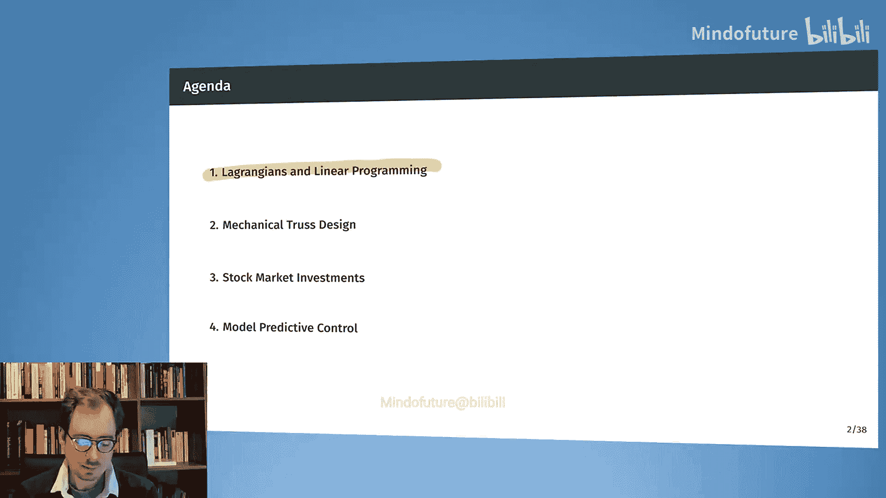
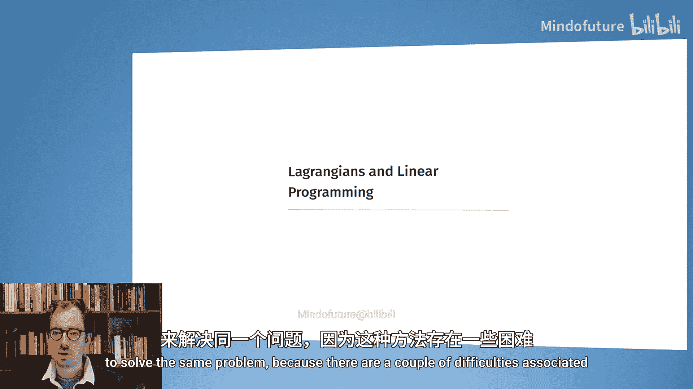
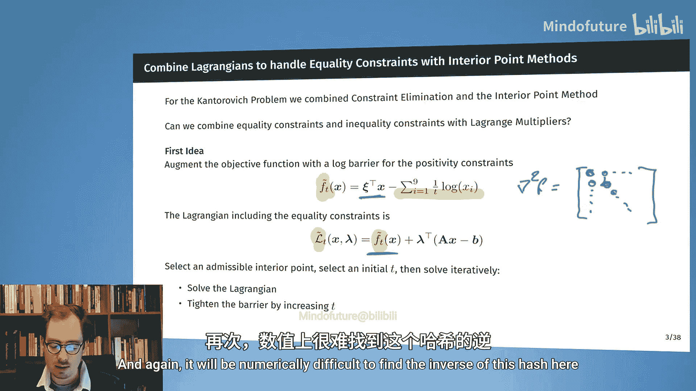
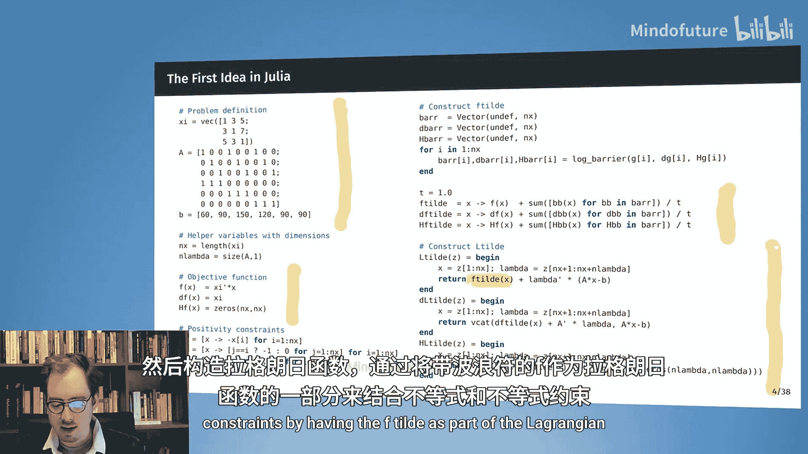
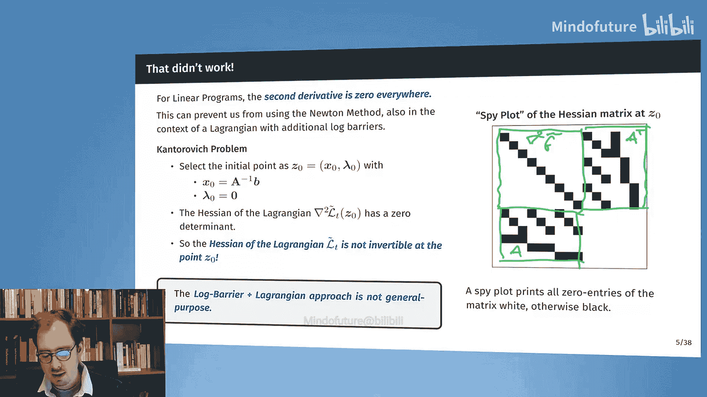
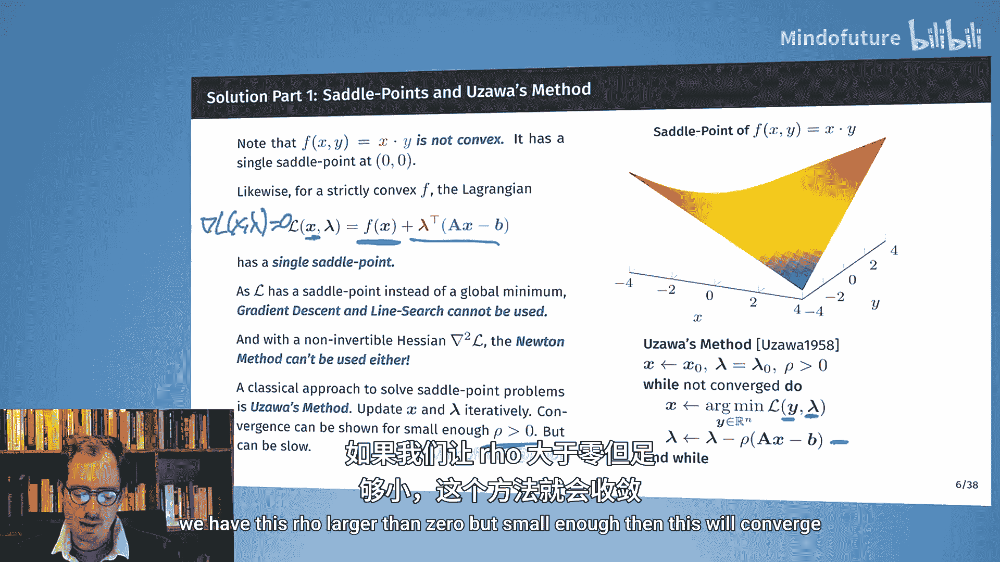
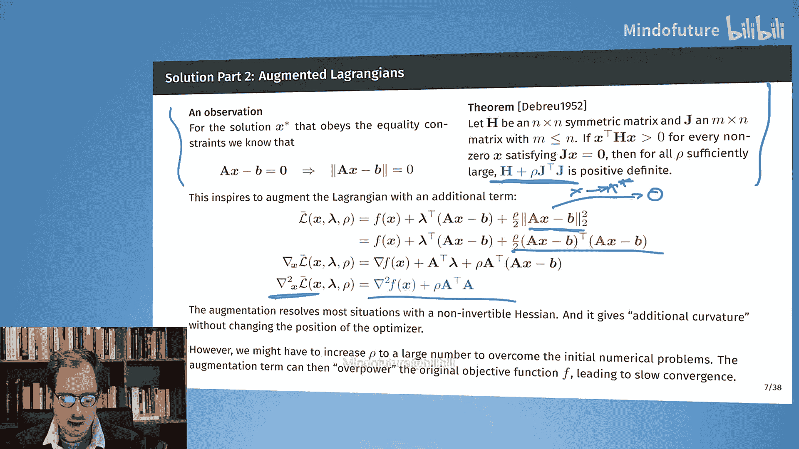
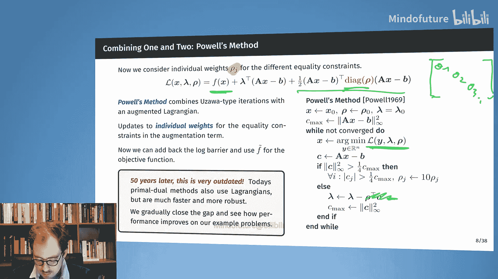
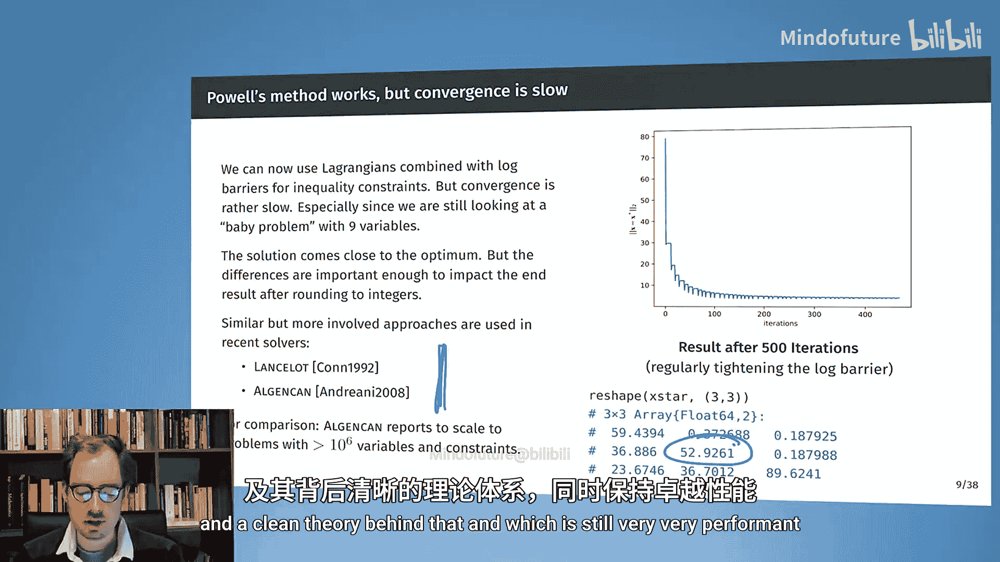

# 【凯尔大学】机器学习优化方法 ｜ Optimization Methods For Machine Learning And Engineering 2021 p18 P18_5.1_拉格朗日量与线性规划 -BV1C6SwBqEp7_p18-

Welcome to this installment of the course of the Ma Methods for Ma learning and Engineing。

Today we will see a couple of application examples。

Before we go into the examples， what is the。Seelection process。

 why did we choose the examples the way we did？And for this。

 let's go back to the Middle Ages and the seven liberal arts so in the Middle Ages the education was structured into the several liberal arts。

 those were well the arts that were free from well the normal labor of artisans or of peasants。

 so a free man who wasn't a butcher or peasants who didn't have to work for his livelihood。

He could pursue the seven liberal arts。And after that， maybe even follow a university education。

Which is theology， law or medicine and so on。And the liberal arts were further grouped into the trivium and the Kt trivium。

The trivium is focused on text and on writing。And the education of a child would start with a tri。

 so first of all， logic or dialectic， how to think， how to get to a logical conclusion。Secondly。

 grammar， which back in the day was mostly Latin but also Greek and at Hebrew。

 not the common vernacular of the people。So the grammar， how to express the thought。

 how to write it down， how to communicate it to other people。And then lastly， rhetoric。

How to convince people， So these three were all。On going into the similar direction。

 how to get to a logical conclusion that is true。How to write that down， how to express it。

And how to convince people。Today， even we have the word trivial in our vocabulary。

 so if something is very easy， we call it trivial。And this stems from the trivium， because back then。

 the trivium were all the subjects that even a child would already learn。And after the trivium。

 there was the so called qua trivium and it changed the focus from words to numbers or to mathematics。

So in the trivium there were four sub topics， the first one is algebra， so numbers， how to compute。

The second was geometry relating numbers to space， so back then they had the books， for example。

 from Euclid containing geometric proofs and here geometry was how to compute about or how to reason about geometry and how to think about numbers in space。

The third one， music was about numbers in time， so adding to the space dimension， the time dimension。

And lastly， as， astronomy about numbers in space and time。

 and this was the most difficult of the subjects。So what you see here on the right hand side。

 this is a picture from the Hous deliia room。Which was in Zoppeddy back in the bay。

 and this was a book for pedagogical purposes。And it comes from the Library of Her of Lasberg。

And she was the abyesss of her monastery quite close to Ktsworth。

So she was a contemporary of Hilig up from being， as you might know her in Germany。Her out of Lasbe。

 she was the abbs of the San Poil monastery， and today this is France in the Elsas region and the Santoil Mountain is maybe one hour。

 one and a half away from Calsbo， so they're also very nice hiking tours around San Toll。

 so you can walk from the so called Luzelburg to Santodll， it's quite nice。

And it has historical importance and as you see here now this image from back in the day where they were explaining the seven liberal arts。

 and so this is a reference to the history of this region。Okay， and in this lecture。

 we pick up this topic and we will talk about numbers in space。This will be a design of a bridge。

 so it's called mechanical trust design and we will be designing a bridge that is as lightweight as possible and therefore solve an optimization problem。

The second one is about numbers in time， about stock market investments。

So how to invest your money in a way that over time it will gain value。

And how to think about the trade off between the expected revenue and the risk associated with that revenue。

And lastly， model predictive control， so how to take a physical system。

 reason about its behavior and improve the behavior of a physical system。

 this will be then the analogone to thinking about numbers in space and time。

Before we drop into these three examples， we have one more subject to cover。

 which is about some difficulties that arise when we use the Laangian approach for equality constraints with linear programming。

So in the last lecture we have seen two different approaches to handle equality constraints。

 first of all， constraint elimination and second linear the Lagoian approach。

And for the constrained elimination approach， we could solve the Kandtohoviitch problem。

 so moving the soldiers and moving the soldiers in an economic fashion from barracks to their fighting positions。

But we haven't concluded the lecture by using the second approach。

 the Lagoian approach to solve the same problem， because there are a couple of difficulties associated with that。

 and we will show them today and also show how to get around these difficulties。

So。Initially we meant to think that combining the equality constraints approach of the Lagoian with the interior point method is quite trivial。

 so for the control which problem we have equality and inequality constraints。

 so somehow we have to combine the solution methods for both。

And so we might think it's rather trivial because we can just create some augmented target function that contains our original problem。

 which was linear for the cantage problem and then that contains then also the logariththmic barriers depending on some parameter t。

 where we can increase the tightness of the border over the time。And we can think， okay。

 instead of F， let's just plug F tilde into our Lagoian。

 and then we will get some Lagosian tilde that is then also parameterized by little T。

 and we can just iteratively solve the Laorian， and then increase T， solve the Lagosion， and so on。

And if that for many problems that can be done。In essence。

 this is then an approach that works that converges to the optimal。But in this case。

 we have a slight problem。So。For the， for the Lagoian here。When we plug in our Ft them。

You see that the filda originally or the original target function was a linear function。

 and we were just adding the。The barrier。And what you have to ask yourself is what is the Hasian of this f tilde here。

 or first of all， let's look at the hesian of F。So let's just take here。Hesian of F。And。

Since this is a linear function， if we are deriving two times。

Then the second derivative will be zero everywhere， so the Hesian。Of the original target function。

Is0 everywhere。And the problem with this target function。

Is that we cannot invert it or we cannot invert the hesian because it's zero everywhere。

Now since we are having here the additional lock barrier， we will have some more entries。

And in this case， we will have some more entries here on the diagonal， so here we will have。

 I don't know， ABC and so on some entries on the diagonal。However。

 when we are far enough from the barrier， then these entries on the diagonal will be pretty small and again。

 it will be numerically。Difficult tool to find the inverse of of this。呃，还是。

But let's look at the actual numbers and what arrives so here on this slide we have the implementation of the optimization problem for the controlvi problem let me go over that really quick so here we are defining the basic constraints of the controlvi problem。

 we have the objective function that we want to solve。We construct our ftilde。

 which is the objective function plus the logarithmic barrier。

 and then we construct the Lagosian that is then combining the inequality and in theequality constraints by having the ftilde as part of the Lagoion。

And what happens now if we take the original point or the starting point that we had defined in the previous lecture and plug that in。

Then we will find that the Hesian is not invertible at that point。

So now we see how the het looks like。And we can clearly see in the spy plot what the different components are。

So a spy plot is an image that shows a 2D image that shows the matrix and all the elements of the matrix that are zero are white。

Or transparent and or the other elements are black。And here we see， okay。

 this is the second derivative。Of the ftilde， where we only have some elements on the diagonal。

And then the other entries here。So these are then our matrix A from the equality constraints and this is a trans post。

 so here we find the definition of the Laorian of the hesian of the Laorian we find that precisely in this bypl。

AndNow if we evaluate this hesian matrix at the initial point。

 then we will find out that it has a determinant of0 and cannot be inverted。

 so the new method cannot be applied。And for us， this is problematic because we are optimizing a saddle point and we want to find the saddle point of the Lagoium。

And we cannot do that by just using gradient descent because it would overshoot and go even below the saddle point。

And so here we cannot apply the methods as we had originally intended。

Now let's look at this saddle point topic a little bit more on the right hand side this is a really easy example。

 this is just F of x and y is x times y。And this function has a single set part at exactly zero and zero。

And then。You see that this doesn't have a global minimum because if we wanted to minimize and we're using gradient descent。

 then we would just walk down down here and be unconstrained and we could walk down infinitely far and our solutions wouldn't converge there is no global minimizeising。

And so this is one example for a Sa point。And if we just compare the look of this f of x function here and the laggoian。

 then we see that it is somehow similar， so again here we are multiplying two elements that we are both optimizing over so here we are optimizing or could be optimizing over x and y in the top here。

And now we are optimizing over x and lambda， and both of them are multiplied here and this is a strong hint that there will be a set point。

And one can prove that the lagorian term if f of x is strongly convex。

 has exactly one saddle point that we want to find。

 and this works brilliantly with the newt method because the newde method will converge to the point where the gradient is0 and the saddle point is the place where the gradient is0。

 however we can no longer use the newde method here。Okay， what can we use instead。

 and there are a couple of elements that are combined for the solution and let's see here the first element which is Uzava's method。

Hro Fumi Uama he was a researcher from Japan， worked mainly in economics。

 but also he discovered important results in mathematics。

That he then also directly employed and used in his work on economic soul， describing the economy。

And what he developed Uzaba's method is splitting the optimization。

So initially we would here directly work on the Laotian and we would try to find a point where the minimize where the gradient of the Laotian with respect to x and lambda is zero。

 so this is what we try to find。And what he does is he's splitting this up in two steps that are repeated iteratively。

And the first step of the iteration。Is to fix the lambda。And to minimize over the X。

So here we call it y to distinguish， but now we are minimizing over the first part y。

 and so here this f of x。F of x， this is strictly convexed and so when we keep the Lada fixed here。

 then we will again end up with a strictly convex term because we are just then adding here something linear to the end。

Something Fine and if we have a strictly convex function and we add an Fhan term， it will remain。

It's strictly complex。And so we are now minimizing over this first part， keeping the Lada fixed。

And then we update the Lada in a second step by looking at how strongly the different equality constraints are violated。

🎼For the constraints that are violated more strongly。

 this Lada will be strengthened and will be given more importance， so to say。

 and one can show that if we have this role larger than zero but small enough。

 then this will converge。

However， conversionvergence doesn't have to be fast and actually in this case it will be rather slow。

The second ingredient is the so called augmented laggo。So first of all in observation。

 we see that for a solution x star that is the minimizer， we would have x minus b equal0。

🎼So this is the initial equality constraint and we know that all the solutions。

 the admissible solutions will hold this。This time。And from this。

 we also know that the norm of x minus b will be exactly zero。

Let's have another insight and this is a theorem from the 50s and what we want to achieve here is that our Hasian matrix again becomes positive definite。

 so we want to be in a situation where we can invert。The Hesian of the Laor。

So here we have our initial matrix H that is not necessarily invertible。

 and we want to modify it in a way that it becomes invertible and there's this theorem by the。

 that if we have a second matrix that fulfills that with a second condition that whenever Jx，Equals0。

Then the original matrix with x transpoposedse hx is greater than zero。And if that is the case。

 then we can select some rule sufficiently large， such that h plus rule J trans J is positive definite。

Okay that's maybe a mouthful， maybe one has to think a little bit about that。

 this is essentially a motivation to augment the laggonian with an additional term and what we are adding to the laggonian is here x minus B and then the squared norm of that。

Times were divided by2。And why does this make sense so we can unpack here this Euclidean norm notation and get to rh divided by2。

X minus b transpo times x minus B。And now when we compute the first and the second derivative of this term。

We will end up with。Hesm of the original objective function。Plus， rule a transposedposed times a。

And this looks kind of similar to this guy up here， from which it was shown that it is。

 it has to be positive definite。And we also know。Because here of the left hand observation that we have not moved the position of the optimizer。

Because in the optimum， so here when we let x go to x star。We know that this red term here。

 it will be exactly zero。So in the optimum or in all the solutions where the equality constraint hold。

Here this term will be exactly zero， but what we get from this term is additional curvature in the hesel。

And the conditions from up here， so the conditions for this Ethereem， they don't hold in every case。

 but this is a strong motivation to look for the goal that makes our Hasian of the Lagoganian of the new Lagoian positive definite。

However， we might have to increase this wall to a quite large number to overcome the numerical problems to have an invertible hesian。

 however when this wall becomes too large then it can overpower the normal objective function and then we run into new numerical problems where we need a long long time to converge。

So also this augmented Lagoian， and if we take this purely， then conversionvers can be released low。

But what people have done and what they did already 50 years ago is to combine the approach of Uzava's method with the augmented lac washing。

And this is Po's method。So we will not use Powell's method in the exercises this is but only to show。

How the building blocks， the ingredients that we saw so far？Can be combined into a solution method。

That can solve more or less every optimization problem that is complexvex。

Because we have the possibility to express inequality constraints。

 we have the ability to express equality constraints， we can treat any。

Strongly convet optimization problem so what we see here is what we will have is a pretty universal solution method。

 however it will be really small and then what will be interesting in the lecture is how we improve this over time and we will track how the different。

Ts and theories that we will be learning， how they lead to an improvement in the solving speed and so that you see where these improvements over the last。

50 years are coming from so that we today have fast solvers that can run optimization problems with millions of variables。

Okay， but what Pos method does just in a nutshell is we no longer have a single scalar rule。

 but we now have a weight rule for all the different equality constraints。

And what they are doing is they construct here a matrix with all the entries of row on the diagonal。

 so here they have a matrix that has then you know row1 and row  two and row3 and so on on the diagonal。

 all the other entries are zero。And this in this term。

 it leads to a scaling of the different equality constraints independently of one another。

 so role one is scaling the first equality constraint。

 role2 is scaling the second equality constrain。And then we can remove this。

Overpowering of the original objective function by only scaling up the importance of the equality constraints that are。

Problematic or that need a little bit more， more， more control。So again。

 here we have Uzava's method integrated， so we are firstly minimizing our Lagosian and keeping the role and keeping the lambda fixed。

Second， we have a look at whether we have to change the rule if we have to make the weighting of one of the equality constraints stronger and if yes。

 then we do that。If not， we will adjust the Lambda here。

 and now you see this strong relation to the Uzaas method。And this guy here。

 probably because we want this to be Victoria， probably this has to be Diek。🤢。

Of the vector wall。Times C saw that we end up with a vector expression in the。Okay， so today。

 50 years later， this is somehow audited， we are a lot more performant with our methods today。

However， many of the building blocks are still in place and we will gradually close the gap and make the improvements to get to the performance all us that we have today。

 and we will also have some simplification。So in some sense。

 we have to add a theory that is more powerful。But from the algorithm side。

 you will also see some simplification so that in the end we have something that is very short。

 only a few liness of code and still a really performance however。

So the method as it is shown on the previous slide， Powell's method。

We can combine it now with the inequality constraint handling of the interior point method。

 so we can now use powers method， but instead of F。

 we can have F tide depending on T so how strongly， how tight we want the barrier to be。

And then we can iteratively solve the optimization problem with the laggoia and increase the tightening of the barrier and repeat and what you see on this slide is how exactly this performs and we see it does converge however it converges really slowly so here we need hundreds of iterations to somehow converge and even then。

Didn't we arrive at the global optimum， we have only approximated it。So look at the result。

 even when we are rounding， for example， here， we would end up with， I don't know， 52。

000 ors doing a certain movement。And I think the the ground truth from the previous lecture was 55 in this case。

 so you see that we have converged and。We have gotten really close to the global optimum but we didn't exactly reach the global optimum and well in the last 50 years people have worked to remedy this situation and today we have solves that are still conceptually very close to what we saw with powers method。

 for example， the Lancecelot or the Egenhanhan method but they were adding and adding。

How to say bend aids or。The underlying ideas， many of the underlying ideas are still the same。

 but then we were adding heuristics to solve the upcoming problems and so these are solvers that are performant and we can scale them up to millions of variablesables and networks works。

However， what we will see at the end of this courserus is that we don't have to add heuristics and band aids to a method that。

It works but doesn't scale it， but there are also approaches that give us a really clean solver and a clean theory behind that which is still very。

 very performed。

