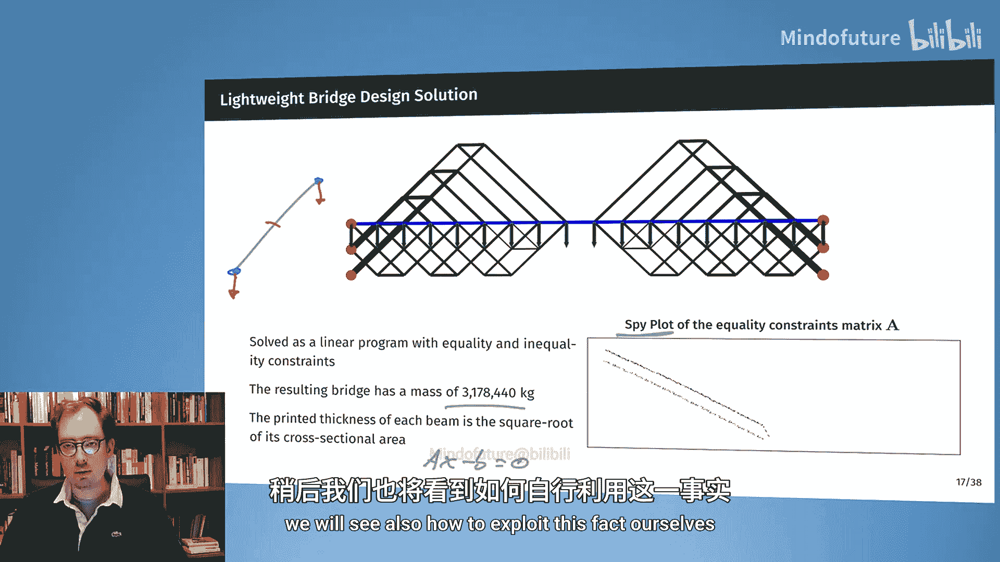

# 【凯尔大学】机器学习优化方法 ｜ Optimization Methods For Machine Learning And Engineering 2021 p19 P19_5.2_机械桁架设计 -BV1C6SwBqEp7_p19-

The first application example is on mechanical trust design。So what is the trust？

Imagine a bridge or imagine an electrical tower， you have seen trusses every day in your life probably。

So a is a mechanical structure that consists of rigid beams that have been connected together at joints and in some regular gridit。

And an example of a truck structure here， the bridge on the right hand side or some hidden book type of airship。

Where the hull is constructed as a truss。Or electrical towers， the a tower， and so on。In the last。

 let's say， 150 years， we learned how to construct these。Towers and also how to compute them。

 how to trust them。In the first days， maybe some of them crash down today， they don't。

And that's also due to the fact that we know exactly what the stresses are inside of the trusses and we can。

Computer what happens to them also if there's wind or some vibrations and so on。

And what you see here， these references， these are some of the important improvements that were made during the last1 hundred years。

In the computation of the properties of these stresses and also in optimizing their design。

So if the trus structure is too heavy， it might break down under its own load， under its own weight。

If it's too light， it might not hold the load that we put on top of it。

So somehow we need to find a good structure that holds， and that is maybe also。

Cheap or economic to construct。In this example， we will learn how to exactly do that。But be careful。

 being able to do the computation does not mean that you're an expert。

And does also not mean that you can evaluate the safety risk associated with that。So。

Writing down the optimization problem and solving it is one thing and it's good to have， for example。

 then the best structure for your needs。But the domain experts。

 they do a lot more and they can not only evaluate the result。

 but also also on the assumptions that went into the optimization problem that was solved。

So here we learn to optimize， but that does not make us domain experts just say。

So how was this field developed historically， one important figure was Luian Street。

And with others in the 1960s， he founded the scientific discipline of designed centtrofue so to take some。

Description of the requirements and the constraints and then synthesize the best design。

And they started with some simple trus structures， for example。

 here this five partaw structure and then wrote computer programs for their optimization initially of course the hardware was slow so they had like IBM 360 series machines。

And photon。But gradually， computers became better and also the methods became better。However。

 even after the first decade， so in the 70s， this will still consider to be a toy。

So the problems they could solve were rather small， like five part tower structures。

And no real engineer would touch these methods also because you still had to be a programmer in order to use the tools。

However， in the 80s， when computers became fast enough and the interesting problems could be solved。

Companies were founded and the tools were developed to be nicer to use to have graphical use interfaces and to be integrated with computer aided design tools。

And soon， these。These methods that were， evolved from， from some。

Research department became a workhousese and became really indispensable for the engineers in the field。

 and today many of the structures that are created。

Could not have been thought of without the help of a computer。And。

Today we have more general tools available as well。

 so we can also do topology optimization of free form shapes and any 3D shape that can be imagined and optimized that。

But for this example， we will still focus on the trust structure。

One interesting thing concerning here is five partaw structure。

 so this was included back in the day in research grants or in applications for a research grant。

And there is one story where the caption under this figure was that this is an electrical tower and they wanted to develop methods to optimize the design of electrical towers and get money from the American government。

And the ground was rejected。And as this was the 1960s， they changed the caption and said。

 okay now they want to optimize the landing gear of a moonle back then when space shuttles and rockets were developed to land or the moon and actually it kind of looks as if it could be the landing gear of a moonle。

 and the same ground then was accepted so this goes to show that sometimes you know how or how to market your work。

Okay， so the trust structure we want to optimize is making a couple of simplifying assumptions。So。

We are concerned with a trust that contains a set of beams that are connected to one another。

 So here I'm drawing them in green。These are the beams of the truss。

 and these are connected to each other。And the connection points。

 these are called the joints so here。We have all the joints。And。

Some of these joints are taking on an external load。So here we have the load。

 like some weight and gravity pulling to the ground。And in addition。

 we also have candy level points and these other points where the tru structure is connected to the ground or to the wall or to some fixed point。

And our goal is to find a trust structure that is as lightweight as possible。

Where we assume that the x and y coordinates of all our joints are fixed。

 so we make the simplifying assumption that this trust structure doesn't move when I am adding a load。

嗯。And which is reasonable if our trust structure is sufficiently strong。But of course。

 every trust structure has to move a little bit in order to exert a counter forcece when I'm putting load on it。

 because every force has a counter forcece acting on it。

But we make this assumption that the joints don't move and we know the joints ahead of time。

 and we also assume that the trust itself has a negligible weight so that we don't have to consider the gravity of the trust structure itself。

 so these are the assumptions we are making。And what we then have to consider are the so called equilibrium conditions。

So there are forcess going along in the direction of the beam， of the beams and chlor。

And when the beams meet。At the joints， the forces that go in the direction of the beams。

 they have to exactly cancel out。So here we have a force going in the direction of this beam。

 a forest going into the direction of this beam， and a force going in this direction。

And these forces have to cancel out so that the sum of these forces in every direction。Is exactly 0。

And。Well， the forces can be positive or negative， so we can have tension and compression。

And still it has to cancel out and in a real trust structure this is the case。

 if it weren't the case， the trust structure would be accelerating and moving and obviously this doesn't happen。

Okay so from the forces going in the direction of a beam， how can we compute its y and x coordinates。

 so let's say here we have a force going in the direction of the beam。And we want to decompose that。

We want to decompose that sub into a force in the x direction and another force in the y direction。

And for this， well it's clear that we have to use the trigonometric functions of sine and cosine。

 so the strength of the force here in the X direction。

 this is exactly if here we have our ad theta here we have exactly the cosine of。

Theta times the force of the beam and the force along the beam， we consider this to be a scalar。嗯。

And we can write this down in a more simple fashion。

 so you know maybe from high school how to compute the cosine of theta。

 so now if theta is down here in this angle，And then Theta will be the。诶。Length B， or here the the。

Yeah， the length B divided by the hypotheus， so the length C。And if you know call this here， our。

If we represent this sea line here。By a vector and recording the vector Db。

Like the direction of the beam。 So here we have Db。

Then we can compute the length of the hypotheus as the Euclidean norm of TBb。here， you carry know。

And in order to compute the cosine。Of sitta Yeah then we take D B。In the X direction。

Divided by the length。Of DB。In the Euclidean distance metric。Okay。

 and so you can see from this how this expression up here。

 this ends up with a vector and the vector is then exactly the force。

Along the beam in the x direction and the force along the beam in the Y direction。对拜。

And now Newton's third law comes into place that the forces between two objects exist in equal magnitude and opposite direction。

And have to cancel out。And therefore， if we take them the sum of the。Forces on the beam。

 they have to be exactly zero， so here we then we are still in the 2D domain。

 so here we have0 in the x direction， zero in the y direction when we sum up all the forces。

But for that you also have to consider the external load。

 so if there's a force acting on one of the joints， we have to add that to the equilibrium condition。

And with this equilibrium condition in place。We can ask ourselves the question， well。

 what do we then want to optimize？And we want to minimize the weight of the truss。

so that it still holds a given load。So the weight of a certain beam。

is defined by its cross sectional area， so we know the length of the beam because the positions of the joints are fixed。

And now when we look at the beam here， it has a cross sectional area。

And then the weight of the beam would be the volume of the beam。

 which is the length times the cross section area， plus some constant factor for that depends on the material like what type of steel you are using for example。

And we know。How much cross section area we need at least for a certain force。

So if there's a certain force， it's all tension or compression。

Acting along the direction of the beam， we know how to。

 how thick to make the beam at least so that it can safely hold this force。

And then we are minimizing the weight or the cross section area so that it is exactly at what is required。

And from the literature， then we have a certain factor here it's de。

And the mass of the beam is then the length of the beam times the absolute force。

 so either tension or compression acting along the beam。

Times this delta and this delta then it combines all the knowledge from the literature。

 what cross section area we need depending on the force。

 and there is some linear relation between that。Okay， so depending on the forces。

 we can compute the required mass of each beam。And now the question remains how much force has to act along every beam so that the entire trus can be in the equilibrium condition that we need。

So we are now minimizing over all the forces。Under the constraints that the equilibrium is always there。

And this looks like a normal linear program with some equality constraints and we know how to solve that there's just one problem here and the problem here is this absolute value。

So here we have an absolute value and as we have already discussed in one of the exercises。

 we have a problem with absolute values because at the zero point there is no gradient defined。

And somehow we need to get around that and still define this in a way that we have a convex optimization problem that we know how to solve。

How in general do we deal with absolute values and there's a certain trick for doing that。哦。

Originally， we are minimizing over the absolute value of F ofx。

And now we want to transform that into a convex optimization problem and what we do is we are adding an additional variable S。

And what we want to achieve is that S is exactly the absolute value of f of x。And in order to do so。

 or in order to achieve that， we have to add two inequality constraints to our optimization problem。

In order to understand what happens here， we have to look at two different cases。

 so we have the first case。Wherere F of x。It is bigger than zero。

And now the optimization problem looks as follows。We have here our coordinate system and since we're minimizing S。

It looks exactly like this。The function that we're optimizing。And now we have added to。

Inequality constraints， let's say F of x would have this magnitude。

And then we require S to be larger than f of x， which would be here because f of x is as positive as we said。

And it has to be larger than minus f ofx， meaning this area here。

 we are excluding it by the inequality constraint。In this area。

 we are also excluding it by the inequality constraint。And we know then that S will sit exactly here。

At the。The place where the constraint begins。Because we have a force to minimize S。

 and this is like pushing the solution into the inequality constructtrain。

And now let's look at the other case。Let's or let's finish this up here。We know then that S。And is。呃。

F of x。That S star R， the optimum here is equal to f of x。And then for the case2。We have F of x。

Smaller than zero。 and let's just。可です。Canning canning canning。Now again。

 we have the coordinate system， we have our function that is just S that we are minimizing。And now。

We have the first constraint that says。S has to be larger than f of x F of x is something negative。

 so again， we are excluding all of this area。And also s has to be larger than minus f of x and minus f of x would now end up on this side。

And we are excluding this area。And again， S ends up here because we are exing impression。

 we want to minimize S。And pushing it into the inequality contraint。And therefore here as well。

In the optimum， we have a star。This times minus。F of x。And that means in conclusion。That a star。

Is the absolute value of F of X。And this is exactly what we want to have。

But you need to make absolutely sure。That the optimizer is adding pressure to S and wants to minimize that。

 and that becomes important later on when we have several of these variables of which we are taking the absolute value of when this is hidden somewhere inside an equation。

 you have to make sure that there's actually an incentive for the optimizer to push our additional value towards the absolute of F of if F of x is what we're interested in。

Okay， now with this， we can state the full optimization problem for computing the minimum weight design of ourbridge。

And this is a linear problem because delta is fixed， the length of the beams is fixed。

 and now we just have take the sum over all beams and here look at the absolute value of the beams that we have created by adding these additional constraints。

And we see also that there is pressure exerted。On the absolute values， so we know that here。

 this upper relation here， this is actually ho。And the side constraint is the equilibrium condition for every joint。

So we have optimization variables in two times the number of beams because we have added this F to the B。

And we have。Equality constraints two times the number of joints because for every joint we look at the equilibrium in the x and in the y direction。

Now， what does the design space look like？Now， let's take here some。Example。

 we have a bridge that shall span a span of 80 meters。And as the design space。

 we have defined a grid of 18 by7 joints and beams connecting these in a regular way。

And we can connect the bridge to the ground at six canilever points that are here marked in red。

And the center line which is blue， this is where we'll have our road where or the rail track where the train is driving and here we are adding a load an assumed load of 20 tons or 20。

000 kilograms times the gravity constant acting in the X direction on every joint that is here on the center line。

And the question is how lightweight can we make each of the beams so that the bridge will still hold this load actingangle on？

Now compute compute compute， we are optimizing linear problems。

 we can solve them quite fast with our computers today。And this is the optimum result。

 so we will have a bridge design that actually resembles many bridges that exist in real life。

 so this seems to be like a natural solution。And this bridge then has a weight of 3000 tons。

 so the weight of the bridge itself will no longer be negligible and we would have to include that in the optimization itself。

But including the weight of the bridge and the optimization itself。

 this is what you will be doing in the exercises because this is one of the practical examples that we will solve altogether。

 just giving you a hint of how to include the weight itself。

 what we will be doing as we look at the beams and at the joints connecting the beams。

And then we make an assumption that is that the weight of the beam will be distributed evenly across the joints。

 so we will cut here in the middle and say half of the weight will be added as an external load or as an additional load in the X direction on the joints that are connected to this beam。

One observation that is also relevant going forward is how do our equality constraints look like and here again we have a sppl for the equality constraints so again we can combine or the equality constraints in a big matrix equation Ax minus B equals zero and the matrix a has a very interesting structure。

Because it is very sparse， so most entries of this matrix are zero。And they are。

There are approaches to exploit the fact and to get many orders of magnitude improvement in speed when we can ignore all the elements of this matrix that are zero and later we will see also how to exploit this fact ourselves。

