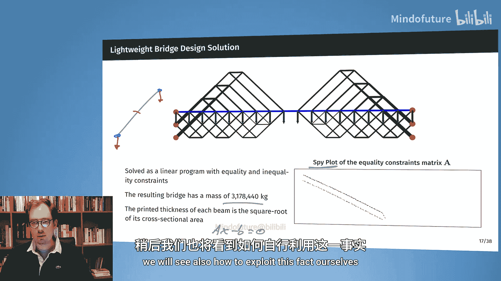

# 机器学习优化方法：5.2：机械桁架设计 🏗️

在本节课中，我们将学习如何将优化方法应用于一个经典的工程问题：机械桁架设计。我们将了解桁架的基本概念，学习如何将物理平衡条件转化为数学约束，并最终构建一个可求解的优化问题，以找到最轻量化的桁架结构。

## 什么是桁架？

想象一下桥梁或电力塔，你在日常生活中可能每天都能见到桁架。桁架是一种由刚性梁在节点处连接而成的机械结构，通常呈规则的网格状。右侧的桥梁或某些齐柏林飞艇类型的船体，其外壳就是由桁架构成的。在过去的约150年里，我们学会了如何建造这些结构，以及如何计算和设计它们。如今，这些结构很少倒塌，部分原因在于我们能够精确计算桁架内部的应力，并能预测其在风或振动等条件下的行为。

## 历史背景与发展

历史上，一位重要人物是Luian Street。在20世纪60年代，他与其他人共同创立了设计优化这一科学学科，旨在根据需求和约束条件，综合出最佳设计方案。他们从简单的桁架结构（例如一个五杆塔结构）开始，并编写了优化程序。起初，硬件速度很慢，但随着计算机性能的提升和方法的改进，到了80年代，当计算机足够快以解决有趣的问题时，相关公司成立，工具也发展为具有图形用户界面，并能与计算机辅助设计工具集成。如今，许多结构的创造都离不开计算机的帮助。

## 桁架优化问题设定

我们将要优化的桁架结构基于几个简化假设。我们考虑一个由一组梁（绿色部分）相互连接而成的桁架。连接点称为节点。其中一些节点承受外部载荷（例如重力）。此外，还有悬臂点，即桁架与地面、墙壁或固定点连接的点。

我们的目标是找到一个尽可能轻的桁架结构。我们假设所有节点的x和y坐标是固定的，这意味着当我们添加载荷时，桁架结构不会移动。我们还假设桁架本身的重量可以忽略不计。

## 平衡条件与力的分解

接下来，我们需要考虑所谓的平衡条件。沿着梁的方向有力作用。当梁在节点处交汇时，沿梁方向的力必须精确抵消。这些力可以是正的（拉力）或负的（压力），但总和必须为零。在真实的桁架结构中，情况就是如此，否则结构会加速移动。

为了计算沿梁方向的力在x和y方向上的分量，我们需要使用三角函数正弦和余弦。具体来说，x方向的分力是梁上力的标量乘以角度的余弦值。我们可以用向量形式更简洁地表示：如果用一个向量 **Db** 表示梁的方向，那么x方向的分力就是 **Db** 在x方向的分量除以其欧几里得范数（长度）再乘以梁上的力标量。y方向同理。

根据牛顿第三定律，两个物体之间的力大小相等、方向相反，必须相互抵消。因此，在考虑所有力（包括外部载荷）后，每个节点在x和y方向上的合力必须为零。

## 优化目标与问题构建

我们希望最小化桁架的重量，使其仍能承受给定载荷。单根梁的重量由其横截面积决定，因为节点位置固定，梁的长度已知。梁的重量是体积（长度乘以横截面积）乘以取决于材料（例如钢材类型）的常数因子。

我们知道，对于沿梁方向的特定力（拉力或压力），至少需要多大的横截面积才能安全承受。因此，我们最小化重量或横截面积，使其恰好满足要求。根据文献，存在一个因子δ，梁的质量可以表示为：
`质量 = 长度 × |力| × δ`
其中，`|力|` 表示力的绝对值。因子δ综合了文献中关于所需横截面积与力之间的线性关系知识。

因此，问题转化为：在所有梁上寻找一组力，使得整个桁架满足所需的平衡条件，同时最小化总质量。这看起来像一个带有等式约束的线性规划问题，但存在一个挑战：绝对值项。

## 处理绝对值项的技巧

绝对值项在零点没有定义的梯度，这给优化带来了困难。为了将其转化为可求解的凸优化问题，我们使用一个技巧。

原始问题是最小化 `|f(x)|`。我们引入一个额外的变量 `s`，并希望 `s` 恰好等于 `|f(x)|`。为此，我们向优化问题中添加两个不等式约束：
`s ≥ f(x)` 和 `s ≥ -f(x)`
同时，我们最小化 `s`。

以下是其工作原理的分析：
*   **情况1：f(x) > 0**。约束 `s ≥ f(x)` 是起作用的，而 `s ≥ -f(x)` 自动满足。由于我们最小化 `s`，最优解 `s*` 将被“推”至 `f(x)`。
*   **情况2：f(x) < 0**。约束 `s ≥ -f(x)` 是起作用的，而 `s ≥ f(x)` 自动满足。最小化 `s` 会迫使 `s*` 等于 `-f(x)`。

因此，在这两种情况下，最优解 `s*` 都等于 `|f(x)|`。关键在于优化器必须对 `s` 施加最小化的压力。

## 完整的优化问题表述

利用上述技巧，我们可以陈述计算桥梁最小重量设计的完整优化问题。这是一个线性问题，因为δ是固定的，梁的长度也是固定的。我们需要对所有梁求和，并通过添加额外的变量和约束来处理绝对值。

优化变量是梁力的两倍（因为引入了额外的 `s` 变量）。等式约束是节点数的两倍（每个节点的x和y方向平衡条件）。

## 设计空间与实例

让我们看一个例子。假设一座桥梁需要跨越80米。我们将设计空间定义为一个18x7的节点网格，并以规则方式用梁连接。桥梁在六个红色标记的悬臂点处与地面连接。中心蓝线是道路或铁轨所在，火车在此行驶。我们假设在中心线上的每个节点施加一个20吨（20,000千克乘以重力常数）的载荷，方向向下（y方向负向）。

问题是：在仍能承受此载荷的前提下，每根梁可以做到多轻？

通过计算优化（如今计算机可以快速求解线性问题），我们得到了最优结果。这个桥梁设计类似于现实中的许多桥梁，看起来是一个自然的解决方案。这座桥的重量为3000吨。此时，桥梁自身的重量已不可忽略，我们需要将其纳入优化中。在练习中，你将学习如何做到这一点，基本思路是将梁的重量均匀分配到其连接的节点上，作为额外的外部载荷。

## 等式约束的矩阵形式与稀疏性

一个相关的观察是等式约束的矩阵形式。我们可以将所有等式约束组合成一个大的矩阵方程 **Ax - b = 0**。矩阵 **A** 具有非常有趣的结构：它是高度稀疏的，即大多数元素为零。存在专门的方法来利用这种稀疏性，从而在计算速度上获得数量级的提升。在后续课程中，我们也将学习如何自己利用这一事实。

---

本节课中，我们一起学习了如何将机械桁架设计问题转化为一个可求解的优化问题。我们从桁架的基本概念和历史发展讲起，明确了优化目标和简化假设。核心在于建立力的平衡条件，并将其转化为数学约束。我们遇到了绝对值项带来的挑战，并学习了通过引入辅助变量和不等式约束将其转化为线性规划问题的技巧。最后，我们看到了一个具体的桥梁设计实例，并了解了等式约束的稀疏矩阵特性，这为高效求解大规模问题提供了可能。通过这个过程，我们看到了优化方法在解决实际工程问题中的强大应用。