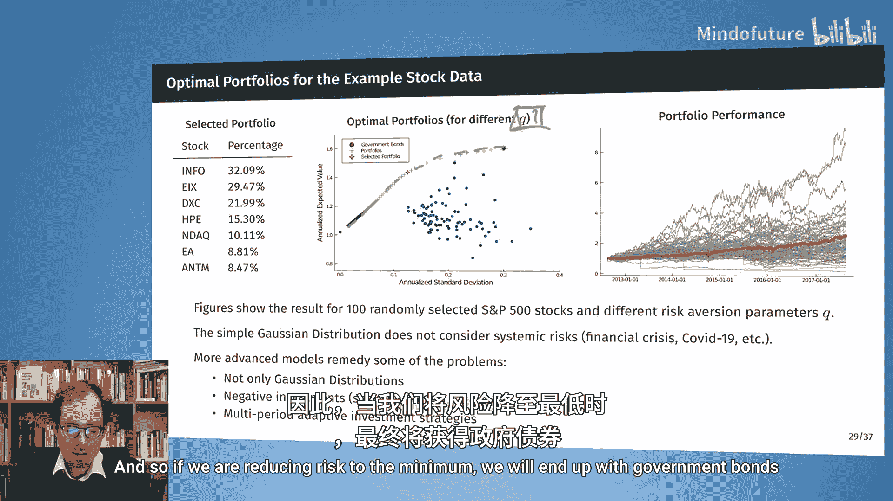

# 【凯尔大学】机器学习优化方法 ｜ Optimization Methods For Machine Learning And Engineering 2021 p20 P20_5.3_股票市场投资 -BV1C6SwBqEp7_p20-

The next example is about stock market investments。So here we see a couple of examples。

 the stock prices for Amazon， Apple， Google， and a couple more of the last years。

And they have all been normalized to start at one because we are not interested in the absolute prices。

 but in the change of price。And we see that over this time period of。For five years。

 the price for the Amazon stock has more than cutul and the prices for a couple other ones have grown a little bit or have even diminished。

And less so in Europe， but in America， it's very common to invest your money into stock and also to do this for retirement and many Americans entirely rely on the stock market in order to not be homeless in the old age。

But also for usE in Europe it's interesting because the stock market is a good way to still earn money by investing。

 so in some years prior you could get maybe 4% at the bank but today it's more 0。

5% and many people are asking where to invest their money and well stock usually is considered high risk high reward。

And today， what we will learn today is how to make stock investments high reward with only medium risk。

So the stock price， if you look at it， it looks kind of random and this is also acknowledged by looking at the histogram of the daily changes over time。

 so here we see the stock price changes of Google。And this looks like a probability distribution or like a histogram with samples from a probability distribution。

 it even looks key in Gaussian but it's obviously school so it's not a perfect Gaussian distribution and so the mean is here somewhere around 1。

0 and probably because the Google stock has increased in price over this time period the actual mean will be somewhere here。

 larger than 1。0 that means on average every day， the stock is earning。

 it's earning money is' increased in price。But obviously sometimes the stock is also losing and the past is not a perfect predictor for the future。

 and therefore this distribution probably will look slightly different in the next years。

 especially if there is a next financial crisis or something。

 but otherwise this distribution is a kind of good predictor of the Google stock how it will change over the next years。

There is， however， something called the efficient market hypothesis and that says that the traders have already integrated all the available information on the company in the stock price and by considering the efficient market hypothesis。

 you cannot earn money by buying stock because all all all the information is already integrated in the price。

 however this is generally not true because not everybody has access to the same information and not access to the same analysis capabilities for choosing the best investments and also it doesn't include things like quantitative easing where the government or the central banks are pushing big amounts of money into the stock market in order to avoid financial collapse。

So you still can earn money at the stock， but it all depends on the information that you have available on the analysis capabilities that you have。

The question we are interested here is how can we select an optimal portfolio so if you're investing into stock which stock should you buy and how can we formulate this as an optimization problem and this implication example is exactly concerned with that。

 we will understand how the optimization problem is formulated and how you can do this at home and we will do this in the exercises also with the actual stock data if maybe you have some investments to make in the next weeks。

 you could actually use the investment strategies to could effect that you're learning here。

Now first of all， what we have to understand is that we are not totally rational with respect to the expected reward。

 but instead of the expected value of the stock， what we should also consider is what is called the utility function and the utility is the subjective perceived。

Vue so there is the numerical value， so how much money do we have in the bank account？

But there's also the utility function， which basically describes how much your lifestyle and your living conditions improve by increasing your money by a certain amount。

 and this will lead us to the consideration of risk。

So if we were only interested in the expected increase， then we could put risk entirely aside。

But since risk obviously is important to us， we no longer consider just the expected value of the stock but we have to integrate this with our personal utility function。

And the idea of the utility function it dates back to Daniel Bennoli。

 who gives a very nice example of a poor guy who somehow obtains a lottery ticket that has a 50% chance for winning 20。

0002 cards， so really a fortune back at the time。And it has a， a 50% chance of winning nothing。

And the question is how much is this lottery ticket worth to the poor guy。

 so imagine he has not enough money to feed his family， he maybe lives on the streets。

 he is not warm。Poor guy in the 1800s。And。The question is whether the lottery ticket will be worth its expected value。

 which is 10，000 du cards。Or whether the poor guy shouldn't rather sell his luxury ticket for 9。

000 du cut that he gets with 100% certainty。So on the one hand。The expected value。50% for 20。

000 dual cardss would be 10，000 dual cuts。the question is if somebody were to offer 9，0002 cuts。

 cash in hand to the poor guy。Shouldn't he take the money？And to Benulli。

 he argues that he should take the money。Because he should not consider the expected value of the luxury ticket。

 but he should consider what this brings him in improvement of lifestyle。

And the difference between a poor guy who cannot feed his family and somebody who has 9。

000 du cuts where he can maybe already own nice houses， so multiple houses。

The difference in life between  zero and 902 cut。Is a lot bigger than the difference in lifestyle between 9。

0002 cut and 10，0002 cut or 9，002 cut and 20，0002 cut。Meaning。

The added utility of money decreases the rich you get。And today。

 this is researched under the termPro theory， so there have very famous publications by Kaneman andtoki。

 you always mentioned the two together who showed what the utility function is of actual people。

So Kaim Manentwesky we're interested in human behavior and we're devising experiments to find out which mechanisms are happening in our brain when we make decisions。

And we are not totally rational and objective， but we rather follow also internal utility functions that we have。

 and that can be explained。And what they came up with or what they rather discovered。

 they didn't invent it。 they discovered this is a very。Characteristic S curve。

And the S curve is convex for winnings。Meaning， if we are playing poker and you are winning five euro。

Then you achieve a certain kind of additional wellbeing and you're happy that you won。嗯。However。

 if you win 50 euro when we are winning poker。You are probably more happy than just by winning five euro。

 but not 10 times more happy。And this positive side of the utility function it describes。

How much your perceived value changes by adding more and more money to the winnings？

On the other hand， if you are losing money， the curve is convex and it looks a little bit different。

Because first of all， losses are evaluated stronger than winnings， so this is a psychological effect。

And also， if we are accumulating and adding more and more losses。You will evaluate the。

How much this loss impacts you by a convex curve that is somehow flattening out and again here。

Somehow at some point it will really flatten out because imagine that you owe 10。

000 euro to the bank， you're feeling bad about that。If you're owing 1 billion to the bank。

 you're feeling really bad about that and probably you will have to get into。呃。

special program for getting rid of that debt within five years or so。

 which is the personal bankruptcy。So you're really feeling bad about that。

 but now if you're owing 2 billion to the bank， you will go into personal bankruptcy anyway。

 so somehow also on the lost side at some point this curve it will flatten off。

Okay now to the stock market and modern portfolio theory。

 so we still call this the modern portfolio theory today， but this dates from the 1950s。

 so it's already 70 years old， still this is modern portfolio theory about the stock market。

And it was invented by Harry Markovviitz， who back then was 25 years old。

 so maybe as old as you are today。And he had the idea of modeling the stock price changes as a joint probability distribution over all the stocks。

So these people have already investigated before him， but on top of that。

 to represent investment decisions as an optimization problem that make an explicit tradeoff between the risk and the return of the investment。

And he came to the idea because he was in the middle of the development of modern optimization theory。

 so he worked alongside George Danig， and well we already heard about Dsig。

 the inventor of linear programming， and while he worked with Dank on optimization theory and tools and alongside that developed modern portfolio theory。

And there's a link between MPT， model portfolio theory and prospect theory。

 because from prospect theory， we know that we have。We attach a negative value to risk。

 we are risk averse in general， and the question is how should that risk be considered in our investment decisions？

Already in the 60s， some of the assumptions that were made by Mackovis were known to be not true。

 for example， assumptions on Gaussian distributions and so on。

 so today there is a much richer and also mathematically more advanced theory for doing investment decisions but as a baseline this is still working really nice even today。

Now we have to learn a couple of more definitions from probability theory。

 fear not this will not be relevant for the exam， but it will be very irrelevant for your understanding of this example if you want to later for example。

 earn money on the stock market， so you will not become a professional investor just by having applied the methods of this example。

 but it will give you a really good baseline understanding and that will probably be even a better baseline understanding。

 then what you will get from your advisor at the local Spk assay or some other regional bank。No。

Random variables， again， we are denoting them with an underlying notation and every random variable lets us draw samples from an underlying probability distribution。

So this is here we consider continuous probability distributions like Gaussian distributions。

And we want so the probabilities for certain outcomes to be positive and the integral to be one end so only。

The very basic definitions for probability theory， we will not go into measure theory here。

And to this probability distribution we can attach the mean， so the expected outcome。

 and here the mean is just the notation for that is mu R for the random variable R。

In addition to the mean we have the variance， so how much the probability it fluctuates around the mean。

 and this is the expected value for the sample that we have from r minus the average or the mean of r and the whole thing squared。

In addition to the variance or。As something equivalent to the variance。

 we can look at the standard deviation which is just the square root of the variance。

 so the variance here is sigma squared of a and the standard deviation is just sigma of a。

So we just take this square root， the big advantage of the stand deviation is that it has the same physical unit as the underlying random variable。

 so if we are measuring， for example the temperature，Ands in degree Celsius。

 and there are some random process from which we measure the degree Celsius。

Then the standard deviation of this measurement will also have the physical unit of degrees Celsiusius。

 so this is the big advantage of the standard deviation。

 it is much better for interpretation of the meaning of that。However。

 the variance is better for computation， it has some nice properties that we will see in a little bit。

In addition to the variance， there's also the covariance。

 so how much two random variables are moving together or what is their inclination or how are they positively。

Related and covariance and correlation are also similar terms correlation again we will see in a little bit。

Now the covarient we will describe as sigma squared AB。

 and the formula for that is the expected value of the sample of a minus the average of r times the sample of B or the random variable B minus the average of B。

And。What you see here is first of all， that the variance is just the covariance of a variable of a random variable with itself。

And the covariance is also symmetric， so covariance of AB is the same as covariance of B。Okay。Now。

 Gaussian distributions that we already saw in one of the first。Lectures。

 they are special because they are defined only by their mean and covariance。

So every random variable and every joint distribution over multiple random variables has a mean and covariance defined。

However， Gaussians are special because we can describe the entire distribution only by the mean and the covariance。

Now some mononotation， let's say we have two random variables。

 we can combine that into a vector of random variables， so here fat。Ft Y with an underland。

And if they are gaian。Then description or the definition of the Gaian distribution has two components first here we have the vector of the random values and we have the matrix sigma which is the covariance matrix and it contains all the covariances。

We here covariance of a。With itself。Wwhich is just the variance of a。

 then the covariance of B with itself， so just the variance of B， and then the covariance AB。

And the covarient EA and the two yellow ones here， they are equivalent。

 so this is also asymmetric matrix。And it will also be symmetric if you go to higher numbers of multivariate distributions with many random variables in a joint distribution。

And now we can see how the Gaussian is defined， so basically here the important term is this part and then the first part here。

 this is just a normalization factor， so the number in the fraction here。

 this is just a scalar number that we need to use in order to ensure that the integral over the distribution will be exactly one。

And here the n here depends on the dimensionality of the distribution。

 and then we have the determinant of the covariance matrix also somewhere in the middle of that。Okay。

 so those were some basic definitions for how。Random variables and probability distributions can be described。

Many of these definitions apply to all。Probability distributions。

 and sometimes we then also make the additional assumption that a distribution is caution。

And these will now be applied to the stock values or to the historical。

Data from the stock markets that we have。Now， how do we do that？First of all， for every stock。

 we want to estimate the average rewardt that we get from investing in that stock。

Meaning every day we have a probability distribution for how the stock changes and we want to know how much in expectation the stock will change every day。

And we can take that by just considering that every day is a sample drawn independently from some distribution。

This is not true。Because the stock market it is a time series and obviously in the time domain all the days are coupled。

 so actually we are not drawing from we are not making independent draws from an underlying distribution。

 but this is also one of the assumptions that is made here。

 meaning that we take samples from so-called or we take so called IID samples and the IID。

 it stands for。Identically or independently distributed。

And what we do is we just take then K samples， which would be like the change every day for 10 years or a five year period and then we just compute the average by summing up the samples and dividing them by k。

 so the number of samples。And this is an estimator then for the true average moon。

 and sometimes so here we will call it overland y if y is underlying random variable。

And in other contexts， it's also called Mu hat， where the hat stands for an estimator for a certain value。

 and in this case we want to estimate them。Besides estimating the mean。

 we are also interested in the risk， so now considering all the variables of the stocks。

Independently， we can also compute the variance for the daily change of the stock price。

And we do that by first computing the empirical mean here， the overline y。

 and then taking the squared distance to that and summing that up， however。

 now we no longer divide the resulting value by k， but we divide it by k minus1。

And there are good reasons for that， so we will deal with large case or maybe stock values。From。

From hundreds and thousands of days where this minus1 becomes less and less important。But still。

 we want to be correct here because well we are investing our money。O。Now compare this。

This second equation here to the original definition of the variance and well the question is where does this k minus-1 come from and let me just get into that for a minute。

 again this is not relevant for the exam， but it should be really enlightening if you're interested in stock investments and about probability in general。

So we just take here the sum of the squared distance to the empiricalamine and develop that a little bit further。

So first of all， what we do is we include first minus mu and then a plus mu in the equation。

 so minus minus is plus so these two here in principle， they would be canceling out。

But we are not canceling out， we are expanding here the square。

And then we get to the next term with three different components。And then we can simplify this。

In the next step， we can then remove here the tool by removing this term and we then end up with the sum of I equals one over a k。

 so the sum of all the samples we have。Of the sample minus the true mean。

 so here we have the true mean。Minus k times。 and here we have the empirical。

The empirical mean minus the truemi。And now we plug this result。Into an expectation。

 So now we want to know， what is this guy。Here in expectation。And therefore， also what is。

This guy here。In expectation。And now we can simplify a little bit more and what is important here is that what we have here。

This is actually the variance of the mean estimator。So here we have our overline why。

And this overland at y is the estimator for the true average。

 but the overland y is itself also a random variable as long as we do not know our samples。

So whether something is random or not。It doesn't depend on the nature of the world。

It depends on you because if you have perfect information about the system。

 sometimes you can compute。What the sample will be ahead of time。And it will not be random to you。

 but for another observer who doesn't have the same information about the system。

The sample could look completely random， so randomness says more about you as an observer than about the system itself。

 and as long as we don't have seen the samples as long as we didn't open the box with the sample inside。

As long， also this estimator for the average will itself be a random variable and have also a variance。

And this here， this is the variance of the。Rand off the estimator。喂 over来。

And we will see this in I think two minutes， but we know that this is the formula for the estimator and that the variance will reduce linearly in the amount of samples that we have taken。

And then we can simplify a little bit more and we come up with k minus1 Sigma squared。

We can move the k minus1 to the other side of the equation， and then we exactly end up with the。

Formula for the unbiased estimate of the variance。 So we have the sum of the。

Sd distance to the empirical meme divided by Ca in this one。O。So that was maybe a little bit。

Far reaching into the definitions from probability theory。

 but now finally let's apply everything to the stock market。So we randomly select 100 stock。

 100 stocks from the S&PU 500 index， so this is just a list of the 500 most important stocks in America。

And we will make this data also available to you for the exercises。

So we randomly select 100 of these stocks over some time period and now we have every for every day in the time series。

 we have the opening and the closing price of the stocks。

And now we can compute the mean and the variance。So all the 1 hundred stocks are depicted here in a figure and the figure contains on the。

X X。The annualized standard deviation， so we take the standard deviation for every single day and we extrapolate that to the entire year。

 so it's a little bit easier to think about what that would mean in daily change because the numbers are a little better to work with if you think about it in the annualized setting。

And also annualized here we have the expected value， which means in。

 if we look at the probability distribution， how much will the stock price increase over time。

 so here we have one particular stock that on average every year will increase by 60%。

That's quite a lot。So we can talk about whether it is likely that he will continue growing 60% every year。

Or or whether maybe some smart investor has already predicted that and has already integrated this into its current price。

But well， that's the discussion of the efficient market。😊。

Now and we see that here we have a lot of combinations of risk and return。

So this guy here that is expected to grow 60% if the past is the predictor for the future。

He also has a quite large standard deviation of 0。3。

There are other stocks that only have a standard deviation of。0。12。

 so here we have a variance of maybe three times between the minimum and the maximum variance here of the stocks。

And somehow we have to choose， somehow we have to balance that and we have to say。

do we care about risk or not and by how much do we favor less risky stocks？And。

But there is always a baseline， so if you have too much money under your mattress and it's hurting your back and you get want to get want to move it somewhere safe。

 what you can do is for example you buy government bonds so in the US this would be called the T bills。

 the T bills are issued by the American government who needs，Money and who's also in debt。

 but still these are considered zero risk because investors assume that American government will not default。

 will not go bankrupt。And these government bonds， they what they have zero risks out here。

 no zero standard deviation， but they also give little return so here just assumed that their return is at 1。

02。Today it's probably less in today's market conditions， but 10 years prior or。

 2% on government bonds was possible， especially if you buy government bonds that have a runtime of maybe 30 years or so。

 then generally the percentages you get is increasing a little bit。Okay。Now the question is。

Which stocks should you buy and we have a preference for stocks that are here。

In the upper left corner， because these are the stocks that have a high ret， high expected revolt。

 and low risk。And somehow we want to make an investment and we want to combine these stocks in a way that we get high reward and little risk。

And how can we do that？That's the big question。For that， we have to consider also。The combination。

off。Probability distributions so far we have only looked at each stock independently and now we went to build a portfolio。

 so a portfolio with a combination of stocks and the question is how does the mean and the variances change when we are combining stocks so adding them and maybe weighting them or scaling them and so on。

And let's start， first of all。With independent probability distributions。

So we are drawing samples from two lotteries that are not related。

 or somehow we have probability distributions that are independently from another in the probabilistic sense。

And here， addition is rather straightforward。Because for addition， we can just add together the mean。

And we can edge together the variances， and this is the nice property of the variance compared to the standard deviation that we can just add up the variances when we have independent probability distributions。

And for the mean， this is straightforward， you can just look it up from the definition。

 but for the variances， it's a two line proof let's show this here。

 first of all independent variables， they have zero covariance。

And this is here the first term in red。So the covariance between A and B is zero。

 it must be zero if we have inency between the two。

And now we can just write down the equation for the variance of a plus B。And again we。

We unpack this and unpack the square and we get to the equation here in the second line here the middle term that is again in red。

 this is zero and it has to be zero because we are still in expectation here and so we know this is zero from the independence。

And we can simplify and we just get to the variance of a plus the variance of B。For scaling。

 it is a little bit different， so in scaling when we are multiplying our random variable a by some scalar factor。

It is not linear， but if we are scaling from r to alpha R， we get linear scaling in the mean。

But the variance changes differently。 So for the variance of alpha R。

 we have alpha squared times the variance of a。And the proof is a one line proof。

 so again here this is the definition of the variant of Al。And we can pull out the alpha in front。

 pull it out of the expectedant term， and then we get a squared the variance。Okay。

 so these were just a three line proof and essentially a one line proof。

 so all straightforward enough。But what does that mean for us？The question is。

 if we have independent probability distributions and if we now assume that the stocks were independent probability distributions。

好使主义。Diversify how should we invest online？And this is closely linked。To the question。

Of how the variance of an estimator improves when we have more and more samples coming in。

But let me explain this。So let's say we have again a random distribution A and we are able to draw independent samples from them。

 so again IID， independent and identically distributed samples from the same distribution。

And we can and then we take the sum of this， so we take our case samples and we sum up of all of them。

 and this can again be described by a random variable S。Which is k times a。

 and this then has variances。sigma。Square S。Is k times or sigma squared a。

 so variance of S is k times the variance of a。What is important here is the difference between this guy up here。

Down here and this guy up here。On the left hand side， we were scaling。

What we could do is we just scale our random variable by K。

But then our variance would have increased by k squared times the variance of a。

We are not doing that What we do is we take K independent samples。

And let's say we were taking just two samples。 Then the equation from up here would apply。

 so then we would have the。Variance of a plus a， which would be2 times the variance of a。

But we don't have two samples， we have k samples， so in essence the variance increases by having k times the variance of it。

Okay。Now we are。诶。Not。😡，Interested in the sum。 but when we have an estimator， for example。

 an estimator for the mean。Of the random distribution A。

 then we take our case armus and we divide everything by k。

So this is what we did two slides before when we wanted to estimate the mean。We take Ks。

 sum it up divided by K。But now when we are dividing by K。This is now a scaling。So， this is now。

This scaling here。Here， let's like the scaling on this side。So and therefore。

 here we have to reduce the variance。By1 over k squared。

And that means when we have our mean estimator。It will have a reduced variance compared to the original distribution A。

And the variance will be half reduced by 1 over a k。

And the standard deviation will have reduced by 1 over the square root of k。

That means if I double the number of samples， then I double the precision of my estimator in terms of the variance of the estimator。

And how similarly。If we were。We're thinking about distributing our money among stock。

 so we have different companies that we can invest in。

If these stocks were independent from one another。if they were described by the same underlying probability distribution。

That we then we should just evenly， uniformly， distribute our available money across all these investments。

And have the same expected return then for the individual investment。

But the variance of our portfolio will have decreased by one over k compared to the single investment opportunity。

However。These assumptions do not hold， so we do not have independence between the different stocks。

And before we go into the reasons for that， let's talk about another term that often comes up。

 which is correlation。So correlation is pretty close to covariance， however。

 correlation is normalized so that it is easier to think about correlation。

So let me give you an example。The definition for the correlation here is the corevari。

Divided by the standard deviation of the first times the standard deviation of the second random variable。

And this normalization means that the correlation。Of a random variable with itself will always be exactly one。

Because then we have exactly here the variance of a divided by the variance of a。

For different random variables， if they are independent， then the correlation will be exactly zero。

That means they are independent from one another。If， however， there is a positive correlation。

That means the two random variables are like moving together， so if one of them increases。

 then the other one has tendency to have also increased and vice versa for decreasing。

The correlation can also be negative， and that means they are moving in opposite directions。

 so then they are negatively correlated。And we can compute the correlation matrix between all our companies between their stocks from historical data。

 and we come up with the matrix that you see here on the right hand side。On the diagonal。

 it's all once because this is the correlation of the company stock with itself。

And then we see some of these stocks with a very high correlation and others even with a negative correlation。

 so here in the election you see sometimes the stocks are negatively correlated。

And oftentimes there is good explanation why this is the case。

 so this is just the historical observation for the correlation and then。

We can come up with some reasons， but oftentimes there are many reasons and also contradictory reasons why maybe two stocks are correlated positively or negatively。

 but let me just give you examples that are more like anecdotes why something like this can。

So the first example is for positive correlation。And there we have a car manufacturer that is earning less money when he has to pay more for the steel。

But when the price for the steel goes up。All of the car manufacturers are earning less money。

And that means that in for the car industry， this is one reason why stocks are possibly positively correlated because the impact for the。

Price increase for the steel will be an impact in the same direction for of them。

And this is one possible reason for the positive correlation of the stock prices of car manufacturers。

Now to continue with the example， probably the car manufacturer and the steel manufacturer。

 so the supplier of the steel。In the car manufacturer， they are negatively correlated。

Meaning if the steel price goes up。Then the steel supplier is earning more money and the car manufacturers are earning less money。

 so these two industries are likely then to be moving contrary to each other and to be negatively correlated。

And we can compute the correlation in the covariance。Between all the stocks。

And then exploit this information， so if we then have the information about the covari。

 the big question is how can we integrate that in our decision making in order to buy a certain stock or not？

And the idea is here to take out some of the risk of our investment by counterbalancing with a negatively correlated stock。

And the best thing that can happen to us is to find two stocks that have both high expected revolt。

But have also a high negative correlation。Because that means in expect， both are going up。

 but for the risk， so for the variants， they are canceling out each other because they are。

Counteracting probably on on the movements of of the other one。Okay， but。

Let's see a couple more definitions first， how we can compute with random variables that are not independent。

 but now we have dependent random variables。And here again。

 we have the laws for adding them and for multiplication with a scalar or for for scaling them。

First of all， the addition。Again， the mean is easy for the mean， the formula will not change。

 however。And the variance is now computed differently。Because if we get。

This's the different erectome。So the variance of a plus B is the variance of a plus the variance of B plus2 times the covariance of A and B。

And this is actually the red part is the covariance AB plus the covariance of B。

 and because of symmetry， this is two types the covariance。

And the proof is analog to the proof of addition that we just saw on the slide before。

 just we cannot make any longer assumption that the covariance will be zero。And now for the scaling。

 so let alpha and beta be scaling factors and we then have alpha A and beta B and the question is what is the covariance between alpha A and beta B？

And the covariance between the two is alpha times beta covariance R。The proof again is one line。

 so here we have the covariance of alpha A and beta B and we can just pull out alpha beta in front。

 it's a one line proof。But usually we not only have two stocks that we are investing in。

 but we have many stocks that we can potentially invest in。And now we are building up a portfolio W。

 this will be a vector。Usually fake notation， but if I'm writing it by hand。

 I hear're saying writing an arrow to indicate that the portfolio W will be a vector。

And this vector W will contain a scaling factor for every stock and then we put zero for a stock that we don't buy at all and we put one for a stock where we put all our money into this one stock or we put something in between so the portfolio will basically then be described by a vector where the entries are positive and have to sum to one so here for this the entries each of the entry has to be positive。

And the sum so the sum of I equals 1 to n of the W I， this has to be1。And this will be our portfolio。

And there we are combining。Many investments and we are interested in the mean and in the variance of the whole portfolio。

Okay。So we want， first of all， describe the joint distribution of all the stocks and the joint distribution of all the stocks is described by a vector mu with all the mean values and with a big covariance matrix big signalig。

And for that， we have given like。An index and an ordering to all the random variables and now all the stocks are one of the random variables here and we order them from one to end。

Okay。And now we take the weighted sum。So where we take every stock and we weigh it by how strongly we have invested in that stock and take the weighted sum。

 and this is then our portfolio and the value of our investment， how that will change all the time。

And for this， we want to compute the average and the variance， the average it's quite easy。

 it's just W transpose times mu。And for the variance， it is W transposed， big sigma， W。

And how this works out， you can see that by assuming that we only have two different stocks because then we will here have our big sigma。

Equal to the matrix with。Verance of A。Verance of B。What be。And then the covari of。

B and the covariance of a B。And you can just evaluate here then the equation for the overall variance and you will find exactly the equations from the left hand side of this slide。

 and this then also scales up to higher dimensions。So we know the covariance of the stock prices。

 so we can also compute the variance of our portfolio and the mean value of our portfolio and so on。

And another question is， how can we。Decide which is the best portfolio for us。

And this is then exactly the Markov its portfolio selection， so what Markovvi published in 1952。

And here we see three different options， but these three options are all in a sense equivalent。

The first version is to minimize the variance under earning constraints。

That means you go to the bank and you say， I want to earn at least 4% every year。

And subject to this constraint that you want to earn at least 4% in expectation。

You want to minimize the risk。And。So again， we have here the conditions for our portfolio。

 so it has to sum to one and all the entries have to be larger than zero。And we are。

G a constraint that our earnings have to be at least our expected value has to be larger than some minimum。

It doesn't mean that such a portfolio exists， but your soilva will then tell you if there is no feasible solution。

 for example。When if such a solution exists， then you can further minimize over the variance of that portfolio。

And。If the big Sigma is a positive definite matrix。

 then we know that this will be a convex optimization problem that we know how to solve with the algorithms from the previous lectures。

Another way to express your portfolio preference is to say you want to maximize your earnings。

 but you also want to limit the risk or you want to limit the variance of your portfolio。

So you go to the bank， you say， I'm accepting a variance of 0。1。And under that constraint。

 maximize the expected reward， this will be the formula M of fu。And we can also。Integrate。

The two considerations and say there is an explicit trade off where we have here when we are maximizing the expected value of the portfolio。

Minus the variance times some scaling factor。And again。

 we have the constraints that we have to be somehow we have to have a same portfolio。Okay， and。

So you have to somehow indicate your preference， or you have to indicate your riskversion by giving a parameter newmin or variance marks。

 or the scaling factor Q。And the Markrovvid portfolio selection will give you the best portfolio there is under the assumptions of modern portfolio theory。

 so some of the limiting assumptions that we've been discussing before。

And professional trading firms are still doing that today， however。

 they have special ways of improving the covariance matrix。

So they obviously they look at past performance and at a covariance and correlation between companies。

 but they are also integrating already additional knowledge that they have。

 so they have an advantage because they are professionals in the field who have maybe Bberg terminals and advanced。

Alysis tools， and they can already then improve the covariance matrix to not only look in the past。

 but also to integrate some of what the changes to the covariances they expect for the future。

But just looking at the historical data and how we would have performed on the historical data。

 let's see what were the possible portfolios。Now the blue dots are exactly the blue dots that were shown earlier。

 these are the different stocks with their risk and their reward。

 and now if we combine these stocks into a portfolio by abusing and exploiting the covaris。

 we can get much better combinations that are more to the upper left。So high reward with less risk。

And all these these。Green plus here， these are portfolios on the efficient frontier。

And you get them by varying either this Q or varying the mu min or the variance max parameter。

 and by using either of the previous three methods。

 you will end up at a portfolio on this efficient frontier and in that sense the three methods are also equivalent so because depending on how you choose your preference parameter you will end up somewhere on the efficient frontier。

 but you can always find the parameters that correspond to each other that result in the same position on the efficient frontier independently of which of the three methods you're applying underneath。

And so if we are reducing risk to the minimum， we will end up with government bonds because only they have zero risk。

 so here there is one portfolio here that contains only government bonds but then when we go up。

 there will be a mixture that is exploiting the covariance。

 up until the point where we end up at the expected reward where only a single stock can still fulfill that and here again we will have a portfolio that is not a mixture。

 but that contains only one stock。

Okay， but here we have selected some Q and this has given us a portfolio on the efficient frontier for the historical data。

 for the 100 random stocks that we consider， you see here how the distribution was done in that portfolio and we see in the historical data。

 how that would have performed and it's actually acquired。诶。

Impressive curve because many of the natural random movements have somehow been filtered out and the stock is increasing。

 but it looks as if it is reduced by risk by quite a bit。Of course。

 this can only consider historical data and everything that is not contained in the historical data is not foreseen by this method。

 so if you have historical data without a financial crisis。

Your model would not predict the financial crisis and you can be very much off from your original prediction。

 so be careful just by knowing Markovviitz and the modern portfolio theory does not make you a professional investor。

 but at least you can sensibly speak to some bank advisor and probably you will know more about modern portfolio theory now than they do。

However， the real professionals who work at the stock market and the quants that are employed by the big trading firms。

 they have much more advanced models than this now so in the last 70 years this was improved so we no longer assume only Gasian distributions are only mean and covariance but also higher order modes of the distributions。

 we can have negative investments， so short positions on some of the stocks we can consider multiperiod trading strategies and also consider maybe the price if you're switching stocks because theyre also there's a transaction costs to consider and so on。

 so today the models are much more advanced but this will be a quite good baseline and give you some idea why investing at the stock market is not necessarily as risky as one of things if you find a good balance and if you're confident that for example there will be no financial crisis in the next year。

