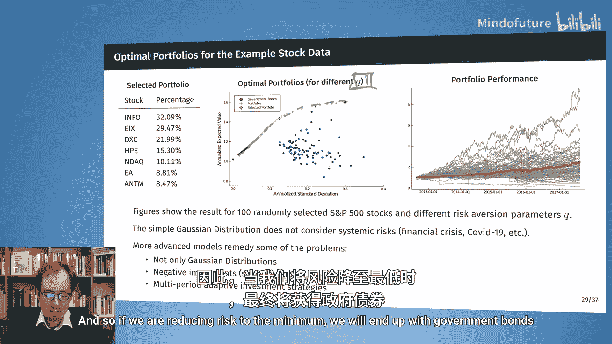

# 凯尔大学机器学习优化方法：5.3：股票市场投资 📈

在本节课中，我们将学习如何将投资组合选择问题构建为一个优化问题。我们将从理解股票价格变化的基本概率模型开始，逐步引入现代投资组合理论的核心思想，并最终学习如何通过优化方法在风险与回报之间找到最佳平衡。

---

## 概述与背景

上一节我们介绍了优化问题的一般形式。本节中，我们将来看一个具体的应用实例：股票市场投资。

股票价格随时间变化，看起来似乎是随机的。下图展示了几家科技公司过去几年的股价走势（已归一化）。我们关心的不是绝对价格，而是价格的变化。

观察每日股价变化的直方图，可以发现它类似于一个概率分布。这意味着我们可以用概率论的工具来分析和预测股价行为。然而，过去的表现并不能完美预测未来，尤其是在发生金融危机等重大事件时。

“有效市场假说”认为，所有已知信息都已反映在股价中，因此无法通过分析公开信息持续获利。但现实中，由于信息不对称、分析能力差异以及政府干预（如量化宽松）等因素，通过股票投资获利仍然是可能的。

我们面临的核心问题是：如何选择最优的投资组合？即，应该购买哪些股票，以及如何将这个问题表述为一个优化问题。

---

## 效用函数与风险厌恶

在深入讨论投资组合之前，我们需要理解一个关键概念：**效用函数**。我们并非完全理性的决策者，只关心期望收益。相反，我们对风险的承受能力会影响决策。

丹尼尔·伯努利曾用一个例子说明：一个穷人获得一张彩票，有50%概率赢得20000达克特，50%概率一无所获。这张彩票的期望价值是10000达克特。但如果有人出价9000达克特现金购买这张彩票，穷人应该卖掉它吗？伯努利认为应该卖掉，因为从身无分文到拥有9000达克特所带来的生活改善（效用），远大于从9000达克特增加到10000达克特（或20000达克特）的改善。这引出了**边际效用递减**的概念。

现代“前景理论”通过实验研究了人们的真实决策行为，发现效用函数通常呈S型曲线：
*   **盈利时**：函数是凹的。赢得50欧元比赢得5欧元更开心，但开心程度并非10倍。
*   **亏损时**：函数是凸的，且人们对损失的感受比同等盈利更强烈。

这意味着我们在投资决策中，必须将个人对风险的厌恶程度考虑进去。

---

## 现代投资组合理论

现代投资组合理论由哈里·马科维茨于20世纪50年代提出。其核心思想是：将股价变化建模为所有股票的**联合概率分布**，并将投资决策表述为一个在投资**风险**与**回报**之间进行明确权衡的**优化问题**。

为了应用该理论，我们首先需要回顾一些概率论的基本定义。

---

## 概率论基础定义

以下是理解后续内容所需的核心概念：

*   **随机变量**： 用带下划线的字母表示，例如 `R`。它代表从一个潜在概率分布中抽取的样本。
*   **均值（期望值）**： 随机变量的平均结果。记为 `μ_R`。
    *   **公式**： `μ = E[R]`
*   **方差**： 衡量随机变量围绕其均值波动的程度。
    *   **公式**： `σ²(R) = E[(R - μ_R)²]`
*   **标准差**： 方差的平方根，与原始随机变量具有相同的物理单位，更易于解释。
    *   **公式**： `σ(R) = sqrt(σ²(R))`
*   **协方差**： 衡量两个随机变量一起变动的趋势。
    *   **公式**： `σ²(A, B) = E[(A - μ_A)(B - μ_B)]`
    *   注意：一个随机变量与自身的协方差就是其方差：`σ²(A, A) = σ²(A)`。
*   **相关性**： 标准化后的协方差，取值范围在-1到1之间，更易于理解。
    *   **公式**： `ρ(A, B) = σ²(A, B) / (σ(A) * σ(B))`
    *   `ρ(A, A) = 1`；若A与B独立，则 `ρ(A, B) = 0`。

对于**多元高斯（正态）分布**，其整个分布完全由均值向量和协方差矩阵决定。如果我们有n个随机变量（例如n支股票），可以将其组合成向量 `Y`。其高斯分布定义为：
*   **均值向量**： `μ` (维度 n x 1)
*   **协方差矩阵**： `Σ` (维度 n x n)，这是一个对称矩阵，对角线元素是各变量的方差，非对角线元素是变量间的协方差。

---

## 应用于股票数据

现在我们将这些概念应用于股票市场历史数据。

首先，对于每一支股票，我们需要从历史数据中估计其每日价格变化的**平均回报（均值）**和**风险（方差）**。我们通常假设每日价格变化是独立同分布（IID）的样本，尽管这在实际时间序列中并不完全成立。

*   **估计均值**： 使用K个历史样本（例如过去5年的每日数据）计算样本平均值。
    *   **公式**： `\bar{y} = (1/K) * Σ_{i=1}^{K} y_i`
*   **估计方差**： 使用样本方差作为无偏估计。
    *   **公式**： `s² = (1/(K-1)) * Σ_{i=1}^{K} (y_i - \bar{y})²`
    *   分母使用 `K-1` 而非 `K` 是为了得到无偏估计（证明略）。

下图展示了从标普500指数中随机选取的100支股票的风险（年化标准差）与回报（年化期望收益）关系。每个点代表一支股票。

我们偏好位于左上角的股票（高回报、低风险）。但问题在于，我们如何**组合**多支股票来构建一个整体表现更优的投资组合？

---

## 投资组合的均值与方差

一个投资组合 `w` 是一个向量，`w_i` 表示投资于第i支股票的资金比例。它满足：
*   `w_i ≥ 0` （暂不考虑做空）
*   `Σ_{i=1}^{n} w_i = 1`

设所有股票的联合分布均值为向量 `μ`，协方差矩阵为 `Σ`。那么，投资组合的总体表现也是一个随机变量，其均值和方差计算如下：

*   **投资组合的期望回报**：
    *   **公式**： `μ_p = w^T μ = Σ_{i=1}^{n} w_i μ_i`
*   **投资组合的方差（风险）**：
    *   **公式**： `σ_p² = w^T Σ w = Σ_{i=1}^{n} Σ_{j=1}^{n} w_i w_j σ²(i, j)`

这个方差公式至关重要。它表明，投资组合的风险不仅取决于各股票自身的风险（方差），还取决于股票之间的协方差。如果两支股票负相关，那么它们的价格变动趋势相反，组合起来可以降低整体风险。这就是**分散化投资**的力量。

---

## 马科维茨投资组合选择

基于以上分析，马科维茨提出了三种等价的优化问题表述形式，以找到最优投资组合 `w`：

1.  **在最小收益约束下最小化风险**：
    *   **目标**： `min_w (w^T Σ w)`
    *   **约束**： `w^T μ ≥ μ_min`, `Σ_i w_i = 1`, `w_i ≥ 0`
    *   **解读**： 我要求投资组合的年化收益至少达到 `μ_min`，在此条件下，尽可能降低风险。

2.  **在最大风险约束下最大化收益**：
    *   **目标**： `max_w (w^T μ)`
    *   **约束**： `w^T Σ w ≤ σ_max²`, `Σ_i w_i = 1`, `w_i ≥ 0`
    *   **解读**： 我能承受的最大风险（方差）为 `σ_max²`，在此条件下，尽可能提高收益。

3.  **明确的风险回报权衡**：
    *   **目标**： `max_w ( w^T μ - q * (w^T Σ w) )`
    *   **约束**： `Σ_i w_i = 1`, `w_i ≥ 0`
    *   **解读**： 参数 `q ≥ 0` 代表投资者的风险厌恶系数。`q` 越大，表示越厌恶风险，优化时会更倾向于降低方差。

这三个问题都是**凸优化问题**（假设 `Σ` 是正定矩阵），可以用我们之前学过的算法求解。通过改变参数（`μ_min`, `σ_max²` 或 `q`），我们可以得到一系列最优投资组合，它们构成了所谓的**有效前沿**——即在给定风险水平下能提供最高回报，或在给定回报水平下具有最低风险的所有投资组合的集合。

在上图中，绿色的 “+” 点就位于有效前沿上。通过优化，我们可以找到比单一股票更优的风险回报组合。

---

## 总结与局限

本节课中，我们一起学习了如何将股票投资问题构建为优化问题。我们从股价的概率模型出发，引入了效用函数和风险厌恶的概念，并详细阐述了马科维茨的现代投资组合理论。该理论的核心是通过优化方法，利用股票间的协方差关系，在期望回报与风险之间寻找最佳平衡点，从而构建出位于“有效前沿”上的投资组合。

**重要提示**：现代投资组合理论是一个强大的基线模型，但它基于一些简化假设（如股价变化服从高斯分布、基于历史数据估计参数等）。现实中的专业交易员会使用更复杂的模型，考虑非高斯分布、做空、交易成本、多期策略以及融入对未来市场的前瞻性判断。

因此，学习本课内容并不能让你立即成为专业投资者，但它为你提供了一个坚实的理论基础和分析框架，使你能够更理性地思考投资决策，并理解分散化投资降低风险的数学原理。在运用任何模型进行真实投资前，都必须充分意识到其假设和局限性。