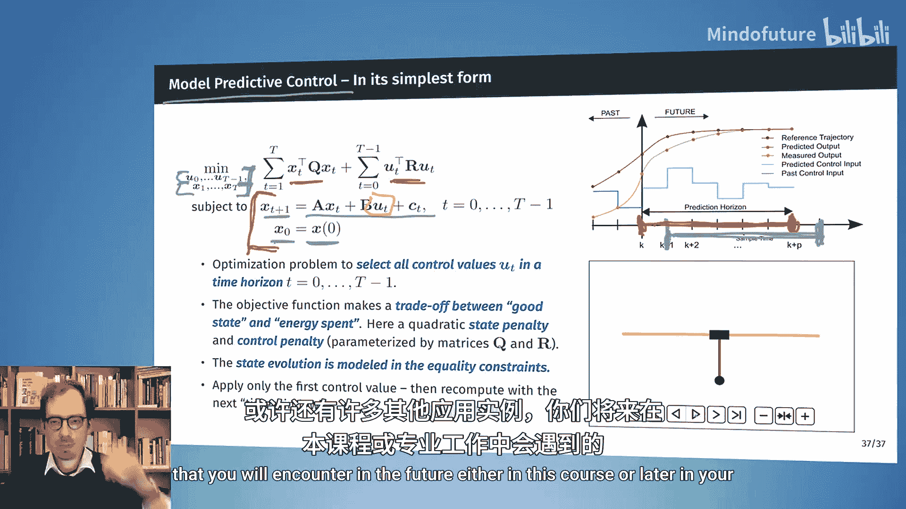

# 【凯尔大学】机器学习优化方法 ｜ Optimization Methods For Machine Learning And Engineering 2021 p21 P21_5.4_模型预测控制 -BV1C6SwBqEp7_p21-

This ends our application example on。

The stock market investments and we now come to model predictive control。そう。

The first example we saw with the bridge， this was about numbers in space。

The second example with the stock market was about numbers in time， so the stock market。

Changing over time and moving randomly。Now our example is concerned with numbers in space and time。

Control。And this is interesting if for example， you want to go into robotics or if you want to control physical systems。

 because now we will learn how to take a system and make it behave in a way that wouldn't be natural and the example that we are using here is the inverted pendulum that we also saw in the first equation at first。

First lecture。Now， some history。The control theory that exists today。

Is a development that was started or is the outcome of a development started in the 1940s。

 which back then has been called cybernetics？So Nova Vina is the father of cybernetics。

 or he coined the term cybernetics in his book。Cybernetics or control and communication in the animal and the machine。

 or groundbreaking book， and this was considering feedback mechanisms。And Andy Komoovrov。

 a very famous researcher， he called cyberbernetics design concerned with the study of systems of any nature。

 which are capable of receiving， storing and processing information so as to use it for control。

And control can be many things， so control can be a rocket going through the moon。

 control can be a car， autonomous car staying in the middle lane。

Control can be the inverted pendulum swinging up， control can also be an electrical in an electrical motor or a chemical plant or a biological system。

 so somehow a system that is selfregulating by receiving information and using it to change its future state。

So cybernetics founded in the 1940s， back then， this was a mixture of many fields interested in feedback mechanisms。

 not only the technical sciences， but also psychology，th anthropology， and many others。

Besides the development in the US， there was also an analog development independently in Germany by Hamman Schmidt。

 Ardof Leonhart， Woodolve， Odenberg and a couple more， but somehow the cybernetics。

 how to say stream from the US， is the more prominent one。And control theory， control theory。

 as it is considered today by electrical engineers or biomechanical engineers。

 is essentially branched off from the original cybernetics term in Stuttgart。

 you can still study technically kubernetic， but again。

 essentially this is today control theory when we talk about cybernetics in a mathematical term in a systems term and no longer also in a psychological or anthrop social sciences way。

Some of the early researchers in artificial intelligence have also been there in the cyberbernetics community。

 but after the famous Dar Dartmouth symposium or the conference in Dartmouth。

 they also branched off and got funding on their own and also got their own brand then for doing artificial intelligence。

This is an interesting picture so this is a picture from the Macy conferences I think they started in like 1942 or something and this was a yearly conference where the researchers in cyberbernetics came together and this is just who of famous famous researchers at the time so you had John Fon Neyman。

 you had Nobad Vina you had people like Pis and McCalo so the guys who invented the neural networks in the 40s and 50s so I think Pis is Pi this is Pis。

And Mcallo is， I think in the second line somewhere。嗯。No， I in the first row。 I'm sorry。

So the cow is。That's make up。So these were the inventors of the neural networks。

And but mixed into that， into into the famous mathematicians， or somewhere。

 there's even there's Claude Shannon， where he C。This is Claus Shannon。

 so if you haven't read a theory of communication， you must。

 it's a very readable paper and it advanced humanity by at least 10 years。

And so mixed into these very famous researchers that were more mathematically inclined。

 you also had very interesting people from the social sciences， so for example， Margaret Mead。

 and Gregory Bateson and these were very interested also then in feedback mechanisms in the human。

 for example， even the term the word feedback， it comes from this Macy conferences。

 they invented it back then before this concept didn't really exist。And so today。

 if you have a boss that that。wa sent to enough corporate trainings then he knows that he has to give you feedback and he packages it as a shit sandwich where he says something nice in the beginning and at the end。

So the word feedback and how that works， it took its origin at the Macy Conference and at the same conference they talked about very deep mathematical subjects that led to control theory that we have today。

And it's even more strange than that because in the early days at the Maci conferences they were interested in subjects like hypnosis。

 but because there were serious serious researchers。

 they couldn't say hypnosis so they had to use different words for the effect in order to be respectable。

AndMar means， for example， she went to Bali and to see how people went into Francences and used hypnosis in daily life。

Crazy things。 And so this was really a hotbed of interesting new ideas。 And then after some time the。

The social sciences and mathematical sciences they're somehow separated。

 but we still have a lot of effect today from these Macy's conferences and there's an interview with Margaret Meat and Gregory Bateson that shows this other perspective on the Macy conferences。

But now to the actual content， so we are back and we are now doing some control theory。

 so it's all pretty basic， but in the end we can still control a physical system to do something that it wouldn't normally do。

What we see here depicted is a high level overview on control。So we have discretized our time step。

 this is one of the first assumptions that we are making， we have discretized our time steps。

 and then we have like 100 milliseconds also in between our discrete time steps that we are considering。

And the system that we have。The chemical plant or the electrical engine or the inverter pendulum。

 it has a system state and the system state is described in a vector x of T and also the dimension of this vector x of T depends obviously on the system itself so if it has a00 state components or maybe only two。

Okay， and there is a state update function， F。And this state update function。

 it describes how the system evolves from one time step to the next。

So we have our inverted pendulum and if we do nothing。

 then it will start to fall down and function F， it describes how fast it the state of the pendulum will change。

But the state。It not only depends on the previous state， so here we have Xt。

 which is the current time step， and then we go to Xt plus1 so to the state of the next time step。

But the dynamics of this are influenced by a control value that we can choose。

 so we are controlling the system， so in addition to the previous state。

 we are also putting our control influence into the state update and then this produces ST as well。

And here we could also have some randomness involved， but we are not considering this today。

Or we're not even considering it in dis course to have control with randomness。Okay。

 but how do we know？How to influence So if we are somehow turning the knobs to control our chemical plant。

How do we know in which direction to turn the knobs， we are obviously observing the system。

So we have an observer H。That sits on top of the system and it gives us a partial or somehow transformed observation coming from the current state of the system。

 so here we have the current state XT and our observer it gives us an observation Y T which is somehow derived from that。

And then we have a control policy and the control policy tells us for which observed systems need。

We are selecting which control values as input to impact the state update of our system。And。

This can be described by the equation here on the left hand side， so we have our observation。

We have our control value as the result of the observation。

We put the current state and the control value into the state update to get to the next state。

And if we now just plug everyone in， we get one big equation now for。The new state update。

 which again only depends on XT。So here this guy， we can also then write it as F Jilde of Xt because it only depends on Xt。

And by appropriately selecting the observer and by appropriately selecting the control policy pie。

 we can create a new system that has a different behavior so our original。

 if we don't have a control input here then if the system was left to its own devices。

 we would have F somehow describing its evolution and maybe the chemical plant would explode or our。

Inverted pendulum would drop down， but we don't want that。

 therefore we are adding the controller and we get a new system that has a new updated behavior and that is somehow preferable。

And so the big question is how to design this controller here。And the controller。

 it should steer the system in a way that it shows good behavior。

And what we do in this example is we explicitly model an optimization problem so that the controller values selected by the controller are the result of an optimization problem。

And for that。We not only want to consider just the next time step Xt+1。

 but we want to forecast into the future and want to optimize in some time window that is long enough and I also want to balance the system state that we achieve。

With the energy spend for control so sometimes we can just put into a million volts into our system to immediately jump back to a good state。

 but we have to balance and somehow also the energy spend might not be worth a certain improvement in the system state。

 so somehow there's here also a trade off to be made between the goodness of the system state and the energy that we need to spend。

Okay。Inverted pendulum， it was mentioned many times and actually this is the example we are considering today。

 so we have an inverted pendulum， so a pole with a mask sitting on a cart。The mass is2 kilogram。

 the cart mass is 8 kilogram， and we have a pole of 50 centimeters。In addition。

 the usual gravity constant here on earth。And the first question is how do we describe the state of the pendulum and in this case the state vector x？

We'll have four components， which is the angle， so the degree here with how much the pendulum is deviating from the upper top that center。

The position of the carriage， so here this is P here is the position on the horizontal axis where we are with our cart。

And in addition， also the angle speed and the position speed of the card。

And so the speed here is important because in a physical system， there is momentum。

We have to consider that as well when we want to describe the coming evolution of the system state。

Okay， how can we control we can apply a certain voltage to the cart that will then accelerate it into one or the other direction。

 so we cannot immediately set the speed of the car。

 we can only influence the speed of the cart over time by accelerating it by applying a certain voltage and changing the momentum。

And now there are a couple of big scary equations。DonDon't look at them too closely so big scary equations coming from physics that describe the acceleration of the pendulum and the carriage and this is just the dynamics in the terms of a partial differential equation or it's actually an ordinary differential equation and well this is then for a continuous time this would be the update of the state because here we are already considering the so the control input that we want to select how that is impacting on the acceleration for the angle and also the position of the card。

Okay so in computer science we can work with simulation so we don't have to spend weeks and weeks to build up a physical demonstrator。

 even though that's a lot of fun but here we are using just a simulation so the big square equation it was put into Julia code down here and we can plug everything into a OD however so we take an off the shelf or the is however from the differential equations package and the only thing that is important here is that we have a way of really precisely predicting what will happen in this idealized world with the。

Inverse pendulum。And if I click on here， if you do that on the Adobe reader software。

 it can show you the animation， I think it requires JavaScript in the P reader or something to show the animation。

And so you see how the pendulum is swinging and well we are obviously。So this is frictionless。

 so the pendulum will never stop swinging without friction。

 but we are very interested in now changing the movement of the car in a way that the pendulum will swing upright and will also stay upright。

How can we do that， first of all。Let's see at ways to。

To predict the movement of the card that is less difficult than using the OA server from the differential equations package。

So the OD servers from the differential equations package。

 they use something that is derived from the so-called Gungi Kuta methods， pretty involved。

 precise fast but also pretty involved now we will look at a more simple way and the more simple way is the Euler method。

 Euler again famous mathematician Swiss mathematician from the 17th from the 18th century。

And what he used to do the integration or to do the forward simulation。

Is to just assume constant speed at discrete time steps。

 so let's say here we have discrete time steps。And we have some initial state here and then we just assume constant speed。

 and then at the next time stamp， maybe speed has changed a little bit then constant speed。

Next time step。Again， constant speed and so on。And this is a very。

 very gross estimate and if you can avoid it。You shouldn't use the audio method。

 it's just one of the simplest methods we can use to forward simulate by assuming at the current time step。

 what's the speed， we multiply the change by the time step length and at that on top so here your method。

By having access to the second derivative， we can do a little bit better。A little bit better。

 this is then called the valley method。So French French physicist from the 20th century。

 and what he says is well， if we know the second derivative。

Then we know by how much we will accelerate in the current timeframe。

And so we know that we will accelerate if this is where a movement， so not everything's a movement。

 but if this's where a movement and XT would be the position。

Then x dot T is the first derivative in the time domain。

And dot dot Xt is the acceleration in the time domain。And then if the acceleration was constant。

 then we would know that we would accelerate by that much。

And then probably you did that already in high school physics and then we can multiply the acceleration by again。

 the time step divided by2 and this gives us then the additional。

Difference in position that we gained by acceleration just in that time frame， so somehow。Top top。

 top， so。On this axis here， we have then the speed。And then here we have the time frame。

We can essentially take the。The integral of this triangle here to say what is the difference in position already from the current acceleration in this time step and well this assumes that acceleration is constant。

 which is also not true in general in these differential equations。even within such a time step。

 but when we make the time steps smaller and smaller and smaller。

 somehow this will become a predictor that is already a lot better than just using the oil method。ok。

But why are we interested in the Oer method， the question is how can we pose the control problem as an optimization problem and for that we already need to do a forward simulation。

For several time steps。As part of our optimization that we are doing。O。

But in addition to just assuming discrete time steps。

 we want to linearize the system dynamics in every time step。

Let's assume that the angle of our cart or the angle of the pendulum。This pi。

 so the pendulum is pointing down and the pendulum angle is exactly pi at the current time step T that we consider。

And if that is the case， then all of these scary equations that we saw。

 they are simplifying quite a lot because then the acceleration will be just u or control divided by LC。

 the acceleration of the pendulum angle and the acceleration of the card position is just divided U divided by C。

嗯。And so this already looks a little bit simpler， Obviously this will be， again。

 a scary equation when P is a little bit different。

But let's just take this for an example because it will make our equation for the exposition here a little bit easier to work with。

So。We assume now from the vale method。That the acceleration is fixed during the current time step。

 and we have here computed the current acceleration by the two equations that you saw up here。

And now we can write down the state update。So our F， so we have x。T plus one is F of X T comma U T。

And this guy， we can write down the following。So we have our next。State。So with the anger。

 the position and the speed。And the state update， it can be written。

By doing just matrix vector modifications。So， let's look only at the first line here。

So the first line here at the next angle。And I'm doing it down here because I have more space。

 so here essentially the first line translates as the following， so the next angle will be one times。

The angle from the last time of the current time steps。Plus。The current speed。Times。

The duration of the time step。Plus and now we come to VS method here then we have UT。

 so the control value， the voltage that we apply。Divided by LC。Times the time step。

Times the time step divided by 2 so this will be probably pretty small because here we have two times or we have the time duration of the step squared。

 but you see that here we exactly end up with the equation for for the value method and it's pretty simple because in the end it's just the matrix vector implication and here we can。

Describe not only the update of the annual， but the update for the entire state of our system。

 but just doing matrix spectrum modifications。So the same here is then also true for the change in speed。

Of the， of the angle。诶。so here we would first have sort of T plus1 here we would have first the current speed。

One times。Plus。And。呃。Plus， and now here we have。Be T divided by S C times。

The step duration and again here this is just the first discretized and then linearized state update for all system。

So we have arrived at a very general form that is used for many for describing many， many。

 many different kinds of systems。Deisretizing， the time domain and then linearizing。

 but notice that here the matrices， they will be different for the different time steps so if we can already foresee。

The future evolution， we can， we can here modify that the A0。We'll be matching。嗯。ok。

And now what we do is we are stacking these database。Because when we have a way to compute。

XT+1 from XT and UT， and we can do that also for multiple steps into the future and then also compute XT plus 5 and so on。

 and we have the way to describe the evolution of our system depending only on the initial state and afterwards on our control input。

And what we then do is we are stacking the state updates。

And putting the result or putting the resulting equation as an equality constraint of our optimization problem。

So now we are at the heart and probably the most difficult slide。

So now what we are doing is called model predictive controller。

And model predictive control was invented by people such as Manfquet Moragi and others。

 so for example， Mr。 Mr。 Bpova and they started developing that already in the 70s when computers were very slow and back then model predictive control could only be applied to slow moving systems like chemical plants。

And but today it' it's more preview controller is everywhere。 It's in your car it's。It's planes。

 trains and automobiles， every physical system that needs good control probably uses some sort of motor predictive control or will it soon。

 so this is really taking over。And in modern predictive control。

 what they do is they solve an optimization problem with a very high frequency today。So in your car。

 if you have an MPC controller somewhere or in your future autonomous car。

 this is solving optimization problems hundreds and thousands of times every second and is using the result of the optimization problem of the optimization to apply control to steer your car to the middle of the lane and similar things。

So obviously today， autonomous driving， they're also using neural networks。And and they work fine。

 We don't know maybe some of the limits， but what you see here。

 this is the classic engineering approach to do control。 And over the last 50 years。

 they have developed methods also to describe the the limits so by taking some。

Assumptions on what on the system and the surrounding environment。

 you can then also compute heart limits of what your system will do and what it won't do and so so somehow now there is like a clash between the traditional approaches that include motor predictive control and now on neural networks taking over also far for like safety critical tasks and。

Well this of course， has the patina of many years of development and experience and the tools to also talk about safety critical systems。

But what is the optimization problem？What we。Have to do is we have to simulate our system over several steps into the future。

And then do a trade off between the system state， how much do we like the system state？

And the control， so the voltage or some other control input that we had to spend in order to achieve that system state。

So。What we are doing is we have an optimization problem and we are minimizing。

 we are minimizing over all the control values over a time window and the time window goes from now to some big big T is only a scalar in this case so'm sorry about the notation confusion so this is an optimization problem over all the control values and all the control values here can also be vectors so we can have also several control values being selected for every time step。

Okay， so we are optimizing to find the control values over the entire time horizon up to big T。

 so big T is like 100 or something。And in addition， we also consider the states。

Namely from the next state， up to the state at time big T。However。

 these are only auxiliary variables and these are required to be part of our optimization problem。

 but these here are heavily constrained by an equality constraint that we put。明明。

For every state update， from one stage to the next here we put in the equality constraint that is exactly the kind of state update equations that we saw on the previous slide with the inverter pendulum。

And so we have here some degrees of freedom， but the degrees of freedom exist only in the control values that we can select。

Because also the very first system state here， this is predetermined because this comes from the measurement here we assume that we entirely know the initial system state。

And in these equality constraints， here we are doing our simulation。

 so for the predictive part of model predictive control。

 this is the predictive part and now we are minimizing to find a good tradeoff between the systems state that is achieved。

And the control that has to be spent in order to achieve that state。 And there are many， many。

 many variations of that where we have different additional constraints and the constraints are changing over time。

 because maybe if we are thinking about。Optimly heating a house then maybe you have to constrain that during the day you need a temperature in the house between。

If it's on offers between 18 and 20 degrees。But at night you don't care and then if we formulate the optimization problem。

 we can have additional constraint and different constraints for the different time steps where we say only during the day we have a temperature constraint at night we don't care and then by computing optimal heating of the house。

 you can consider when you have to start heating to exactly hit the 18 degrees when people arrive early in the morning and things like that。

Many variations also considering then uncertainty then it's called robust NPC。

This is just a playground for good ideas and for。Important and expensive system where it can have a real impact by optimizing resultsss and not by just having some funky heuristics or maybe inexperienced humans that have to do the decision making。

So overall， what NPC then does is considering a time window， so here we have a time window。

And within this time window， we make our prediction。We optimize for the best。

Control values for every time step in their prediction horizon。

And get back your result with the you for every time step。

But what we then do is we apply the controller for the first time step。Then we observe what happens。

 we get a new state observation。And then we shift the tang window。

And now we have a second time window that goes from here to here because the wall clock time has also moved forward。

And then we redo the entire optimization for the new time window based on the new state measurements that we got。

So we make the prediction for a long horizon， but we always only apply the result for the first。呃。

timester。And that way， we can also deal with random influences because if there is a random influence and the next。

State measurement is not where we have predicted it， then we can still react。And also。

 our prediction model doesn't have to be perfect。Because we are redoing the computation and we basically we can counteract。

UThe the。The prediction errors in the next time step when we have updated state measurements。

This is the basic idea of more predictive control。And now applies to our pendulum。

 if you have the aob wheel， you can click on the play button to see the animation。

I think we can also put it into the video here。You see that the pendulum it starts moving and there's a swing up of the pendulum and the pendulum is actually kept upright。

So here for this very small example。We see that the controller actually has found a strategy to swing up the pendulum and in the exercises you will be then deriving your own controller。

We will treat a different system， but there you will also be able to force a new behavior on your system to do something it wouldn't normally do like for the pendulum to stay exactly upright。

With that， we conclude today's lecture， so this was more about applications and these will be applications that will follow us into the coming weeks with the exercises。

 so we here we try to cover a wide range of topics to see what optimization can do to also see what other different tricks that have been applied or developed in the different domains and also to give you a sense of the possibilities to do optimization in space。

 optimization in time， optimization in space end time and maybe many other application examples that you will encounter in the future either in this course or later in your professional work。

