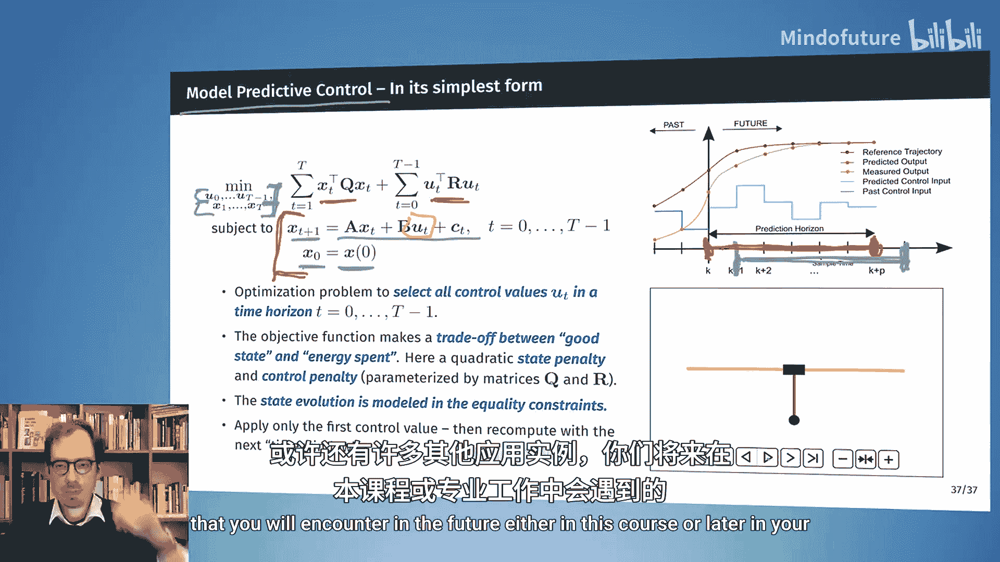

# 机器学习优化方法：5.4：模型预测控制 🎯


在本节课中，我们将学习模型预测控制的基本概念。这是一种通过求解优化问题来控制物理系统（如机器人或化工设备）行为的方法。我们将从一个简单的倒立摆例子入手，理解如何将控制问题转化为优化问题，并实时求解以引导系统达到期望状态。

---

## 从空间与时间到控制问题

上一节我们讨论了股票市场投资这个关于“时间序列”的优化问题。现在，我们来看一个同时涉及“空间”和“时间”的优化应用：**控制**。这对于机器人学或任何需要控制物理系统的领域都至关重要，因为我们希望系统能按照非自然的方式运行。本节课的核心例子是我们在第一讲中提到的**倒立摆**。

---

## 控制论简史 📜

现代控制理论起源于20世纪40年代的**控制论**。诺伯特·维纳是控制论之父，他在其著作《控制论：或关于在动物和机器中控制和通信的科学》中提出了这一概念。控制论研究的是能够接收、存储和处理信息，并利用这些信息进行控制的系统。早期的控制论融合了多个领域，包括技术科学、心理学和人类学。在美国发展的同时，德国也有一批学者独立地进行了类似研究。

有趣的是，早期人工智能的一些研究者也来自控制论社区。在著名的达特茅斯会议之后，人工智能逐渐成为一个独立的领域。20世纪40年代至50年代的梅西会议汇集了众多著名学者，如约翰·冯·诺依曼、诺伯特·维纳，以及神经网络发明者皮茨和麦卡洛克，还有信息论之父克劳德·香农。会议甚至引入了“反馈”这个词，如今已广泛应用于各个领域。

---

## 控制问题的高层概述

为了进行控制，我们首先需要对时间进行**离散化**处理，即设定固定的时间步长（例如100毫秒）。

一个系统（如化工厂、电机或倒立摆）的状态由一个向量 **x(t)** 描述。系统状态从一个时间步演化到下一个时间步，由一个**状态更新函数 F** 决定。这个函数不仅依赖于前一状态 **x(t)**，还依赖于我们选择的**控制输入 u(t)**。

我们通过一个**观测器 H** 来获取系统状态的部分或变换后的信息 **y(t)**。然后，一个**控制策略 π** 会根据观测值 **y(t)** 来决定施加何种控制输入 **u(t)**。

整个过程可以总结为以下公式：
```
x(t+1) = F( x(t), u(t) )
y(t) = H( x(t) )
u(t) = π( y(t) )
```
通过精心设计观测器 **H** 和控制策略 **π**，我们可以改变系统的自然行为，使其按照我们的期望运行。

---

## 倒立摆示例 🤖

我们以倒立摆为例。它由一个质量为2千克的摆锤、一个质量为8千克的小车和一根0.5米长的杆组成。系统状态向量 **x** 包含四个分量：
1.  摆杆角度（偏离垂直向上的角度）
2.  小车位置（水平轴上的坐标）
3.  摆杆角速度
4.  小车速度

我们只能通过向小车施加电压（控制输入 **u**）来使其加速，从而间接影响摆杆的运动。系统的动力学由一组物理微分方程描述。在计算机科学中，我们可以使用仿真来模拟其行为，而无需搭建实体。

---

## 系统动力学的离散化与线性化

为了将控制问题转化为优化问题，我们需要能够预测未来多个时间步的系统状态。一个简单的方法是**欧拉法**，它假设在每个离散时间步内速度恒定。更精确一点的方法是**韦莱特法**，它利用当前时间步的加速度信息来改进预测。

为了简化优化问题的求解，我们通常会在每个时间步对系统动力学进行**线性化**。例如，当摆杆角度接近π（垂直向下）时，复杂的动力学方程会大大简化。这样，状态更新就可以写成矩阵与向量的乘法形式：
```
x(t+1) = A * x(t) + B * u(t)
```
其中，矩阵 **A** 和 **B** 在每一步可能不同，取决于当前的线性化点。

通过堆叠多个时间步的状态更新方程，我们可以描述系统在未来一段时间内的演化，并将这些方程作为优化问题的**等式约束**。

---

## 模型预测控制的核心 🧠

**模型预测控制** 的核心思想是：在每个控制周期，我们都在一个有限的**预测时域**内求解一个优化问题。

优化问题的目标是：在满足系统动力学（即状态更新等式约束）的前提下，最小化一个代价函数。这个代价函数通常权衡两方面：
1.  **系统状态代价**：衡量系统状态与期望状态的差距。
2.  **控制代价**：衡量所施加控制量（如能量消耗）的大小。

优化问题的数学描述如下：
```
minimize   Σ [ 状态代价(x(t)) + 控制代价(u(t)) ]
   u, x
subject to x(t+1) = A(t) * x(t) + B(t) * u(t),  for t = 0, ..., T-1
           x(0) = x0 (已知初始状态)
```
我们求解这个优化问题，得到未来一系列时间步的最优控制序列 **{u(0), u(1), ..., u(T-1)}**。

然而，MPC只实施序列中的**第一个**控制动作 **u(0)**。然后，系统向前运行一个时间步，我们获取新的状态测量值，将预测时窗向前滑动，并基于新的初始状态**重新求解**整个优化问题。这种“滚动优化”的策略使MPC能够处理模型误差和外部干扰。

---

## MPC的应用与展望

MPC自20世纪70年代被提出以来，已广泛应用于汽车、航空、化工等慢速或快速系统中。如今，它正与神经网络等现代方法结合，应用于自动驾驶等安全关键领域。MPC的强大之处在于它能以严谨的优化框架处理多变量、带约束的控制问题。

在课程提供的倒立摆仿真中，你可以看到MPC控制器如何成功地“摆起”并稳定倒立摆。在后续练习中，你将有机会亲自为其他系统设计MPC控制器。

---

## 总结



本节课我们一起学习了**模型预测控制**。我们从控制论的历史讲起，理解了控制问题的基本框架。然后，以倒立摆为例，详细阐述了如何将连续的系统动力学**离散化**和**线性化**，从而构建一个可在每个时间步实时求解的**优化问题**。MPC通过滚动时域优化，结合预测与反馈，实现了对复杂系统的有效控制。这种方法融合了空间与时间的优化，是工程领域一项强大而实用的技术。