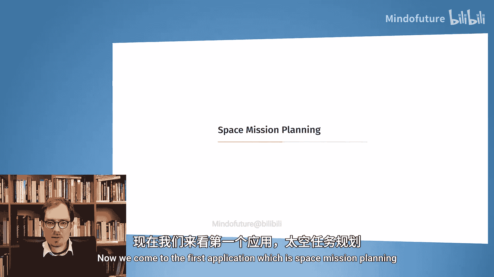
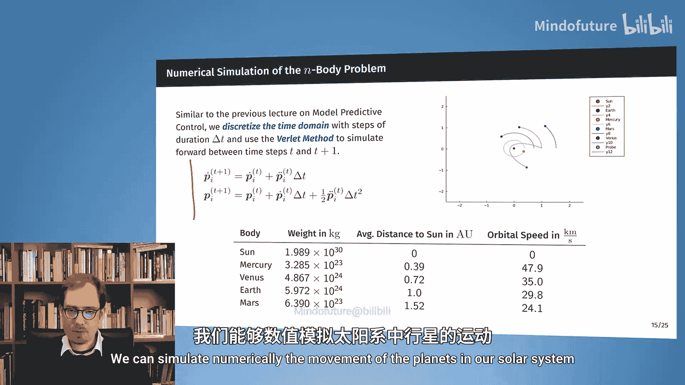
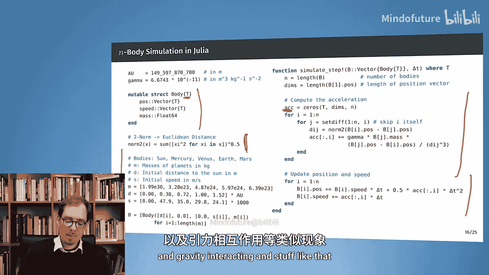

# 【凯尔大学】机器学习优化方法 ｜ Optimization Methods For Machine Learning And Engineering 2021 p23 P23_6.2_太空任务规划 -BV1C6SwBqEp7_p23-

Now we come to the first application， which is space mission planning。

So Sa Mark Waney， many of you， I assume have read the book， the Martian and。

Maybe even seen the movie and there an astronaut has stranded on Mars and we have to bring him back to us so he's able to get into orbit of Mars but not much further than that so we need to send a rocket to pick him up from Mars and bring him back to us and for this we have to do a flyby of Mars and have to be well。

Hat a mass or get as close as possible to Mars without hitting mass。Okay。嗯。The rocket。

 for this example， we are simplifying things a little bit。

And now we assume that the rocket has to be cheap and we cannot carry fuel outside of Earth' orbit。

 so we have we have to pick up speed and then we leave Earth。

 And afterwards we have a ballistic trajectory。 So afterwards the rocket is moving like more like a cannonball so it it is attracted by the gravity of the different planets。

 and just by giving it an initial。Speed and direction we need to bring it on a ballistic course that sends the rocket to Mar and afterwards back to Earth where Mars and Earth are obviously moving at the same time so all planets are moving at the same time and everybody is pulling with its gravity and sun also pose with gravity and the question is。

Which way to shoot the rocket so that it picks up Mark Watney and brings him back to us。

And your mission， should you accept it， is to design this course or to find exactly the trajectory that will save here。

There's。Mo about the people who did the actual trajectory computation at NASA back in the 60s and what's interesting here。

 these were black ladies and some of them were even still alive when the movie came out a couple of years ago and this was a big recognition of their work。

And they used the very early IBM computers to numerically perform this calculation。

And many of the techniques that we are using here were also in use back then。

 but obviously since then the state of the art has greatly improved and now we not only have ballistic trajectories but the rockets can also steer and we are doing slingshot across multiple planets and stuff like that so it's a little bit simplified here but still the techniques are realistic and if you watch that movie you see some hints and some techniques are also mentioned and you will see that well we have reached at least the state of the art of the 60s to do this example and but it took many。

 many years to get there so the theory that we need to consider。

It goes back hundreds of years because we have to describe the movement of the planets first。

In order to then optimize our trajectory。And。This is a little bit problematic。

Because we cannot describe the movement of the planets in a closed form equation。

 we can only numerically approximate that。So this is known as the N body problem。

 where I have n and n greater than two massive objects that interact with each other by gravitation。

And we then want to describe their movement and actually it was proven many years ago and by Po Ka that there can be no close form solution and with that he got the prize money that was awarded for the close found solution。

 but he could show that such a solution could not exist。And。Going back。

 we then also encounter a lot of the great men。Of science， back then mostly men， for example。

 leading up to Newton who came up with a final theory of gravitation。

 leading up to Newton we had Copernics who first had to declare that Earth is not in the center of the universe。

 then we had Keplplan， who told that planets have elliptic orbits around the sun。In between。

 we also had Decarte， which who said that only bodies that are touching can interact with each other because what he observed on earth is that only objects that are in direct contact or maybe with a gas in between can interact and therefore he declared there has to be some substance between the planets so they could interact with each other by gravity and he called that ether today we know that that's not the case。

 but those were all the different theories that were discussed back then there were also theories by Tikubra on who wanted to。

Who claimed that some of the planets move around Earth and some of the planets move around sun and so on so there was a big confusion。

 also Galileo came in and brought in the idea that all bodies are accelerated by gravitation and finally Newton。

 who settled the case by also inventing calculus， so basically is a derivative and what is integration in his major work the Pri Kiia Mathematica。

And so what we see now is the Newton's theory of gravitation so how do we solve the endbody problem in an numericalmer fashion first of all we say that we have our set of planets or of bodies。

 the planets and the sun and also our rocket that we are interested in and each of these bodies is described by its mass so here we have a mass we have a position so this is a vector and we have a speed。

Here， the speed is the derivative of the positioning in physics。The load dot。

 it indicates a derivative with respect to time， and we're using it for the P dot。Okay。

 and in addition to speed， we also need to consider acceleration and acceleration is what we get from gravity。

So here all the planets are pulling and how strongly they pull it depends on the distance between the planets。

 so here the distance is here just the Euclidean， the two norm。

 we don't consider relativity theory here， so here the distance is the to norm and then with this equation here that also includes the gravitational constant。

We can compute the force exerted from one planet on another， and together with a mass of the planet。

 we then know the acceleration that it receives。O。If you want to go deeperpot。

There is a book called Structure and Interpretation of Classical Mechanics。

And this is from the same people who also wrote the book structure and interpretation of computer programs。

 the book that we saw earlier in this lecture。It's in the same style。

 so it also contains the code together with a mathematical explanation on the same page。

 it's a very interesting book but it goes much deeper than we can go here so if you want to go really deep on the subject。

 go read structure and interpretation of classical mechanics but it might take you a while。嗯。

Okay so here we have now the acceleration and another simplification that we are doing in this lecture is we are only considering a two dimensional approximation。

 we don't have to do that so the equations if I have a 3D vector or only a 2D vector here for the position the speed and the acceleration。

 the equation works are exactly the same the same also the code。

 but this is just the simplification that we have for easier plotting and evaluation I think。Okay。

So now for the numerical simulation of the movement of the planets。

 we again discretized the time domain similar to what we did with modern creative control in the previous lecture。

 and similarly we also use the v method to simulate forward between our discrete time stepss。

And now we have for all the planets， or we only consider a subset of the planets。

 we have their weight， we know their distance to the sun， we know their speed。

 we have an initial position， and off we go we can simulate numerically the movement of the planets in our solar system。

And in Julia， it looks the following， so here we define a structure for our moving bodies where we have a position。

 we have the speed and we have the mass。What is important here here， this is like a template。

 so here we have a free type T。And here we can plug in the dual numbers later on。

 so usually here this would be a float 64。Or some other representation of a real number。

But later on here we have the freedom to plug in also our don numbers and therefore here we have the T。

Then we also define the twoome。We have a list of the bodies with their initial with their mass and initial position and speed and so on。

And with this， we can now define the function that simulates the movement of the planets。

 so first of all， we iterate over all the planets and compute their acceleration。

And we fill a big matrix with the acceleration vector for all the different planets and the sun。

And afterwards， we update the position and the speed of every planet with the v algorithm and in the exercise you will do the same and then we also see nice plots of planets moving around and gravity interact and stuff like that。

Okay。But we not only want to simulate the movement of the planets。

 we also want to shoot out the rocket in the correct direction and for that we need a loss function。

 so we need an evaluation that tells us whether this was a good direction or not。

So let's recall that we want， first of all， our rocket to do a flyby on Mars。

And then to come back to us。And for that， first of all。

 we extend our simulation by just adding our rocket to the list of bodies that we are considering and here for the list of bodies that we are considering。

 we take the rocket at Earth's position with a little offset。And with the initial speed of the Earth。

And an offset of the speed taum。 So this datata is what we are selecting。 And this is the。

The speed that we give the rocket as it leaves off。Okay。And then we can simulate everything forward。

 so we are in a big loop for all the different time steps that we are considering。

And we write out the distance of our rocket to Mars and we write out our distance to Earth in every iteration of the simulation loop。

O。And now once we have done that here， we have two big vectors。

Or two big arrays with the distance to Mars and the distance to Earth in every time step。

 and now we can find the time step when we are closest to Mars。And afterwards。

 we consider all the time steps。When we have already been to Mars and come back to Earth and then we consider how close we have come to Earth after Mars。

 and the loss function that we are minimizing is， first of all。

 the minimum distance that we ever had to Mars， and second。

 the minimum distance we have to Earth after having been to Mars。It's a bit backwards。

 but I hope you see how this is a target function that is useful to us because this target function is zero only when we get exactly to Mar and then back exactly to Earth。

Okay。Now we have a target function that takes as input a vector。

And gives us back like a quality of the vector or how how much how much anticipated loss is for that vector in terms of the distances。

And using automatic differentiation。We can now just write gradient。off。Trajectory loss。好吗？Cer。

For some theta that we have chosen。And we get back the gradient of our simulation。

With respect to the theta vector， so in which direction do we have to move our theta vector to get an improvement？

And if you plug in the examples from the previous slides。

It works out of the box you don't itself conently， you don't need anything in addition。

We can already compute the gradient here now for the loss function for our mission planning of the rocket。

And。The slide or the figure that you see here， this is the loss function evaluated for different theta。

 so we have a 2D vector for the theta because were in a 2D。AWor that we have assumed。

And so this is a little bit easier for plotting now。

 and now we can plot the loss function for different values of theta and we see that this is very much a non convex function。

So the simulation that we did and the loss function on top of it results in a very nonconvex function and we even have here some funny peaks and the funny peak here it happens when we sinshot around one of the planets and then it really kicks us out and we。

End up far away from the solar system， So there are some very sharp peaks also in our loss function。

And what we can do for the optimization then is， first of all。

 to go over this loss function here or over the space for our possible thetas in a regular grid and make the gridit finer and finer and finer and finer。

 but obviously this can become very expensive， especially when we are in higher dimensional spaces。

So what we do instead is， yes， we do some， we are on the grid and we are evaluating some example points。

But then we use the gradient that we have available to us。

To do a gradient descent and then very quickly we will improve our solutions and then we are somewhat more robust to the grid size that we have chosen because well depending on the curvature of the loss function we will then by doing using gradient descent。

 move towards a better solution that is in the vicinity or in the neighborhood of the point on the grid that we have started with。

And you will do this in the exercise， and then in the exercise you will also have the dynamic plots where you can see the rocket flying and the planets moving and things。

