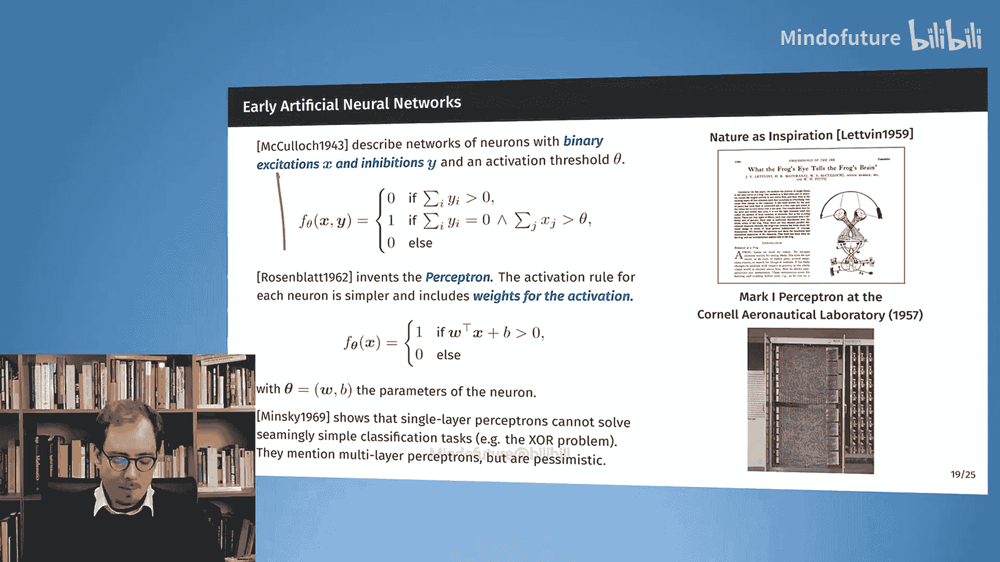
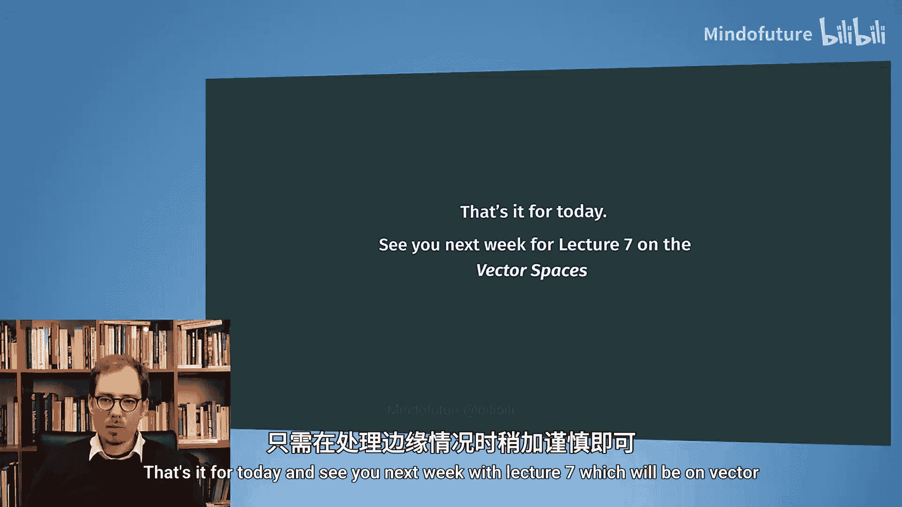
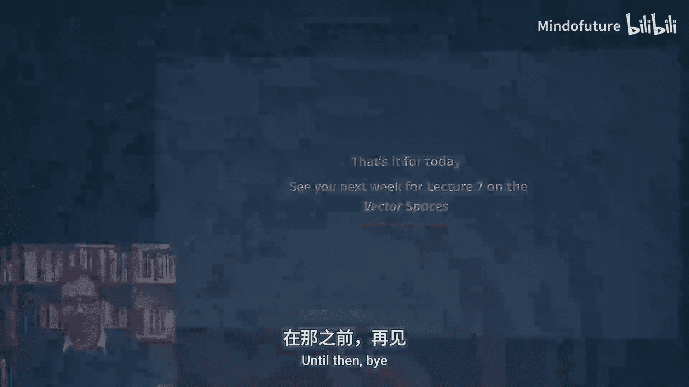

# 【凯尔大学】机器学习优化方法 ｜ Optimization Methods For Machine Learning And Engineering 2021 p24 P24_6.3_人工神经网络 -BV1C6SwBqEp7_p24-

Okay。Now we are looking at a second example and the second example is also a big challenge of humanity。

 so the movement of the planets it took us really many hundreds of years to get it right and probably also for the inner workings of the brain it will need us some years to get it right and also this can be tackled with automatic differentiation so what ties these two scientific problems of humanity together is we can use automatic differentiation on them。

First of all， let's have a small look back for the neural networks， how did they originate。

 well obviously they originated in nature， and but for the scientific community。

 the first people to describe them were godigi and harmmononic Caha to Spanish researchers who found out that with certain coloring。

 they could stay in tissue samples from the nervous system and from the brain so that the neurons and the synapses suddenly became visible in the microscopes。

So as usual， as soon as we can observe a phenomenon。

 we can also describe it and they were the first that were able to describe neurons and this then kicked off a whole scientific discipline。

And while Iya， a German researcher， he actually didn't discover anything but he popularized。

 he used this prominence in the scientific community to popularize the findings of Gogi and Harmoni Kahail and both of them together won the Nobel Prize in 1906。

 and there's a nice Nobel lecture， you can go read by Harmoni Kahail about the discovery of the neurons。

So the neurons are not standalone， they are connected by a synapses that transmit signals between the neurons and then we have like sparks where the neurons are firing and so this was originally described by Sherington in the end of the。

19th century as well， but it took quite a long time to discover how the brain was learning。

So we always knew that the brain was learning， we are doing this even at university and children start with this really early on and the theory that is commonly used today is from hep。

 it's called heian learning that says that synapses that fire together wire together。

 meaning if synapses are activating at the same time。

 they have the tendency to build up synapses between them。

 and then if synapses are used often and more often then they will get stronger and the connection between these neurons then will also get more and more intense。

 so heavyian learning is the biological explanation for how the brain。

Of the human and the animal is working and in learning。And。As soon as computers came up。

 we tried to replicate that。So artificial neural networks came up in the 40s with Ps and McKuk working on them。

 and they described every neuron as a mathematical function that had two states either zero or1。

 so either firing or not firing depending on the input that this neuron is receiving。

And originally， they considered excitation inputs and inhibition inputs。So the difference is。

If any inhibition input is active， then the neuron will stop and for the excitation input they need to reach a certain threshold and they call it theta so the sum of the excitations needs to be larger than theta and then the neuro will activate and will fire again。

What is important here for Maccaro and Pis， they considered only binary signals so here the inputs X and y。

 those who are vectors with exclusively binary inputs， so everything was either zero or was one。And。

But pretty soon， so 15 years later round about。People invented perceptton and for the perceptton。

 it takes real numbers as input and then is building up。A weighted sum also of the inputs。

 so with some vague vector W， and then again if the input is large enough。

Is bigger than some threshold than the neuron will activate。So here the input。

It can be a real number。However， the output of the neuron will be binary。

 so there's like a jump and the activation function is discrete， so it's either zero or one。

And so back then people were also interested in how the brain interacts with its environment。

 so which are the signals sent out to the muscles and which are the signals received from the sensors so the sensors of the animals and the humans are for example。

 the eyes， theres a very famous paper， what the frog's eye tells the frog's brain and Mcallo and pits were also coreauthors of this paper and they discovered that a lot of preprocessing is already done in the eye of the fck。

 so that it can have really fast reactions to catch to catch a fly that is flying by the fck so that he can like。

catchched with a tongue and stuff like that and they discovered that it's not just the raw signal transmitted to the brain but there's preprocessing already happening directly after the Eina and you have to mention back in the day they were literally laughed out of the room so people did not believe them and they had to go and individually show the experiments they did in order to be accepted。

And around the same time at Cornell， people who were working at the Pceptron。

 they already built a first perceptron and they had photo diodes and they took as input 20 times 20 images so they had already 400 pixels as input and if you zoom in to this image you see a lot of cables。

 so everything was analog more or less and they had potential me to change the weights and so on。

 but they were already working in the 50s on object detection based on neural networks or petcepts as they were called at the time。

Everything stopped， everything ground to a halt in 1969 when Marvin Minsky and Seyour Pat published a book that showed some of the problems with Percepttons。

For example， there are a really simple benchmark problems， for example。

 the XO problem that the perceptton cannot solve。If you only consider a very small perceptton that doesn't have hidden layers。

 so today we have the deep neural networks but back then they were only looking at singular air perceptons and they could show that these singular perceptons are really weak and some benchmark problems cannot be solved by them they were even pessimistic about multi layer perceptons so today we know the deep neural networks work really well。

 but back end the day they were pessimistic about them and。

They basically stopped research into neural networks for quite a few years and there was also like a fight between scientific communities and Minsky and Paupp。

They rather belonged to the people who wanted to do symbolic AI。

 so to operate on symbolic representations of the world instead of sub symbolmic。

nuummeric representations of the world and back in the day they won out。

 their book was a huge success and people then discarded the idea of neural networks and the funding mostly went into the expert systems and。

Logical reasoning systems of the symbolic community。Okay， but。We have learned a lot since then。

 and we have made the jump from heavy and learning what nature is doing to back propagation。

Because for the percepttons， the big challenge was always how to train them。

And so we will see in a later lecture also how the perceptton was traineded。

 but a big jump in understanding was made in the 80s when the big propagation algorithm was widely。

Dseminated， so people knew about it before， but it got widely disseminated only the 80s and what the core idea behind the back propagation algorithm is to replace this。

Step function。Of the previous perceptton neural networks with a continuous function。

 so for the perceptton it was either zero or one， so here we had a step function。And obviously。

 the step is not differentiable。And the。One of the breakthrough ideas was instead of the step function to use the sigmoid function。

So the sig function that you see defined here， this is the differentiable function and by scaling the sigmoid function。

 we can make it look very close。As if it were a step function。But it's still differentiable。

So the same idea a similar idea was presented with the logarithmic barriers。

 where I can also now scale the logarithmic barrier and make it look closer and closer as the indicator function and here it's the step function that we' are approximating so we go here from zero to one。

With our step and with our scaling， we can define how hard。We want to follow the step here。

And with the sigmoid activation function， we can get differentiable neurons and can then also couple the neurons together to a larger neural network。

So here we see an neural network with a green input layer。Y， green。Green input layer。

Then we have a blue hidden layer， so hidden just means it's not connected with the input or the output and then we have an output layer。

 obviously we could have even more hidden layers。And。

We are assuming that our network is fully connected， that means between the layers。

 all the nodes are connected to one another and there's a weight factor that describes this connection here。

And this can be described。Just by a matrix multiplication。So if I want to compute from the input。

 the green input。What the hidden layer receives。The only thing that I need to do here。

I to multiply my input vector X。By a big matrix W that represents here all the connections in the fully connected layer。

And on top of that， we have some。Some bias that we are adding on top of that。

 and you can think about this like the default stage of the neuron or how much convincing the neuron needs in order to finally activate。

And so the output of this first hidden layer， it's just the input multiplied by our big matrix plus the vector。

 and then we shove the entire thing into the sigmoid function where here the bold sigmoid function。

 it represents the elementwise application of the sigmoid。

 so here this would then also return as a vector of the same dimension。

And then we can repeat that for the second layer again by just multiplying with the big matrix for the fully connected connections and then adding another vector back on top。

Where this B2 here would only be a vector with a single element。Okay。And。

So that's the whole magic and these are the neural networks there are then also different activations functions。

 not only the sigMma， the other ones that can be used as well。

 but basically a neural network is a big mathematical function。

 that maps from an input that could also be high dimensional to an output where the output could also be multidimenal。

 for example， if I want to have probabilities for different classes in a classification problem。

 then I could here have multiple output neurons and each output neuron represents like the probability for a certain for a certain class to be detected。

Now。We have a big mathematical function and we want to use that for regression or for classification and now for training。

 what we need in addition is a loss function。So you will recall the notation here。

 this is exactly the notation from the first and from the second lecture， so we have a model。

 the model depends on a parameter vector theta in our case， the parameter vector。

It contains all the matrices and the vectors that are defining the synapses of our neural network。

So this moderate parameter vector here， it can get really large。

 we can have millions of parameters in here depending on the dimensionality of the matrices that we are considering。

Okay， but we have a model only that depends on this parameter vector。

And now we are iterating our data and we are computing the loss produced for every element of our data set and this then is the loss function and what we then want to do in order to optimize the model parameters is we want to do gradient steps with respect to the loss function derived by the model parameters so here。

We have our loss function and we are deriving our loss function。

By the model parameters and we get out a very high dimensional gradient。

 and then we take a step in the negative direction of this very high dimensional gradient。

And in neural networks， you might have heard about this famous。

 or we have already told you about this famous back propagation algorithm。

 and the back propagation algorithm， it actually boils down to just automatic differentiation。

So what we do today is when we encounter a neural network or also in IntensorF。

 when we have like the graph representation of our neural network。

We will use reverse mode automatic differentiation to get this gradient with respect to the motor parameters。

And then we just repeatedly do the gradientscent step and over time。

 improve our model parameters to get to a well trained model that can perform like the classification task that we are asking it or similarly。

So long story short。We have a lots， we have a lot of history from the 1940s until today。

 so already 80 years of history nearly， and today we can boil it down to something really simple and actually if it's on a single slide which we will see in a couple of minutes。

But we need to fill up our back of tricks a little more。

 so we need some additional back of tricks and the most important one is called stochastic gradient descent。

So， for the。For the optimization of the trajectory of the rocket。There we could just。嗯。

Do a grid search and afterwards， improve the solutions from our grid search by an additional gradient descent。

For the neural networks， this would be a lot more complicated。

Because when we have millions of parameters。And we are in a million dimensional space。

We can completely forget doing research。So we are optimizing a very non convex function。

And this then poses a problem。Because in such a highly non convex function。

 we will quickly get stuck in a solution that is not so good。

So we will do gradient of the sense steps and end up in a local minima or end up in a saddle point where the gradient is zero and so for many years people have tried that and got stuck in local minima it couldn't perform very well。

So we see here from a recent publication。A plot of a typical loss function of a neural network。Well。

 this is now projected on a 3D space so that it can be plotted。

 but you see already in 3D space that this is highly nonconvex。

 it has many peaks and valleys and it also has a very sharp minimum so the minimum here is really sharp and if we start with a slightly different random initial point we might miss this very sharp minimum and so we need to apply a lot of tricks to find that。

The second order methods aren't very helpful either。Because the newde method， it seeks set points。

 so the newde method it loves set points that it wants to get close to them。

 but we want to escape the set points。We want to find the minimum and we have many saddle points we are not interested in。

And also the newde method， it requires us to compute the Hasian。

 and when we have a million model parameters， then the Hasian would have a million times a million entries and it's just computationalally unfeasible or uneconomical to use second order methods therefore for the neural network。

But there are ways to improve。And to find better solutions。

 but also at the same time to avoid overfitting。So overfitting in neural networks is a huge problem because if we have millions of parameters in our model。

 then in some cases we could just learn the training data by heart。

And then like a parentro who repeats the sentence without understanding it。

 the neural networker could on the training data just repeat a learned answer back without actually generalizing and therefore overfitting is also a problem in neural networks。

 but there are techniques that at the same time help us find better solutions。

 so get to a lower loss。And also to avoid overfitting。

And the most important one is called stochastic gradient descent。

So what we do in stochastic gradientdi descent or SGD is that we randomly vary the loss function between iterations of training steps。

So we repeat the training many times and every time we take a slightly different loss function into consideration and we do that by depending different subsets of the training data。

 and these are called the mini batches。So the SGD algorithm is also spelled out here on the right hand side。

 it takes as input， the neural network or the model in its general form。

 as well as the training data， some initial model。Parameterorization。Then we have learning red E。

 we have batch size guitar， and we have a number of training iterations KX that we want to use。

And what we then do is in every iteration， we choose randomly a subset from our training data of size be。

And use that to compute the gradient so the gradient obviously depends on the training data I'm using and every time I'm choosing a different set of elements and therefore get perturbations or random changes on my。

On my gradient， but in expectation， I will still have the correct loss function。

And this helps me to get out of local minima， it helps me to get around saddle points。

 and I'm like wiggling my way through this loss function and getting closer and closer to a good solution。

So this is stochastic gradient descent and then there are additional tricks， for example。

 even if I don't have the hesian I can improve on simple gradient descent I can consider something called momentum and here we also encounter on nestte of so the famous nest of who came who worked and improved the barrier method for the interior point approaches so the same nest of now also turns out to be hugely influential and important for the neural networks。

By his ideas of momentum of gradient descent or in combination of gradient descent。

And last but not least dropout， so by randomly disabling some neurons。

 I can also change the topology or the loss function from one training iteration to the next and this is then also helping me in converging and in avoiding overfitting。

Okay， so this was a lot of explanation， but what can we do with this。

We can approximate just continuous mathematical functions。

 but we can also do more interesting things， for example we can detect handwritten characters on an image this was a very famous application by Yli Kun who worked on this in the 80s when he was still working at AT&T in。

In the United States， and they came up with the idea of convolutionional and neural networks。

We're not going into details today。But this reduced the number of model parameters necessary when working with image data。

 and today this MNIS data set that Yalin also had creating is essentially solved。

 so with today's computers， we don't have much difficulty in solving the MNIS task。

So much more goes into a full featured character， optical character recognition engine because first I need to know where there is a certain character before I can classify it first I have to draw the boundaries around each character。

But this。嗯。Recognition of characters with a neural network。

 it's like the inner 5% of such an optical character recognition engine。

 there are different approaches not using neural networks， but this is one that proved very。

 very successful and in the exercises actually we intend to build an amist solver from scratch by just using automatic differentiation as a technique and at nothing else。

Okay， but first let's look at how we can use neural networks with automatic differentiation first we are defining some additional functions that we need so here the sigmoid function。

The sigma function up here and then the softm function。

 this guy here is important for training of classifiers with neural networks。

 we will see a little bit more detail on that in the exercise because this is already getting long。

And then we have a neural network。And this here。These may be 50 lines of code。

This is the entire neural network that can be used to classify M characters。

So what we take here as input is we have our theta theta。

 the vector with all the parameters of the neural network。

 as well as the image and this image here then is。At 20 times 28 matrix。

 but we then reshape that so that it is only a vector。The theta vector is also reshaped。

 so first we extract our first matrix W1 if you remember that from the formula as well as the vector B1 and then we can defined the mathematical function for the first layer and we do that also for the second and for the third layer and then we can just plug them one into the other and in 509th of code。

 I here have defined a neural network。Rather simple one with fully corrected layers。

 but this is a full feature neural network and this is actually enough to solve to some degree。

 the M classificationification task。And what is cool here now that I can just then use automatic differentiation to get the gradient of my neural network and the loss function for stochastic gradient descent with respect to the model parameters and I can use that for training to improve the parameters。

 so what you see here on this one single slide， including the loading of the MNIS data。

 is sufficient to solve MNT。And this goes to show you some of the power of automatic differentiation。

 it simplifies a lot。And it also allows us to differentiate entire algorithms。

So if I have a very complex simulation， it might not be feasible to mathematically define a derivative。

 but with automatic differentiation， I don't even have to change my code。

 I can just use the dual numbers and get the gradient that way。So what did we learn today in summary。

 we saw automatic differentiation， how can we get derivatives without doing the math。

 and how can we implement it by using operator overloading。

 here we saw that in the Julia language it would also work in C++ and also packages in Python that provide this functionality。

However， with the dual numbers， we have to be careful if we are having complicated control flows in our algorithms that we differentiate because there might be h cases in the case distinctions where there is actually no derivative。

 but the dual numbers will give us one reside anyhow。

 depending on the actual path that we took in the control flow。ok。

And then we used automatic differentiation to optimize two different examples for highly nonconvex functions。

 and we had to introduce additional packs of tricks in order to get to good solutions。

 so for the space mission planning from to Mars and back from Mars。

 we had to do domain grid scanning and then gradient descent based on these initial starting points。

And the other idea for the neuraler network was to use stochastic gradient descent。

 so to randomly perturb our target function， our loss function in order to get around。

saddle points and auto local minima， and we saw that back propagation or the trading algorithm for neural networks is actually just an application of reverse mode。

 automatic differentiation。嗯。This concludes the lecture of today and I hope you are convinced that this will increase your toolbox by something very useful if you are working in machine learning in the future or if you are staying in an engineering domain in the future because it removes the need for mathematical derivatives and oftentimes either don't have them or we are a little bit lazy and now we can derive everything。

 any algorithm， we just have to be a little bit careful with the edge cases。

That's it for today and see you next week with lecture 7。

 which will be on vector spaces until then bye。

