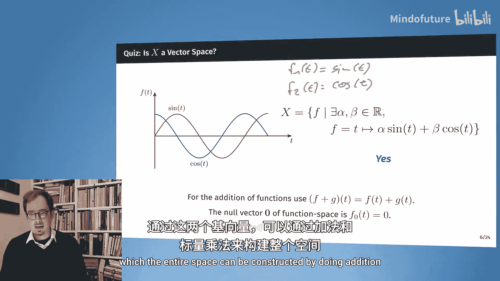

# 【凯尔大学】机器学习优化方法 ｜ Optimization Methods For Machine Learning And Engineering 2021 p25 P25_7.1_向量空间 -BV1C6SwBqEp7_p25-

Welcome to today's lecture for the course of the Ma Method in machine learning and engineering。

 today we will talk about Ve spaces。Today's lecture is structured as follows， first of all。

 we will see the definition of vector spaces。Then we will go to banax spaces。

 which are vector spaces with a norm defined and some additional conditions。

And then we will continue to hiderbutt spaces and the projection theorem and the projection theorem will enable us to solve a whole range of interesting applications。

Okay let's dive right into it， What are vector spaces， so you all have worked with vectors before。

 mostly in our N so in some finite dimensional space。And for these vectors。

 we have a defined addition and also scalar multiplications。

 so in geometry when you think about vectors as geometrical objects。

 we have all seen how addition and scalar multiplication work there。

But the term vector can be seen also as something that is a little bit more general。

 so vectors are not only geometric objects。But just in general。

 we have some set called X here that contains elements， and we call this set X。

 a vector space if we have addition and scalar multiplication defined and if some additional axons hold。

And this is completely independent from the elements of X being geometric objects or not。

 So it can also be something else。 we can even have vector spaces that contain functions。So we can。

 but we will see an example for that later。But what we need is addition defined and scalar multiplication defined。

 so some element of x multiplied with a scalar value。And on top of that。

 the following exons have to hold。So the first of the axioms is the commutative law。

 so x plus y equals y plus x， then we have the associative law。

 so I can draw my brackets here however I want and the result will be identical。

And this Associative law holds not only form。The addition。

 but also for the scalar modificationplication。Then we have the distriive law so that I can bring the scalar multiplication here inside of the brackets and this again the distriive law。

 it works both for scalar multiplication and also for the addition of these scals。

 so here how they distribute。Okay， on top of that， we require that there is another vector。

So there exists some element of x that I get out I multily or when I multiply any element of x with0。

 I get out the nano vector and when I add the N vector to some other element。

 I will get exactly that element， so it's the N vector it does nothing when I'm multiplying with it。

And。So multiplying anything with zero gives me the Nive vector and multiplying anything with 1 gives me the same element vector。

 so these are the basic axioms of vector spaces。And what is important that in the proofs that we will see today。

 only these axioms are used， so nothing depends on the vectors being geometric objects。

 everything follows from the axioms here。Okay。就。The elements of course could still be from our end。

 so could be geometric vector， but many other types of things can also form such an X and what is also important。

 not all the subsets。Eleement all the subsets in RN obey all these exoms so it is not enough to be in ourN in addition we have to check that the exoms are fulfilled for X and we will see some examples now so let's have a quiz to see whether everything was clear。

First of all， the question is， is this x a vector space。

 or there's always the definition of an x for the quiz。

 and I will ask whether this is a vector space or not。

And here we just say x is the entirety of RN for some n。And indeed。

 we can check the axiomons and do the proofs and yes， this is indeed a vectorpa。

Now a little bit more complicated assume now that we are are three。

 so in in the space of all the three vectors， and we are defining some plane m here。

 so M is basically cutting out one plane in the three dimensional space where the Z vector or where one of the dimensions is always zero。

So we have this M where one dimension is always0， and this M here。

 this would be a vector space indeed。So we can verify whether the addition and scar multiplication and or the axioms are always lead to the required conditions。

 and n is indeed a vector space， we can prove that。

But what we now do is we translate this vector space， so we have some P， any P。

 and we translate our vector space by looking at all the elements of M。

And each element is has here this P added Okay， or this could also be written as x is all the vectors x such that there exists an M。

And x is M。Oops。X？M plus P。Okay。And here we have to say that the x set is not a vector space。

 and we can see that very easily because the Nile vector is missing。 So here this is our nu vector。

 and we have Nll is not element。Of x。 And therefore， it is not a vector space。

 So the aons are not holding。 So this is not a vector。What we see on this slide here。

 this is called a cone。And Germany， would say kgan。Here we have some M， which is any subset of RN。

 and we are embedded here in RN。And in order to have a cone in the red set X， or let's make it red。

So this is x。嗯。So here we consider。All the points where there exists an M in big M。

Such that I can multiply with a scalar alpha and get back my X。For example， here。

 let's select some point。Here let's select this point here and we can now find a point on M。

Probably somewhere。Somewhere here。嗯。So that I can find an I where this M is somehow on the line。

 so now I can have like a line between this M here。Sma M。

Here this is my small M and somehow I can multiply this small M here with a scalar alpha to get exactly out this point x for which I wanted to check whether it is in the vector space or not。

But that obviously works also in by extension on the other side。

 So the alpha can also be bigger than one， larger than one。 So I could also have the X here。

Let's call it X prime。And this is the basic definition of a columne。However。

A cone by itself is not yet a vector space。And we can see that quite easily because it stops all here at the zero vector。

And if I'm looking at an x here on the other side。You're an x。That wouldn't be contained in the comb。

But I would like to get there， or it should be possible to get there because if I take my M and now I'm looking at M times minus-1。

So then m times minus-1， it should be somewhere here， minus M。

And we see that minus M is not part of the cone。 Let's continue。Mus M should。Like here，-1。

So what I see that minus M is not part of the cone。However， if x was a vector space。

 minus n must be included， so this xom is not holding and the cone is not a vector space。Okay。

 now let's look at something that is a little bit more fancy here I have a space X that contains functions。

But not any functions， it contains functions that I can construct。

By a weighted sum of the sine and the cosine function。So let's give some concrete examples。

 what would be in x， so x is somehow a big set， actually it contains infinitely many elements。So， x。

Remember， x contains infinitely many elements。 So we can only look at a couple of examples here。

 so it would contain。Sign of T。And it would contain cosine of T。And it would contain。

Sine of T plus cosine of T。And also， then。0。5 sine of P。

And all possible variations thereof that I can think of。

So for all the elements that are now I'm calling them F， for all the elements F that are in x。

I ask that there exists an Ir and beta that are scalar numbers so that F is the mapping of some T to I sine of t plus beta cosine of T。

And。So there are infinitely many elements in my X， but they all follow this form。

And now we also have to talk about what it means for functions to be to be added。

The addition of a function here， if I'm adding F plus G。

 then it's just F of T plus G of T if I'm evaluating 40。And we have to define the nine vector0 of。

This vector space in here I'm saying that it is just F of T that returns always0。

 and this is not my another vector for this special function space vector space。Okay， and indeed。

 now we can look at all the axioms and if we do that in detail。

 we will see a couple of examples in the exercises。

 then well it becomes clear that actually x is indeed a vector space。Okay。

And now many of the results from linear algebra。Can be reconstructed for general vector spaces so that they hold。

 for example， then also。For the function space or the example of the function space that we just saw with this sign。

And cosine function。So for example， we can have some notion of linear combinations。

So when we then then we can also have some notion of linear independence so we already saw that for geometric vectors。

 so here we have x1 and x2 and now it you have to imagine this in three dimensions。

 then these x1 and x2， there would be a basis that spans this vector space， big x。

But as x1 and x2 are linearly independent from this epsilon here。

 we know that epsilon is not an element of this vector by speak x that was spent by x1 at x2。

And so now we also have a notion of dimensionality and all of this basically translate then also to vector spaces that are not the geometric vectors。

But we have to be careful because here when we talk about dimensionality。

 there are also vector spaces that are essentially infinite dimensionals and there we have to be a little bit careful。

But if we go back to the vector space here of the sine and the cosine function。

This is actually a two dimensional space because we can define two basis vectors。

 so for I here we could have F1 of T is sine of t。And F2 of T is cosine of T。

And then these two would actually base vectors from which the entire space can be constructed by doing additional scalar multiplication from these two。

