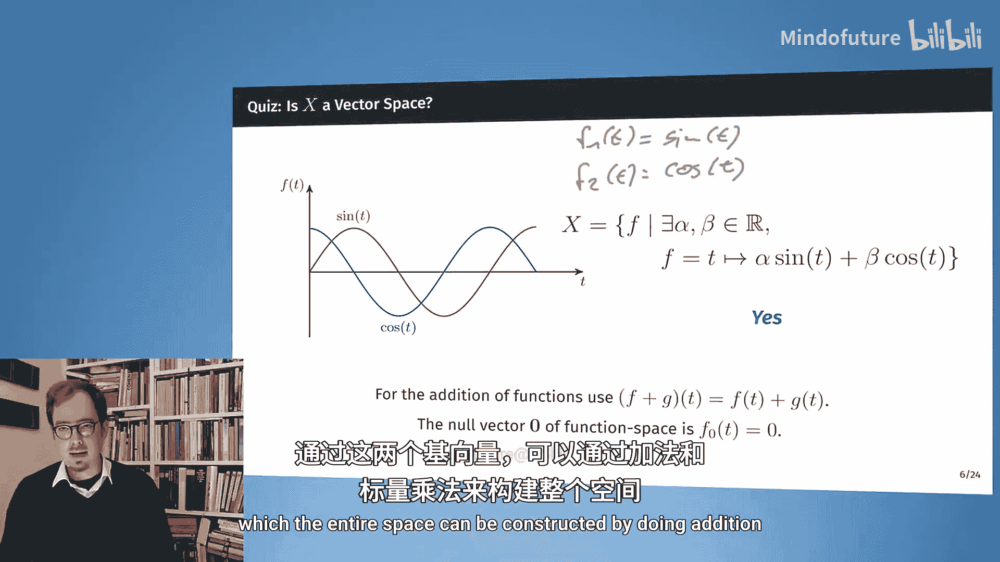

# 机器学习优化方法：P25：向量空间 🧮

在本节课中，我们将学习向量空间的基本概念。向量空间是线性代数和许多机器学习优化方法的基础。我们将从定义开始，逐步探讨其性质，并通过实例加深理解。

## 向量空间的定义

上一节我们介绍了课程背景，本节中我们来看看向量空间的具体定义。向量空间是一个包含元素的集合，并定义了加法和标量乘法运算，且这些运算满足一系列公理。

以下是构成向量空间必须满足的公理：

*   **交换律**：对于集合中的任意元素 **x** 和 **y**，有 **x + y = y + x**。
*   **结合律**：对于加法和标量乘法，结合律均成立。即 **(x + y) + z = x + (y + z)**，且 **α(βx) = (αβ)x**。
*   **分配律**：标量乘法对向量加法可分配，即 **α(x + y) = αx + αy**；标量加法对向量乘法也可分配，即 **(α + β)x = αx + βx**。
*   **零向量存在**：存在一个特殊的零向量 **0**，使得对于任意向量 **x**，有 **x + 0 = x**。
*   **单位标量乘法**：对于任意向量 **x**，有 **1 * x = x**。
*   **标量零乘法**：对于任意向量 **x**，有 **0 * x = 0**（这里的 **0** 是标量零，结果是零向量）。

这些公理是抽象的，不依赖于向量是否为几何对象。集合中的元素可以是数字、函数或其他数学对象。

## 向量空间示例与辨析

理解了定义后，我们通过几个例子来辨析哪些集合构成向量空间。

*   **示例一：全体实数向量**：集合 **X = ℝⁿ**（所有n维实向量）是一个向量空间。我们可以验证它满足所有公理。
*   **示例二：三维空间中的平面**：集合 **M = { (x, y, 0) | x, y ∈ ℝ }**（即三维空间中z坐标为0的平面）是一个向量空间。它满足所有公理。
*   **示例三：平移平面**：集合 **X = { m + p | m ∈ M }**，其中 **M** 是上一个例子中的平面，**p** 是一个固定的非零向量。这个集合 **X** 不是一个向量空间，因为它不包含零向量。
*   **示例四：锥集**：对于集合 **M ⊆ ℝⁿ**，定义 **X = { αm | α ≥ 0, m ∈ M }**。这样的 **X** 称为锥集。锥集通常不是向量空间，因为如果取 **α = -1**，元素 **-m** 可能不在 **X** 中，违反了向量空间对标量乘法的封闭性。

## 函数构成的向量空间

向量空间的概念可以扩展到函数。考虑由正弦和余弦函数线性组合构成的所有函数集合：

**X = { f: ℝ → ℝ | f(t) = a sin(t) + b cos(t), 其中 a, b ∈ ℝ }**

在这个空间中，向量的“加法”定义为函数的逐点相加 **(f+g)(t) = f(t) + g(t)**，“标量乘法”定义为函数的逐点缩放 **(αf)(t) = α * f(t)**。零向量是恒为零的函数 **f(t) = 0**。可以验证，该集合满足所有向量空间公理，因此 **X** 是一个向量空间。

## 线性代数概念的推广

对于一般的向量空间，线性代数中的许多核心概念依然适用。

*   **线性组合**：向量 **v** 是向量 **v₁, v₂, ..., vₖ** 的一个线性组合，如果存在标量 **α₁, α₂, ..., αₖ**，使得 **v = α₁v₁ + α₂v₂ + ... + αₖvₖ**。
*   **线性无关**：一组向量是线性无关的，如果其中任何一个向量都不能表示为其他向量的线性组合。
*   **基与维数**：向量空间的一组基是一组线性无关的向量，并且空间中的任何向量都可以表示为这组基的线性组合。基中向量的个数称为空间的维数。

例如，在上述函数空间 **X** 中，函数 **f₁(t) = sin(t)** 和 **f₂(t) = cos(t)** 就是一组基。因为任何 **f(t) = a sin(t) + b cos(t)** 都可以由它们线性表出，且 **sin(t)** 和 **cos(t)** 是线性无关的。因此，空间 **X** 的维数是 **2**。

需要注意的是，也存在无限维的向量空间，例如所有连续函数构成的空间。

## 总结

本节课中我们一起学习了向量空间的核心概念。我们首先给出了向量空间的抽象定义及其必须满足的公理。然后，我们通过几何向量、平移平面、锥集以及函数空间等多个例子，辨析了向量空间的条件。最后，我们了解到线性组合、线性无关、基和维数等线性代数概念可以自然地推广到一般的向量空间，这为后续学习更复杂的空间（如巴拿赫空间、希尔伯特空间）奠定了基础。理解向量空间是掌握许多机器学习优化算法中数学工具的关键第一步。