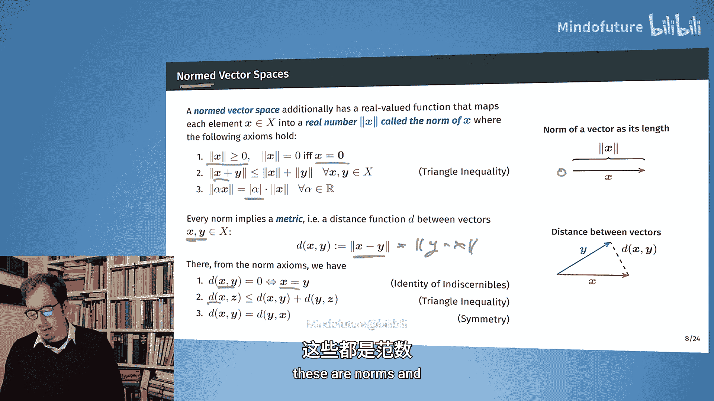
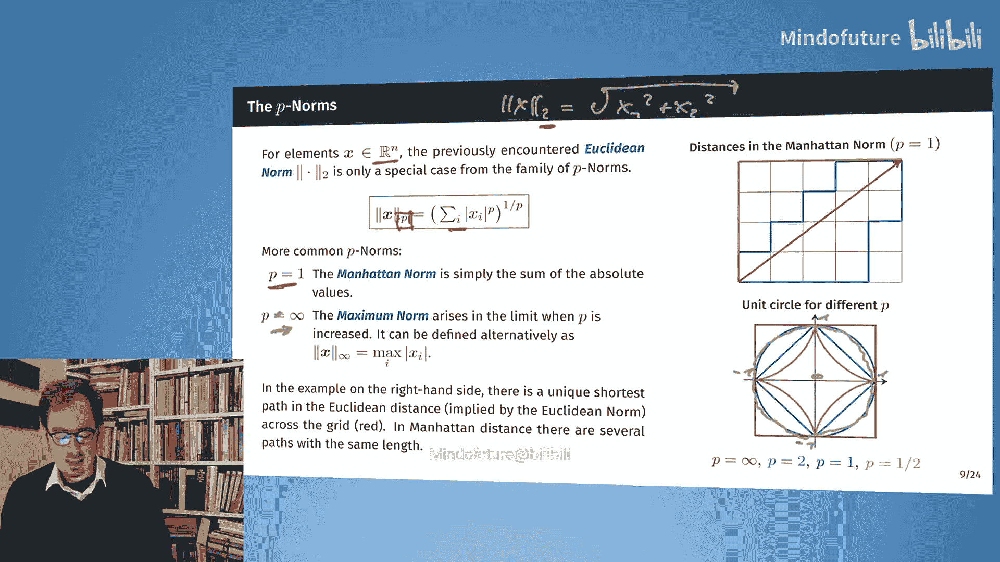

# 【凯尔大学】机器学习优化方法 ｜ Optimization Methods For Machine Learning And Engineering 2021 p26 P26_7.2_范数与巴拿赫空间 -BV1C6SwBqEp7_p26-

Now， let's move on， so。In mathematics， people they can spend entire semesters just on material pertaining to vector spaces and banner spaces。

 today we will have to move for a little bit quicker。

 but we will have at least some mathematical rigor。

 but we cannot do all the proofs to time constraints and in order to get to the applications that are interesting to us。

O。So we saw vector spaces， addition multiplication， and so on。

 and what we are adding now is a notion of distance。And for this， we define norms。

So a non vector space。Is a vector space in essence， and in addition。

 has a real value function that maps。Every element to a real number。

 and we call that the norm when it holds a couple of axioms。So for the norm。

 we can think about the norm as a length。 So we want to describe the length of a vector。

 and for that， we have the norm and the axioms are that the norm is always。Or is at least zero。

And that the norm is exactly zero only if x is the Nile vector。

So we can also think about the normum as like the distance to the naveto。

So if here we have0 and then x is the vector going out from that。

 then the norm would be zero only if x here would also be exactly the N vector。O。Now。

 the next one is important， the triangle equality inequality， when I take the norm of x plus y。

 then the norm of that will be smaller than the norm of x plus the norm of y。And the thought。

The third axiom is that if I take the norm of alpha x， this would be the same as。

I'm multiplying the absolute value of alpha with the norm of x。And so there are many different norms。

 and for all of them， we will check that this， or we can check that these three aoms are holding。Now。

 when we have a norm， this norm automatically implies a distance function。

So when I have two vectors x and y， then I can define the distance function between them as the norm of x minus y。

And this is also symmetric， so here this would also equal y minus x。have the same distance。

And just from the norm axioms， we have。Following axioms for the distance。 So for example。

 the distance between x and y is only 0 if x is equal to y。

 this is also known as the identity of indiscernibles。

 So if I cannot distinguish two elements by the distance， then they have to be identical。Okay。

 then the triangle inequality， we also have that for the distance metric and well also symmetry。

 we saw that just before。These are norms and now what are possible examples for norms。

 one of them you have already encountered prior， so before we saw the Euclidean norm that you know from normal geometric vectors。

 so if I here take the Euclidean norm of x。

Then this would be and this is maybe a 2D vector， and this would be x1 squared plus x2 squared。

 and the square would the entire thing。And here I was writing this little tool here。

And this little tool。I put it there for the Euclideanome， but this is also an indicator。

That this doesn't have to be a true because here I can also choose different values and I call this the family of the P norms that I can choose many。

 many kinds of the P。And。Let's give you some example of what I get for other values for P。

 so for P equals to1， this is the Manhattan norm。So where I just have the sum of the absolute values of the。

Elements of my vector。 So here I'm in Rm。And therefore， each vector can be。

I can look at the different elements of tobacco。And。

And I'm taking here always the sum of the elements and for the Manhattan normal if P equals to one。

 it's just the sum of the absolute values。Now if I choose p equal to2。

 then I will square every element， sum them up， and then take the square root of the entire thing。

But it becomes very interesting if I increase P even further， so by letting p tend to infinity。

 so here it shouldn't be equal it should be here by P in the limit going to infinity。

 I get the maximum norm， and there I'm just now taking the largest absolute value of the largest of the absolute values for the elements of my x。

So on the right hand side we see some visualization so here we see the Manhattan norm。

 this is called the Manhattan norm because it looks like like the city layout of an American city where for a taxi driver。

 it's not very important where he is crossing over because essentially there are many different tours from point A to point B that have the same distance。

And what is shown on the lower side of the right hand side。

 this is the unit circle for different values of P。So。Let's first look at the unit circle。

 the green unit circle here， which is just the typical unit circle you would expect。

 so all the values that lie here so here we would have zero in the middle and here there would be Ex one and here there would be Ex one。

Here is minus1 and here is minus1 in the respective dimension。

So all points that lie on the green circle， they have a distance of exactly one。To to the na vector。

But now by choosing different P， this unit circle will look different and。诶。Yeah。

This is just a nice visualization of what happens if I am modulating and increasing or decreasing the P here。

Okay， so we will not individually check the norm axioms here。

 but I think the biggest takeaway is that there can be many different norms， even for R end space。

 basically it's a design decision。Of which norm I want to use but the results that we develop here for vector spaces。

 they will work independently of the norm that I am choosing。

Now， we saw。The notion of distance。And we can now ask the question of convergence。

So convergence essentially means that the distance to the limit or to the limit point is reduced and is continually reducing down to zero。

But now let's make this more precise， we will now go in the direction of so called Banas spaces。

Bath spaces were developed by Shafa Banard here， you see him on a picture where he was roughly at the age where he developed these results and these are really really a workhor in mathematics and used in many different places。

嗯。Already earlier in one of the previous lectures， we saw a conversion series and we used that in the discussion of open and closed sets。

 and now we make this idea or this notion of congence more rigorous and more precise。

Now let's take a sequence of elements from a non vector space X。 So here， instead of series。

 we should be writing sequence。So here we just have a series x1， x2， x3， and so on。

And we have such a series and all the elements or entries in our series they are all in big X。

 and big X is a non vector space。And we say that this series converges。If there is some element， why？

For which the distance between y and the Xi decreases when I'm increasing the I。

So I'm looking at the distance of。X1 minus y。And this should be bigger than the distance of x2 minus y。

And so on。So I'm decreasing the distance to y by going forward or stepping forward in the sequence。嗯。

But more precisely， what does this conversionverence now mean？

Convergence means that for every epsilon， larger than zero。But arbitrarybitrarily small。

 I can choose Epsilon very small。For every Epsilon bigger zero， there exists an index M。

We are all the entry series after M。In the sequence。A closer to epsilon are closer to y than epsilon。

Okay， so that depends， I can choose Epsilon as small as I like。

 I can find some M so that all elements in the sequence after M are closer than Epsilon to the point to which they are converging。

ok。And now there's a second notion of conversiongs。

 which says that a sequence is called koshi sequence if for all the entries or if the distance of X I minus Xj。

Converges to zero。嗯。When I want。嗯。I and J larger that sum index n。

Again here I choose some epsilon bigger than zero， but arbitrarily small。

There will be an index M that for every I and that I'm choosing in the sequence after this M。

 their distance will be smaller than Epsilon。O。And in a non vector space。

Every conversiong sequence is also a crshe sequence， so this is some of the prerequisites of proofs。

Okay。And。So here on the this was maybe a little bit dense here on the right hand side in the lower corner we see a non crshy sequence。

 so here this is starting to oscillate。And the， I can move forward in in the sequence。

 And this is not corey， because when I choose an epsilon that is very small， let's say。

I'm not sure whether this is the actual epsilon， but let's say choose Epsilon 10 to the minus 10。

 so something very small。And I can move forward， however， I'd like。

 I will always be able to get some points that are。Some distance apart。诶。So here these two points。

 for example， would be some distance apart that is bigger than this epsilon and this cannot happen okay。

 so probably let's see。Here， we would have。Here this would be the eye index increasing。

And here probably we then have the。The X I。On this。

 so what I'm looking at is actually only the distance in this。Direction here。

 but you get the idea here this would be a non conversion sequence。O。

We will see more examples to make this a little bit clear。And a non vector space x is complete。

If every crti sequence from x has its limit in x， so completeness it's another adjective that we are learning today so if every crtt sequence from x has its limit in x。

 then we call this entire thingcompte and we will also call it a ban space。Now。

I think we need a counter example here， otherwise it might be a little bit difficult to imagine。嗯。

Now again， we are looking at function spaces。So。We are looking at the space of continuous functions。

And they have a special。A special。Norm defined for them。

 but not let's see the actual examples of this function space first。

Now here we are defining a series FI。And here I have different functions or let's start at the very beginning。

 so here this should be I equals 2 and I equals 3。 Now the first element here would be the function that goes like this so I have a ramp it ramps up until one half and then the function is flat。

And the function in L 201， it is actually here only defined between。你注。0。And one。

 so this is the definition range。And then let's look at the next element in this。Sequence。

And then another element in this sequence and so on。

And what you see that all the elements of my sequence are continuous functions。

And if I'm then looking at the distance so we can now define a norm for these functions and I see that somehow they are converging。

 so here clearly they are converging to something and what they are converging to is the step function。

And now I have a problem because now I have a series of elements。That is converging。

But that is converging to something that is not a continuous function。

 so this the limit to which this is converging is not in the original vector space。And hence。

 this is an example for a noncomp knot space。O。Why do I here？

And let's unpack this a little bit why we should care about this。First of all， in many cases。

 we are fine because in any finite dimensional subspace， we know that it is complete。So everywhere。

 when we are looking at geometric vectors in RM。We know that this is a complete subspace。

 so also it's a Banak space and all the results that we have for Banak spaces also apply here。嗯。

But completeness is a prerequisite for actually many of the optimization algorithms that we saw in the previous lectures。

 and now when we want to generalize these optimization algorithms to，To vector spaces。

 we have to consider completeness。And let's give you an example for that now let S be a subset of a non vector space。

 so we have a non vector space x and we consider some subset of that。

And now we have a function that is a transformation on S。

 so it takes an input from S and it gives an element from S spec。Then we call this F a contraction。

If there exists some alpha between0 and 1， but not exactly one。Such that the， the。诶。诶。

F of x minus F of y and taking the norm of that。This must be smaller than alpha times the norm of x minus the norm of y。

In essence， that means if I'm applying F to two points。

 then these two points are moving closer together。And for the banak spaces， for complete spaces。

We know that if F is such a contraction。Then there exists a fixed point X star。

And by repeatedly applying the F to an element and then reapplying it to the result and reapplying it to the file and so on。

 we will be converging to this fixed point x star。And now in the context of an optimization problem and of the iterative optimization methods like gradient de and the Newton method。

They were actually the proof of convergence for them， it relies on this Ben point theorem。

Because these were also iterative methods that were maybe in addition then with Ly search。

Getting closer and closer and closer to the optimum and for conversions。

 what has to be proven is that an optimum exists。And also that in every step we get a little bit closer to this optimum and when we take gradient descent and we are at the optimum and we want to take an additional gradient descent step。

We will have exactly this， so if now F is the gradient descent method then we would not move away from the optimum so again here we have reached a fixed point and then we will stick to the fixed point and also the fixed point is the optimalimum。

Okay。That was quite a mouth， but what you have to take away from this slide is that by having this completeness and having like a nice。

Behaving space， many of the optimization algorithms can be be can be applied or at least translate。

 and this is really interesting for some fancy infinite dimension of vector spaces， but in general。

 we don't have to specifically prove the completeness because whenever we are in our N。

 then we know that the space is also complete。