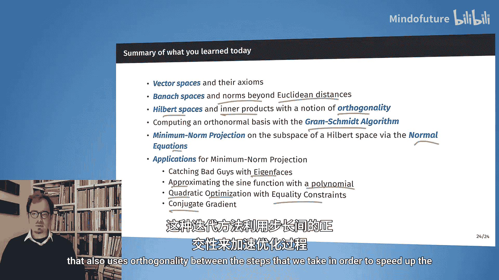
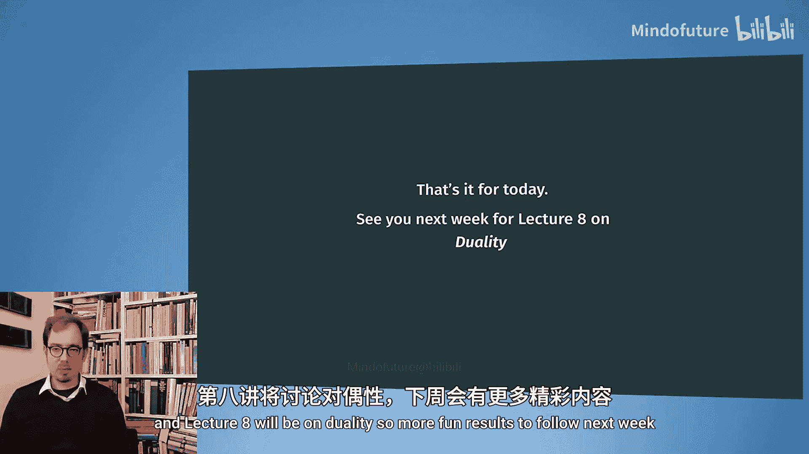

# 【凯尔大学】机器学习优化方法 ｜ Optimization Methods For Machine Learning And Engineering 2021 p28 P28_7.4_投影应用 -BV1C6SwBqEp7_p28-

Okay， so now we can compute minimum distances and this allows us already to solve。

Quite a few applications that would be challenging if we。

 if we didn't have this capability to compute projections of of minimum norm。

The first example I want to show you here has the the。Inesting name of eigenfaces。

And what we will do here and this we will also look at in the exercises here。

 we will be catching bad guys。So imagine you are at the police and you are taking mug shots of gangsters。

So the gangsters are arriving and you're taking a picture of them and they have to look into the camera and they cannot smile and maybe the gangster is lying to you and is not giving you his real name。

Now， how can you find out who this person actually is？

Oftentimes the police will have a database of all the past mugshots and maybe also can knows about people that were arrested in previous years or in other cities and so on。

 and they want to know whether this guy was already arrested。And for that。In the past。

 they just had to。Go over a long list of pictures。And with computers today， it can be aided。

 there can be some assistance by the computer， and the eigenfaces， they are actually quite old。

 so today we have very fancy methods and very performance methods to compare phases but in the 80s。

 we were doing this with the eigenphas method。But。Now we have to get back to the question of projection and minimum norms。

So what is happening is that we basically have a basis that consists of how to say feature prototypes。

We have this is the average phase， so we have the average face。That is the result of just。

Looking at hundreds and thousands of face images and computing this average trace。

 so initially we are removing the average face， so we want to consider at the particularities that go beyond just the average face。

And then we have the eigenfaces。 So this will be here E1 and E2 and so on。

 These are then the eigenfaces。 and what we want to achieve is we want to reconstruct the the image that we have。

By projecting on the vector space span by the eigenfaces。

And the way these eigenphas are initially created， it depends on this eigen decomposition technique that we already saw for computing Fibonacci in constant time。

 we were not。Look at what the eigenic composition does。

 we just assume that we have a couple of funny faces somehow from which we can reconstruct the actual faces。

And by taking the weighted sum off the eigenfaces and then adding back the average face。

And so we have the actual picture。 so here somehow we have the actual picture。Of the guy。

 and he's not smiling。yeah， we have a face and what we want to do is we want to take the actual picture that we have。

And find the projection to the space of the eigenfaces that is closest to it。

So here we then also have to define a distance。AndIn our product， and then we can do that。

And the big advantage is that we can now。Describe every face with a low dimensional number of descriptors。

Because now we have this I 1 to Ihi N， maybe we have 100 different eigenferes。

And then when the gangster comes in， we can describe his face with 100 dimensional vector。

And all the other phases in our database， we can also describe them with 100 dimensional vector。

And this now allows us to do efficiently， for example。

 nearest neighbor lookup and to look at maybe candidates。

 the system gives us candidates and then we can compare and figure out whether maybe this person from the Macshot is actually。

In the database already。And the technology to do that it's now。More than 30 years old today。

 it's a lot more advanced。 but here why we are we are taking this example here is because it shows some of the power and that even quite high dimensional。

Entries of a vector space or had I mentioned vector spaces。

It can be useful and that we can efficiently compute this projection for them and in the exercises we will actually implement such a system where we can figure out if a person on an image is already in our database。

Okay。Now let's switch gears， let's take another example and also an example that shows what we can do by looking at or by designing an inner product that helps us solve an actual optimization problem。

So。What we want to do here is we want to approximate the sine function with a polynomial function。

So the sign function， it is actually difficult for the computer to work with the sign function。

Because in many places when I evaluate the signine function， I could get infinitely many digits。So。

The computer who gives us or who computes sign in finite time。Only gives us an approximation。

And now what I'm asking here is whether I can approximate sign with a polynomial， so again。

 a polynomial is just。Let's say I have C1 plus。C1 times x plus C C2 times x plus C3 times x is squared plus C4 times x to third power and and so on。

 So I'm looking at the polynomials here with respect to to x。And。Well， the question is。

 how should I select the weights， the C in order for this to approximate the sine function as closely as possible？

And what we already see here some of the results that we will recreate shortly。

 so now here we have a sign approximated by a second auto polylynomial， or it's not actually s。

 it is actually G of T， which is the sine of pi times t so here this should be G。

And this here should also be gene。And so， we。We see here already that the second degree polynomial。

 it's not a good approximation at all， so here we have a lot of error。

It's directly visible to the naked eye， it's not a good approximation。However。

 when we go to the fifth degree or the fourth degree polynomial。

 we see that it's already much closer and it's still not perfect， but with the naked eye。

 it already looks quite close。And so how can we compute these。Weights。

 how can we compute the actual coefficients of the polynomial。

 and this is actually also a projection that we are doing。Now again。

 look at the or consider the vector space a tool that contains all the continuous functions and now so these are all the functions between the right one or with the domains between the right one that are mapping to the real numbers。

And with with the edit constraint that if I now take the integral between0 and1。Of F T squared。

For this F， my function， this has to be smaller than infinity。

 so this is just one of the side constraints of this aunome so that the inner product that we are looking at makes sense。

Okay， and now we have the inner product between F andG， between zero and1 and multiply FNG。

By taking the integral between0 and one and at every point， might decay the tool。Okay。

 and we have a corresponding norm to that， which is just the inner product of F with itself and taking the square root of that。

Okay， so this is the first。Inredient that we need。 So this is just the vector space H。

And obviously sine is an element of E2 so the sine function or rather this G function here。

 but also sine， So here G of T， it's an element of this vector space。O。Now another vector space that。

We need to consider is the vector space？Of all the polynomials。

Of n degree or this is rather the the space of polynomials of up to n degree because I can just set some of the coefficients as0。

 so the polynomials of fifth degree include also all the polynomials of fourth degree and so on。Okay。

 and I can represent every polynomial by an n degree polynomial by an n plus one vector。

 so with n+1 elements， because I also have to consider the intercept。

 so here this first element also has to be considered so the second degree polynomials I need three real numbers to describe it。

And any set of polynomial functions spans a subspace of L2。

 and if these polynomial functions are now linearly independent。

 now we have to think about what does it mean for functions to be linearly independent。

They spend a subspace。O， off at。And we can even compute an often normal basis for it。Now。

 first of all， let's look at， let's look at P3 and let's look at a couple of elements of P3 that we could use as the basis。

 for example， here， we could have now。callinglling it B1。 So B1 of T is just one。

So that could be an example。R B2 of T is T。These are all now elements of P3。

And I can now use the Gam Schchmidt orthogonization method to compute an orthonormal basis for that。

So we have our vector space L2。And we have a subspace of that with all the polynomials。

 and now when I choose some element， for example， the sine function or this G of T。

 which is a modified sine function， it looks a little bit。Better in， in， in the blocks。

 Then the question is。Which of the polynomials is closest to the sine function or is closest to G。So。

 now here。We are looking of Fn。Looking for Fn， which is the polynomial of up to eighth degree。

That is closest to this G function， according to the norm from the inner product up here。And。诶。

Let's see how we could do this at Julia and it's all fitting on a single slide。

 so it's actually not so much code。First of all， we need in Julia to define the polynomials。

 and the polynomials are just a structure that contains a vector of F 64 with all the coefficients so if I had a fourth degree polynomial I would put here a vector with five elements。

And now， when I'm evaluating the。Polynomial at a certain point， X。

Then I just go over the coefficients and take my x and take the corresponding power of x so here the first I would take x to the zero's power。

 which would be one and multiply that with the intercept and then go on by looping over or the elements of my coefficient vector。

Okay， so just with four lines， I can define polynomials and how to evaluate polynomials。

What I then need in addition is addition and subtraction。

 so here I'm overloading my edition operator and specializing it for two polynomials as the input。

The same force subtraction。Then I need multiplication and division with a scalar number it the same。

 I'm overloading the operator and defining multiplication for polynomial with a scalar。

And now I can evaluate that， so for example， the polynomial of here this would be。嗯。1 plus。

X plus0 times x squared？And I can evaluate that at the point 2。0 and I get out five。

 which is what I expect。And now I can also multiply polynomials and add them multiply with the scalar and add polynomials together。

 so the entire thing on this page here， this is just vector basic stuff。

And it doesn't yet have anything to do with norm spaces or Hilbert spaces and so on。

 but now I'm adding the definition of the inner product so here。

Now here we are in Hbert Space territoryri。Because now I'm defining the inner product。

And just the way it was defined on the previous slide with the integral。

 but here I'm taking a shortcut， I'm approximating the integral by having a very。

 very small discretization or discretization with some small number and now I'm taking the sum and but this is the usual method on how an integral would be approximated。

 it's actually very close to what we saw with the oil method in the previous batch。Okay。

 now I have a vector space equipped with an inner product， and that's all I need。Now， I just have to。

嗯。Oh， and what is important， so this is the vector space。Of polynoials。Of police。

And this guy over here， this is the HiipPA space。开除。嗯。

And what I can now say is I take an element of the Hilbert space， which you see the GT。

And I want to project this。On a basis。From the on a basis， from the space of polynomials。

 So here this is the space of polynomials。Okay。And I can just plug that in so the previous definition of the normal equations it works exactly the way one would expect now I just have to use a different here special value type for the norm so that the type inference works correctly and then everything will be figured out automatically now I'm taking this function G。

As input。And projecting it on the basis P， and it will actually return to me now the coefficients of the approximation that we saw on the previous slide。

 so here we had zero minus 0。05 plus something plus something and this is actually what is returned here。

Now， what is interesting is that you' are。Computer整。

Can only approximate the sine function to some precision。And how does your computer actually do that？

He either has an implementation in Har with all kinds of lookup tables and so on。

Or he has an implementation in software。Typically provided。

By the standard math library of your operating system or a Li in any if you are in Uni or Linux mode。

And now if we look at the different implementations of the sine function provided。

 so you have the new standard library that also comes with the math functions， or some other ones。

 for example， the NeL library is one of the original open source implementations of all the mathematicalthe standard functions that you need。

They actually approximate the sine function with a polynomial。

 so there's a good chance that your computer， if you call sine of something， internally。

 will run a polynomial or evaluate a polynomial get to approximate signine。

And the coefficients of this poly polynomial have been originally found by exactly the。

 the methods that we saw here。 Maybe there were a little bit smarter， even in the definition of the。

Of the， of the inner product they wanted to use。 But here， we saw the。

One approach where we actually compute with continuous functions。

 and we immediately see how this applies and how this goes to the core of what our computer is doing in numerical in numerical problems that use trigonometry。

Okay。Now， one further example here and now we are getting closer and closer to optimization problems or optimization problems in the way we have seen them in previous lectures。

Is here the optimization of a quadratic with equality constraints。So。

We have a we have an optimization problem where we want to minimize x transposed times matrix Q times x where the Q。

Mattris here has to be positive。Definite in order for the entire thing to be convex。And in addition。

 we have an inequality constraint similar to what we had already seen in the past。And actually。

 this guy here， it can be represented also as a non minimization。But first。

 let's build up a little bit more machinery that we need。Now the Ax times b。

 the Ax equals B equality here。This actually constrains our solution to lie on what we call a linear variety。

 so we had seen the linear variety in the quiz earlier。And here we see V。 So for all， for all。诶。

Little V in BigV， we have。诶。V equals B。And this is a linear variety because there exists a vector space that crosses the zero。

 the Nive vector， because every vector space has to cross the N vector or include the Nive vector。

But we can。诶。Offset this vector space here in order to get the linear variety B。Okay。

So that's the first thing that we notice。 and the second thing is that that the function。

X transpose Q x。It is actually a valid。In a product。So。Well。

 actually for the inner product here would have noted that X in product Y。

 yeah this would be this would be the inner product and then we can also have a norm for that so then the norm for that would be then X with the inner product with itself。

Okay， and now we can ask the question in order to， to， to solve this guy up here。

 this optimization up here， what we are actually asking which element of V。

Is closest to the nano vector。With respect to the distance metric or the norm for this inner product。

So it's just a different way of stating the same problem。And the way we solve that。First of all。

 we look for any V， any small V that fulfills the constraint， A V equals B。

 so this is an arbitrary V that fulfills this constraint。And what we then do is we translate。

 we find， first of all， the space， a big H。That is the translation of V so that it crosses the N vector。

And here we just compute the nu space of a of the matrix A and take the result as the basis that spans this H tde。

And。Well how we compute the artspace， we already saw how to do that in Julia。Okay， and。

But this H then is equipped also with our special inner product with this queue here。

And with the standards methods that we already saw， we can now project the V onto HTD。

 so here we have this projection going down here。And now we saw we see a certain distance of this age to the N vector。

 so here we have this distance。And what we now do is we apply this distance or here， well。

 here this is actually H。And now we are moving our original V。And here。

 this is actually the same vector。So here this is my H and now I'm removing H from my original V。

 and this gives me my point x star that lies on this linear variety。

And is closest to the Nile vector， and this has like an angle because of the Q that was chosen。

 if Q contained or if Q was the identity matrix， then X star would lie exactly on the arrow that you see here to indicate one of the dimensions。

O。So for this special type of optimization problem， we could now compute a closed form solution。

So we didn't have to use iterative methods like gradient descent of a newton method。

 but we actually had a closed form solution。Which is great。

 which is actually what the best that we can hope for is to find a closed form solution。

And by being clever， we can also try to use sparsity in the queue where it exists and make this somehow efficient。

And there are even a couple of interesting applications that take exactly this form。

And one of them is the layout of sea of Gs chip。So the sea of Gs is one method for producing processor or microchips。

 so there are two extreme solutions or there are two extreme methods on the spectrum。

 so you can have FPGAs where the FPGAs rather expensive， but it's also very flexible。

Because you can just upload logic and on the other end of the spectrum you have the Ass。

 so real the silicon that is custom made for a certain functionality and somewhere in between you have these C of gates option where a lot of structure is already imposed。

But and you will produce chips that only have the functionality that you give it。

But it's still a lot cheaper to produce than AsIs because there's like a predefined matrix of transistors and you only define where to put a connection and where not to put a connection。

 so it's not freely programmed like an FPGA， but it is more structured than an AsI。

 and you use that if you produce a couple of thousand of chips where the FPGA is not cost effective。

 but where you also don't want to do the full litthography for an AsI。

Okay so C of gates is one way to produce computer chips and you want to optimize the topology of that。

 you want to save space and also you want to shorten the connections that you have between transistors and but you have some constraints we have some constraints because here we have these IO pads on the outside and so given these constraints we want to minimize the length of of the connections between the transistors and this gives us exactly a quadratic optimization problem with equality constraints and if someday you are producing a computer chip and want to use C of gates。

With high probability， you will be using quite expensive software for the tapeout and when you press the button。

 it will solve this type of optimization problem and give you the exact topology of the chip。Okay。

 so again， one more application example。嗯。what is important here for this application example to consider is the closed form solution it only works when we have exactly the form that we show here。

If we are now adding one additional linear factor， so here if we have an additional， how to call it。

 let's say small R transposed X。嗯。诶。The optimization literature would still call this a quadratic optimization problem。

 but it does not allow the closed form solution of this minimum norm projection。

Okay and now the last application example is conjugate gradient。

 conjugate gradient is very closely related to gradient descent。

 but we have one additional step processing step for the gradient before we apply it。

 we make the gradient orthogonal through the previous steps。

So here there's a picture to show that the usual gradient descent would be here in green and we zigzag along until we get to the target and we might take quite a few zigzas and on the other hand here with the conjugate gradient method we only have one zig and so depending on the norm that is in place here。

 this here would be the two gradient steps would be orthogonal to each other and if we are in a higher dimensional space then。

I want to be orthophagona to all previous gradients until I run out of five dimensions and then I can restart。

Okay。So gradient descent， I compute the gradient， I orthoize it with the Gchmidt orthoization method。

 and then I apply an additional line search where specialized line searches exist and exploit a little more of。

Structure。And what is nice here that if I have a quadratic optimization problem with n dimensions。

 then I know that I only need n steps for conjugate gradient to get to the result so the newton method would solve this quadratic problem in a single step but I need to evaluate the hesian and solve a linear equation for it and in general I can achieve some speedups with conjugate gradient and to conjugate gradient oftentimes also works nicely if I am not in a quadratic but more complicated optimization setting。

One little anecdote to wrap this up is Hetenus worked on this in the 40s and 50s and back then they worked at the Zu Z4 computer so probably you heard about Zusi and like the German lineage of the first computers that were developed and these were not only theoretical or somewhere in a garage。

 but people did actual work with them， so they had one of the Zuss in Zurich at the ETH University and there they developed things like the Al Gore programming language which is the Granddaddy of many operating languages。

 programming languages we used today， and they also developed conjugate gradient on the Zuss Z4 computer back in there。

Okay， so what did we learn today， we learned about vector spaces and the different axioms that vector spaces or that have to be fulfilled in order for something to be a vector space。

We learn about norms and norms that go beyond Couclidean distances and panax spaces。

 which are vector spaces equipped with a norm that are also complete。Now Hi spaces。

 Hi spaces are then adding the notion of orthogonality within inner a product。

 and this orthogonality can be used for minimum nonproion by making use of the corresponding theorems and we have the gaam Schchmidt algorithm and the normal equations in order to compute this minimum non-projection。

 and we can do this in the usual geometric vector spaces， but also for example， in function basiss。

Okay and with this we saw a lot of applications for minimum non projection。

 so we saw how we can catch bad guys or compare mugshots with the eigenfaces。

 how to approximate the sine function by computing a polynomial that is very close to the sine function。

 and so here we had a minimum non projection on a function space。

We saw how to solve a quadratic optimization problem with equality constraints and how to solve it in a closed form。

And we saw a conjuggate gradient， which is an iterative method that also well uses orthoonality between the steps that we take in order to speed up the optimization。

That's a photo and see you next week for lecturec8 and lecture 8 will be on duality。

 so more fun results to follow next week， see you then。

