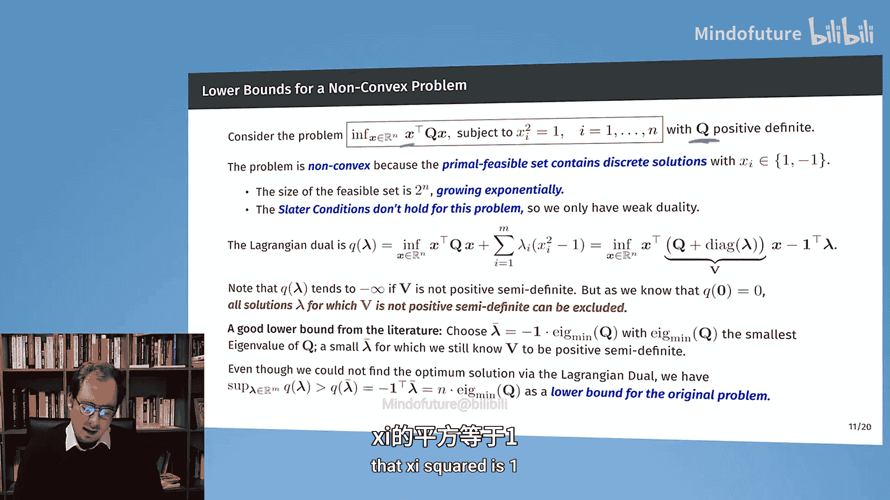

# 【凯尔大学】机器学习优化方法 ｜ Optimization Methods For Machine Learning And Engineering 2021 p29 P29_8.1_拉格朗日对偶性 -BV1C6SwBqEp7_p29-

Welcome to the course optimization methodsth for machine learning and engineering。

 Today's lecture will be on duality。The agenda for today is as follows first of all we will talk about ligooian duality one particular kind of duality interesting optimization。

 we will then see the Kash Kuntaka conditions which are conditions that need to hold for optimal solutions。

And we will see the primaryal dual methods which give us a nice speed up in the optimization of convex optimization problems。

ok。First of all， duality， why are we interested in the subject？

Dwellality is oftentimes used to describe an object that has two alternative representations。

 and I can transform between the two representations without losing any critical information。

And we see an example here， for example， here we have a set as the union of points。

 so here I have a set。And I have many points in the set。

 and I just described the set as their union and there can be also infinitely many points in my union。

So here it looks as if I had a set that is compact， that means it is closed and bounded。

 So if I take two points from the set， they have。And they always have a finite distance。

And so it's closed and it includes the closure， and also it looks like a convex set。

And for these types of sets， I can also describe them as the intersection of some half spaces。

So here down below， we see the half spaces， so the half spaces are are excluding。

One part of the original space R2， so R2 is the original space。

 and now we have all these half spaces and each of them is excluding like a half of R2 quote un coded。

And in the intersection， exactly our set remains， but depending on how this exactly is defined。

 we might meet infinitely many of these half spaces。

 but I can translate between these two points of view sets of unions or intersectional half of half spaces and depending on what I want to do。

 one or the other might be more practical。There are other examples， for example。

 the Four year transform of a time series where it can also transform between the time series and the F year transform up to the frequency that can still be represented。

Okay and why do we care why is this interesting in optimization so when we compute the dual of an optimization problem。

 what we get is a lower bound so this tells us how good we can get in with a solution so the lower bound must not be achieved in every case。

 but I know that I cannot get better than a certain quality of the solution and I might use that for early stopping to say when can I stop my solution。

 for example， when I'm closer to 0。01% the。Unit that I'm optimizing of。ok。And then， we will see。

Additional improvements that we get， for example， dimensionary reduction by looking at additional structure that is exposed by the dual and also faster conversions by considering additional optimality conditions。

Now let's take a closer look at Lagoian duality， this is only one type of duality even an optimization。

 therefore this can get confusing， we need to be precise which duality we are talking about here it's the Lagoian dual team and this is often presented by just stating facts about the dual representation here we will take an approach in order to really understand and the material will be developed from the point of view of game theory so this is not found as often as I would prefer but here it will enable us some insights that we wouldn't get otherwise。

Okay。Game theory， let's jump directly into the subject。

Game theory is the brainchild of John Ferneumman and we have mentioned him already several times so John Feronneuman is extremely interesting and he。

 for example， he wrote the book that first used Hilbert spaces to describe quantum mechanics。

It's the centralron phenomenonennailment that developed the phennoand computer architecture that is really prevalent today。

He was important in the development of the atomic bomb during the Second World War。

 and he also originated game theory。He wrote an article in 1928， So Ti Ri Gazeev Sper。

 and then later in '44 he published a book on the theory of games together with Oscarscar Morgant。

 and this is really the groundwork for much of what happened in the early development of game theory。

And John Ferraman said about the minimax theorem that we are looking at today。

He said about that theorem， as far as I can see， there could be no theory of games without that theorem。

I thought there was nothing worth publishing until the miniax E theorem was proved。Okay。

 so really a strong advocate of this theorem， and we will see that the results are deep and important also optimization。

Okay， let's start off with the first equation and here we see the mini max equality。

 which says that for a function psi from x and y to the real numbers。

 we have that the of the infeum of the function is smaller than the inum of the supreome of the function。

Okay， now we have to unpack that a little bit what does that mean first of all the supre and inphyum。

 these are the equivalents of the max and min operator so we have the max operator is somehow similar to the supre operator。

And the min operator。I somehow similar to the info female operator。

But there is a very important difference， and the difference is that the Iheum and supreme。

 they include the limit。诶。For which the solution tends。Let me give an example if we are looking for。

inhemo in an open set。And we have some function defined on an open set。

 and there is like some some search direction。 we want to go in that direction。

 and then we will get to the。To the closure of our open set。And to the in female operator。

 it will actually return to us the limits or the point on the closure to which the mini message tends or converges。

And the min operator will not do that， so the min operator can only return solutions from the set。

 and the inferor operator can also return a solution on the closure if it's an open set。

And this might also be important if we are just in， in R N， so the。Which is an open set？

Because they are the in female operator， it might return to us infinity and the min operator in principle will not do that。

Okay， so now we will talk about the supremo met the inphum when we are in the context of an open set or in the context of not a closed set。

 so there are also sets that are neither open nor closed。Okay。

 and what happens here is essentially I'm creating an tool optimizations that are nested。

 so I have a first optimization here。The infe on the left hand side。

And I can look at this as a function。Q of。Why？Q of y。

And this Q function internally performs the optimization of finding the infeum given a particular way。

And then the outer problem is the supreme， so maximizing and what I'm saying here is that if Im。

If I take the supremo of the function that internally minimizes。For X。

Then the result will be smaller， then if I call the function that with x that internally。

 now let's call this wW of x。Then the function that internally does the max。

 and so this inequality it always holds。So independently of whether Psi is convex or not。

Independently of whether x and Y are nicely shaped or not， this mini max inequality。

 we always have that。But we can now get a step further。

 so for Neiman he discovered then that if x and y are compact， so closed and bounded。

And if there are and also convex。And if in addition， this psi is convex in x and concave in y。

Then I have equality here， that means that independently of whether I first do the maxization and then the minimization or the other way around。

I will get to the exact same result。And here now I can talk about Max and min instead of inhimo and supremo。

Because we are now in closed sets， and therefore this is possible。And this situation here。

 we can think about this as a two player zero Z game。So here I have two players， X and Y。

Who play one play against the other。And every。Every every win of player X is the loss of player Y。

 this is why this is called a zero sum game， so it's like a game where there are finite resources and everything player X has player Y does not have。

So zero sum game and therefore the player X， he tries to so this function。

 essentially we can say that Psi is now counting all the winnings of player X。

 so the player X he wants to maximize that and no it's the other way around。

 so the player Y wants to maximize that and the player X wants to minimize it。

And here it also says that it is not important。In which order these players can， can， can， can play。

So。You can think about the mini Maxax inequality up here。

A little bit like a game situation where in the first where where on the left hand side。

 the player Y can choose first。And on the right hand side， the player X can choose first。Okay。

And it says that if the player Y can choose first。Then he will be at a disadvantage because the player acts he can see what the player Y did and he can already counteract so he then has knowledge about why will' do and choose accordingly and if you switched that the other way around then the player Y will be at an advantage and so it depends on。

Yes。It might be a little bit different if we are considering situations where the choices that X made。

诶。Impact the remaining choices of Y so if the set y depends on the choice of the other player。

Then we not necessarily have this mini maxax equality， but in the setting， as I just described here。

 the mini Max inequality always holds and in the mini Maxax theorem。

 if we are in a situation where it's compact and convex the two selection sets。

And the function is con in x， and conk f and y， then we always have equality。

And let's see how far we can get with just that initial result。Okay， now game theory in a nutshell。

 let's see a couple of examples here here we have two games。

 the first you might have all played when you were children。

So the first game is called Rock paper scissors。I have two players playing against one another。

And depending on whether they choose rock paper and scissors and what the other one does。

 the first player is either winning， then he gets a one or he's losing， then he gets a minus one。

 for example， if the first player chooses rock，And the second player chooses scissors。

 then the first player wins， he gets a one， and if the first player chooses rock and the other player chooses paper。

 then the first player loses minus1。This is a zero sum game because every game of the first player is the loss of the second。

The second example that we look at is the prisoners dilemma， and this is not a zero sum game。

But it has other very interesting properties。Now imagine that two robbers broke into a bank together and were caught or sometime after the police caught them。

 but the police doesn't have really good evidence。So they tried to convince the robbers of signing a letter where they state or where they confess that they were the robbers of the bank。

And in order to entice the robbers to assign the confessment， they are confessing。

 the police wants to give them a deal。And so first of all， if both of the rubbers don't talk。

Then they will be， then they will get some sentence。

 but there is the doubt and therefore they get both， for example， two years in prison。

 and this is minus two for both of them， if both of them don't confess。On the other hand。

 if one of them takes the deal。Then the police offers him to let him go， so he has a cost of zero。

But when the other one is not talking。So when one of them is talking and for example， is saying。

 well， the other one was the main instigator of the whole robbery and I was only and I was maybe forced to partake in that en so on。

 then he can go freely and the other one will get 1 years。However， if both of the robbers。Confess。

Then both of them will get five years in prison。And now the big question is what should they do so should they talk or shouldn't they talk。

 obviously in this case they must not coordinate， but everybody so on his own has to think about his situation。

 what should he do and then he confesses to the police or not？

And we can think about the selection or the actions that everybody is taking。

 we can think about that as a discrete selection。So either I talk or I don't talk。

Or either I choose rock or I choose paper and so on。

But we can we can think about that also differently。 so we can have the pure actions。

 which are the the。The choices that can be taken。But we can also devise so calledled mixed strategies and the mixed strategies。

 these are simply probability distributions over the pure strategies so in rock paper scissors。

I can think about a strategy that I will take rock in 20% of the cases and paper in 80% of the cases and it will never take scissors。

 so this would be a valid mid strategy or here we have another example。

 so 10% of rock and 550% of paper and so on。And the same for the person as dilemma。

 so probably no rubberer will ever do that， but in principle they could also think about their choices in terms of mixed strategies。

And。For the rock papers this example。The question is， if you were the player on。

 how would you react to this mixed strategy that we saw here？

And if I know that most of the time the other player will choose paper。

 then I will counteract accordingly so if the other guy probably or with probability larger than a third will choose paper。

 then the best reaction of why。Is to always select the scissors。嗯。And the question is。

 what is the best strategy for the prisoners？And also。

 is there maybe a stable situation where both are happy with their situation and I can or the other one can guess what the other prisoner or the other robber will do？

And the problem appears with the persons dilemma is that there's no real equilibriumum。

 so for the rock paper scissors games， there isn an aum because if one of the players chooses。

Every option in 33% or in a third of all cases， then the best reaction of the other one is also to play randomly with a third order time。

Um， but for the prisoner's dilemma， there is no such equilibrium because initially。

 if we say initially both don't want to talk。And then one of the prisoners can improve the situation。

诶。But that means， or when this happens， then the other prisoner can further more improve his situation and what in the end。

 both will talk。actually have to take it back so if both talk。

 this is actually a stable situation because there is no incentive of both of the prisoners to not talk when the other one does。

But this is not a very good equilibrium because there would be a better outcome for both of them。

 but the better outcome we both don't talk this one is not stable。Okay。

And finding these strategies in general， it can be computationally challenging。

 so there are books on algorithmgic game theory， how to find these equilibrium and generally humans are not capable because it's just also mentally algorithmgically too complicated and there are also situations where there is more than one equilibrium。

And these equilibrium type of situations have been studied very famously by John Nsh。

And here's now the definition， so such a equilibrium is a stable combination of player strategies where none of the players can improve his situation by changing his strategy unilaterally。

And Nsh， he showed that in certain categories of games， so also the non zero sum games。

 at least one Nsh equilibrium must exist。And so in all the games where the mixed strategies。

 where the set of mixed strategies is compact， then the set of strategies must。

Must contain one niche equilibrium。And now what is a compact set here for the following the mixed strategies。

 for the rock paper scissors game， what we see here， this is called the Sx。And all the here we have。

A pure strategy where I'm always choosing rock in 100% of the cases。

And here there is one where I always choose scissors in 100% of the cases。

 and here there's a strategy where I always choose Payal in 100% of the cases。

And now I can have mixed strategies and the mixed strategies they are exactly here on this surface。

And you can immediately see that this is a compact and bounded。

 it also conves set here for all the mixed strategies of rock pipe and scissors。

 so however I want to play， I will always end up with my strategy somewhere here on this hyperplane。

オッー。And well as， there can be many Nsh equilibriumli， some better than others。

 but it might be difficult to find them。But what also follows from this and what was also the idea behind the proof for the Nsh Eria。

Is the existence of a saddle point？That means if I think about the game as a zero sum game。

 like here in the mini Max Ethereorum setting。Then there will be a set point。

Where I have here this equality from the minimax theorem achieved。

 so this is the optimum solution and then if one of the players or X here is minimizing。

So he's coming down from the top。So this is the player X。And the other one is the player a why。

He's maximizing He comes down from the bottom。And they both get to the same solution because here we have a saddle point and we know that in the mini max setting there must be a saddle point and exactly at the saddle point。

 we have our solution where the equality holds。Okay。

 but what does that mean for us and now we have to loop back to optimization and theory。

Consider now an optimization problem。So we want to find the infeome over the real numbers in several dimensions。

Subject to some equality constraint。And now here at this point。

 we don't even require this to be Eine。So ax minus b equals zero equality constraints this year can even be nonlinear equality constraints later on have we have to change that。

 but here it's still all。Poly non nonlinear。Okay， and we use a shorthand to write this down。

 so here we will the bold X when we describe the vector of all the or the equality constraint values。

And in essence， I have a solution space， a big X that contains all the solutions for which here my equality constraints are holding。

And。I can describe an indicator function。 So the indicator function， this guy here， it will be。0ero。

When my x is in the feasible set， so in the big X and the indicator function will jump to infinity otherwise。

So the indicator function we saw it already in lecture three， I think。

 so here indicator function of x。And this here' is a big X。嗯。And this is a case distinction。

 so I have zero。If x is in big x。And it is infinity， otherwise。And now I can write down my。

My constrained optimization problem。As if it was an unconstrained optimization problem。

 so here this would be my constrained original version。

Where I have my equality constraints encoded here in this set big X。

But I can write the same now as an unconstrained optimization problem over all the real numbers in n dimensions。

By taking this special Tde F， which jumps to infinity if I get outside of my solution set and the inferum obviously will then lie inside of my solution set。

And the essential insight that we have here。Is that we can replace the use of this indicator function here。

By adding an additional su town。So here I have f of x plus my indicator function。

 and this here is obviously this is F2D of x。It'sF of x plus the indicator function。

And I can write the same one as f of x plus。Some y transposed c of x， and then take the supreme of y。

And now what happens here？If。If why。If why？Not equal the zero vector。Then。

This then the Supreme will attend to infinity。Because then I can choose wait a sec， no see。If C of X。

Now you have to see a bold sea。Is not the zero vector。Then the whole thing will go to infinity。

Because here the Supremepre， it can choose a very small or very large value in Epsilon。

in y to let this go to infinity because the Supreme wants to get as large as possible and if it has like a hold。

 if theres a non-zero term somewhere here in the C of x。

 then the Supreme can crank that up and can let it go to infinity。However， if C of x。

Is the zero vector？Then the entire thing here， it will go to F of x。And therefore。

 this is exactly the same as F of x plus the indicator function。Okay， and in addition。

 we know that our F of x。 Now， let's say our F of x is。Uses convex。And furthermore。

 say that the Cx equals0。Here this guy here is a of x minus b equals 0。

Because that means then essentially that my problem is convex in x。

 and it is concave in y when we now get to y。嗯。Then but still here。

 I can write the entire thing down as infeum or the minimization of f of x。

Subject to the constraints down here。I can write the same as a function。

 f of x plus y transpose c of x and take theum of the supreme of that。

So the optimization problem up here。It could be equivalently represented。Ass this guy down here。

And let me backtrack， this still works if f of x is not convex and it still works if the C of x are not linear equality constraints。

So here we are still in a very， very general settings and here still the two bounded red boxes。

 these are equivalent problems。Okay， and now we can。Move on from that。And now we introduce the。

The Fine equality constraints。 so x minus B equals 0。

And what we now see is that the mini Maxax formulation that we saw， it looks really。

 really similar to the Laangian formulation that we saw in lecture4。

So here I have this problem up here expressed as this insup f of x plus something problem。

And it looks exactly like the Lagoian formulation。The difference is now for the Lagosian formulation。

 I try to find the point， the saddle point where the Laorion is exactly zero。

But in the mini Maxax formulation， it's the same， I'm interested in the saddle point。

 also of this mini Maxax formulation。诶。Here we see this great。

 great equivalentvalence of the two approaches or of the two historical ways to get to the same formula。

Okay， so now we have different motivations it's the same equation but for different motivations and the mini Max formulation。

 it gives us one additional really important insight that means if we have found the saddle point。

So if we have found the point x star and Lambda star where our optimum lies。

 so if I have found this set point where also this condition up here is fulfilled。

Then I have equality。Between the primer problem where I have the infemum of the supremo and the supremon of the infemum。

 So here I have。Equality between the two。If。I'm it。X star and Lada star。

And we will now exploit this and try to abuse this or exploit this additional structure that we have found that we can just reverse here the infeum and the supreme step and we will see some interesting results from that。

And we we will now see what is the Lagoian duall， so we are talking about laggoian duality here and now here in the dual problem。

I have this inner function that then only depends on the lambda because the x will be selected internally by taking the infemo。

 so here this is this Q of lambda and I'm calling this the Lagoian dual and now this Lago multiplier from the Lagrange term we also call that a dual term now。

Now from the minimax inequality that we saw on the first slide， it follows weak duality。

 and that means if I take the duall，The of the Lago town。Then for all points。诶。诶。X and Lada。

 the solution will be smaller than in the optimum can get by solving here the E few moments and Per problem。

So here， this guy here， this will yield us the Lagoor term。E X star at Lada star。

And the supre of the inphum， so here the dual term， it will be smaller than that。

 and that directly follows from the mini maxax equality。And the difference between the two。

 I'm calling that the dualwellity gap。So here we have like the optimization problem like this and then the do。

NowYou mentioned this a little bit in 3D， So here。读了啊。And then I have two solutions。

I here the optimum solution and then the dual might attain might exactly get to the。

ToTo the saddle point。But in some problems， the mini Max theorum conditions are not fulfilled。

 and then I cannot get exactly to the set point and I will end up in a solution that is a little bit worse。

 and then there will be here this dwellity gap between the two and from this2LT gap I can describe also whether it is worthwhile to invest more time in optimizing or if I'm already close enough。

ok。So if this duality gap is zero， then we have what is called strong duality， if it's not zero。

 we are talking about weak duality。And in the case of strong dual。

 we know that the value of the dual function will be exactly the value of the primer problem that we try to optimize and that's easy to see because the second part in the Lagorange term this guy here。

 it vanishes in the optimalimum。Okay。And。The minimax Ethereorum tells us when the conditions for the mini Maxax theorem hold。

 then we know that we have strong dual， then we must have strong dwell。

But there are other conditions that we can check to see if we are in a situation with a strong v。

There are a couple of ones， what is mostly used are the s conditions and the s conditions tell us that if our F is a convex problem。

O， so it's also convex over with a primer feasible set X。Then there exists。

 then it is strongly dual if there exists a solution in the interior of PX。

So recall from lecture three the discussion of open and closed sets。

And so if I have my solution X somewhere here inside。 and if I can draw an epsilon ball for some。

Arbitrarily small epsilon。And this is still fully contained in my set big X。

 then I know I have a solution in the interior of x， and then there is a strong velocity。

We will later see an example where we don't have strong dual。

So recall from the lecture three exactly that and we can now write the latest conditions as this term here。

 so I have a convex problem and there exists an element in my solution set so that I can find an epsilon。

 larger zero where the epsilon ball is fully contained in the solution set so I have an interior point。

And so latest Ethereorem will also work when I have inequality constraints in addition to the equality constraints that we have just considered。

 and we will see what the inequality constraints mean for the dual later on in the lecture。Okay。

 now we have seen when。嗯。When we have strong reality and now let's apply this new knowledge。

Only couple of example problems。And the first example problem here is。

A quadratic optimization problem。So I want to find the inphum of one half x transposed times x。

 so this is a quadratic optimization problem subject to some。In linear equality constraints。

Or Fine quality constraints， or linear with an offset。

And we can write this down as the dual problem with the Lagoian。

 and here this inner cu of lambda is the infeum over x for our quadratic term a half x transposed x plus here。

 lambda transposed a minus B。Okay， and。Now we know for this Q Lada here。

We can compute a closed form solution。So we know that this is a convex optimization problem。And and。

So here taking this in feum here， we can think about this problem also as x transposed。And then。

 I have here a。Identity metrics with a lot of ones。And then x plus lambda and so on。And for this guy。

 we know that the identity matrix here is。APositive， definite。

And therefore we know that the entire problem is convex and looks a little bit like this。

 like a square function， but in several dimensions and then in addition we have some equality constraints and for this guy here we know that。

It is a a quadratic term plus a term that is linear in x。 So here we have an additional。

An additional term that is linear x， and we know how to solve that in closed form because we can just find here the lowest point。

By taking the gradient of the part that is marked right here and setting the gradient to0 and so here this is the gradient and we set that to zero and we re transformform a little bit and now we have a closed form solution and so we have Q of Lambda。

Equals to minus a transpose lambda。Okay， so we had a problem we didn't know too much about initially。

 but when we read down the Lacoian and then formed the Lacoian do it。

Suddenly we can find a close form solution for that part。

 and now we just remain with a question of finding the supre of Q of Lada。

And now for the supreme part， we can just plug in the results。

So I can take I can take the results here x equals minus a transpose lambda。

 I p that in here and now I。Simplify the resulting equation a little bit and I end up with this second term that I'm now marking here in blue。

And this second term here， it turns out， is concave。So first of all。

 here we have this a times a trans post。And for eight times air transposed。

 we know that this must be symmetric， so this is helping us learn a little bit when we are doing further transformations。

And furthermore， we know that a times a transposed is a positive definite。

 so if you just look at this line， we see that this corresponds to some norm problem or some norm expression for which we know the result has to be larger than zero。

 so we know a here to be positive definite。But we take the negative， so minus some convex problem。

And the supreme of that。We have a con caveve problem and we are maximizing。And for this， also。

 we can now find the closed form solution by setting the gradient into0， and we end up with。

Lambda star， so the optimizer is exactly this， and now we have found a closed form solution for which we know it must be the optimal。

Furthermore， we have strong dwell， so for this we can show strong dwell。And together with one。

 so one is up here。To gather with one， we can plug everything back in and we will get the optimum also for the primal problem。

 which is a little bit longer。But by some easy arithmetic transformations。

 you will get the same while it's actually not so complicated here because we can just plug the Lada up here in this and then we will get X star。

Okay， so this was a first example where the likeor duality is helping us solving a problem in closed forming。

Now another problem， which is not as nice because we have a convex problem。

 which is again a quadraic optimization problem with some cu here in here， positive definite。However。

We have some constraints that make it non convex。Because here we require that Xi squared is one。

For this X I。So this X， it has to be either plus  one or minus one so that this conditions holds。

And that in essence， means that I get like a cube of possible solutions。So for example。

 here I have solution 11。And here have solution one minus-1。Here I have -11 and here I have-1。-1。

But then the cube gets even larger if I have additional dimensions and so on。

 so here I now have like a big hyper cubee with possible solutions in the corners and there are many discrete solutions and I have exactly two to the end possible solutions so this thing is growing exponentially。

And。Well， I don't want to check。All the solutions， because if I bring N up to 30 or 35。

 I no longer can solve this even on a very fast computer。Furthermore。

 the ster conditions don't hold for this because there are no interior points。

 so the laterter condition asks us whether there exists an interior point of the solution set and there is not because it's all discrete。

So we only have wheat dwell here， so it's not as nice as the previous example。

Still we can write down the Lagoian duall， which is what we do next so here this is the Laorian dualer。

 it's inphome of x over here my original function plus now the equality constraints with an additional Lago wash termm and now here I cannot express it as nicely I have to take the sum over or the I for the different for the different equality constraints。

So notice that I here took， I wrote down a Lagoshham that contains some non linearity in the equality constraints。

Okay and now let's transform this so what we can do is we can because here we have something that is quadratic in the X term。

 we can push that forward where it will again be quadratic in the X term so we here have now Q plus a matrix that is diagonal or that contains or the Lada I on the diagonal。

And so on， and everything else will be zero。And you can just check that here I have equality between the two because I can express this sum back here。

 I can express it as x transposed times this diagonal matrix times x minus and how it comes。

 I have here this minus1 here， minus the one vector transposed lambda。Okay。

 so here I get to this term。And。So what happens is this Q Lada internally is computing inphum of this function here。

But what I'm interested in is the supre。我好 on。Supreum over all the cues。嗯。And I know， for example。

 that if I select。Let's say if I select Lada as0。Then I will get out zero again。

Because let's try this out， so if I select Lambda is0， then this part here will cancel out。

And if I select Lada0， this party will cancel out。And then the enhe algorithm。

He sees that he has a positive， definite cue。And he will then select X。

S exactly zero and will return to me zero and because this is a convex problem。

 he cannot get any better than that， and therefore Q of the vector of 0 is exactly  zero。Okay。

 that means if I'm optimizing。And now I'm back here at looking at the Supremepre。哦。Of you。

Then I know the solution has to be at least zero。Or better。Okay。嗯。

But there is a risk when I'm selecting the Lada， because if I select Lada in a bad way。

Then suddenly V might， so here the sum of these two， V might become no longer positive definite。

And if we。Not positive， definite。Com on。Then a Q will go to negative infinity。

Because my infe here can then select the x in a very clever way and let it tend to negative infinity。

And we cannot have that。We cannot have that because we know that we want Q to be at least zero because we are taking again the supre for all the lambdas。

Okay， so the question now is。Can we select？London in a good fashion。

Where I still have the positive definite。 So what is the best。ラだ。With V positive death。Quest mark。

And there is a。A a good。Idea。For selecting a lambda from the literature。

 you're not expected to know this in the exam， but in the literature what people do is they choose here for a lambda。

The minus the one vector multiplied by the smallest eigenvalue of this Q matrix。

There's a good explanation for that， but not for this course。So here this one is a scalum。This one。

 heres the scaleo。And this is a this is the best or one。

 this is a good lambda for which I still know that V is a positive definite。And therefore。

 with this solution， I will get a lower bound because。诶。We still。

 even though the slter conditions don't hold， we have weak duality and by choosing this Lada here。

And plugging that in。I will find that the I will get for Q。

 the value n times the smallest eigenvalue of Q。And I know that my primer solution。

 it cannot get below that so this is now a lower bound for the primer solution。

And if I'm now running heuristic algorithms， for example。

 that are stepping through this hypercube with all the discrete possible solutions。

 it's very helpful to have this lower bound。And I can then also decide when to stop to say when。

 okay， probably we are close enough to the optimum solution。So even when I don't have strong dual。

 I might exploit additional structure that is exposed to me by the dual formulation。

