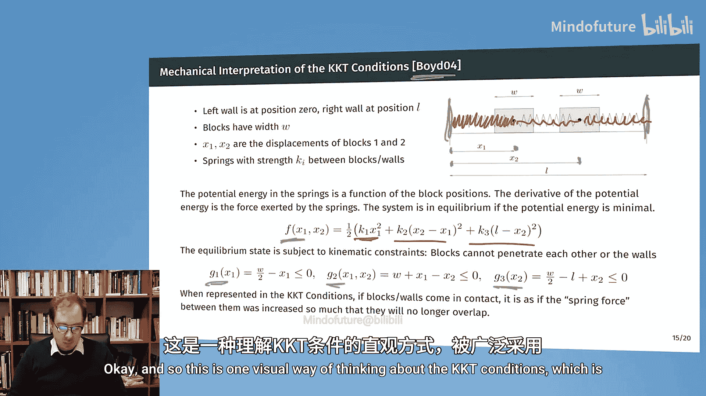

# 【凯尔大学】机器学习优化方法 ｜ Optimization Methods For Machine Learning And Engineering 2021 p30 P30_8.2_卡鲁什-库恩-塔克条件 -BV1C6SwBqEp7_p30-

The second section of this lecture is on the Ka Kntakka conditions。First of all。

 let's recall the cana。嗯。Way of writing down a convex optimization problem。

 So here we have a convex objective function F of x。And in addition to that。

 we have the inequality constraints， G of x and the equality constraints， Hj of x。啊。

And because we are in a convex setting here， we require the equality constraints to be f。

 so they all have this form a trans post x minus B。

 and we can write them also as a big matrix equation with all the equality constraints combined。

And also on the inequality constraints， we can write them in a single vector expression where here G of x contains G1 until GMM。

And what we saw earlier that we can incorporate the。

Equality constraints in a lagroion that is f of x plus lambda transposeds ax minus B。

 and I know that my optimum solution has to lie at the center point where the gradient of the Lagoroion is zero。

And what we previously also did is use the lock barrier for the interior point method and to find solutions where I have GI of x smaller than zero for all possible points。

So we had these special lock barrier and we constructed in a La gorange term with a tiilde that indicates that we have an additional lock barrier。

 so here this is then the lock barrier and we have a scaling factor T and the scaling factor T it tells us how tight we want to have the lock barrier and we will increase this T over several iterations。

Okay， and。What we now say， we want to have an additional Lagoe multiplier。

Especially for the inequality constraints， so we already have a LaOS multiplier a lambda for the equality constraints。

And now we also want to have one of these， but for the inequality constraints。

 and we are calling it new， this is the La multiplier for the inequality constraints。And。First。

 let's look at the derivative。Of this modified lag goe with the。Lo burial。And so here。

 what I marked in blue， this is the derivative of the log barrier and because of the way the logarithm works here。

 I have minus1 over TG of x times the gradient GI of x。And now I just define this term。

This term with a fraction minus1 over TG of x， I say this here is my new eye。Qui by definition。

Or let's maybe call it a thought experiment。嗯。Oh， I am considering this as my new eye。And。Now。

 what happens is I have some of the inequality constraints。

That lie exactly on the closure of my feasible set。And I have some of my for the optimum solution。

 and I have some of the inequality constraints that lie somewhere on the inside of the feasible set for the optimum solution。

And for those that have GI of x smaller than zero。We have this mu eye approaching zero when we are increasing the T。

 so when we increase the T in here。And G of x is something。Strictly smaller than0。

Then the whole term here this me， I will go to zero。However， if the GI tends to zero。

 then I have T going into something very big。N G。Very small。 And this could cancel out。

 And I could still。Turn out to have some finite value for U I in the end。

But here it's a little bit unclear what this would be。But now in addition。

 let's imagine that we have separate scaling factors TI for the different inequality constraints。

So we can initially we had a T for all of the equality constraints。

 so we were scaling the lock barrier and this was scaling all the lock barriers at the same time。

And now let's imagine that we can have different TI for the different inequality constraints I。And。

This gives us an additional freedom to select the muI because now we can modulate the TI。

And for example， choose TI in a way that corresponds to how close GI is to the to0 in order to have mu I something like a finite value and we can control this a little bit now we have additional degrees of freedom。

And so we now have a special Lagoian that also includes a Lagoe multiplier for the inequality constraints and if I take the derivative of my special Lagosian。

 I will end up exactly with this derivative up here with my new eye appearing at the appropriate location。

But we have an additional constraint， so theda I the lambdas could be anything basically in the saddle point as long as the as the the。

The being 0 was achieved， but for the mui we have an additional constraint and we need the mui to be larger or equal to 0 because we want our GI of x to be smaller than 0。

And here I have minus1 divided by the G of x， but we want the entire thing to be larger than zero so that my constraint G of x smaller than0 still is true。

Okay， and now I have this new Lagoian and I can also define the Lagoian dual for this。

 So here I have my in term。And surrounding that， I have my supreme term， but now the supreme term。

 it is for both the Lada and the Mu Lagomatic。So for the original Lagoian。

 I was looking for the saddle point。And we could just take the derivative of the Dagoian。

And set that to zero。And everything was nice。But it's more difficult when we consider now also the inequality constraints。

So here with the inequality constraints， this should be here ahold。Ft， and this is also bold font。嗯。

If I derive this new Lagoe term。u by me i get out exactly g of x。

But I cannot just set g of x equal to zero for the saddle point because what I want to have is G of x smaller or equal to zero。

嗯。And so we have to modify this a little bit so now we have to treat this additional like wash multiplier differently and say。

 well this is not the same， I allow it to be also smaller than in。So。Again。

 if I have here my feasible set。And one of the constraints is on the closure of my feasible set and the other is somewhere on the inside。

And so the constraint that is on the inside。For。嗯。Or the constraint where at the optimum。

 I have G of x strictly smaller than zero。I would prefer to not see that constraint at all。

And the other constraint that we I have achieved exactly G of x equals zero at the optimum。

I can essentially treat that the same as I treat or the other likeosmaticpls。

Because for the S for the G， if I have a special， let's call it call it K。If I have a g K of x。

For which。GK of x， which is exactly zero at the border。Here this is x star， this is optimal。

 and I have this exactly to0。Then I can treat the LaOS multiplier U corresponding to that。

 I can treat that one exactly like the Lada LaOS multipliers because here this I have equality in the optimum for this guy。

But I don't know beforehand whether this is the case for the individual equality constraint。

 whether it will be an active constraint or not an active constraint in the optimal。However。

 what I can do is I express this complementary slackness in a condition that is mu Gi of x equals to0。

And this corresponds exactly to the situation that I just described。If my G I of x。

Is strictly smaller than zero， then I need to have the mu I to be equal to 0 and I am shutting it off。

 it's an unactive constraint， I'm not seeing it。However， if my。If my。What is the other way around？

If my G of X， then。Its zero， then I can select my mu I also larger， so if G of x equals to zero。

Then I can then I have more freedom in selecting the muI and then I can treat it as if it was a normal equality constraint La multiplier。

But it has to be positive。So that is still the case。Okay。

 and with this we get to the Ka kaka Opity conditions， so the first line。

 the first line is exactly what we saw on the previous slide。The second line here。

 Ax minus B equals0， this is the typicalica。Divative of the Lagoian by the Lambda term and so here in the optimum。

 obviously my equality constraints they need to hold。And in addition。

 now I have something that has to hold for all my inequality constraints。

 so I have G of x less or equal to0， my new I large are equal to0。

 and now my complementary slackness， my additional constraint that nu I times G of x has to be equal to  zero。

One thing that might be handy or which is important here， the definition of the Jacobian。

 we already saw the Jacobian in one of the exercises the Jacobian is essentially the derivative of a function that returns a vector。

And so you can think of this like a stacked and transposed version of all the。

The derivatives of the individual elements of G so I have。

Divative of the first output of G of x with respect to all the x。

And I transposedse that to have a row vector NM。Stacking all all these row vectors。Okay。

 and Jacob and it ends up in here， exactly。Okay， and these Kaos Kunakka conditions。

 they have an interesting history， so they were first published in 1951 by Kun andakka。

 and for many years they were just called the Kunakka conditions。

But laterhead was found out that Kabosh had proved the same already in his master thesis 12 years prior。

 and now these are generally called the KKT or Kaboush Kunakka conditions and you find them in many places in the optimization literature。

Okay and these KKD conditions， they describe properties of the optimizer and actually these are sufficient。

 so whenever I have a solution where the KKD conditions hold， then I know it's also the optimal。

But the KKT conditions don't give me an immediate update step。

 so I just cannot apply immediately a newton step based on the KKT conditions or something similar。

 we have to do some additional work to get there。There is a cool mechanical interpretation of the KKT conditions。

 so this comes from Boyd's book。So imagine a mechanical situation where we have the different blocks or different carts that are loaded with springs and I have a wall on the left and a wall on the right and in between I have these carts freely moving with springs in between them。

And these blocks have a width W， so they cannot overlap and they also cannot move into the walls and for this I have to consider their width。

And furthermore， I describe the length of the springs by looking at the displacement of the blocks with respect to the left side wall。

Okay， and then each of these springs here has a different spring constant。

 so the force exerted by the spring， it depends on the spring constant and also by how much the spring has been compressed。

 so maybe here I have a very strong spring。And then I have a very loose spring or however we should draw strings of different strength。

And the big question is here， where will this system end up so probably this will oscillate a little bit and then get into some equilibrium condition。

We can describe the equiphiilium condition by looking at the potential energy stored in the different springs and the equium point has the least potential energy across all of the springs。

And also， the derivative of this potential energy is the force currently exerted by the strings。

So we can write down here the potential energy in the first spring in the second spring and the third spring。

 depending on the position of the car。And。And now we have a function that we want to minimize to get to the equilibrium state。

But we have additional constraints and these additional constraints come from the kinematics where the blocks they cannot overlap and so on。

 so they cannot penetrate and when we represent these additional inequality constraints here。

In the KKT conditions and then also look at the likear multiplier mu and so on。

So what happens that if these blocks？Come into contact or come into contact with the ball。

Then we can think about the what happens by these。Additional mut。

As if there was a virtual spring force between the blocks that was achieving the size that is just right to keep them separated。

Okay， and so this is one well visual way of thinking about the KKT conditions。

 which is quite popular。

