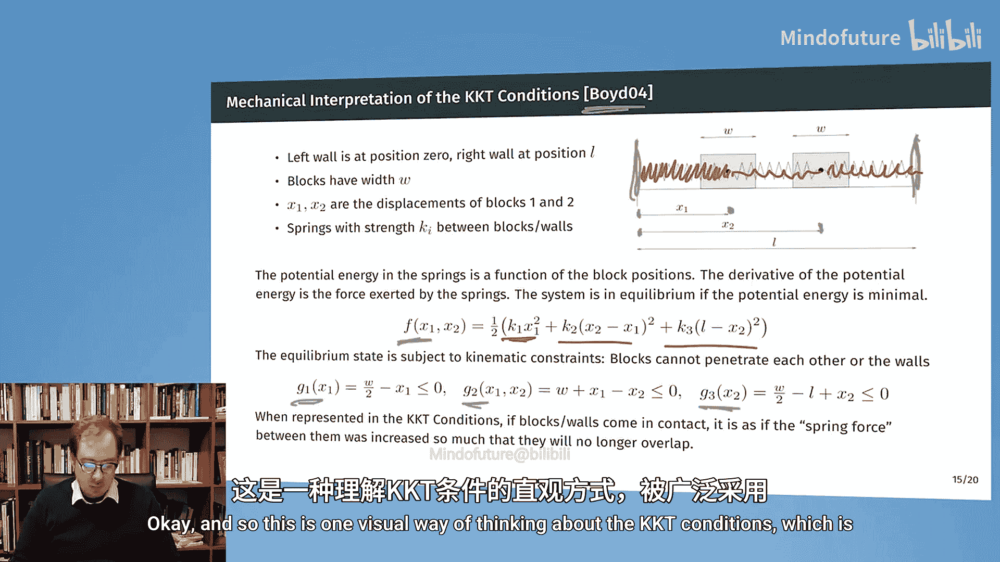

# 机器学习优化方法：8.2：卡鲁什-库恩-塔克条件 📚

在本节课程中，我们将学习卡鲁什-库恩-塔克条件，这是处理带有不等式约束的凸优化问题的一组重要条件。我们将从回顾凸优化问题的标准形式开始，逐步引入并解释KKT条件的构成及其意义。

## 凸优化问题回顾

上一节我们介绍了凸优化问题的标准形式。本节中，我们来看看如何将不等式约束也纳入拉格朗日框架。

一个凸优化问题通常包含：
*   一个凸目标函数 **f(x)**。
*   一组不等式约束 **gᵢ(x) ≤ 0**，其中 **g(x)** 是一个向量函数，包含从 g₁ 到 gₘ。
*   一组仿射等式约束 **hⱼ(x) = aⱼᵀx - bⱼ = 0**，可以合并为矩阵形式 **Ax - b = 0**。

对于等式约束，我们构造拉格朗日函数 **L(x, λ) = f(x) + λᵀ(Ax - b)**，并通过令其梯度为零来寻找最优解。

## 引入不等式约束的拉格朗日乘子

为了处理不等式约束，我们曾使用对数障碍函数法，构造了一个包含障碍项的拉格朗日函数：
**L̃(x, λ) = f(x) + λᵀ(Ax - b) - (1/t) Σ log(-gᵢ(x))**
其中 **t** 是缩放因子，控制障碍的“松紧度”。

现在，我们希望为不等式约束也引入拉格朗日乘子，记作 **ν**（读作“nu”）。首先观察修改后的拉格朗日函数 **L̃** 对 **x** 的导数。其中，对数障碍项的导数部分为 **-(1/t) * (1/gᵢ(x)) * ∇gᵢ(x)**。

我们通过一个思想实验来定义新的乘子 **νᵢ**：令 **νᵢ = -1 / (t * gᵢ(x))**。这样，导数中与 **∇gᵢ(x)** 相乘的项就变成了 **νᵢ**。

## 互补松弛条件

对于最优解 **x***，有些不等式约束是“活跃的”（即 **gᵢ(x*) = 0**），有些是“非活跃的”（即 **gᵢ(x*) < 0**）。

*   对于非活跃约束（**gᵢ(x*) < 0**），当缩放因子 **t** 增大时，对应的 **νᵢ** 会趋近于 0。
*   对于活跃约束（**gᵢ(x*) = 0**），**gᵢ(x)** 趋近于 0，而 **t** 很大，**νᵢ** 可能保持为一个有限值。

为了统一处理这两种情况，我们引入一个关键条件：**互补松弛条件**，即 **νᵢ * gᵢ(x) = 0**。
*   如果 **gᵢ(x) < 0**（约束非活跃），则必须有 **νᵢ = 0**。
*   如果 **gᵢ(x) = 0**（约束活跃），则 **νᵢ** 可以取非负值（**νᵢ ≥ 0**），此时该约束在最优解处可被视为等式约束。

此外，由于原问题要求 **gᵢ(x) ≤ 0**，且我们定义 **νᵢ = -1/(t * gᵢ(x))**，要保证该式有意义且与原问题一致，必须要求 **νᵢ ≥ 0**。

## KKT 条件

综合以上分析，我们得到完整的卡鲁什-库恩-塔克条件。对于凸优化问题，在最优解 **x*** 处，存在拉格朗日乘子 **λ*** 和 **ν***，使得以下条件成立：

1.  **平稳性条件**：拉格朗日函数的梯度为零。
    **∇f(x*) + Aᵀλ* + Jᵀ(x*)ν* = 0**
    其中 **J(x)** 是 **g(x)** 的雅可比矩阵（即所有 **∇gᵢ(x)ᵀ** 堆叠而成的矩阵）。

2.  **原始可行性条件**：
    *   **Ax* - b = 0** （等式约束）
    *   **g(x*) ≤ 0** （不等式约束）

3.  **对偶可行性条件**：**ν* ≥ 0**

4.  **互补松弛条件**：对于所有 **i**，**νᵢ* * gᵢ(x*) = 0**

当优化问题是凸的，且约束满足某种规范性条件时，KKT条件是取得全局最优解的**充分必要条件**。

## KKT 条件的历史与解释

KKT条件由库恩和塔克于1951年发表，最初被称为库恩-塔克条件。后来人们发现卡鲁什在其12年前的硕士论文中已证明了相同结论，故现在统称为卡鲁什-库恩-塔克条件。

KKT条件描述了最优解的性质，但它本身不直接提供迭代求解的更新步骤（如牛顿步长），需要进一步推导算法。

一个理解KKT条件的经典力学比喻如下：
想象几个用弹簧连接的小车被放置在两面墙之间。小车有宽度，不能互相穿透，也不能穿墙。每根弹簧有不同的劲度系数。系统的平衡态是弹簧总势能最小的状态，同时满足小车不重叠的约束。
*   **目标函数**：弹簧的总势能。
*   **约束**：小车之间的不穿透条件。
*   **拉格朗日乘子 ν**：可以理解为保证小车恰好不接触所需的“虚拟接触力”。当两车未接触时，这个力为零（**ν = 0**，约束非活跃）；当两车刚好接触时，这个力为正值（**ν > 0**，约束活跃），大小刚好抵消使它们穿透的弹簧力。

---

本节课中，我们一起学习了KKT条件。我们从凸优化问题出发，引入了不等式约束的拉格朗日乘子 **ν**，并解释了关键的互补松弛条件 **νᵢ gᵢ(x) = 0** 的含义。最终，我们得到了完整的KKT条件组，它构成了处理带约束优化问题的理论基础，并可以通过一个经典的弹簧小车模型获得直观的物理解释。