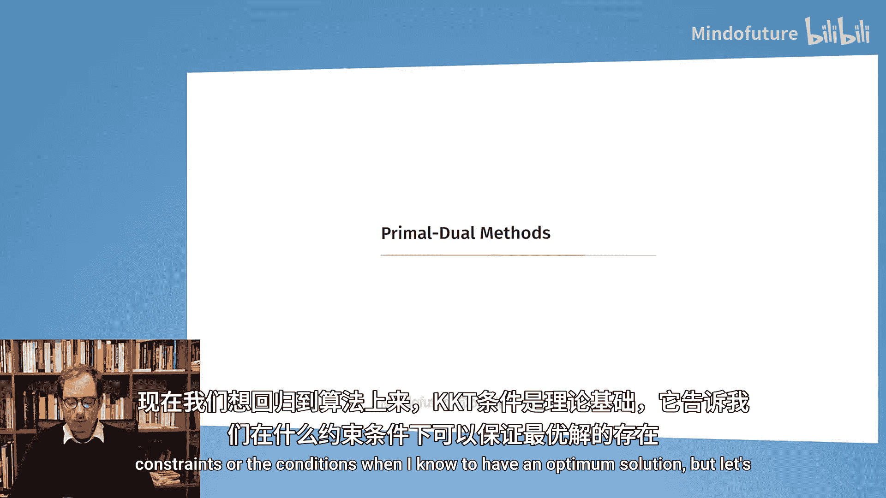
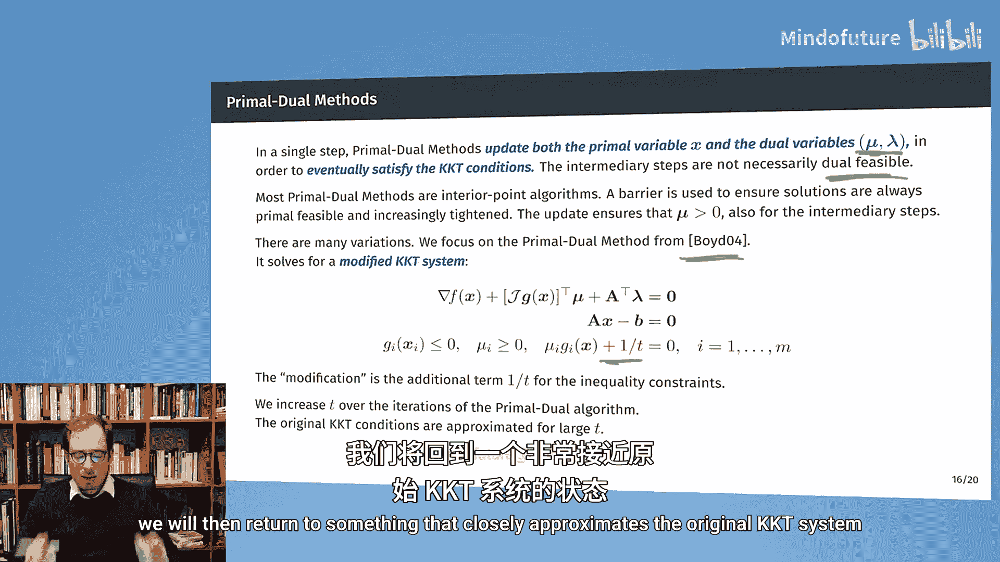
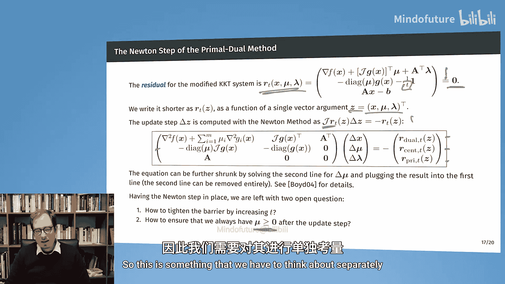
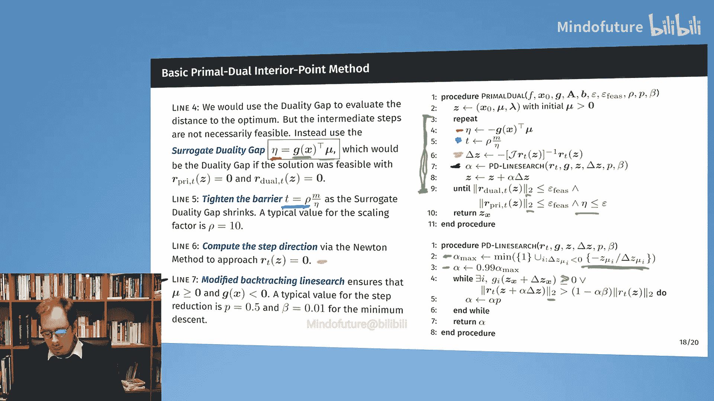
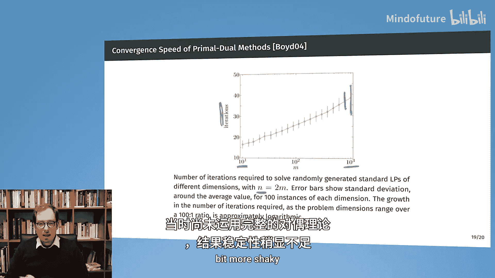
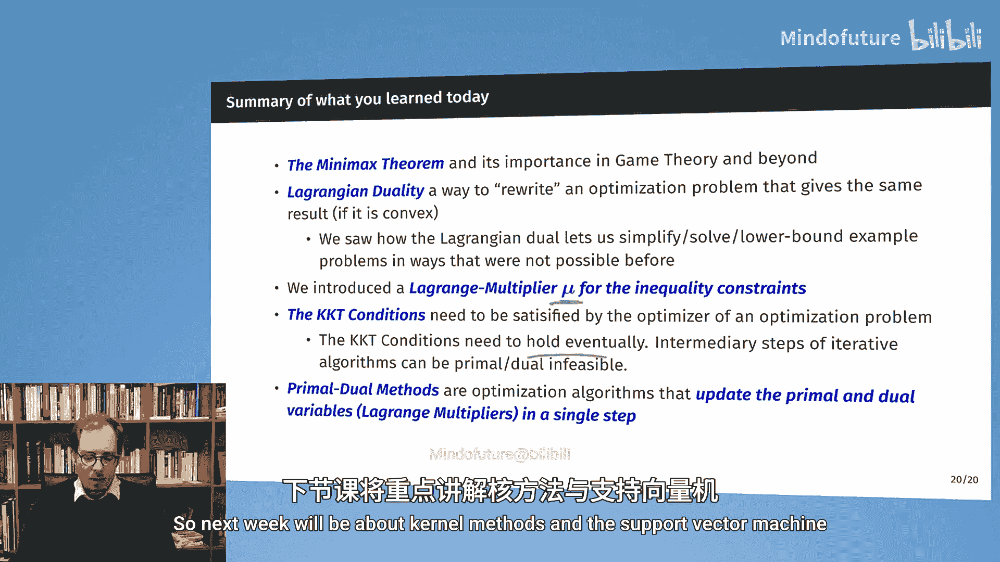

# 【凯尔大学】机器学习优化方法 ｜ Optimization Methods For Machine Learning And Engineering 2021 p31 P31_8.3_原始-对偶方法 -BV1C6SwBqEp7_p31-

Now we want to get back into algorithms， so KKD conditions are theory。

 what are the constraints or the conditions when I know to have an optimal solution。

 but let's compute something with that。

So the primal dual methods， they operate on this Laoian that we saw with both the La Lada and the moon。

 Lago multiplierers。And they update both the primer variable and the dual variables mu and Lada in a single step。

 so again this is an iterative algorithm。And we know that we will eventually converge to a solution that solves the KkD conditions。

However， the intermediary steps are not necessarily dual feasible。

So before we had seen algorithms that are alternating， first optimizing for the x。

 then optimizing for the Ladas， and here we do everything at one step and this will have really great consequences for our runtime。

嗯。So there are actually many prim dual algorithms here we use a particular one also from Boyd's book。

And what this does is it solves for a modified Kkt system。

 So here we will have a modification with an additional term 1 over T added。

 And this plays a role that is similar to the。to the barrier that we saw in the first interior point method。

 so here we have this one over T and the T will also be increased over time and for very large T we will then return to something that closely approximates the original KKT system。

And now we look at the so calledze world。 So now we have our K KT system from the。Previous slide。

 and for a current solution， the residual describes， well。

 how close we are to solving this KKT system， this modified KKT system。

And what we want to do is oh this zero here， well this is obviously not always the case。

 but we want to achieve that so we want to get this residual to get to zero and we can describe this as as a root finding problem for which we saw the Newton method。

And so we apply the new method and here we again have the Jacobian of this residual function that we now express in just a single variable。

 Z， which contains both the primal and the dual variables。

And now we have a Newton step that we can do and you can look how these equations work out。

 so this is just the Jacobian now of this R function and the R then also we can think of this decomposed as the dual part。

 the second one， we call the centering part and the last one is the primary part。

What we can do is shrink this equation even more。Because we can solve the second equation for this deelta mu。

 so the deelta mu is the steps that the Newton equation wants us to take。

 so the second line en closed form we can solve this for mu and plug it back in and essentially reduce the dimensionality of this matrix。

And well， this is interesting because for the newde method we have to solve for this matrix and most of the time actually is lost in the step where we have to solve for that or even invert this matrix。

Okay， but we will not follow this， you can have a look at Boych， how he does this， how he does this。

 so having this newton step now in place are we are left with a couple of open questions the first is we have still this tea in here。

Here is the T。And we have to ask ourselves how we should increase the T over time。

And the second question is how to ensure that we always have this muu larger or equal to zero。

Because this is also one of the requirements of the KKT system and this is not included here in the residual term。

 so this is something that we have to think about separately。

And the way this is done is in the primal dual algorithm and the important things are the steps that are repeated。

 so here between line 3 and line9 and everything in between will be explained in some detail。

So first of all， we would like to always look at the duall gap。

So the duality gap from the La origin dual where we know， okay。

 this is the maximum distance that we might still have to the optimizer。

And we would like to use this duality gap， but we have not access to it because the intermediate steps from the prim dual algorithms are not necessarily feasible。

But we do have access to what is called the zeroeroga duality gap。

 which for us is just a geo of x transpoposed new。And this would be the duality gap if the solution was feasible。

 so if we had exactly ax minus b equals zero， then this would be the duality gap。嗯。

And actually we will get to a solution where we have a minus b equals0， and then in the limit。

 the surrogate duality gap will be exactly the duality gap。

 and this will also be the stopping condition for when we stop the algorithm。Okay。

 so we compute here the surrogo duality gap。It唱。In the line 4。Next of all。

 we tighten the barrier and we tighten the barrier。

 the closer the surrogate duality gaps gets the larger we make the barrier。

And we have some additional scaling factor here or， this is typically chosen as 10。

 but it depends a little bit on the problem， so here we are updating the T value for this barrier。

Okay。Then we perform the step update。 so then we here perform the Newton step and this gives us。

The direction into which we want to step。So this would be this case。Okay。

 and then we have an additional special line search。

 so we cannot use the usual line search because we have to consider in addition that our mu I remains larger than zero and that our GI all remain smaller than zero。

 and therefore we have a special backtracking search step for the line search algorithm。

That takes additional things into consideration。 So first of all。

 we look at the mu here we have this special notation that。诶。Of Mu I。

 and this is actually from our value Z this guy here。

 we are extracting the mu I because we have this big vector that also includes our mu。

And so here first of all， we look at the maximum multiplier from the line search that is possible that would still make our or enable our muI to be。

Larger than zero。 So here this is the maximum alpha that we can have the maximum multiplier for for step。

And if we are smaller than that， this is still okay for our news。Okay。

 and then we take some value that is strictly smaller than this alpha max and then go on and repeat and reduce the step length until we have the condition that all our Gs are smaller or equal than zero here。

The the way we want them， or we repeat as long as this condition here。

 as long as we don't have achieved that the GIS are or smaller than zero and also here we check whether our residual has actually improved。

 so whether our residual has approached the zero vector to some degree， by taking here the two norm。

 the Euclidean norm with a distance to the zero vector。Okay。

 so here we have then the line search and this is the whole primer dual algorithm。

 we repeat that until we get to a solution that is close enough where both our for both of our primer and for our dual result the residual is。

Really close to zero。And also where our Eta， so our duality gap is really close to 0。

 so we can choose these epsilons here。 We can choose them rather small。

And let's see how fast this converges， so what has been done here is some linear optimization problems have been randomly generated with sizes between 10。

10 inequality constraints and。诶。And here， these are。1000 inequality constraints。

 so this goes across two orders of magnitude， this plot here。And on the other axis。

 this is the number of iterations required to find the solution to a sufficient degree and what we see is that for the problem where the 10 inequality constraints and 20 variables。

 so we choose the number of variables double the number of inequality constraints we need well about 16。

17 iterations and for 1000 variables we here need about well 30，30。

9ine iterations so there are some there is some standard deviation so this is obviously when I generate these problems randomly then it might take a little bit more a little bit less time but it's more less stable and you see that the number of additional iterations of the prim dual method that we need it only grows about logariththmically with the number of variables and constraints in my optimization problem which is really good so now I have an。

An opera an algorithm that scales well and that also performs somewhat predictably where I can expect results to come back within a certain timeframe。

 which is a big improvement compared to some of the algorithms we coded in Julia prior。

 where we didn't yet have access to other dwellity theory and where things were a little bit more shaky and worked well for some of the problems but not so well for others。

So in summary， what did we learned today， we saw first the miniax Ethereorem。

 one of the most important theorems from game theory and how it applies or can be applied to develop the Lagoian duality。

The like motion duality is a way to rewrite optimization problem in an equivalent way that gives us access to some additional problem structure that we can exploit by simplifying it。

 reducing some dimensionality， lower bounding the solution， and so on。Then afterwards。

 we looked at ways we can introduce an additional languagesh multiplier mu specifically for the inequality constraint and how this is used in the KKT conditions to describe the conditions for which I know that optimality has been achieved。

And these KKD conditions tend need to hold eventually。

 but I can take intermediary steps where I deviate from feasibility。

And then we saw an algorithm that iteratively reduces the error with respect to the KKT conditions and approaches them and actually showed pretty good speed for solving convex optimization theac problems。

One of the advantages of this primer dual algorithm is that it updates the primer and the dual variables at the same time in a single step。

 and I don't have to alternate between optimizing the primer and the dual numbers and overall I get a fast algorithm that also has a good predictive behavior。

That's it for today we only had 20 slides for today but some of them were quite dense next week we will once more drop into the problems from machine learning so next week will be about current methods and the support vector machine。

